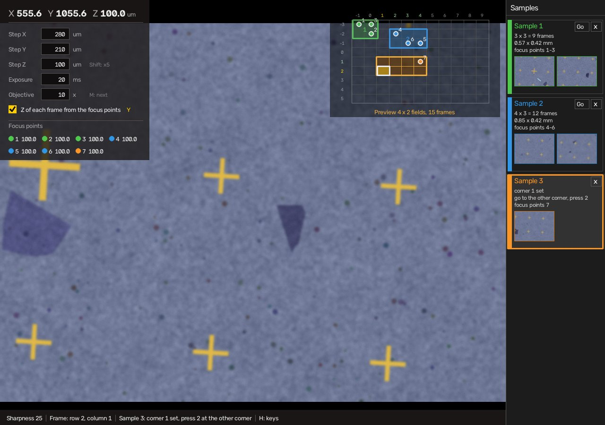
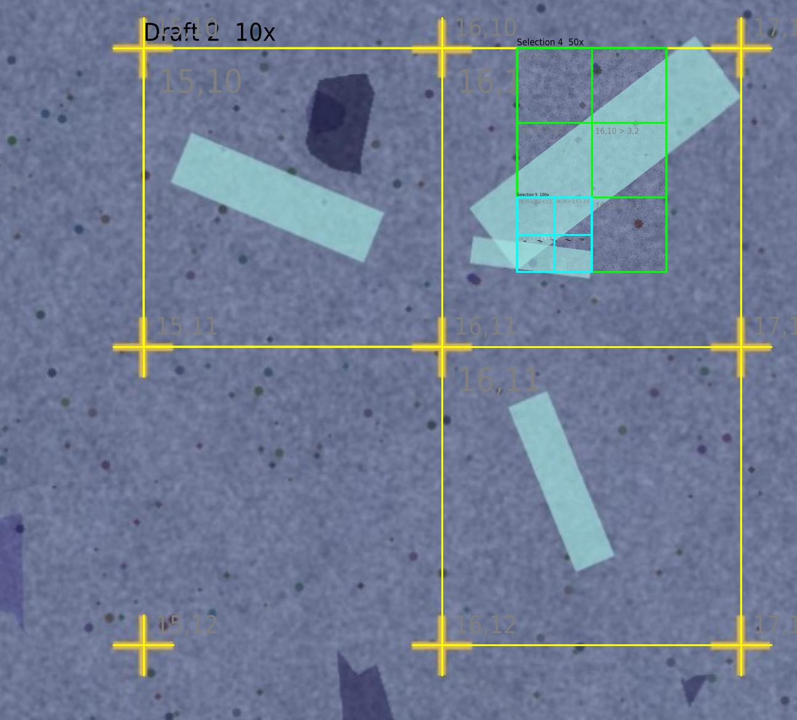

# MicroControl

**Управление рамановским микроскопом Optosky ATR8300 из Python: снять подложку, сшить её в одну картинку, наложить решётку литографии, выбрать нужные квадраты и вывести их для AutoCAD.**

**Авторы:** А. Ляпейков, С. Доменко · **Версия:** 0.40.0 · English: [README.md](../README.md) · 中文: [README_zh.md](README_zh.md) · PDF: [RU](MicroControl_ru.pdf) · Полный технический справочник: [RU](reference_ru.md), [EN](reference_en.md), [中文](reference_zh.md)


> Независимый проект, не связан с Optosky. Предоставляется «как есть», без гарантий — см. [Отказ от ответственности](#отказ-от-ответственности) и [лицензию MIT](../LICENSE).

---

## Быстрый старт

Пять шагов — от образца на столике до чертежа для AutoCAD:

```python
import microcontrol as mc

s = mc.Project("Graphene", "flakes for transport").sample("Chip 1", "SiO2 285 nm")   # 0. проект и образец
m = mc.Microscope(objective=10, sample=s)   # 1. подключиться   (mc.Microscope('sim', objective=10) — симулятор)

m.manual()                   # 2. зелёная область: клавиши 1 и 2 в противоположных углах, фокус в каждом
folder = m.scan()            #    снять кадр за кадром (или S прямо в окне)
mc.stitch(folder)            #    сшить кадры в одну картинку (или S в mc.view)

mc.view(folder)              # 3. клавиша C: щёлкнуть два соседних креста -> красная сетка
                             # 4. клавиши M / B: выбрать квадраты (зелёные)
mc.export(folder)            # 5. выбранные квадраты: картинки + чертёж в микрометрах (DXF / DWG)

m.close()
```

Окно микроскопа закрывается **Shift+Esc** или крестиком; просмотр — **Esc** (когда не открыт режим, подсказка или список) или крестиком. **H** — все клавиши. **Ctrl+P** — показать / спрятать панель Settings слева.

---

## Пять шагов

### 1. Подключиться

`m = mc.Microscope()` сам находит порт контроллера и камеру, включает свет и проверяет, что столик отвечает. Все координаты — в микрометрах, $+Z$ — столик **вверх**, к объективу. Каждое движение проверяется по пределам (один шаг, весь ход, потолок по $Z$), так что опечатка не загонит образец в объектив. `mc.Microscope('sim')` — симулятор: те же команды без прибора.

### 2. Зелёная область — что снимать



`m.manual()` открывает живую камеру. Двигаться — стрелками (одно нажатие — один кадр), фокус — `E` / `Q` (или `F` — автофокус). Буквы — для дел: `L` свет, `I` лазер, `W` баланс белого, `R` линейка, `S` поставить съёмку в очередь (сшивается quick в фоне; очередь — внизу), `V` открыть результат в просмотре.

- **Одно окно.** В строке сверху — главные кнопки: **New area**, **Scan area** (съёмка + сшивка), **Export** (чертёж для AutoCAD: DWG + DXF выбранного участка), **Settings** (шаги, экспозиция, точки фокуса).
- **Карта** (справа сверху; `Tab` — карта крупно, по центру — где сейчас камера, камера уходит в угол): всё уже снятое на своём месте (10x под 50x под 100x), контуры участков и жёлтая рамка — где камера сейчас. Где камера только проезжала, её живые кадры остаются на карте чуть темнее, под снимками («туман войны» рассеян; хранится у образца в `<образец>/fog/`); щелчок по карте рассеивает туман и по пути. **Layout** (меню): один вид (камера крупно, карта в углу, `Tab` меняет) или два рядом — камера | карта или карта | камера (`Tab` меняет их местами); список выделений справа или слева (и в просмотре). Запоминается. **Щелчок по карте — столик едет туда**; **тянуть по карте — новый участок** на стоящем объективе; **`Ctrl`+тянуть — свободная рамка** ровно как нарисована (вокруг кристалла), не по квадратам; колесо — зум; правой кнопкой — двигать карту; двойной щелчок по снятому участку — открыть его в просмотре.
- **Выделение клавишами** по-прежнему работает: в один угол — `1`, в противоположный — `2`.
- **Точки фокуса:** высота $Z$ в каждом углу запоминается; `K` добавляет ещё точки. В скане каждый кадр получает свой $Z$ по этим точкам, поэтому наклонный образец остаётся резким. С галочкой «Z follows the focus points» по ним идут и стрелки.
- **Несколько выделений, слои:** задаются по очереди (`1`, `2`, потом снова `1`, `2` или протянуть мышью по карте). Все выделения на одном уровне и могут перекрываться, любые объективы; порядок списка справа — порядок слоёв (верх — сверху), перетащите карточку, чтобы поменять. Щелчок — выбрать, **Go** — подъехать, **...** — все его съёмки (звезда — основная), **x** — удалить.
- **Линейка:** `R`, затем два щелчка — расстояние в мкм (между щелчками столик можно двигать).
- **Отмена:** `Ctrl+Z` отменяет любое действие в любом окне (выделения, объектив, галочки, порядок, точки фокуса, свет, шаги, прозрачность, совмещение, кресты и клетки, переезд — столик вернётся), до 1000 шагов; `Ctrl+Y` возвращает.

`m.scan()` снимает каждую область кадр за кадром с перекрытием 30 % (на 50x, 100x — 35 %); каждая съёмка выделения — новая папка `<образец>/scans/<дата>_<время>_S03_50x/`. При удалении выделения номера и цвета остальных не меняются. Снимаются только выделения того объектива, что сейчас стоит. Перед съёмкой пишется ожидаемое время; эта оценка учится на прошлых сканах вашего микроскопа. В окнах съёмка встаёт в очередь и **сшивается quick прямо во время съёмки**: каждый новый кадр сразу сшивается с уже снятыми соседями (в отдельном процессе, на других ядрах), просмотр показывает кадры по мере появления, а кресты можно ставить параллельно; quick после съёмки берёт эти швы готовыми (остановленная съёмка сшивается, докуда дошла); из Python — `mc.stitch(folder)` (`mode='quality'` — точная сшивка).

### 3. Красная сетка — найти квадраты


`mc.view(folder)` открывает сшитую картинку (тянуть — двигать, колесо — масштаб).

- Нажать `C` и щёлкнуть **два соседних креста в одном ряду**. По ним программа узнаёт наклон и размер квадратов, выравнивает картинку и рисует красную сетку на всё поле. Отметка ставится ровно туда, куда щёлкнули; `Shift`+щелчок притягивает её к центру креста, отметку можно перетащить. Сетка сразу подгоняется по всем крестам; `Shift+C` затем ставит каждый кадр на кресты (см. *Точность для литографии*).
- **Номера:** нажать `N`, щёлкнуть квадрат и набрать номер, написанный рядом с ним (`12 7`). Так для двух квадратов в разных рядах и столбцах — и у каждого квадрата будет его настоящий номер.
- **Сетка на весь образец одна.** Она строится по крестам, отмеченным руками на одном выделении (выбранном в списке), и не меняется, пока не меняются они. Любая другая съёмка берёт её как есть; если её картинка сдвинута, `A` (совмещение) двигает картинку под сетку. Чтобы построить сетку на другом выделении, сначала уберите старые кресты (открыть то выделение, `C`, `Del`) — `C` в другом месте так и скажет. Номера квадратов появляются, когда вы пронумеруете два квадрата (`N`).

### 4. Выбрать квадраты — маска

- `M` — выбор: щелчок по квадрату (ещё раз — снять) или рамка — выбирается всё, чего она касается (`Shift` — снять). Правый щелчок — убрать один квадрат, `Shift` + правый — всю зелёную область. Выбранные квадраты — зелёные; **Enter** делает из них выделение.

### 5. Вывод

`X` (в любом окне) или кнопка **Export** пишет всё, что отмечено галочкой на карточках (по умолчанию галочки сняты), в `<образец>/export/` (каждый раз заново). **Все отмеченные выделения должны быть сшиты quality**, иначе экспорт не делается, а сообщение называет остальные.

Результат — один чертёж `export/drawing.dwg` (начало — крест 1,1, ровно по решётке): снимки выделений на своих местах в микрометрах, каждая клетка — замкнутый квадрат, кресты с номерами, каждое выделение на своём слое, и пустой слой `BONDS` для бондов. **Чертёж делается, только когда кресты размечены** (кресты — маяки, по которым всё склеивается для литографии); без них — только снимки и `mixed.png`. Рядом: снимки (`S03_50x.png` …) и `mixed.png` — все отмеченные съёмки одна поверх другой в порядке списка, с пикселем самой точной. DWG пишет бесплатный ODA File Converter, если он установлен; иначе есть `drawing.dxf` (AutoCAD: Сохранить как → DWG). Папку `export/` держите целиком: снимки в DWG — всегда отдельные файлы. Для одной съёмки `mc.export(folder)` пишет её выбранные квадраты ровно (PNG, DXF, список номеров) в `export/` этой съёмки.

`mc.projects()` и `mc.all_samples()` печатают таблицу: id, имя, образцы, выделения, съёмки, создан, изменён, описание (то же — в диалогах Open). В просмотре Open → **New window** показывает другой проект в своём окне (`mc.view_window(папка)`), текущее остаётся открытым.

Квадраты, выбранные в просмотре (`M`), по **Enter** становятся выделением — **draft** (без объектива, не снимается) или сразу с объективом, выбранным для новых (`Shift+G`); оно сразу в списке и выбрано. Все выделения на одном уровне: любые объективы могут перекрываться, ничего не обрезается; порядок списка — порядок слоёв (верх — сверху), меняется перетаскиванием карточек; галочка на карточке — в экспорт. `U` в просмотре — выделение по углам: каждая сторона идёт только поперёк или вверх / вниз и привязывается к крестам и к уже поставленным углам (серые направляющие), поэтому контур всегда прямоугольный; щелчок по первому углу или Enter замыкает его (последний угол достраивается сам). **Export** пишет всё отмеченное в одну папку `<образец>/export/`: чертёж AutoCAD (начало — крест 1,1, картинки на месте, каждая клетка — замкнутый квадрат, кресты с номерами), снимки и `mixed.png` — все отмеченные снимки с наложением в порядке списка, в выбранном разрешении.

| | |
|---|---|
|  |  |
| *Слои на карте: 10x → черновик → 50x → 100x, камера в углу* | *Съёмка 50x: сетка на весь образец одна — по крестам, отмеченным на 10x* |
|  |  |
| *Чертёж для AutoCAD: наклонный чип ровно по решётке, его кресты — на нарисованных* | *Крупно: quality-снимки 50x и 100x, каждый на своём слое* |

## Точность для литографии


По чертежу потом пишется схема поверх чешуек, поэтому каждая картинка на нём ставится **по крестам вокруг неё**, а не по столику. Что важно и что делает программа:

| Что | Как |
|---|---|
| Сшивка в два шага | Quick — сама после съёмки (кадры по перекрытиям, обзор). **Quality** — Stitch / `Shift+J` (в очередь; для слабого шва столик сам едет и снимает кадр посередине пары — мост со сдвигом, связывающий оба; размытые кадры переснимаются). Затем `C` (2–3 креста) и `Shift+C` — каждый кадр ставится на кресты: кадры, квадратная решётка и дисторсия подгоняются вместе, поэтому ошибки швов не копятся. Python: `mc.stitch(folder, mode='quality')`, затем `mc.fit_crosses(folder)` |
| Картинка в чертеже | каждый пиксель берётся через **4 креста своего квадрата** (билинейно), кресты измерены на этой же съёмке; остаток сшивки, дисторсии и наклона в чертёж не попадает |
| Центр креста | шаблон + **края плеч**: две прямые через середины плеч, их пересечение — центр (≈0.1 px, и когда чип повёрнут; цифры у креста не мешают) |
| Дисторсия объектива | `D` в окне микроскопа (`m.calibrate_distortion()`): 3×3 кадра с перекрытием 50 % вокруг любых деталей; по совпавшим кусочкам перекрытий — $k_1, k_2, p_1, p_2$ без крестов и без доверия к столику. Помнится для объектива, применяется ко всем сканам |
| Кадры | полное разрешение камеры, по умолчанию JPG 95; `m.frame_format = 'png'` — без потерь. Кресты и швы меряются по зелёному каналу (самый резкий, без цветной каймы) |
| Перед съёмкой | кнопка **Prepare**: мастер поверх живой картинки в 3 шага — каждый говорит, куда отъехать, затем **Done** / Skip / Cancel: чистое пустое место: экспозиция (самое яркое ≈80 %, без пересвета), баланс белого, **плоское поле** (5 мест, медиана: виньетирование и пыль на оптике) → деталь: автофокус, пауза на успокоение → дисторсия (раз на объектив). Сохраняется для микроскопа и объектива; в следующий раз спросит: **Overwrite** или **Keep** (с датой). Сшивка берёт это плоское поле (и тёмный кадр, если снят `m.dark_frame()`). Python: `m.prepare()`, `m.flat_field()` |
| Масштаб | `m.mask_pitch = 100` — проектный шаг крестов на маске: все размеры чертежа — от него. `Shift+C` ещё и меряет настоящий размер пикселя по крестам (и растяжение X/Y, перекос) и запоминает для объектива: линейка и следующие сканы берут его |
| Автофокус | контраст (нормированная дисперсия) — найти пик, Vollath F4 — точный проход, по кривой резкости подгоняется гауссиана; шаг и окно — свои для каждого объектива в Settings (`AF step`, `AF window`, 0 — от глубины резкости). Важно: один шаг мотора Z — 5.56 мкм, это больше глубины резкости на 50x / 100x |
| Люфт | `B` — подъезд с одной стороны (помнится). Сшивка столику всё равно не верит; это держит кадры там, где их ждут, и точной — разметку поверх камеры |

Для самой схемы контуры чешуек снимайте на 50x / 100x: на 10x оптика размывает края примерно на 1 мкм.

---

## Проекты и образцы

Работа группируется так: **Проект** (работа, с описанием) → **Образец** (одна подложка на столике: свои выделения и координаты, описание) → **Выделение** (область на одном объективе; слои: карта 10x > участки 50x > 100x) → **Съёмка** (каждая съёмка выделения — новая версия) → сетка, выбранные квадраты, чертёж. Выделения хранятся в образце и возвращаются, когда его открывают снова; выбранные квадраты на картах, `m.list()` и просмотр — только открытого образца. Выделения — слои: контур из прямоугольников (без внутренних квадратов) и объектив, все на одном уровне, порядок списка — порядок слоёв; Ctrl+щелчок по карточкам, затем Merge / Minus / Overlap. Квадраты, выбранные кистью в просмотре, становятся выделением по Enter (по одному на фигуру, черновик или объектив, выбранный для новых); выделение снимается только кадрами, задевающими контур; глаз на карточке скрывает его на картах.

```python
p = mc.Project("Graphene", "flakes for transport")   # открыть или создать; p.uid — короткий id, например "k3f9x"
p = mc.Project("k3f9x")                              # открыть имеющийся проект по id
s = p.sample("Chip 1", "SiO2 285 nm")                # образец проекта: открыть или создать
m.sample = s                                        # работать с ним (его выделения вернутся)
p.samples, s.selections, s.selections[0].scans, s.selections[0].latest.view()
mc.projects(), mc.all_samples()
```

В обоих окнах сверху меню: **Open** (образец любого проекта), **New** (из списка: Project или Sample), **Info** (описания), **Scans** (все версии), **View**, **Help**. Окна открываются обычными окнами; `m.manual(fullscreen=True)` — на весь экран.

## Слои: карта и подробные участки

Когда кресты отмечены, на карте ручного режима видна сетка литографии — тонкие полупрозрачные красные линии: новые области собираются ровно из этих квадратов; сетка одна на весь образец.

1. Отметить большое выделение на малом объективе (10x) и снять его — это карта.
2. Посмотреть карту (`mc.view`) и найти интересные места.
3. Поставить объектив больше (`O` в ручном режиме или `m.objective = 50`), протянуть мышью по карте маленькие выделения и снять снова — снимаются только выделения 50x. Так же со 100x на участках 50x.

Все выделения на одном уровне (вложенности нет): рядом с именем — объектив (`10x`, `50x`, `100x`), кадры и время считаются для этого объектива, порядок списка — порядок слоёв. Дальше: сшить нужное quality, совместить съёмки (`A` в просмотре), отметить кресты (`C`) и экспортировать (`X`).

```python
m.list()          # все отснятые выделения слоями, с номерами
m.open(3)         # снова посмотреть № 3 (mc.view)
m.remove(3)       # удалить № 3 совсем (сначала спросит)
m.info()          # где проходит время: каждое действие меряется таймером, сначала самые долгие
```

## Способы управления

Одним микроскопом можно управлять шестью способами, в одном сеансе — вперемешку.

| Способ | Для чего | Пример |
|---|---|---|
| **Python / Jupyter** | всё, сценарии, повторяемая работа | `m.move(dx=200)`, `m.goto(x=0, y=0)`, `m.focus()`, `m.photo()`, `m.light = 3`, `m.scan()` |
| **Окно ручного режима** | смотреть, искать образец, задавать области | `m.manual()`: стрелки, клавиши, мышь (щелчок по полю — ввести шаг, колесо — масштаб, щелчок по списку справа) |
| **Окно просмотра** | сетка, номера, выбор квадратов, вывод | `mc.view(folder)`: мышь и клавиши |
| **G-код** | программы движений и снимков, как у 3D-принтера | `m.gcode("G0 X500 Y200\nM240")`; `m.plan()` пишет программу скана, её можно править |
| **Командная строка** | проверки и аварийная остановка из другого окна | `python -m microcontrol probe` · `status` · `stop` |
| **Прибор на другом компьютере** | старый компьютер у микроскопа обслуживает его, Jupyter — на мощном | там `python -m microcontrol serve` · здесь `mc.Microscope('net://КЛЮЧ@192.168.50.2', objective=10)` |
| **ИИ-агент** | локальная языковая модель работает через инструменты, оператор разрешает каждое действие | `mc.agent.chat(m, model='qwen3:8b')`, MCP-сервер |

Параметры — обычные свойства с проверкой диапазона: `m.settings` — все сразу, `m.photo_pause = 0.5` — изменить один, значение вне диапазона отклоняется с указанием допустимого. `mc.help()` — краткая справка.

**Аварийная остановка:** `python -m microcontrol stop` в любой консоли (или файл `~/.microcontrol/STOP`): работающая программа посылает «свет 0» и «лазер 0», закрывает порт и останавливается. Если программа вылетела или убита, не закрыв прибор, отдельный процесс-сторож сам выключает лазер, моторы, свет и охлаждение.

**Прибор на другом компьютере.** На компьютере, к которому подключены микроскоп и камера: `python -m microcontrol serve` (сам находит контроллер, открывает камеру и печатает адрес с ключом). На мощном компьютере: `m = mc.Microscope('net://КЛЮЧ@192.168.50.2', objective=10)` — ключ запоминается, в следующий раз достаточно `net://192.168.50.2`; всё остальное — как с прибором рядом, считает этот компьютер. Прямой кабель Ethernet с постоянными адресами или один роутер; Wi-Fi тоже работает (кадры тогда идут JPEG 95). Безопасность остаётся у прибора: нет вестей от программы 10 с или связь оборвалась без `m.close()` — сервер выключает лазер, моторы, свет и охлаждение; `python -m microcontrol stop net://192.168.50.2` останавливает откуда угодно. Через интернет — только через VPN (Tailscale, WireGuard).

---

## Как команды доходят до прибора

```
Python: ваша команда
   │  проверки: пределы шага, потолок Z, разрешённые команды
   ▼
кадр:  AA 55 | длина | код команды | данные | контрольная сумма
   │  виртуальный COM-порт USB, 115 200 бит/с
   ▼
контроллер ──► моторы, свет, лазер

камера ──► MindVision SDK по USB ──► кадры (массивы numpy)
```

- **Связь:** виртуальный последовательный порт, 115 200 бит/с, 8 бит данных, без чётности, 1 стоп-бит — как у штатной программы.
- **Кадр:** каждая команда и каждый ответ — короткий пакет `AA 55 | длина (2 байта) | код команды | данные | контрольная сумма`; контрольная сумма — сумма байтов по модулю 256. Пример — «серийный номер?»: `AA 55 00 04 04 08`.
- **Только целые числа:** движение передаётся байтом направления и числом шагов мотора (один шаг ≈ 5,56 мкм), поэтому микрометры переводятся в целые шаги, а округление сообщается. Свет и лазер — тоже целые.
- **Белый список:** отправить можно только те команды, что использует штатная программа; запись калибровки или смена типа прибора заблокированы.
- **Время:** контроллер отвечает через несколько миллисекунд, ещё до конца движения, поэтому программа ждёт расстояние ÷ скорость плюс паузу на успокоение; ответ «концевик» блокирует это направление.

Весь протокол по шагам: [справочник, раздел 5](reference_ru.md#5-протокол-обмена-с-контроллером).

---

## Как устроена каждая часть

| Часть | Идея коротко |
|---|---|
| **Подключение** | С контроллером программа говорит по последовательному порту теми же командами, что и штатная (протокол получен реверс-инжинирингом). Порт может держать только одна программа; файл аварийной остановки останавливает всё сразу. |
| **Безопасность** | Каждое движение проверяется до отправки: размер шага, ход столика и потолок по $Z$. Подозрительное движение отклоняется с кодом ошибки и подсказкой. Лазер заблокирован, если не разрешить его при подключении. |
| **Ручной режим** | Живая камера и мини-карта в целых кадрах. Области и точки фокуса хранятся в настоящих координатах микроскопа, поэтому остаются верными при сдвиге нуля. |
| **Скан** | Программа движений и снимков (G-код, можно прочитать и поправить): центры кадров на сетке с перекрытием, $Z$ каждого кадра — по точкам фокуса, пауза на успокоение столика, снимок. По желанию (`m.refocus = True`) мутные кадры перефокусируются и переснимаются. |
| **Ожидаемое время** | Небольшая обучаемая модель: сначала оценка по физике, потом — по настоящему времени ваших сканов (см. [Машинное обучение внутри](#машинное-обучение-внутри)). |
| **Сшивка** | Соседние кадры перекрываются; сравнение перекрытий даёт их точные сдвиги. Все сдвиги решаются вместе, поэтому ошибки столика не накапливаются. Неровное освещение объектива (тёмные края другого оттенка) измеряется по самим кадрам для каждого цвета и вычитается; затем яркость каждого кадра подгоняется к соседям по перекрытиям, поэтому швов не видно. Рассчитана на сотни и тысячи кадров, вдохновлена идеями BigStitcher и MIST: сдвиги с долей пикселя независимо от ошибки столика, модель столика с люфтом отсекает ложные совпадения (повторяющиеся кресты на размытом кадре), разреженный решатель (тысячи кадров за доли секунды); в просмотре любой шов можно выключить, и кадры сразу встанут заново. |
| **Сетка** | Два креста дают направление и длину стороны квадрата; сетка квадратная, поэтому больше ничего не нужно. Подгонка по всем крестам делает её точной. Два подписанных квадрата дают нумерацию всей сетки. |
| **Стоп** | У любого долгого дела на полосе прогресса есть кнопка Stop (или `Esc`); полоса идёт по этапам дела, а строка состояния внизу всегда говорит, что происходит. |
| **Вывод** | Всё отмеченное — в одну папку: один чертёж AutoCAD ровно по решётке (когда кресты размечены), снимки и `mixed.png`; только выделения, сшитые quality. |
| **Выделения и слои** | У каждого выделения свой цвет, объектив, точки фокуса и съёмки; все на одном уровне, могут перекрываться, порядок списка — порядок слоёв. |
| **ИИ-агенты** | Локальная языковая модель может пользоваться всей программой через инструменты; всё, что двигает столик, требует «Allow» оператора. См. ниже. |
| **Симулятор** | Виртуальная подложка с крестами, чешуйками и наклоном — всё можно попробовать без прибора. |

---

## Машинное обучение внутри

### Ожидаемое время эксперимента

Программа предсказывает, сколько займёт скан, и **учится на каждом законченном скане** вашего микроскопа.

1. **Априорная оценка (физика).** Пока данных нет: время на кадр = переезд (шаг кадра ÷ скорость мотора) + пауза на успокоение + пауза перед снимком + экспозиция + запись файла; плюс постоянное время подготовки.
2. **Данные.** После каждого законченного скана пара (число кадров $N$, настоящее время $T$) записывается в файл памяти этого микроскопа — отдельно для каждого набора настроек, влияющих на скорость (объектив, способ фокуса, паузы, экспозиция, проверки, формат кадров). Хранятся последние 20 сканов.
3. **Модель.** Методом наименьших квадратов подгоняется прямая (линейная регрессия):

```math
T = T_0 + t\,N,
```

   $T_0$ — подготовка, $t$ — секунд на кадр (оба неотрицательные; если $N$ было одно, прямая проходит через ноль).
4. **Априорная оценка + данные.** Предсказание — взвешенная смесь физики и подогнанной прямой; вес данных растёт с числом сканов $n$:

```math
\hat T = (1-w)\,T_\text{физика} + w\,T_\text{прямая},\qquad w = \frac{n}{n+2}
```

   (1 скан — 33 %, 4 — 67 %, 10 — 83 %) — как байесовская оценка, которая всё больше доверяет опыту.
5. **Во время скана** «Left» начинается с этого предсказания и по мере съёмки переходит к настоящему темпу.

---

## Клавиши

**Одна буква — один смысл в обоих окнах.** Клавиши только одного окна в другом говорят об этом (и ничего не делают).

| Клавиша | Смысл | Окно микроскопа (`m.manual()`) | Просмотр (`mc.view(folder)`) |
|---|---|---|---|
| стрелки, колесо, `+` / `-`, `0` | двигать, масштаб, всё целиком | столик на кадр (шаг X, Y); карта | картинка |
| `,` `.` | предыдущее / следующее выделение | ✓ | ✓ |
| Ctrl+щелчок | отметить несколько | карточки (Merge / Minus / Overlap над списком) | карточки и картинка |
| `Enter` | подтвердить | поехать к выбранному | выбранные клетки -> выделение (выбрано и здесь, и там); записать совмещение |
| `Del` | удалить | выбранное / новое (Ctrl+Z вернёт) | отмеченные / выбранное (не снятые); в режиме крестов — кресты заново |
| `S` | съёмка: в очередь | выбранное / отмеченные (Scan area) | выбранное / отмеченные (в очередь окна микроскопа) |
| `J` | сшивка | сверка живого кадра с мозаикой; `Shift+J` — точная (quality) сшивка выбранного (Stitch) | правка швов руками (quick — сначала её quality-сшивка); `Shift+J` — quality-сшивка в очередь окна микроскопа |
| `X` | экспорт | всё с галочкой -> `<образец>/export/` (Export) | то же |
| `O` | объектив | тот, что стоит: следующий (поставить его) | выбранного / отмеченных выделений; `Shift+O` — для новых |
| `[` `]` | прозрачность | картинка выбранного на карте | картинка выбранного / отмеченных |
| `R` | линейка | два щелчка | точка-точка -> прямая-прямая -> точка-прямая -> выкл |
| `T` | повернуть картинку | камера на 180° (помнится) | ровно по решётке / как снято |
| `M` · `C` · `N` | клетки · кресты · номера | — | выбирать клетки (`Ctrl+A` — все / ни одной) · отмечать кресты (`Shift+C` — кадры на кресты) · номер квадрата |
| `P` · `G` · `A` · `Y` | профили · ровные края · совместить · другие | — | линии профилей (4 щелчка) · срезать ступеньки · совместить эту съёмку с другими (Пробел — само) · картинки других выделений вкл / выкл |
| `U` | контур | — | выделение по углам: стороны только поперёк / вверх-вниз, привязка к крестам и углам; Enter или первый угол замыкает |
| `E` / `Q` (`PgUp` / `PgDn`) · `F` · `K` · `1` / `2` | столик вверх / вниз · автофокус · точка фокуса · углы | ✓ (`Shift` — ×5) | — |
| `L` · `I` · `W` · `Пробел` · `V` | свет · лазер · баланс белого · снимок · открыть просмотр (своим окном: это продолжает работать) | ✓ | — |
| `Tab` или щелчок по полю | шаги, экспозиция, объектив | ✓ | — |
| `Ctrl+Z` · `Ctrl+Y` | отменить · вернуть | ✓ (и движения) | ✓ |
| `H` · `Esc` | все клавиши · выйти из режима / снять отметки | ✓ | ✓; `Esc`, когда ничего не открыто, — **закрыть просмотр** |
| `Shift+Esc` | закрыть | окно микроскопа (только так) | ✓ |
| `Ctrl+P` | панель Settings (слева) | показать / спрятать | — |

**Панель Settings** окна микроскопа (кнопка Settings, стрелка слева или `Ctrl+P`): Z по точкам фокуса, подъезд с одной стороны (люфт), **Prepare**, **Distortion** (дисторсия), **Zero here** (ноль здесь), **Steps = frame** (шаг = кадр), **Check directions** (проверить направления), **Arrows X / Y** (стрелки в другую сторону), **Map 90 deg** (повернуть карту). Сверху: Prepare, New area, Scan area, Stitch, Export, Settings; меню: Open, New, Info, Scans (история выбранного; то же, что `...` на его карточке), Queue, View, Help. Ctrl+тянуть по карте — рамка на объективе, что стоит (кристалл); `Esc` во время дела — остановить.

---

## Где что сохраняется

```
projects/<проект>/project.json                        имя, описание
projects/<проект>/samples/<образец>/sample.json       его выделения (порядок списка = слои), описание
    scans/<дата>_<время>_S03_50x/                     все съёмки, один уровень; каждая — новая версия:
        frames/  join/  grid.json                     кадры, сшитая картинка, кресты и квадраты
    export/                                           экспорт (заменяется): чертёж, снимки, mixed.png
    thumbs/<uid>/                                     картинки углов выделений
    photos/                                           отдельные снимки (Пробел)
logs/                                                 журнал каждого сеанса
```

---

## ИИ-агенты

Локальная модель (например, через Ollama) может управлять микроскопом: смотреть в камеру и на мозаики, двигать столик, снимать, сшивать, отмечать кресты, нумеровать и выбирать квадраты, выводить результат.

```python
mc.agent.chat(m, model='qwen3:8b')                 # чат с локальной моделью
python -m microcontrol.agent --mcp --port COM3     # или сервер для любого MCP-клиента
```

Каждое движение, скан или удаление открывает окно: **Allow**, **Allow for this session** или **Deny**. Лазер агенту недоступен, пределы безопасности действуют, каждый вызов пишется в журнал. Подробно: [справочник, раздел 25](reference_ru.md#25-ии-агенты).

---

## Установка

Python 3.10–3.14 (рекомендуется 3.13), Windows.

```
cd /d D:\MicroControl
py -3.13 -m venv .venv
.venv\Scripts\activate
python -m pip install -r requirements.txt jupyter
jupyter notebook
```

Камере нужен MindVision SDK из комплекта драйверов прибора. Перед подключением закройте штатную программу Optosky: порт и камеру может держать только одна программа. Примеры: `example.ipynb` и папка `demo/`.

**Первый запуск:** проверить связь — `python -m microcontrol probe`, затем в `m.manual()` проверить направления: `Q` должна **опускать** столик, стрелка → — сдвигать картинку влево. Если нет — [справочник, раздел 20](reference_ru.md#20-порядок-первого-запуска-на-приборе).

**Самопроверка на симуляторе** (прибор не нужен): `python test_sim.py --quick` — около 10 с; `python test_sim.py` — всё, разделы идут параллельно (около 15 мин на 2 ядрах).

## Если что-то не так

| Проблема | Что делать |
|---|---|
| Порт занят (`E102`) | закрыть программу Optosky; `python -m microcontrol status`, затем `python -m microcontrol stop` |
| Контроллер не отвечает (`E301`) | переподключить USB контроллера, `python -m microcontrol probe` |
| Камера не открывается (`E505`) | закрыть другие программы камеры, переподключить USB камеры; или подключиться с `camera=False` |
| Ячейка зависла | `python -m microcontrol stop` в другом окне или перезапустить ядро |
| Смазанные кадры | `m.move_pause = 0.5`, `m.photo_pause = 0.6` |

Все коды ошибок, протокол, формулы и каждый параметр: [полный технический справочник](reference_ru.md).

---

## Отказ от ответственности

**Не связано с производителем.** MicroControl — независимый проект. Он не создан, не одобрен, не поддерживается и не сертифицирован компанией Optosky Photonics или MindVision. Optosky, ATR8300, MindVision и другие названия — товарные знаки их владельцев; здесь они используются только для указания, с каким оборудованием работает программа. Протокол контроллера получен посредством реверс-инжиниринга и только посредством него: по наблюдению обмена штатной программы с прибором через последовательный порт и по именам, которые экспортирует штатная библиотека (OptoSky.dll), исключительно для совместной работы этой программы с прибором. Документация, исходный код и другие материалы Optosky не использовались; исходный код Optosky в проект не входит.

**Без гарантий.** Программа предоставляется «как есть», без каких-либо гарантий, явных или подразумеваемых, в том числе гарантий пригодности для продажи, для определённой цели, точности результатов и ненарушения прав третьих лиц (см. [LICENSE](../LICENSE)).

**Ограничение ответственности.** В максимальной степени, допускаемой законом, авторы не несут ответственности за любой прямой, косвенный, случайный, особый или последующий ущерб, возникший из использования программы или невозможности её использования, в том числе за повреждение микроскопа, объективов, столика, камеры, спектрометра и другого оборудования, повреждение или утрату образцов, потерю данных и результатов измерений, потерю времени или прибыли, а также за вред здоровью.

**Использование на свой риск.** Программа перемещает моторизованный столик и может включать лазер. Пользователь сам отвечает:
- за безопасную работу прибора, в том числе за рабочее расстояние объектива, пределы хода столика и риск столкновения;
- за лазерную безопасность: защитные очки, правила техники безопасности и местные нормы для класса лазера прибора;
- за проверку настроек и результатов до того, как на них полагаться, и за резервные копии важных данных;
- за соблюдение лицензии, гарантийных и сервисных условий производителя прибора — использование сторонней управляющей программы может повлиять на гарантию;
- за соблюдение законов и правил, действующих для пользователя.

Встроенные в MicroControl проверки безопасности снижают риск, но не заменяют внимания и решений пользователя и никем не сертифицированы. Программа не предназначена для медицинского, диагностического применения и для задач, где отказ угрожает безопасности.

---

## Связь

Вопросы и сообщения об ошибках: [andrey.quant@yandex.ru](mailto:andrey.quant@yandex.ru)

Лицензия: [MIT](../LICENSE).
