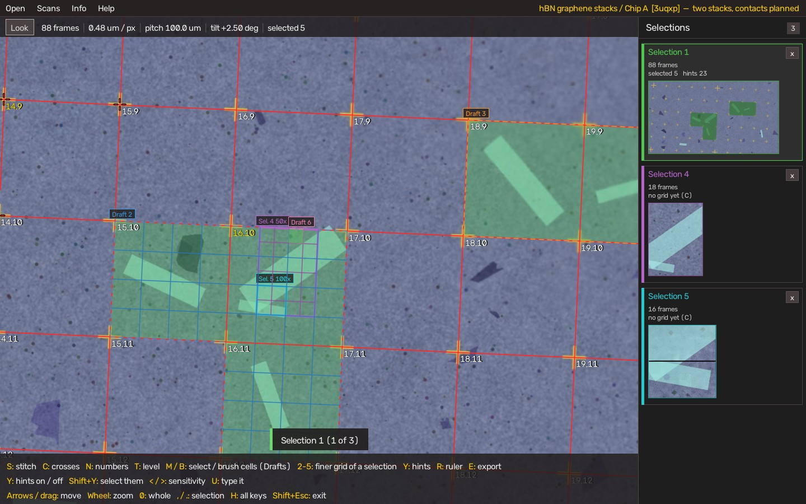
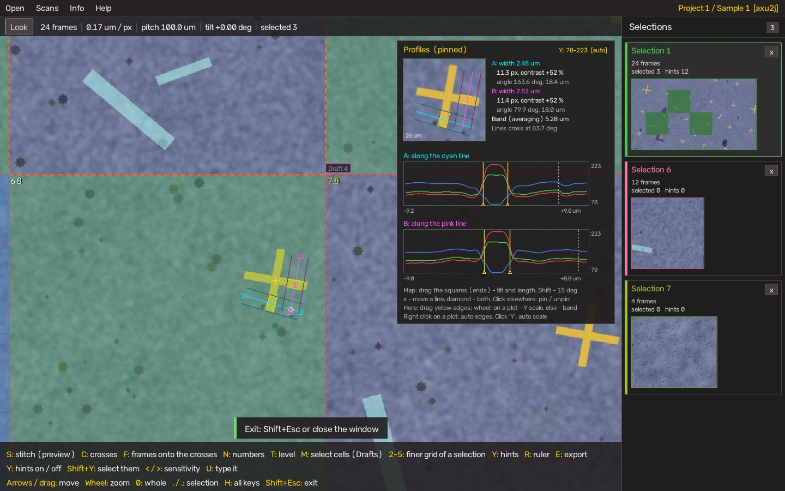

# MicroControl

**用 Python 控制 Optosky ATR8300 拉曼显微镜：扫描基底，把它拼接成一张图，叠加光刻网格，选出需要的方格并导出给 AutoCAD。**

**作者：** A. Lyapeikov, S. Domenko · **版本：** 0.43.11 · English: [README.md](../README.md) · Русский: [README_ru.md](README_ru.md) · PDF: [中文](MicroControl_zh.pdf) · 完整技术参考：[中文](reference_zh.md)、[EN](reference_en.md)、[RU](reference_ru.md)


> 独立项目，与 Optosky 无关。按「原样」提供，不提供担保 —— 见[免责声明](#免责声明)和 [MIT 许可证](../LICENSE)。

---

## 快速开始

五步：从载物台上的样品到 AutoCAD 图纸。

```python
import microcontrol as mc

s = mc.Project("Graphene", "flakes for transport").sample("Chip 1", "SiO2 285 nm")   # 0. 项目和样品
m = mc.Microscope(objective=10, sample=s)   # 1. 连接   （mc.Microscope('sim', objective=10) —— 模拟器）

m.manual()                   # 2. 绿色区域：在两个对角按 1 和 2，每处对焦
folder = m.scan()            #    逐帧拍摄（或在窗口内按 S）
mc.stitch(folder)            #    把各帧拼接成一张图（或在 mc.view 中按 S）

mc.view(folder)              # 3. 按 C：点击两个相邻的十字 -> 红色网格
                             # 4. 按 M / B：选择方格（绿色）
mc.export(folder)            # 5. 选中的方格：图片 + 以微米为单位的图纸（DXF / DWG）

m.close()
```

显微镜窗口用 **Shift+Esc** 或其 × 关闭；查看器用 **Esc**（未打开模式、帮助或列表时）或其 × 关闭。**H** —— 所有按键。**Ctrl+P** —— 显示 / 隐藏左侧 Settings 面板。

---

## 五个步骤

### 1. 连接

`m = mc.Microscope()` 自动找到控制器端口和相机，打开照明并检查载物台是否响应。所有坐标以微米为单位，$+Z$ 表示载物台**向上**、朝向物镜。每次移动都按限制检查（单步、总行程、$Z$ 的上限），因此一个笔误不会把样品撞到物镜上。`mc.Microscope('sim')` 是模拟器：命令相同，但不需要仪器。

### 2. 绿色区域 —— 拍摄什么


`m.manual()` 打开实时相机画面。用方向键移动（按一次 = 一帧），用 `E` / `Q` 对焦（或 `F` —— 自动对焦）。字母用于操作：`L` 照明、`I` 激光、`W` 白平衡、`R` 标尺、`S` 将拍摄放入队列（后台 quick 拼接；队列在底部）、`V` 在查看器中打开结果。

- **一个窗口。** 顶部栏是主要按钮：**New area**、**Scan area**（拍摄 + 拼接）、**Export**（AutoCAD 图纸：所选区域的 DWG + DXF）、**Settings**（步长、曝光、对焦点）。
- **地图**（右上；`Tab` —— 放大地图并以相机位置为中心，相机移到角落）：所有已拍内容都在其真实位置（10x 在 50x 之下、50x 在 100x 之下），区域轮廓，以及黄色框 —— 相机当前位置。相机仅仅经过的地方，其实时帧会以稍暗的形式留在地图上、位于拍摄图像之下（“战争迷雾”被驱散；保存在样品的 `<样品>/fog/` 中）；在地图上单击时，沿途的迷雾也会被驱散。**Layout**（菜单）：单视图（相机大图，地图在角落，`Tab` 切换）或并排两个视图 —— 相机 | 地图 或 地图 | 相机（`Tab` 交换位置）；选区列表在右侧或左侧（查看器中也是）。设置会被记住。地图和查看器按相机显示的方向呈现样品（按 `T` 后或相机镜像时也一样），所以地图上在相机框右侧的东西，在相机画面中也在右侧；`\` 将地图再转 90°。**点击地图 —— 载物台开过去**；**在地图上拖动 —— 新区域**（用当前物镜）；**`Ctrl`+拖动 —— 自由框**，完全按所画位置（框住晶体），不吸附到方格；滚轮 —— 缩放；右键拖动 —— 移动地图；双击已拍区域 —— 在查看器中打开。
- **用按键选区**仍然可用：到一个角按 `1`，到对角按 `2`。
- **对焦点：** 每个角点的高度 $Z$ 会被记录；`K` 添加更多对焦点。扫描时每帧根据这些点得到自己的 $Z$，因此倾斜的样品也保持清晰。勾选「Z follows the focus points」后，方向键移动也会跟随这些点。
- **多个选区、图层：** 依次设置（`1`、`2`，再 `1`、`2`，或在地图上拖动）。所有选区在同一层级，可以重叠，任意物镜；右侧列表的顺序就是图层顺序（上面的在上层），拖动卡片可调整。点击 —— 选择，**Go** —— 移过去，**...** —— 其全部拍摄（星标为主拍摄），**x** —— 删除。
- **标尺：** 按 `R`，再点击两点 —— 显示以 µm 为单位的距离（两次点击之间可以移动载物台）。
- **撤销：** `Ctrl+Z` 撤销任一窗口中的任何操作（选区、物镜、勾选、顺序、对焦点、照明、步长、透明度、对齐、十字和单元、移动 —— 载物台会移回），最多 1000 步；`Ctrl+Y` 重做。

`m.scan()` 以 30 % 的重叠（50x、100x 为 35 %）逐帧拍摄每个区域；选区的每次拍摄都是新文件夹 `<样品>/scans/<日期>_<时间>_S03_50x/`。删除一个选区时，其他选区的编号和颜色不变。只拍摄当前物镜的选区。开始前会给出预计时间；该估计会从你这台显微镜以往的扫描中学习。在窗口中拍摄进入队列，并**在拍摄过程中就做 quick 拼接**：每个新帧立即与已拍的相邻帧拼接（在独立进程中，使用其他核心），查看器随时显示新帧，同时可以标记十字；拍摄后的 quick 拼接直接使用这些现成的接缝（被停止的拍摄会把已拍部分拼接好）；Python 中用 `mc.stitch(folder)`（`mode='quality'` —— 精确拼接）。

### 3. 红色网格 —— 找到方格



`mc.view(folder)` 打开拼接后的图（拖动 —— 移动，滚轮 —— 缩放）。

- 按 `C`，点击**同一行中两个相邻的十字**。程序由此得知倾斜角和方格大小，把图摆正，并在整幅图上画出红色网格。标记准确落在点击处；`Shift`+点击会吸附到十字中心，标记可以拖动。网格会立即按所有十字拟合；然后 `Shift+C` 把每一帧放到十字上（见*用于光刻的精度*）。
- **编号：** 按 `N`，点击一个方格并输入它旁边写的编号（`12 7`）。对位于不同行、不同列的两个方格这样做 —— 每个方格就都有了真实编号。
- **整个样品只有一个网格。** 它由在一个选区（列表中选中的）上手动标记的十字构建，只要十字不变网格就不变。其他拍摄按原样使用它；若图片有偏移，`A`（对齐）把图片移到网格下。要在另一个选区上建网格，先去掉旧十字（打开那个选区，`C`，`Del`）—— 在别处按 `C` 会提示这一点。为两个方格编号（`N`）后才显示方格编号。

### 4. 选择方格 —— 掩模

- `M` —— 选择：点击方格（再点一次 —— 取消）或拖出矩形框，框触及的所有方格被选中（`Shift` —— 取消）。右键 —— 去掉一个方格，`Shift` + 右键 —— 整个绿色区域。选中的方格为绿色；**Enter** 把它们变成选区。

### 5. 导出

`X`（任一窗口）或 **Export** 按钮把卡片上勾选的全部内容（默认不勾选）写入 `<样品>/export/`（每次覆盖）。**所有勾选的选区都必须做过 quality 拼接**，否则拒绝导出并列出其余选区。

结果是一张图纸 `export/drawing.dwg`（原点在十字 1,1，按晶格摆正）：各选区的图片按微米放在真实位置，每个单元是闭合方格，十字带编号，每个选区在自己的图层，另有空的 `BONDS` 图层用于画键合线。**只有在十字已标记时才生成图纸**（十字是信标，保证光刻拼合无误）；没有十字时只有图片和 `mixed.png`。旁边是图片（`S03_50x.png` …）和 `mixed.png` —— 所有勾选的拍摄按列表顺序叠加，像素取最精细的那个。若安装了免费的 ODA File Converter，会写出 DWG；否则有 `drawing.dxf`（AutoCAD：另存为 → DWG）。请保持 `export/` 文件夹完整：DWG 中的图片始终是单独的文件。对单个拍摄，`mc.export(folder)` 把其选中的方格校正后（PNG、DXF、编号列表）写入该拍摄的 `export/`。

`mc.projects()` 和 `mc.all_samples()` 打印表格：id、名称、样品、选区、拍摄、创建、修改、描述（Open 对话框中相同）。在查看器中 Open → **New window** 在单独窗口中显示另一个项目（`mc.view_window(folder)`），当前窗口保持打开。

在查看器中选中的方格（`M`）按 **Enter** 变成选区 —— **draft**（无物镜，不拍摄）或直接带有为新选区选择的物镜（`Shift+G`）；它立即出现在列表中并被选中。所有选区处于同一层级：任意物镜可以重叠，不做裁剪；列表顺序即图层顺序（顶部在最上），拖动卡片可调整；卡片上的复选框决定是否导出。查看器中按 `U` 按角点画选区：每条边只能横向或竖向，并吸附到十字和已放置的角点（灰色辅助线），因此轮廓始终是直角的；单击第一个角点或 Enter 闭合（最后一个角自动补上）。**Export** 将所有勾选内容写入同一个文件夹 `<样品>/export/`：AutoCAD 图纸（原点为十字 1,1，图片在原位，每个单元为闭合方格，十字带编号）、图片以及 `mixed.png` —— 所有勾选的拍摄按列表顺序叠加，分辨率由你选择。

| | |
|---|---|
|  |  |
| *地图上的层：10x → 草稿 → 50x → 100x，角落为相机* | *50x 拍摄：整个样品一个网格 —— 来自 10x 上标的十字* |
|  |  |
| *AutoCAD 图纸：倾斜的芯片按晶格摆正，其十字落在绘制的十字上* | *特写：50x 与 100x 的 quality 图片，各在自己的图层* |

## 用于光刻的精度



图纸之后要用来在薄片上写电路，所以图纸中的每张图片都**按其周围的十字**定位，而不是按载物台。关键因素及程序的做法：

| 项目 | 做法 |
|---|---|
| 两步拼接 | Quick —— 拍摄后自动进行（按重叠拼接，总览）。**Quality** —— Stitch / `Shift+J`（进入队列；模糊帧会重拍；接缝较弱时载物台自动移动，在两帧中间补拍一帧 —— 带偏移的桥接帧）。然后 `C`（2–3 个十字）和 `Shift+C` —— 每一帧都放到十字上：帧、正方形晶格和镜头畸变一起拟合，接缝误差不会累积。Python：`mc.stitch(folder, mode='quality')`，然后 `mc.fit_crosses(folder)` |
| 图纸中的图片 | 每个像素都通过**它所在方格的 4 个十字**取值（双线性），十字在同一次拍摄中测得；拼接、畸变和倾斜的残差不会进入图纸 |
| 十字中心 | 模板 + **臂的边缘**：通过各臂中线的两条直线，它们的交点就是中心（约 0.1 px，芯片转动时也一样；十字旁的数字不影响） |
| 镜头畸变 | 显微镜窗口中按 `D`（`m.calibrate_distortion()`）：在任意细节周围拍 3×3 张 50 % 重叠的图片；由重叠部分匹配的小块求出 $k_1, k_2, p_1, p_2$，不需要十字，也不依赖载物台精度。按物镜记住，用于所有扫描 |
| 帧 | 相机全分辨率，默认 JPG 95；`m.frame_format = 'png'` —— 无损。十字和接缝在绿色通道中测量（最清晰，没有色边） |
| 扫描之前 | 按钮 **Prepare**：在实时画面上的 3 步向导 —— 每一步说明移到哪里，然后 **Done** / Skip / Cancel：干净的空白处：曝光（最亮约 80 %，无过曝）、白平衡、**平场**（5 个位置取中值：渐晕和光学灰尘）→ 细节处：自动对焦、稳定停顿 → 镜头畸变（每个物镜一次）。按显微镜和物镜保存；下次会询问：**Overwrite** 还是 **Keep**（附日期）。拼接使用这一平场（以及用 `m.dark_frame()` 拍的暗场帧，若有）。Python：`m.prepare()`、`m.flat_field()` |
| 比例 | `m.mask_pitch = 100` —— 掩模上十字的设计间距：图纸的所有尺寸都以它为准。`Shift+C` 还会按十字测量真实像素尺寸（以及 X/Y 拉伸、斜切）并按物镜保存：标尺和之后的扫描都使用它 |
| 自动对焦 | 用对比度（归一化方差）找峰，用 Vollath F4 精扫，对清晰度曲线拟合高斯；步长和窗口在 Settings 中按物镜设置（`AF step`、`AF window`，0 = 按景深）。注意：Z 电机一步 5.56 µm，大于 50x / 100x 的景深 |
| 回程间隙 | `B` —— 单侧趋近（会记住）。拼接本来就不依赖载物台；这样帧落在预期位置，相机上的叠加标注也更准确 |

电路所用的薄片轮廓请在 50x / 100x 下拍摄：在 10x 下光学系统会把边缘模糊约 1 µm。

---

## 项目与样品

工作按以下方式分组：**项目**（一项工作，带描述）→ **样品**（载物台上的一块基底：有自己的选区和坐标、描述）→ **选区**（某一物镜下的区域；图层：地图 10x > 细节 50x > 100x）→ **拍摄**（每次拍摄选区都是新版本）→ 网格、选中的方格、图纸。选区保存在样品中，再次打开样品时会恢复；地图上的选中方格、`m.list()` 和查看器只显示当前打开的样品。选区即图层：由矩形组成的轮廓（无内部方格）和物镜，全部在同一层级，列表顺序就是图层顺序；Ctrl+点击卡片，再用 Merge / Minus / Overlap。查看器中用画笔选中的方格按 Enter 变成选区（每个图形一个，草稿或为新选区选定的物镜）；选区只拍摄与轮廓相交的帧；卡片上的眼睛可在地图上隐藏它。

```python
p = mc.Project("Graphene", "flakes for transport")   # 打开或创建；p.uid —— 简短 id，例如 "k3f9x"
p = mc.Project("k3f9x")                              # 按 id 打开已有项目
s = p.sample("Chip 1", "SiO2 285 nm")                # 项目中的样品：打开或创建
m.sample = s                                        # 使用该样品（其选区会恢复）
p.samples, s.selections, s.selections[0].scans, s.selections[0].latest.view()
mc.projects(), mc.all_samples()
```

两个窗口顶部都有菜单：**Open**（任意项目的样品）、**New**（从列表中选择 Project 或 Sample）、**Info**（描述）、**Scans**（所有版本）、**View**、**Help**。窗口以普通窗口打开；`m.manual(fullscreen=True)` —— 全屏。

## 图层：地图与细节

十字标记好之后，手动模式的地图上会显示光刻网格 —— 细的半透明红线：新区域正是由这些方格组成；整个样品只有一个网格。

1. 用低倍物镜（10x）标记一个大选区并拍摄 —— 这就是地图。
2. 查看地图（`mc.view`），找到感兴趣的位置。
3. 换上更高倍的物镜（手动模式中按 `O`，或 `m.objective = 50`），在地图上拖出小选区并再次拍摄 —— 只拍摄 50x 的选区。在 50x 选区上用 100x 同样操作。

所有选区都在同一层级（无嵌套）：名称旁显示物镜（`10x`、`50x`、`100x`），帧数和时间按该物镜计算，列表顺序就是图层顺序。然后：对需要的做 quality 拼接、对齐拍摄（查看器中 `A`）、标记十字（`C`）并导出（`X`）。

```python
m.list()          # 所有已拍摄的选区，按图层编号
m.open(3)         # 再次查看第 3 个（mc.view）
m.remove(3)       # 完全删除第 3 个（会先询问）
m.info()          # 时间花在哪里：每个操作都计时，耗时最长的在前
```

## 控制方式

同一台显微镜可以用六种方式控制，在一个会话中可以混用。

| 方式 | 用途 | 示例 |
|---|---|---|
| **Python / Jupyter** | 一切操作、脚本、可重复的工作 | `m.move(dx=200)`、`m.goto(x=0, y=0)`、`m.focus()`、`m.photo()`、`m.light = 3`、`m.scan()` |
| **手动窗口** | 观察、寻找样品、设置区域 | `m.manual()`：方向键、按键、鼠标（点击输入框输入步长，滚轮缩放，点击右侧列表） |
| **查看器窗口** | 网格、编号、选择方格、导出 | `mc.view(folder)`：鼠标和按键 |
| **G 代码** | 移动和拍照的程序，类似 3D 打印机 | `m.gcode("G0 X500 Y200\nM240")`；`m.plan()` 生成扫描程序，可以修改 |
| **命令行** | 在另一个窗口中检查和紧急停止 | `python -m microcontrol probe` · `status` · `stop` |
| **仪器在另一台电脑上** | 显微镜旁的旧电脑为其服务，Jupyter 在高性能电脑上运行 | 那边 `python -m microcontrol serve` · 这边 `mc.Microscope('net://密钥@192.168.50.2', objective=10)` |
| **AI 智能体** | 本地语言模型通过工具工作，每个操作由操作员批准 | `mc.agent.chat(m, model='qwen3:8b')`、MCP 服务器 |

参数是带范围检查的普通属性：`m.settings` 列出全部参数，`m.photo_pause = 0.5` 修改一个，超出范围的值会被拒绝并给出允许范围。`mc.help()` 打印简要说明。

**紧急停止：** 在任意控制台运行 `python -m microcontrol stop`（或创建文件 `~/.microcontrol/STOP`）：正在运行的程序会发送「照明 0」和「激光 0」，关闭端口并停止。 如果程序崩溃或被杀而未关闭仪器，独立的看守进程会自行关闭激光、电机、照明和制冷。

**仪器在另一台电脑上。** 在连接显微镜和相机的电脑上运行：`python -m microcontrol serve`（自动找到控制器、打开相机，并打印带密钥的地址）。在高性能电脑上：`m = mc.Microscope('net://密钥@192.168.50.2', objective=10)` —— 密钥会被记住，下次只需 `net://192.168.50.2`；其余一切与仪器就在旁边时相同，计算在本机进行。用以太网线直连并设置固定地址，或接同一路由器；Wi-Fi 也可以（此时帧以 JPEG 95 传输）。安全保障留在仪器端：10 s 没有程序的消息，或连接未经 `m.close()` 就断开 —— 服务器关闭激光、电机、照明和制冷；`python -m microcontrol stop net://192.168.50.2` 可在任何地方停止。通过互联网 —— 只能经由 VPN（Tailscale、WireGuard）。

**局域网和 Wi-Fi，另一台电脑上的 AI 智能体。** 链路：显微镜 → 旧电脑（`python -m microcontrol serve`：瘦服务器）→ 同一网络中的新电脑（网线或 Wi-Fi）→ 新电脑上通过 MCP 的 AI 智能体。
- 无需知道地址：`net://密钥@auto` 会在网络中自动找到服务器（端口 5150 上的 UDP 广播）；`python -m microcontrol find` 列出服务器（名称、控制器、相机、空闲 / 占用）。
- 在 Windows 上，服务器会自动为专用网络在防火墙中打开端口 5150（TCP 和 UDP）；没有管理员权限时会打印两条需执行一次的 `netsh` 命令。两台电脑上的 Windows 网络都设为"专用"。
- Wi-Fi：帧以 JPEG 95 传输（按测速选择）；静默断线约 15–30 秒内被发现（TCP keepalive、超时），随后程序自动重连；在此期间服务器在 10 秒无消息后关闭仪器（`--dead`）。
- AI 智能体：`python -m microcontrol mcp net://密钥@auto --objective 10` 是 stdio 上的 MCP 服务器；将其写入框架的 MCP 客户端（DeepSeek 或客户端驱动的任何模型）：
```json
{"mcpServers": {"microcontrol": {"command": "python", "args": ["-m", "microcontrol", "mcp", "net://密钥@auto", "--objective", "10"]}}}
```
  移动、拍摄和删除会在新电脑上询问操作员（Allow / Deny）；激光永远不对智能体开放。

---

## 命令如何到达仪器

```
Python：你的命令
   │  检查：步长限制、Z 上限、允许的命令
   ▼
帧：AA 55 | 长度 | 命令码 | 数据 | 校验和
   │  USB 虚拟 COM 端口，115 200 bit/s
   ▼
控制器 ──► 电机、照明、激光

相机 ──► 通过 USB 的 MindVision SDK ──► 图像帧（numpy 数组）
```

- **连接：** 虚拟串口，115 200 bit/s，8 个数据位，无校验，1 个停止位 —— 与原厂软件相同。
- **帧：** 每条命令和每个回复都是一个短数据包 `AA 55 | 长度（2 字节）| 命令码 | 数据 | 校验和`；校验和是各字节之和对 256 取模。例如「序列号？」：`AA 55 00 04 04 08`。
- **只有整数：** 移动以方向字节和电机步数发送（一步 ≈ 5.56 µm），因此微米被换算成整数步，舍入会被报告。照明和激光也都是整数。
- **白名单：** 只能发送原厂软件使用的命令；写入标定数据或更改仪器类型被禁止。
- **时序：** 控制器在几毫秒内回复，早于运动结束，因此程序等待「距离 ÷ 速度」再加上稳定暂停；「限位开关」回复会锁定该方向。

完整的协议说明：[参考，第 5 节](reference_zh.md#5-控制器协议)。

---

## 各部分的工作原理

| 部分 | 简要思路 |
|---|---|
| **连接** | 程序通过串口与控制器通信，使用与原厂软件相同的命令（协议通过逆向工程获得）。端口只能被一个程序占用；紧急停止文件可以立即停止一切。 |
| **安全** | 每次移动在发送前都会检查：步长、载物台行程和 $Z$ 的上限。可疑的移动会被拒绝，并给出错误代码和提示。除非连接时允许，激光处于锁定状态。 |
| **手动模式** | 实时相机画面加上以整帧为单位的小地图。区域和对焦点以显微镜的真实坐标保存，因此改变零点后仍然正确。 |
| **扫描** | 移动和拍照的程序（G 代码，可阅读和修改）：帧中心位于带重叠的网格上，每帧的 $Z$ 来自对焦点，等待载物台稳定，然后拍照。可选（`m.refocus = True`）：模糊的帧重新对焦并重拍。 |
| **预计时间** | 一个小型学习模型：先用物理估计，然后用你的扫描的实际时间（见[内置的机器学习](#内置的机器学习)）。 |
| **拼接** | 相邻帧有重叠；比较重叠部分得到它们的精确偏移。所有偏移一起求解，因此载物台误差不会累积。物镜照明不均匀（边缘更暗、色调不同）按每个颜色通道从图像本身测得并除去；然后按重叠区使每帧亮度与相邻帧一致，因此看不到接缝。面向数百到数千帧，借鉴 BigStitcher 和 MIST 的思想：位移精确到像素的几分之一且不受载物台误差影响，带回差的载物台模型剔除错误匹配（模糊帧上重复的十字），稀疏求解器（数千帧不到一秒）；在查看器中可关闭任意接缝，各帧立即重新排布。 |
| **网格** | 两个十字给出方格边的方向和长度；网格是正方形的，所以这就足够了。用所有十字拟合使其精确。两个标注过的方格给出整个网格的编号。 |
| **停止** | 任何长时间任务的进度条上都有 Stop 按钮（或 `Esc`）；进度条按任务的阶段推进，底部状态栏始终显示当前在做什么。 |
| **导出** | 勾选的全部内容写入一个文件夹：一张按晶格摆正的 AutoCAD 图纸（十字已标记时）、图片和 `mixed.png`；只限 quality 拼接的选区。 |
| **选区与图层** | 每个选区有自己的颜色、物镜、对焦点和拍摄；全部在同一层级，可以重叠，列表顺序就是图层顺序。 |
| **AI 智能体** | 本地语言模型可以通过工具使用整个程序；凡是移动载物台的操作都需要操作员点击「Allow」。见下文。 |
| **模拟器** | 带十字、薄片和倾斜的虚拟基底，无需仪器即可试用所有功能。 |

---

## 内置的机器学习

### 实验的预计时间

程序预测一次扫描需要多长时间，并**从你这台显微镜每次完成的扫描中学习**。

1. **先验（物理）。** 还没有数据时：每帧时间 = 移动（帧步长 ÷ 电机速度）+ 稳定暂停 + 拍照前暂停 + 曝光 + 写入文件；再加上固定的准备时间。
2. **数据。** 每次扫描完成后，(帧数 $N$, 实际时间 $T$) 被记录到这台显微镜的记忆文件中，按影响速度的每组设置分别保存（物镜、对焦方式、暂停、曝光、检查、帧格式）。保留最近 20 次扫描。
3. **模型。** 用最小二乘法拟合一条直线（线性回归）：

```math
T = T_0 + t\,N,
```

   $T_0$ —— 准备时间，$t$ —— 每帧秒数（两者都非负；若只有一种 $N$，直线过原点）。
4. **先验 + 数据。** 预测是物理估计与拟合直线的加权组合；数据的权重随扫描次数 $n$ 增加：

```math
\hat T = (1-w)\,T_\text{物理} + w\,T_\text{拟合},\qquad w = \frac{n}{n+2}
```

   （1 次 —— 33 %，4 次 —— 67 %，10 次 —— 83 %），类似越来越信任经验的贝叶斯估计。
5. **扫描过程中**，「Left」从该预测开始，随着拍摄逐渐过渡到实际速度。

---

## 按键

**同一个字母在两个窗口中含义相同。** 仅属于一个窗口的按键在另一个窗口中会给出提示（不执行操作）。

| 按键 | 含义 | 显微镜窗口（`m.manual()`） | 查看器（`mc.view(folder)`） |
|---|---|---|---|
| 方向键、滚轮、`+` / `-`、`0` | 移动、缩放、全图 | 载物台移动一帧（步长 X、Y）；地图 | 图像 |
| `,` `.` | 上一个 / 下一个选区 | ✓ | ✓ |
| Ctrl+单击 | 标记多个 | 卡片（列表上方 Merge / Minus / Overlap） | 卡片和图像 |
| `Enter` | 确认 | 移动到所选选区 | 选中的单元 -> 选区（两处均被选中）；保存对齐 |
| `Del` | 删除 | 所选 / 新建的选区（Ctrl+Z 可恢复） | 已标记 / 所选的（未拍摄）；十字模式中 —— 重新标十字 |
| `S` | 拍摄：放入队列 | 所选 / 已标记的选区（Scan area） | 所选 / 已标记的（显微镜窗口的队列） |
| `J` | 拼接 | 实时画面与拼图比对；`Shift+J` —— 所选的精确（quality）拼接（Stitch） | 手动编辑拼缝（quick 先做 quality 拼接）；`Shift+J` —— quality 拼接放入显微镜窗口的队列 |
| `X` | 导出 | 所有勾选的 -> `<样品>/export/`（Export） | 同左 |
| `O` | 物镜 | 当前物镜：下一个（装上它） | 所选 / 已标记选区的物镜；`Shift+O` —— 新选区的物镜 |
| `[` `]` | 透明度 | 地图上所选选区的图片 | 所选选区 / 已标记的图片 |
| `R` | 标尺 | 点击两点 | 点-点 -> 线-线 -> 点-线 -> 关闭 |
| `T` | 旋转图像 | 相机旋转 180°（记住） | 按晶格放正 / 按拍摄 |
| `M` · `C` · `N` | 单元 · 十字 · 编号 | — | 选择单元（`Ctrl+A` —— 全选 / 全不选）· 标十字（`Shift+C` —— 帧对齐到十字）· 方格编号 |
| `P` · `G` · `A` · `Y` | 剖面 · 平直边缘 · 对齐 · 其他 | — | 剖面线（4 次点击）· 裁去台阶 · 将当前扫描与其他对齐（空格 —— 自动）· 其他选区图片开 / 关 |
| `U` | 轮廓 | — | 按角点画选区：边只能横向/竖向，吸附到十字和角点；Enter 或第一个角点闭合 |
| `E` / `Q`（`PgUp` / `PgDn`）· `F` · `K` · `1` / `2` | 载物台上 / 下 · 自动对焦 · 对焦点 · 角点 | ✓（`Shift` —— ×5） | — |
| `L` · `I` · `W` · `空格` · `V` | 照明 · 激光 · 白平衡 · 拍照 · 打开查看器（独立窗口：本窗口继续工作） | ✓ | — |
| `Tab` 或单击字段 | 步长、曝光、物镜 | ✓ | — |
| `Ctrl+Z` · `Ctrl+Y` | 撤销 · 重做 | ✓（包括移动） | ✓ |
| `H` · `Esc` | 全部按键 · 退出模式 / 取消标记 | ✓ | ✓；无其他打开内容时按 `Esc` —— **关闭查看器** |
| `` ` ``（或 `F12`） | 计时：窗口各部分每帧毫秒数（每 5 秒也写入日志）—— 这台电脑上什么慢 | ✓ | ✓ |
| `Shift+Esc` | 关闭 | 显微镜窗口（只能这样） | ✓ |
| `Ctrl+P` | Settings 面板（左侧） | 显示 / 隐藏 | — |

显微镜窗口的 **Settings 面板**（Settings 按钮、左侧箭头或 `Ctrl+P`）：Z 跟随对焦点、单向接近（回程间隙；默认开启）、**Prepare**、**Distortion**（畸变）、**Zero here**（此处置零）、**Steps = frame**（步长 = 一帧）、**Check directions**（检查方向）、**Arrows X / Y**（方向键反向）、**Map 90 deg**（地图旋转）、**Clear fog**（迷雾是按载物台坐标直接放置的实时帧，不做匹配；清除地图上“战争迷雾”的实时帧；设置 `m.fog_refresh`（默认关闭：静止时实时帧本来就会覆盖迷雾）：在已到过的地方行驶时也会重新拍摄，迷雾被新帧覆盖）。顶部：Prepare、New area、Scan area、Stitch、Export、Settings；菜单：Open、New、Info、Scans（所选选区的历史；与其卡片上的 `...` 相同）、Queue、View、Help。在地图上 Ctrl+拖动 —— 当前物镜的方框（晶体）；任务进行中按 `Esc` —— 停止。

---

## 文件保存位置

```
projects/<项目>/project.json                          名称、描述
projects/<项目>/samples/<样品>/sample.json            该样品的选区（列表顺序 = 图层）、描述
    scans/<日期>_<时间>_S03_50x/                      所有拍摄，一层；每次拍摄都是新版本：
        frames/  join/  grid.json                     各帧、拼接图、十字和方格
    export/                                           导出（每次替换）：图纸、图片、mixed.png
    thumbs/<uid>/                                     选区的角点图片
    photos/                                           单张照片（空格）
logs/                                                 每次会话的日志
```

---

## AI 智能体

本地模型（例如通过 Ollama）可以控制显微镜：通过相机和拼图观察、移动、扫描、拼接、标记十字、为方格编号并选择、导出。

```python
mc.agent.chat(m, model='qwen3:8b')                 # 与本地模型对话
python -m microcontrol mcp COM3                    # 或者为任何 MCP 客户端提供服务器
```

每次移动、扫描或删除都会弹出窗口：**Allow**、**Allow for this session** 或 **Deny**。激光对智能体不可用，安全限制依然有效，每次调用都记录在日志中。详见：[参考，第 25 节](reference_zh.md#25-ai-智能体)。

---

## 安装

Python 3.10–3.14（推荐 3.13），Windows。

```
cd /d D:\MicroControl
py -3.13 -m venv .venv
.venv\Scripts\activate
python -m pip install -r requirements.txt jupyter
jupyter notebook
```

**相机需要 MindVision 相机 SDK（Windows x64）：请从相机厂商网站 mindvision.com.cn（下载 → SDK）下载，以管理员身份运行安装程序并重启电脑。** 仅需安装在连接相机的电脑上（通过 `net://` 工作的电脑不需要）。未安装时程序会以 `E502` 停止。连接前请关闭 Optosky 原厂软件：端口和相机只能被一个程序占用。示例：`example.ipynb` 和 `demo/` 文件夹。

**首次运行：** 用 `python -m microcontrol probe` 检查连接，然后在 `m.manual()` 中检查方向 —— `Q` 应使载物台**下降**，方向键 → 应使图像向左移动。否则见[参考，第 20 节](reference_zh.md#20-在仪器上首次运行)。

**模拟器自检**（无需仪器）：`python test_sim.py --quick` —— 约 10 秒；`python test_sim.py` —— 全部，各部分并行运行（2 核约 15 分钟）。

## 出现问题时

| 问题 | 处理方法 |
|---|---|
| 端口被占用（`E102`） | 关闭 Optosky 软件；`python -m microcontrol status`，然后 `python -m microcontrol stop` |
| 控制器无响应（`E301`） | 重新插拔控制器 USB，运行 `python -m microcontrol probe` |
| 相机无法打开（`E505`） | 关闭其他相机程序，重新插拔相机 USB；或用 `camera=False` 连接 |
| 单元格卡住 | 在另一个窗口运行 `python -m microcontrol stop`，或重启内核 |
| 图像模糊拖影 | `m.move_pause = 0.5`、`m.photo_pause = 0.6` |

所有错误代码、协议、公式和全部参数：[完整技术参考](reference_zh.md)。

---

## 免责声明

**与制造商无关。** MicroControl 是一个独立项目。它并非由 Optosky（奥谱天成）或 MindVision（迈德威视）开发、认可、支持或认证。Optosky、ATR8300、MindVision 及其他名称是其各自所有者的商标，此处仅用于说明本软件适用于哪些设备。控制器协议是通过逆向工程获得的，且仅通过逆向工程获得：观察原厂软件与仪器之间经串口的通信，以及原厂库（OptoSky.dll）导出的名称，唯一目的是使本程序能够与仪器协同工作。未使用 Optosky 的任何文档、源代码或其他资料；本项目不包含 Optosky 的任何源代码。

**不提供担保。** 本软件按「原样」提供，不附带任何明示或暗示的担保，包括适销性、特定用途适用性、结果准确性和不侵权的担保（见 [LICENSE](../LICENSE)）。

**责任限制。** 在法律允许的最大范围内，作者对因使用或无法使用本软件而产生的任何直接、间接、附带、特殊或后果性损害不承担责任，包括显微镜、物镜、载物台、相机、光谱仪或其他设备的损坏，样品的损坏或丢失，数据和测量结果的丢失，时间或利润的损失，以及人身伤害。

**风险自负。** 本软件会移动电动载物台，并可开启激光。以下事项由用户自行负责：
- 仪器的安全操作，包括物镜工作距离、载物台行程限制和碰撞风险；
- 激光安全：防护眼镜、安全规程以及适用于该仪器激光等级的当地法规；
- 在依赖设置和结果之前进行检查，并备份重要数据；
- 遵守仪器制造商的许可、保修和服务条款 —— 使用第三方控制软件可能影响保修；
- 遵守适用于用户的法律和法规。

MicroControl 内置的安全检查可以降低风险，但不能代替用户的注意和判断，且未经任何机构认证。本软件不适用于医疗、诊断或安全攸关的用途。

---

## 联系方式

问题和错误报告：[andrey.quant@yandex.ru](mailto:andrey.quant@yandex.ru)

许可证：[MIT](../LICENSE)。
