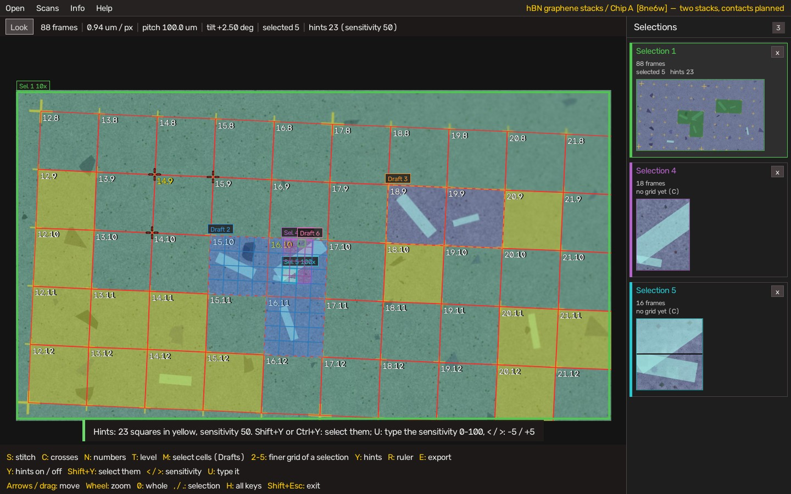
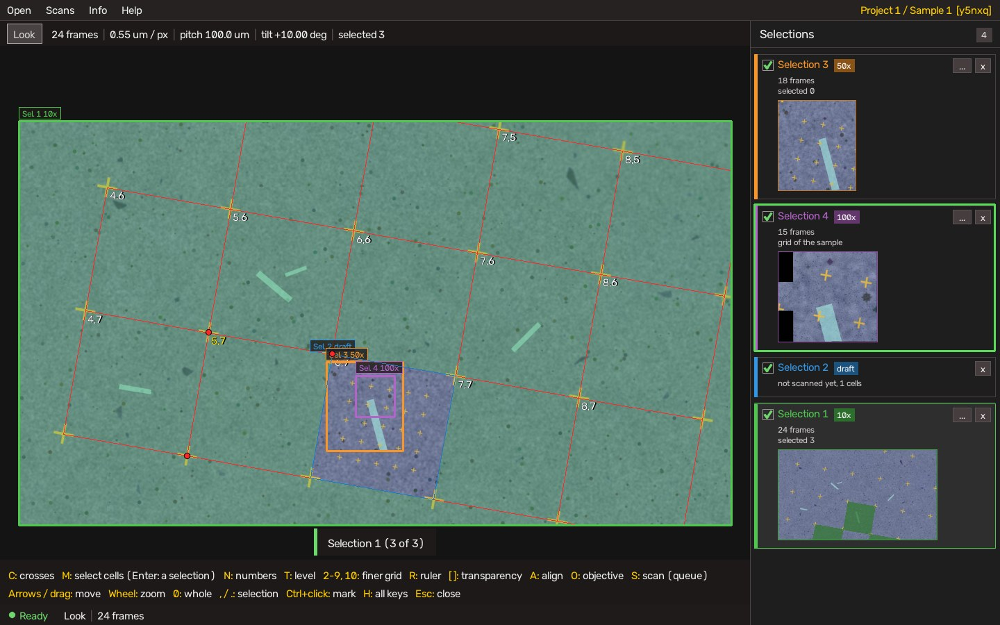

# MicroControl

**Software control of the Optosky ATR8300 Raman microscope (MP / Mapping version): stage, illumination, laser, camera, autofocus, area scanning, stitching and preparation of images for training datasets.**

**Full technical reference** (formulas, protocol, parameters, error codes). For a short introduction see the [README](../README.md). Русский: [reference_ru.md](reference_ru.md) · 中文: [reference_zh.md](reference_zh.md).



> Independent project, not affiliated with Optosky. Provided as is, without warranty — see the [Disclaimer](#disclaimer) and the [MIT licence](../LICENSE).

---

## Contents

1. Purpose and components
2. Notation and units
3. Hardware and its parameters
4. Coordinate systems
5. Controller protocol
6. Motion model and timing
7. Safety: limits and their reasoning
8. Camera and image formation
9. Autofocus
10. Area scanning
11. Data storage
12. Stitching and marking: overlap stitching, crosses, square selection, export, clean-up
13. Preparing images for a training dataset
14. G-code programs
15. Manual mode and viewer
16. Microscope home and position memory
17. Emergency stop and exclusive access
18. Simulator
19. Installation
20. First start on the instrument
21. Troubleshooting
22. Reference: parameters, commands, errors, log
23. Demo programs
24. What is not verified on the instrument
25. AI agents

---

## 1. Purpose and components

MicroControl is a Python library for controlling the microscope from a Jupyter notebook on the computer attached to the instrument. It replaces the stock Optosky program for optical microscopy: moving the stage in three axes, illumination, laser, imaging, autofocus and automatic scanning of a sample area followed by stitching of the frames.

The library reproduces the exchange of the stock program with the controller: the same commands, the same order, the same port settings (section 5). The protocol was recovered from the executable code of the stock program and from recordings of the exchange with the instrument.

Modules:

| Module | Purpose |
|---|---|
| `core` | class `Microscope`: connection, motion, parameters, imaging |
| `protocol` | frame format, list of commands |
| `focus` | sharpness measures and the autofocus algorithm |
| `scan`, `gcode` | scan area, G-code scan program and its execution |
| `storage` | frame storage of a scan (HDF5 or JPG) |
| `stitch`, `optics` | overlap stitching (like ASHLAR), flat field, lens distortion, multiband blending |
| `crosses`, `mask` | cross lattice, square selection, numbering, export |
| `join` | simple mosaic of the frames |
| `manual`, `viewer` | manual control window, scan viewer |
| `device` | instrument memory: home and last position |
| `control` | exclusive access, emergency stop |
| `guard` | crash guard: switches the instrument off if the program dies |
| `remote` | server at the instrument: the program on another computer (net://) |
| `sim` | instrument simulator |
| `probe` | controller link check |

---

## 2. Notation and units

Lengths are in micrometres (µm), time in seconds (s), laser power in milliwatts (mW).

| Symbol | Meaning | Default |
|---|---|---|
| $\delta$ | stage travel per motor step | $5.556$ µm |
| $N$ | number of motor steps (integer) | — |
| $M$ | objective magnification | 4, 10, 20, 50, 100 |
| $a$ | camera sensor pixel size | $2.2$ µm |
| $p = a/M$ | camera pixel on the sample | $0.22$ µm at $M = 10$ |
| $N_x \times N_y$ | frame size in pixels | $2592 \times 1944$ |
| $W = N_x p,\ H = N_y p$ | field of view (frame size on the sample) | $570 \times 428$ µm at $M = 10$ |
| $v$ | stage speed | $3000$ µm/s (assumed value) |
| $\tau$ | pause after a move (`move_pause`) | $0.1$ s |
| $\mathrm{NA}$ | objective numerical aperture | 0.1 / 0.25 / 0.4 / 0.75 / 0.9 |
| $\lambda$ | wavelength | $0.532$ µm (laser) |

---

## 3. Hardware and its parameters

| Unit | Parameter | Value | Source |
|---|---|---|---|
| Stage X, Y | travel | $5 \times 5$ cm | ATR8300MP datasheet |
| Stage Z | travel | 20 mm | datasheet |
| Stage | scan speed | 20 mm/s | datasheet; matches the command rate of the stock program (2 mm in 94 ms) |
| Motors | travel per step $\delta$ | $1/0.18 = 5.556$ µm on all axes | exchange recordings: 200, 300, 500, 2000 µm in the Optosky UI → 36, 54, 90, 360 steps |
| Motors | limit switches | on all three axes | `usercfg.ini`: `DeviceMotorType=XYZLimit` |
| Controller | interface | USB, STM32 virtual COM port, VID 0483, PID 5740 | — |
| Camera | model, sensor | MindVision MV-SUA502C, $2592 \times 1944$, pixel $2.2$ µm | — |
| Illumination | levels | integers 0…5; the stock program uses 5 | — |
| Laser | wavelength, control | 532 nm, power in whole mW | — |
| Spectrometer | CCD cooling | Peltier element with a fan; set point −5 °C in operation, 20 °C at shutdown | `usercfg.ini`: `CoolTemperature=-5` |
| — | sample–objective gap before autofocus | ≈ 1 mm | label on the stage |

The fan noise heard after the stock program starts is the cooling of the spectrometer CCD (command `12`, section 5), not a stage-ready signal.

---

## 4. Coordinate systems

The controller does not report the stage position: it only accepts relative moves in steps. The position is computed by the program as the sum of the executed moves.

There are three coordinate systems.

1. **Motor steps** $(N_x, N_y, N_z)$ — the internal position, integers.
2. **Real coordinates** $(X, Y, Z)$, µm, `m.real_position`:

```math
X = \delta \cdot N_x,\quad Y = \delta \cdot N_y,\quad Z = \delta \cdot N_z,
```

counted from the microscope **home** (section 16); if no home is set — from the connection point.
3. **Working coordinates** $(x, y, z)$, µm, `m.position` — real coordinates minus the zero offset $(x_0, y_0, z_0)$ set by `m.offset()` (G-code `G92`):

```math
x = X - x_0,\quad y = Y - y_0,\quad z = Z - z_0.
```

The zero offset is for convenience; travel limits and home do not depend on it.

**Directions.** $+Z$ — stage up, towards the objective. In the stock program code the direction is a byte: X `00` — "forward", `FF` — "backward"; Y `00` — "left", `FF` — "right"; Z `00` — down, `FF` — up. The correspondence of X, Y to the image on the screen is checked at the first start (section 20) and changed if needed with `reverse_x`, `reverse_y`, `reverse_z` (motor) and `mirror_x`, `mirror_y`, `swap_xy` (camera).

**Camera rotation.** On the ATR8300 the camera is turned by 90°: the screen horizontal is the stage $Y$ axis, the vertical is $X$. This is handled by `m.swap_xy` (`True` by default on the instrument, `False` in the simulator). With `swap_xy` the step-to-pixel matrix is anti-diagonal,

```math
K = \begin{pmatrix} 0 & k_y \\ k_x & 0 \end{pmatrix},\qquad k_{x,y} = \mp\frac{\delta}{p},
```

where $p$ is the pixel size on the sample and the signs are set by `mirror_x`, `mirror_y`; the frame size in stage axes is $(h, w)$ instead of $(w, h)$. The ATR8300 camera image is upside down (mirrored in both axes); `m.turn_180` (`True` by default on the instrument) turns it by 180° when shooting, and $K$ changes sign, so the arrow directions on the screen stay the same. The orientation parameters (`turn_180`, `swap_xy`, `mirror_*`, `reverse_*`) are remembered for each microscope by its serial number (section 16).

**Micrometres to steps.** A requested move $\Delta$ (µm) becomes an integer number of steps

```math
N = \mathrm{round}\!\left(\frac{\Delta}{\delta}\right),\qquad |N\delta - \Delta| \le \frac{\delta}{2} \approx 2.8\ \text{µm}.
```

If $|N\delta - \Delta| > 0.05$ µm, the reply reports the actual move. A move $|\Delta| < \delta/2$ (giving $N = 0$) is refused (error `E214`), and so is a zero move (`E213`).

---

## 5. Controller protocol

> The protocol below was obtained by reverse engineering only (see the [Disclaimer](#disclaimer)).

### 5.1. Physical layer

Virtual COM port: 115 200 bit/s, 8 data bits, no parity, 1 stop bit. DTR and RTS are off, as in the stock program (the .NET `SerialPort` class does not raise them by default; pyserial does, so MicroControl turns them off explicitly).

### 5.2. Frame

Every command and every reply is a frame

```math
\mathtt{AA}\ \mathtt{55}\ \ L_{hi}\ L_{lo}\ \ C\ \ D_1 \dots D_n\ \ S,
```

where $C$ is the command code, $D_1\dots D_n$ the data, $L = n + 4$ the length (2 bytes, high byte first), $S$ the checksum:

```math
S = \left(L_{hi} + L_{lo} + C + \sum_{i=1}^{n} D_i\right) \mathrm{mod} 256.
```

The full frame length is $L + 2$ bytes. Example: serial number request `AA 55 00 04 04 08`, $S = 00 + 04 + 04 = 08$.

The reply repeats the command code and carries the data. The controller replies 1–4 ms after receiving a command, **before the motion ends**: a reply to a motion command means "command accepted", not "move finished".

### 5.3. All numbers are integers

Motor steps are 2 unsigned bytes (0…65 535) plus a separate direction byte; illumination level and laser power are 2 bytes; the cooling temperature is a sign byte (`00` or `FF`) and the magnitude in °C. Fractional values are not transmitted. MicroControl converts micrometres to steps as in section 4, and accepts only integers for light and laser: `m.laser = 2.5` is error `E208`, without rounding.

### 5.4. Commands used

| Code | Command | Data | Reply |
|---|---|---|---|
| `04` | serial number | — | text (ASCII) |
| `03` | model | — | text |
| `66` | maximum laser power | — | 2 bytes (`FF 00` — not set) |
| `31` | calibration block | index `09` | calibration data |
| `26` | instrument type | — | 1 byte: 0 — AutoFocus, 1 — Basic, 2 — Mapping |
| `2D` | illumination | level, 2 bytes | — |
| `20` | laser | power, mW, 2 bytes | — |
| `12` | CCD cooling set point | sign, magnitude °C | — |
| `24` | motors on/off | `01` / `00` | — |
| `2E`, `2F`, `2B` | move X, Y, Z | direction, $N$ (2 bytes) | status, 1 byte |

Status code in the reply to a move (the `MotorXResult`, `MotorYResult`, `MotorZResult` enums of the stock program):

| Byte | Meaning | MicroControl action |
|---|---|---|
| `00` | done | — |
| `01`, `02` | limit switch reached | the direction is blocked, the axis position is marked unconfirmed, error `E204` |
| `03` | failure | error `E306`, position unconfirmed |
| `04` | motor still moving (command came too early) | error `E306`, position unconfirmed, no retry: if the command was queued, a retry would double the move |

No other command codes are ever sent to the controller (allow-list; error `E305`). In particular, writing the calibration (`30`), the instrument type (`25`) and the maximum laser power (`65`) is blocked. The cooling set point may only be −5 °C or 20 °C — the stock program values.

### 5.5. Connect and disconnect sequences

| Step | Stock Optosky program | MicroControl |
|---|---|---|
| Port | 115200 8N1, DTR = 0, RTS = 0, reply timeout 5 s | same |
| Serial number | `AA 55 00 04 04 08` | same; up to 3 retries if there is no reply |
| Model | `AA 55 00 04 03 07` | same |
| Max laser power | `AA 55 00 04 66 6A` | same |
| Calibration | `AA 55 00 05 31 09 3F` | same |
| Instrument type | `AA 55 00 04 26 2A` | same |
| Light, level 5 | `AA 55 00 06 2D 00 05 38` | same |
| Cooling −5 °C | `AA 55 00 06 12 FF 05 1C` | same (`cooling=False` — do not turn on) |
| Motors on (before the first move on any axis) | `AA 55 00 05 24 01 2A` | same |
| Move X "backward", 36 steps | `AA 55 00 07 2E FF 00 24 58` (recorded) | `AA 55 00 07 2E FF 00 24 58` |
| Pause after a move | 50 ms; does not wait for the motion to end | $t = N\delta/v + \tau$ (section 6) (different on purpose) |
| Disconnect | laser 0 → motors off → light 0 → cooling 20 °C → close the port | same |

Confirmed by a recording: the controller answers the serial number (`ATR30007`) and model (`25312082531`) requests within 1–4 ms.

### 5.6. Reading replies and resynchronisation

The STM32 virtual port driver (2010 version) ignores the read timeout: with no reply, an ordinary read blocks forever. MicroControl therefore does not rely on the driver: it polls the number of received bytes and stops waiting after its own deadline (1 s for working commands, 5 s for connection commands), raising `E301`.

**Port loss.** If the port handle becomes invalid (the USB device reconnected or Windows put it into power saving; Windows error `ClearCommError … The device does not recognize the command`), MicroControl closes the port, opens it again (up to three attempts, 1 s apart), restores the light level and cooling and repeats the command — only if a repeat is safe (read requests, light, laser, motors on). A move is never repeated: it is unknown whether it was executed; the axis position is marked unconfirmed and `E307` is raised. In manual mode, when there has been no exchange for more than 2 s, an instrument-type request is sent (read only, not logged) so that the port is not put to sleep. It is recommended to turn off USB power saving: "Power Options → Change plan settings → Advanced settings → USB settings → USB selective suspend setting → Disabled", and in Device Manager clear "Allow the computer to turn off this device to save power" for the USB root hubs.

A frame with a wrong length leaves the controller waiting for the missing bytes; it then reads the following frames shifted and does not reply until it meets the `AA 55` header in the right position. This is exactly how, before 0.11.1, a calibration request without an index "hung" the controller. On connection the first request is repeated up to three times — enough to resynchronise.

---

## 6. Motion model and timing

Since the controller confirms a command before the motion ends and never reports its end, the end of a move is determined by time. A move of $N$ steps is split into parts of at most $N_{\max} = 180$ steps (1 mm); after each part the program waits

```math
t = \frac{|N|\,\delta}{v} + \tau,
```

where $v$ is the assumed motor speed (`m.motor_speed`) and $\tau$ the settling pause (`m.move_pause`). At least 0.06 s passes between any two commands.

The axes move strictly one after another, never together, in the order: Z down → X → Y → Z up. Thus the rise towards the objective is done last, when the stage is already at the right point of the plane.

**Choice of $v$.** The motor speed is set by the controller; there is no speed command in the protocol and the program does not regulate it. The parameter $v$ is the program's **knowledge** of the speed, used only to compute the wait. An error is safe only one way: with $v$ lower than the true speed, the program waits longer than needed; with $v$ higher, the next command arrives during the motion, the controller answers `04` and does not execute it; the program repeats the command every 0.03 s until the motion ends (at most 5 s), so no steps are lost. A picture, however, may be taken before the stage has stopped, so the default $v$ is 3000 µm/s, 6–7 times below the datasheet value.

**Measuring $v$:** `m.measure_speed(distance=1000)`. The stage moves by `distance` in X; the camera records frames until the image stops changing (difference of neighbouring frames below the $3\sigma$ noise threshold for 1 s). $v = 0.8\,v_{\text{meas}}$ is taken. The result is rejected (`E212`, $v$ unchanged) if the motion is seen in fewer than three frames, if the last frame does not differ from the first, or if $v_{\text{meas}} > 20$ mm/s: in all these cases the speed would be overestimated. Measure in focus, on an area with details, with the light on.

**Scan time.** For a frame step $s$ (section 10) the time per frame is

```math
t_{\text{frame}} \approx \frac{s}{v} + \tau + \tau_{\text{photo}} + t_{\text{exp}} + t_{\text{write}},
```

where $\tau_{\text{photo}}$ is `photo_pause` and $t_{\text{exp}}$ the exposure. With $v = 3000$ µm/s and $s = 570$ µm (10x) the move takes about 0.2 s; after measuring the speed — several times less.

---

## 7. Safety: limits and their reasoning

### 7.1. Physics

Only bringing the sample closer to the objective (the $+Z$ move) is dangerous. Moving in the XY plane does not reduce the gap.

The objective working distance (WD) is the gap between the objective and the sample in focus. Reference values (Olympus):

| Objective | Standard series (MPLN) | Long working distance (LMPLFLN) | Depth of field $\approx \lambda/\mathrm{NA}^2$ |
|---|---|---|---|
| 5x | 20.0 mm | 22.5 mm | ≈ 50 µm |
| 10x, NA 0.25 | 10.6 mm | 21.0 mm | ≈ 8 µm |
| 20x, NA 0.4 | 1.3 mm | 12.0 mm | ≈ 3 µm |
| 100x | 0.21 mm (NA 0.9) | 3.4 mm (NA 0.8) | ≈ 1 µm |

The instrument's 100x objective is marked "L PL" — a long working distance series. Assumed WD values (conservative, `m.working_distance`): 4x — 17 mm, 10x — 10 mm, 20x — 3 mm, 100x — 2 mm. The actual value is printed on the objective barrel (WD) and is set like this: `m.working_distance = 3400`.

**Limit rule.** A rise per command $\Delta z_{\uparrow} \le \min(\mathrm{WD}/3,\ 1000\ \text{µm})$, rounded down to 50 µm: even two wrong commands in a row cannot bring the sample to the objective. The Z travel is $\pm 50\,000$ µm from the connection point by default, i.e. in practice limited by the instrument limit switches (full $Z$ travel is 20 mm); the instrument does not go beyond them by itself. A narrower travel is set with `m.set_limits` (7.2).

### 7.2. Limits

| Limit | Value | Error |
|---|---|---|
| X, Y move per `move` command (`max_move`) | ≤ 2000 µm | `E201` |
| Z rise per command (`max_move_z`) | 4x, 10x, 20x — 1000; 100x — 650 µm (with WD 3.4 mm — 1000) | `E201` |
| Z lowering per command (`max_move_down`) | ≤ 2000 µm | `E201` |
| Trip by `goto` or G-code (`max_jump`) | ≤ 3000 µm | `E210` |
| X, Y travel from the connection point (`xy_limit`) | ±25 000 µm | `E202` |
| Z ceiling | $Z_{\text{conn}} + 50\,000$ µm (changed by `m.set_limits`) | `E203` |
| Z floor | $Z_{\text{conn}} - 50\,000$ µm (changed by `m.set_limits`) | `E202` |

**Changing the travel limits.** `m.limits` shows the current limits; `m.set_limits(x=(from, to), y=(from, to), z=(from, to))` sets them in working coordinates (like `m.position`), µm, for any set of axes:

```python
m.set_limits(z=(-2000, 3000))                    # Z: from −2 mm to +3 mm
m.set_limits(x=(-20000, 20000), y=(-20000, 20000))
```

Requirements: the lower bound below the upper one, the current position inside, no farther than 100 mm each way; otherwise `E208` and the limits do not change. The new limits hold until the end of the session.

There is no minimum step: small steps are safe and necessary (field of view at 20x is about 285 µm, at 100x about 57 µm; depth of field is a few µm).

If a short working distance objective is installed (e.g. 100x with WD 0.21 mm), its WD must be set: `m.working_distance = 210` gives a 50 µm rise per command; it is also wise to set the ceiling explicitly: `m.set_limits(z=(-50000, 100))`.

The ceiling is counted from the position at connection: it is assumed that the stage is in a safe position when connecting. The objective must be given at connection (`E207`), since the Z limits depend on it.

### 7.3. Checks before motion

All limits are checked **before** the first command is sent. A G-code program is checked as a whole by simulating all its commands; on any error the stage does not move and the error names the line.

A wrong parameter value or a typo in a name raises an error at once (`E105`, `E206`, `E208`); for a typo the closest existing name is suggested.

### 7.3a. Limit switches

The controller reply to a move tells **which** limit switch is closed (from OptoSky.dll: X — `ReachForward`/`ReachBackward`, Y — `ReachLeft`/`ReachRight`, Z — `ReachTop` = 1 / `ReachBottom` = 2), not the direction of motion. If the switch lies in the direction of motion, it is a stop: the direction is blocked (`E204`, then `E205`) and the axis becomes uncertain. If the switch is on the opposite side (the stage stood on it at the start and is moving away), the motion continues and the warning `MOV-012` is logged. Autofocus that hits a limit switch shrinks its window and carries on (`AF-003`). `m.confirm_position()` also clears the direction block.

### 7.4. Unconfirmed position

**Between sessions** the coordinates continue (with or without a home): the stepper stage stays where it was left, the last position is kept in the device memory after every move, so the selections of a sample stay on their places. At disconnection (and when manual mode closes) a camera frame is kept; at the next connection the picture is compared with it: the same picture — the position is confirmed; shifted — the stage was moved by hand or by another program, and the coordinates are corrected by the shift; a different picture (another sample) — the position is kept as it was, without asking (message; masks snap to the crosses by themselves). The same when the last session ended during a move. After a limit switch, a lost reply or a `03`/`04` code during work the axis position is considered unconfirmed. In this state `goto`, G-code and scanning are blocked (`E211`); `move` and manual mode work. The block is cleared by `m.confirm_position()` after checking that the stage is where expected.

### 7.5. Locked functions

The laser can be turned on only when connected with `allow_laser=True` and not above `laser_max`. Limit switch search (`m.find_limits()`, `G28`) — only with `allow_homing=True`: the limit switch signal has not been verified on the instrument yet.

---

## 8. Camera and image formation

The camera works through the MindVision SDK (`MVCAMSDK_X64.dll`). On connection, auto exposure and software sharpening (it distorts the autofocus sharpness measure) are turned off, and white balance is fixed (manual), so that the colour of the scan frames does not drift. After every move the first 2 frames are dropped so that the picture has no motion blur.

The pixel size on the sample is $p = a/M$ (`pixel_size`), the field of view $W \times H = N_x p \times N_y p$ (`m.frame_size`).

| Command | Action |
|---|---|
| `m.image()` | current frame (numpy array, BGR channel order) without saving |
| `m.photo(name)` | picture into `photos/<date>/` |
| `m.exposure = 20` | exposure, ms |
| `m.white_balance()` | one-time white balance on the current frame (aim at an empty area) |
| `m.dark_frame()` | dark frame: the light is turned off, 16 frames are averaged |
| `m.empty_frame()` | flat field frame: an empty area, 16 frames are averaged |
| `m.sharpness` | sharpness of the current frame |

Reference frames are saved in `references/` as 16-bit PNG; the pixel value is the mean multiplied by 256 (keeps the precision of averaging).

---

## 9. Autofocus

### 9.0. Autofocus by depth of field (default)

Depth of field of the objective (wave part plus geometric part, $e = 2.2$ µm — sensor pixel, $\lambda = 0.55$ µm):

```math
d = \frac{\lambda n}{\mathrm{NA}^2} + \frac{n\,e}{M\cdot\mathrm{NA}}.
```

| Objective | NA | $d$, µm | search step $d/2$, µm |
|---|---|---|---|
| 4x | 0.10 | 60.5 | 30 |
| 10x | 0.25 | 9.7 | 4.8 → motor step 5.6 |
| 20x | 0.40 | 3.7 | 1.9 → 5.6 |
| 50x | 0.75 | 1.0 | 0.5 → 5.6 |
| 100x | 0.90 | 0.7 | 0.35 → 5.6 |

NA are typical values (`OBJECTIVES` in `config.py`, adjust to your objectives).

`m.focus()`:
1. **Window centre** — the expected $Z$ from the focus points of `m.manual()` (4 nearest, weights $1/r^2$); without them — the current $Z$.
2. **Window** $\pm 4d$ (at least 3 motor steps), **step** $d/2$ (at least the motor step $\delta$). At 10x — 15 frames instead of 35–40.
3. **Upward sweep**; the stage also approaches the best $Z$ from below: the backlash is taken up the same way and the found $Z$ repeats.
4. **Sharpness** — mean of 2 frames, the frame is smoothed ($\sigma = 1$ px: noise is not counted as detail) and divided by the squared mean brightness (independent of exposure).
5. The **peak** is refined by a parabola through $\ln S$ (the sharpness profile is close to Gaussian), then rounded to the motor step.
6. Peak at the window edge — the window moves there (up to 2 times). Flat curve (peak/minimum < 1.15) — focus is far away, a wide search is done (9.2).

Wide search directly: `m.focus(wide=True)`.

**Stage limit.** If the $Z$ motor step is larger than the depth of field ($\delta = 5.56$ µm at 20x, 50x, 100x), the stage may stop up to $\delta/2 = 2.8$ µm from the sharpest point, i.e. 0.8–4 depths of field; `m.focus()` prints a "Limit" note. The $Z$ step $\delta$ is assumed equal to the X, Y step; if the $Z$ drive has a finer step, set it separately.

Simulator check (10x, $Z$ backlash 3 steps = 17 µm, focus between steps): from 5 start positions between −60 and +70 µm the stage stops at the step closest to focus (error 0.4–0.6 step, the minimum possible).

### 9.1. Sharpness measures

Sharpness is computed on the central half of the frame (each side), converted to grey $I(x, y)$ and reduced $k$ times:

| `focus_method` | Measure $F$ |
|---|---|
| `laplacian` (default) | $\mathrm{Var}\!\left(\nabla^2 I\right)$ — variance of the Laplacian |
| `tenengrad` | $\langle G_x^2 + G_y^2 \rangle$, $G_{x,y}$ — Sobel gradients |
| `brenner` | $\langle (I(x+2, y) - I(x, y))^2 \rangle$ |
| `variance` | $\mathrm{Var}(I) / \langle I \rangle$ — normalised variance |

### 9.2. Wide search

The depth of field may be smaller than the search step (10x: about 8 µm with a 20 µm step), and fine details are sharp only in a narrow $Z$ interval. So the search has two passes.

1. **Coarse.** From $\min(Z_0 + R, Z_{\text{ceiling}})$ down to $\max(Z_0 - R, Z_{\text{floor}})$ with step $s_f$, where $R$ is `focus_range` and $s_f$ is `focus_step`; the measure is computed on a frame reduced $k = 8$ times. Large details are visible even out of focus, so the maximum is wide and is not missed. The pass stops when at least 4 points are done, the current $Z$ is $2 s_f$ below the best one and $F < 0.6\,F_{\max}$.
2. **Fine.** The interval $\pm s_f$ around the maximum with a step of one motor step $\delta$, measure on a frame reduced $k = 2$ times.

The stage approaches the best position from above: it first rises $s_f$ higher, then goes down. This removes the mechanism backlash.

**Peak contrast**

```math
C = \frac{F_{\max}}{\mathrm{median}(F)}
```

over the coarse pass points. With $C < 1.3$ the maximum is considered uncertain (few details in the frame): the reply has a warning and the log a WARNING record.

Default window and step:

| Objective | `focus_range`, µm | `focus_step`, µm |
|---|---|---|
| 4x | ±2000 | 100 |
| 10x | ±1000 | 50 |
| 20x | ±500 | 25 |
| 100x | ±100 | 10 |

### 9.3. Z resolution limit

The Z motor step $\delta = 5.56$ µm is larger than the depth of field of 20x (≈ 3 µm) and 100x (≈ 1 µm) objectives. If the Z travel per step on the instrument really equals $\delta$, the position of best sharpness may coincide with no reachable stage position on these objectives. This needs checking on the instrument (section 24).

---

## 10. Area scanning

### 10.1. Area and frame grid

The area is given by two corners $A = (x_A, y_A)$ and $B = (x_B, y_B)$ — the centres of the corner frames, usually with keys `1` and `2` in manual mode (section 15); or explicitly: `m.area = mc.Area(x0, y0, x1, y1)`.

The grid step for overlap $q$ (`overlap`, $0 \le q \le 0.5$; by default 30 %, 35 % at 50x and 100x — `SCAN_OVERLAP`) is rounded down to a whole number of motor steps, so there are no gaps between frames:

```math
s_x = \delta \left\lfloor \frac{W(1 - q)}{\delta} \right\rfloor,\qquad s_y = \delta \left\lfloor \frac{H(1 - q)}{\delta} \right\rfloor.
```

Number of frames

```math
n_x = \left\lceil \frac{|x_B - x_A|}{s_x} - 0.05 \right\rceil + 1,\qquad n_y = \left\lceil \frac{|y_B - y_A|}{s_y} - 0.05 \right\rceil + 1;
```

the 0.05 tolerance avoids an extra frame due to rounding. The frames are then spread evenly from corner to corner, $s'_x = |x_B - x_A| / (n_x - 1) \le s_x$ (the same for $y$): the first frame stands at $A$, the last one exactly at $B$, the overlap is not less than $q$. The path is a "snake" (`path='snake'`, even rows reversed) or row by row (`path='rows'`).

### 10.2. Focus during a scan

| `focus` | Method | When |
|---|---|---|
| `'plane'` | autofocus at the points of a sparse grid (every `focus_every` frames, plus the area corners); a plane $z = \alpha x + \beta y + \gamma$ is fitted through the points by least squares; the $Z$ of each frame is taken from it | flat samples (wafers, glass): the sample tilt is taken into account |
| `'each'` | autofocus in every frame | uneven samples |
| `'auto'` (default) | if focus points were set in `m.manual()` — as `'points'`, otherwise as `'off'` | — |
| `'points'` | $Z$ of each frame from the focus points of `m.manual()` (corners `1`, `2` and the `K` key): 4 nearest points with weights $1/d^2$, $z(\mathbf{r}) = \sum w_i z_i / \sum w_i$; no autofocus | tilted substrate: $Z$ changes smoothly, in small steps |
| `'off'` | $Z$ does not change: focus is set once in `m.manual()` | whenever the sample is flat: a $Z$ change shifts the picture in X and Y (backlash, axis skew) and spoils the stitching |

Points with contrast $C < 1.3$ are not used for the plane (the number skipped is reported). With fewer than three good points the plane is horizontal; with none the scan does not start (`E603`). If the points deviate from the plane by more than `focus_step`, `focus='each'` is recommended.

**Re-shooting blurred frames** (`refocus=True`). Frame $k$ is blurred if

```math
F_k < 0.5\,\mathrm{median}(F_{k-20}, \dots, F_{k-1})
```

(with at least 5 previous frames). Such a frame is shot again after autofocus; the flags `refocused` and `blurry` are written to `index.csv`.

### 10.3. Execution

`m.plan()` builds the G-code scan program (it can be read and edited); `m.scan()` runs it. Before planning, the camera checks the axis signs (`m.check_orientation()`: a shift of 20 % of the frame in X and Y and back; with a wrong sign the frames would be stitched in reverse order) and fixes `swap_xy`, `mirror_x`, `mirror_y` if needed; turn off with `m.scan_check = False`. By default frames are saved as JPG in `frames/` (`frame_format = 'jpg'`, quality `jpg_quality` = 90) reduced to `frame_scale` = 0.5: a 0.44 µm pixel at 10x is still 3 times finer than the optical resolution ($\approx 0.61\lambda/\mathrm{NA} \approx 1.3$ µm), so no detail is lost while the volume is about 30 times smaller; lossless — `m.frame_format = 'h5'`, `m.frame_scale = 1`. For each frame: move to the coordinates (in real coordinates, `G53`, so changing the working zero after planning does not shift the shooting), $Z$ from the focus model, pause `photo_pause`, stillness check (two frames must match within 0.25 px), picture. The exposure is fixed for the whole scan. `m.scan()` returns the scan folder path.

**Expected time.** Before a scan MicroControl prints the expected time (also in the mini map label and in the carousel). The first estimate is physical (moves, pauses, exposure, writing); after each finished scan the real time is remembered for this microscope and these settings (objective, focus mode, pauses, checks, frame format) — up to 20 last scans in the instrument memory file — and a line $T = T_0 + t\,N$ ($N$ frames) is fitted to them by least squares. The weight of what is learned grows with the number of scans: $w = n/(n+2)$ (1 scan — 33 %, 10 — 83 %). The "Left" of the progress bar starts from this expectation and moves to the real pace as the scan goes.

---

## 11. Data storage

```
scans/<date>_<time>_<objective>_<name>/      one area; several samples — a session folder:
  session.json       list of samples: number, colour, area, focus points
  sample_01/, sample_02/, …   each is a normal scan folder (as below)
  meta.json          objective, pixel size, field of view, motor step, step→pixel matrix,
                     area, camera and exposure, light, focus settings, pauses, speed, reference frames,
                     zero offset, instrument info, state, number of frames
  index.csv          one line per frame: id, batch, slot, row, col, x_um, y_um, z_um, x_p, y_p, z_p,
                     sharpness, refocused, blurry, t_s
  program.gcode      the executed program
  frames/00001_r001_c001.jpg   frames as JPG (default, frame_format = 'jpg')
  batches/b0000.h5   or batches of batch_size frames (HDF5, frame_format = 'h5')
  join/              stitching results
  viewer/            viewer caches: frame thumbnails and reduced copies (levels/)
  grid.json          crosses, square selection, square numbers
  export/            exported squares (PNG/JPG, DXF, JSON)
```

Each `bNNNN.h5` file has two datasets: `tiles` — lossless frames (gzip), split into $4 \times 4$ chunks (any part of a frame is read without unpacking the whole frame); `thumbs` — copies reduced 16 times for the viewer. A failure during writing damages at most one batch.

Access to the frames:

```python
st = mc.ScanData(folder)
ids = st.query(x=(0, 2000), y=(0, 1000))      # frames touching a rectangle (µm)
img = st.frame(ids[0], crop=0.5)              # central half of the frame
for i, img in st.frames(ids): ...             # iterate, reading batch by batch
st.export()                                    # PNG files and TileConfiguration.txt for Fiji
```

---

## 12. Stitching and marking (main workflow)

**Workflow.**
1. `m.manual()`: sample areas — corners `1`, `2`, one area after another (several samples: section 15).
2. Focus at the corners: at each corner bring the image into focus (`E`/`Q`) and press `1`/`2` (area corners) and `K` (other corners). The "Z follows the focus points" checkbox (`Y`, on by default): $Z$ of each scan frame from the 4 nearest points of its area with weights $1/d^2$; in manual mode, inside an area with at least 2 focus points, every arrow step also sets $Z$ this way (up by at most `max_move_z`). Unchecked — the arrows do not touch $Z$ and the scan keeps one $Z$.
3. `folder = m.scan()` — frames with 30 % overlap, 35 % at 50x and 100x (`scan_overlap` in `config.py`). Before each picture two consecutive frames are compared by phase correlation: if the picture still moves by more than 1 px (the stage has not settled), the picture is postponed (`m.still_check`). Exposure and white balance are manual for the scan (they do not drift from frame to frame).
4. `mc.stitch(folder)` — exact frame positions from the overlaps (12.1). Once per objective — `mc.distortion(folder)` (12.5).
5–7. `mc.view(folder)` — quality stitch (`Shift+J`), crosses (`C`), level view (`T`), square selection (`M`), square numbers (`N`), ruler (`R`) (12.2).
8. `mc.export(folder)` — only the selected squares: PNG (transparent background) or JPG, DXF for AutoCAD (12.3).
9. `mc.clean(folder)` — show, `mc.clean(folder, confirm=True)` — delete the frames and other work files.

The whole mosaic is never assembled in memory: the viewer and the export take only the needed parts from the frames by the found positions.

### 12.1. Overlap stitching (`mc.stitch`)

Built on the ideas of ASHLAR (Muhlich et al., *Bioinformatics* 38, 4613, 2022), MIST (Chalfoun et al., *Sci. Rep.* 7, 4988, 2017) and BigStitcher (Hörl et al., *Nat. Methods* 16, 870, 2019; Preibisch et al., *Bioinformatics* 25, 1463, 2009); our own implementation, without Java. Designed for hundreds and thousands of frames.

1. **Neighbours** — pairs of frames whose rectangles predicted by the stage overlap by at least 30 % of the largest overlap (diagonal corners are dropped). Found through a grid of frame-sized cells, not all against all.
2. **Pair shift, coarse.** The strips of the common part are filtered by a Laplacian of Gaussian (details stay, the smooth background goes), reduced to about $3\cdot10^4$ px, multiplied by a Hann window and zero-padded twice. Correlation with a partly normalised spectrum
   ```math
   r = \mathcal{F}^{-1}\!\left[\frac{F_B F_A^{*}}{|F_B F_A^{*}|^{0.25}}\right]
   ```
   Pure phase correlation (power 1) raises the high frequencies where, after the filter, only noise and the sensor pattern are left; they are tied to the frame, and their peak sits at the stage prediction. With power 0.25 the found shift does not depend on the stage error. The 5 highest peaks within `max_shift_um` = 40 µm of the prediction are candidates; each is checked by the match of the pictures ($e = 1 - \mathrm{NCC}$), the best one wins (repeating patterns, noise).
3. **Pair shift, fine** — Lucas–Kanade on the full-resolution common part:
   ```math
   \boldsymbol\delta = (G^{\top}G)^{-1}G^{\top}(a - \tilde b),\qquad G = \nabla\tilde b,
   ```
   where $\tilde b$ is frame $b$ moved by the current shift (brightness and contrast equalised); 2–6 steps. No pull towards whole pixels (phase correlation peaks have it: up to 0.18 px per seam, it adds up along a row): on a test texture the error is 0.003 px.
4. **Permutation test.** The same geometry, but a distant frame instead of the neighbour: errors of surely false pairs. The threshold is their 1st percentile. A seam not found near the prediction is searched over the **whole frames** without the stage (as in MIST): the stage may be off by more than the overlap (backlash at 50x and 100x).
5. **Stage → pixels model** from the accepted seams: $\mathbf{d}_{ij} = M\,\Delta\mathbf{p}_{ij} + B\,\Delta\mathbf{s}_{ij}$. $M$ ($2\times2$) accounts for the camera rotation, an inexact motor step and skew; $\mathbf{s}_k$ is the side from which the stage approached frame $k$ (written by the scan, `dir_x`, `dir_y`), $B$ the backlash per axis (only where it can be told from the step). Frame position by the model: $\hat{\mathbf{r}}_k = M\mathbf{p}_k + B\mathbf{s}_k$.
6. **Seams far from the model.** The model is accurate to a pixel or two, so a seam more than $\max(4, 5\sigma_m)$ px from it ($\sigma_m = 1.48\,\mathrm{med}\,|\mathbf{d}_{ij} - (\hat{\mathbf{r}}_j - \hat{\mathbf{r}}_i)|$) is usually the neighbouring period of a pattern (crosses on a blurred frame) or a match of noise. It is measured again in a narrow window around the model; seams found over the whole frames stay only if they agree with the model built with them (a backlash axis the first model did not know); the rest are dropped.
7. **Positions** — sparse weighted least squares (conjugate gradients with a diagonal preconditioner, no dense matrices: 3000 frames in 0.2 s):
   ```math
   \min \sum_{(i,j)} \frac{\bigl|\mathbf{r}_j - \mathbf{r}_i - \mathbf{d}_{ij}\bigr|^2}{\sigma_{ij}^2}
   + \sum_{(i,j)} \frac{\bigl|\mathbf{r}_j - \mathbf{r}_i - (\hat{\mathbf{r}}_j - \hat{\mathbf{r}}_i)\bigr|^2}{\sigma_{st}^2}
   + \varepsilon^2\sum_i \bigl|\mathbf{r}_i - \hat{\mathbf{r}}_i\bigr|^2,
   ```
   $\sigma_{ij} = 0.1 + 10\,e_{ij}$ px (a weak match is a coarse measurement), $\sigma_{st}$ — scatter of the stage step against the model, measured on the good seams (the "repeatability" of MIST), $\varepsilon = 0.01$. The stage holds the **step between neighbours**, not the place of a frame: its error is smooth, neighbours move together. Outliers: Cauchy weights with the scale going from $\infty$ down to 2 px; then, as in BigStitcher, the worst of the strong seams is removed while it is much worse than the rest.
8. **Second round.** Where the stage was far off or a seam disagrees with the others, the seam is measured again starting from the found positions (Lucas–Kanade only; the full search if it fails), and the positions are solved again.

The seams are saved (`join/seams.npz`): the viewer places the frames again from them in a fraction of a second when a seam is switched off or on (`J`, 12.2).

Simulator check (10x, backlash 3 steps = 16.7 µm, positions against the true stage positions):

| scan | error before (median / p95 / max, px) | now |
|---|---|---|
| 10x, 208 frames | 0.99 / 135 / 136 | 0.11 / 0.22 / 0.28 |
| 10x, 1044 frames (458 blurred: tilted sample) | 3.2 / 41 / 199 | 0.40 / 1.3 / 1.6 |
| 50x, 56 frames, backlash 1 step | 4.0 / 183 / 185 | 0.32 / 0.72 / 0.80 |
| 100x, 77 frames, backlash 1 step | 175 / 247 / 371 | 0.68 / 1.65 / 1.99 |

Time: 1044 frames of 640 × 480 in 65 s on 2 cores. Backlash found: 16.7 µm (true 16.7). Real ASHLAR: `mc.stitch(folder, engine='ashlar')` (needs `pip install ashlar` and Java).

**Optical corrections** (applied when frames are read for stitching, viewing and export):
- *illumination*: field $F_c(x, y)$ for each colour $c$ — median of up to 60 frames, each divided by its own median, smoothed, $\langle F_c\rangle = 1$; frame $I'_c = I_c/F_c$ (`join/flatfield.npy`);
- *frame brightness*: gains $a_i$ per frame and colour from the overlaps, $I''_i = a_i I'_i$ (`join/gains.npy`); both are computed at every stitch, `flat=False` — without them;
- *distortion* (12.5), if it was measured for this microscope and objective.

Result: `join/positions_all.csv`, `join/stitch.json`, `join/seams.npz` (seams), `join/preview_all.jpg` (reduced mosaic), `viewer/levels/` (frames reduced 2, 4, 8 times — for the viewer on large scans).

### 12.2. Marking in the viewer (`mc.view`)


**One letter — one meaning in both windows.** Keys of one window only say so in the other one (and do nothing).

| Key | Meaning | Microscope window (`m.manual()`) | View (`mc.view(folder)`) |
|---|---|---|---|
| arrows, wheel, `+` / `-`, `0` | move, zoom, whole | stage by one frame (Step X, Y); the map | the picture |
| `,` `.` | previous / next selection | ✓ | ✓ |
| Ctrl+click | mark several | cards (Merge / Minus / Overlap above the list) | cards and the picture |
| `Enter` | confirm | drive to the chosen selection | chosen cells -> a selection (chosen here and there); save the alignment |
| `Del` | delete | the chosen selection / the new one (Ctrl+Z brings it back) | the marked / chosen ones (not scanned); in the crosses mode — crosses again |
| `S` | scan: into the queue | the chosen / marked selections (Scan area) | the chosen / marked ones (the microscope window's queue) |
| `J` | stitch | check the live picture against the mosaic; `Shift+J` — exact (quality) stitch of the chosen (Stitch) | edit the seams by hand (a quick one: its quality stitch first); `Shift+J` — quality stitch into the microscope window's queue |
| `X` | export | everything ticked -> `<sample>/export/` (Export) | the same |
| `O` | objective | the one in place: next (put it in place) | of the chosen / marked selections; `Shift+O` — for new ones |
| `[` `]` | transparency | the picture of the chosen selection on the map | the picture of the chosen selection / of the marked ones |
| `R` | ruler | two clicks | point-point -> line-line -> point-line -> off |
| `T` | turn the picture | the camera by 180° (remembered) | level by the lattice / as shot |
| `M` · `C` · `N` | cells · crosses · numbers | — | select cells (`Ctrl+A` — all / none) · mark crosses (`Shift+C` — frames onto the crosses) · number a square |
| `P` · `G` · `A` · `Y` | profiles · straight edges · align · the others | — | profile lines (4 clicks) · crop the steps · align this scan with the others (Space — by itself) · other selections' pictures on / off |
| `U` | outline | — | a selection by its corners: sides only across / up-down, snapping to the crosses and the corners; Enter or the first corner closes it |
| `E` / `Q` (`PgUp` / `PgDn`) · `F` · `K` · `1` / `2` | stage up / down · autofocus · focus point · corners | ✓ (`Shift` — ×5) | — |
| `L` · `I` · `W` · `Space` · `V` | light · laser · white balance · picture · open the view | ✓ | — |
| `Tab` or click a field | steps, exposure, objective | ✓ | — |
| `Ctrl+Z` · `Ctrl+Y` | undo · redo | ✓ (moves too) | ✓ |
| `H` · `Esc` | all keys · leave the mode / unmark | ✓ | ✓; `Esc` with nothing open — **close the view** |
| `Shift+Esc` | exit | the microscope window (only so) | ✓ |
| `Ctrl+P` | Settings panel (left) | show / hide | — |

**Settings panel** of the microscope window (button Settings, the arrow on the left or `Ctrl+P`): Z follows the focus points, One-side approach (backlash), **Prepare**, **Distortion**, **Zero here**, **Steps = frame**, **Check directions**, **Arrows X / Y** the other way, **Map 90 deg**, **Clear fog** (the fog is the live frames laid simply by the stage coordinates, without any matching; forget the live frames of the fog of war on the map; the setting `m.fog_refresh` (off by default: standing still, the live frame overwrites the fog anyway) makes drives over already seen places shoot again, so the fog is overwritten with new frames). On top: Prepare, New area, Scan area, Stitch, Export, Settings; the menu: Open, New, Info, Scans (history of the chosen selection: View, Make main), Queue, View, Help. Ctrl+drag on the map — a box on the objective in place (a crystal); `Esc` during a job — stop it.


The lattice is always **square**: $\mathbf{v}_2$ is $\mathbf{v}_1$ turned by 90° (no skew, no "projection"); there are four unknowns — origin $\mathbf{O}$, pitch and tilt — found by least squares from the marks. Two neighbouring crosses are enough; far crosses reduce the tilt error in proportion to the distance. `Shift+C` in the view optionally fits the same square lattice to all crosses of the mosaic. Simulator check (tilt 3.5°): 2 neighbouring crosses and 2 far ones — pitch 99.998 µm, tilt 3.494°. Marks and selection are stored in `grid.json` (in mosaic pixels; after a new stitch the marks must be made again).

**Cross centre** is found by a "+" template with a dark rim (it fits thin dark crosses as well as raised light ones with an outline); each candidate is checked for the cross symmetry under 90° and 180° rotation — the lithography numbers next to a cross are not symmetric this way and do not pull the centre. The cross size (arm, px) is chosen automatically when the lattice is fitted to all crosses: the one with which the found centres lie best on the lattice, stored in `grid.json` (`arm_px`). Check on sample images with numbers at the crosses: lattice over 13 crosses — 0.52 px RMS, over 11 crosses — 1.1 px. On a whole 4x frame the crosses deviate from a straight lattice by up to ~7 px towards the edges — this is lens distortion (`mc.distortion`).

**Square numbers.** Lattice indices $(i, j)$ are arbitrary (counted from the first mark). The lithography numbers are obtained as

```math
\begin{pmatrix}X\\Y\end{pmatrix} = P\begin{pmatrix}i\\j\end{pmatrix} + \mathbf{t},
```

$P$ is a signed permutation of the axes (8 variants: which lattice axis is $X$ and which way it grows). $P$ and $\mathbf{t}$ are chosen so that all labels hold exactly. One label gives only $\mathbf{t}$ (the directions are the defaults: $X$ to the right, $Y$ down on the screen); a label on a second square **in another row and column** fixes the directions of both axes — and the numbers of all squares. The number is written in the top left corner of each square (labelled ones in yellow); inconsistent labels give a warning. The numbers go to `selection.json` (`names`), to the DXF (layer LABELS) and to the file names of the squares (`square_X+012_Y+007.png`). No digit recognition is needed: two labels are enough.

**Performance** (30 × 30 frame grid, 900 frames of 1296 × 972, 2 cores): stitching 67 s, memory ≤ 0.6 GB; opening the viewer 0.1 s; a window frame at any zoom 7–63 ms, while dragging 2–25 ms. Small zoom is drawn from the overview mosaic `join/preview_all.jpg`, medium from the reduced frame copies `viewer/levels/` (written at stitching), large from the frames; the copy cache is limited to 400 MB.

### 12.3. Exporting the selection (`mc.export`)

Each selected square (with a 16 px margin) is assembled directly from the frames: pixel $(u, v)$ of square $(i, j)$ is taken from the mosaic point $\mathbf{O} + i\mathbf{v}_1 + j\mathbf{v}_2 + \tfrac{u}{a}\mathbf{v}_1 + \tfrac{v}{b}\mathbf{v}_2$; overlapping frames are blended **by frequency** (Laplacian pyramid, 5 levels): each pixel is given to the frame with the largest weight (the weight falls towards the frame edge), the masks are smoothed per level — fine details without doubling, smooth brightness without a step at the seam. `blend='feather'` — simple weighted blending. The squares are placed in a grid without rotation, joined exactly at the crosses.

- `export/selection.png` — only the selection, the rest is transparent (`fmt='jpg'` — white background);
- `export/selection.dxf` — DXF R12, units µm: layer `SQUARES` — square sides, `OUTLINE` — outer contour of the selection, `LABELS` — square numbers $(X, Y)$;
- `export/selection.json` — list of squares and their numbers, lattice pitch (µm), rotation, output pixel size;
- `cells=True` — also each square as a separate file (`export/squares/`).

Memory is limited by `max_mb` (2000 MB by default): for a large selection the image is reduced.

### 12.5. Lens distortion, stitching on the crosses, the drawing by the crosses

**Model.** A point $\mathbf{u}$ of the straight frame ($\mathbf{v} = \mathbf{u} - \mathbf{c}$, $\rho^2 = |\mathbf{v}|^2/R^2$, $R$ — half the frame diagonal) is seen in the picture at $\mathbf{u} + \Delta(\mathbf{v})$:
$$\Delta = k_1\mathbf{v}\rho^2 + k_2\mathbf{v}\rho^4 + \tfrac{1}{R}\bigl(p_1\,2xy + p_2(3x^2+y^2),\; p_1(x^2+3y^2) + p_2\,2xy\bigr),$$
radial ($k_1, k_2$) and decentring ($p_1, p_2$); linear in $\theta = (k_1, k_2, p_1, p_2)$.

**Calibration** (`m.calibrate_distortion()`, button Distortion on the Settings panel of the microscope window): 3×3 frames with 50 % overlap around any details. Each overlap is cut into pieces (~1/10 of the frame); for every piece its exact shift $\mathbf{r}_a - \mathbf{r}_b$ is measured. One equation per piece: $\mathbf{P}_b - \mathbf{P}_a + \theta\cdot[\varphi(\mathbf{r}_a) - \varphi(\mathbf{r}_b)] = \mathbf{r}_a - \mathbf{r}_b$ ($\varphi$ — the four basis fields): frame positions and $\theta$ together, by least squares with outlier weights. Neither crosses nor stage accuracy are needed. Saved for the objective and written into `meta.json` of every scan. Simulator: of 0.88 px (rms, non-linear part of the field) 0.09 px is left.

**Stitching on the crosses** (`mc.fit_crosses(folder)`, `Shift+C` in the viewer): unknowns — positions of all frames, the square lattice $(O, \mathbf{a})$, $\theta$. Each cross $(i, j)$ found in the **raw** frame $k$ at $\mathbf{r}$: $\mathbf{P}_k + \mathbf{r} - \Delta_\theta(\mathbf{u}) = O + i\mathbf{a} + j\,\mathrm{rot}_{90}\mathbf{a}$; each seam: $\mathbf{P}_b - \mathbf{P}_a + \theta\cdot G_{ab} = \mathbf{d}_{ab} + \theta_0\cdot G_{ab}$. A frame with a cross is fixed to the lattice absolutely, seam errors do not add up. If the objective is calibrated, $\theta$ stays near the calibration. If $\theta$ changes by more than 0.5 px at the edge, the seams are measured again on straightened frames. Report: share of crosses within 0.5 µm of the grid. Simulator (10x, tilt 10°, backlash, distortion): 100 % within 0.5 µm, 95 % within 0.08 µm.

**Cross centre**: template «+» (with the tilt of the grid: the window is turned first), then the **edges of the arms**: across each arm 7–40 profiles, in each two edges with sub-pixel accuracy, the middle; a straight line through the middles of the horizontal arms and one through the vertical; the centre is their crossing. Profiles with another stripe width (digits, dirt) are dropped. Synthetic test, cross at 10°, noise and digits: 0.1 px (template alone 0.2–0.3 px).

**Drawing by the crosses.** For a selection whose scan has a numbered grid, its picture in the drawing is built pixel by pixel: drawing point → lattice $(u, v)$ → grid cell → mosaic point bilinearly from the **4 crosses of that cell** measured on this scan (missing ones — from the grid). The picture is square to the lattice; what is left of stitching, distortion and tilt does not reach the drawing. `drawing.json` lists, for every area, how many crosses were measured and how far they were from the straight grid.

**Frames**: full camera resolution (`m.frame_scale = 1`), JPG 95; `m.frame_format = 'png'` — lossless. Crosses and seams are measured in the green channel.

### 12.4. Simple mosaic (`mc.join`)

`mc.join(folder)` builds the whole mosaic in five stages (for small scans and training datasets).

1. **Initial positions** of the frames — from the stage coordinates and the step-to-pixel matrix.
2. **Refinement.** For each pair of neighbouring frames the mutual shift $\mathbf{d}_{ij}$ is computed by phase correlation over the overlap strip: the maximum of the inverse Fourier transform of the normalised cross spectrum

```math
R = \frac{\hat I_i \hat I_j^{*}}{|\hat I_i \hat I_j^{*}|}.
```

The shift is accepted if the peak height is at least 0.08 and the correction does not exceed a quarter of the strip; otherwise the stage shift is used.
3. **Global fit** of the positions $\mathbf{r}_i$ by least squares over all pairs at once (errors do not accumulate along a row):

```math
\min_{\{\mathbf{r}\}} \sum_{(i,j)} w_{ij}\,\bigl|(\mathbf{r}_j - \mathbf{r}_i) - \mathbf{d}_{ij}\bigr|^2 + \varepsilon \sum_i \bigl|\mathbf{r}_i - \mathbf{r}_i^{(0)}\bigr|^2,\quad \varepsilon = 0.01,
```

$w_{ij}$ — correlation peak height, $\mathbf{r}_i^{(0)}$ — position by the stage.
4. **Illumination flattening** (with at least 8 frames): for each colour channel a field $F_c(x, y)$ — median of up to 60 frames, each first divided by its median (so a frame with another overall brightness does not spoil the field), smoothed by a Gaussian with $\sigma = \min(W, H)/12$ and normalised to the mean; the frame is divided by $F_c$ channel by channel. The edges are corrected both in brightness and in tint.
5. **Frame brightness** (after the positions are known, like exposure compensation in panoramas): for every pair of neighbours with an overlap of at least 10 % in X and Y, $m_i$ and $m_j$ are the medians of the common part in each frame (per colour). Gains $a_i$ minimise
$$\sum_{(i,j)} \bigl(\ln a_i - \ln a_j - \ln m_j + \ln m_i\bigr)^2 + \lambda^2 \sum_i (\ln a_i)^2,\qquad \lambda = 0.05,$$
(linear least squares in $\ln a$), the median gain is 1, $|\ln a_i| \le 0.7$. The result is reported as `frame brightness evened (±N %)`.
6. **Blending** with weights falling towards the frame edges:

```math
w(x, y) = \min(x + 1,\, N_x - x)\cdot\min(y + 1,\, N_y - y).
```

Memory is limited (`max_mb = 3000`): if needed, the mosaic is built at a reduced scale; the original frames are not changed. A part of the scan: `mc.join(folder, x=(x0, x1), y=(y0, y1))` or `center=0.3`. Result: `join/mosaic_*.png`, `preview_*.jpg`, `positions_*.csv`.

---

## 13. Preparing images for a training dataset

| Requirement | Reason | Implementation |
|---|---|---|
| Constant exposure | brightness differences must not become a feature | the exposure is fixed for the scan and written to `meta.json` |
| Lossless storage | lossy compression adds artefacts | HDF5 + gzip (`frame_format = 'h5'`, `frame_scale = 1`); camera software sharpening is off |
| Physical scale | object size in µm is a feature | `pixel_size_um`, frame coordinates in µm |
| Sharpness | blurred frames hurt training | focus model, re-shooting, `sharpness` and `blurry` for every frame |
| Illumination correction | vignetting, non-uniformity | reference frames $D$ and $E$ are saved; the frames themselves are not changed |
| Reproducibility | repeating the acquisition | `program.gcode`, all parameters in `meta.json`, link to the log |

**Field correction** when preparing the data:

```math
I' = \frac{I - D}{E - D}\,\langle E - D \rangle,
```

where $I$ is the frame, $D$ the dark frame (`m.dark_frame()`), $E$ the frame of an empty area (`m.empty_frame()`), $\langle\cdot\rangle$ the mean over the frame.

Recommendations:
1. Before a series: warm up the illumination for 2–5 min, `m.white_balance()`, `m.empty_frame()` on a clean substrate, `m.dark_frame()`. Repeat when the objective or light level changes.
2. Do not change exposure, light and white balance within a series.
3. Overlap: for overlap stitching use the default 30 %; for labelling objects on frame borders — 0.1–0.2 is enough.
4. Split into training and validation sets by areas or samples, not by random frames: neighbouring frames are correlated, and a random split overestimates the quality.
5. Exclude frames with `blurry = 1`.

---

## 14. G-code programs

Control in the spirit of CNC machines and 3D printers. Units — µm. A comment follows `;`. `m.gcode(program, save='name')` — run a string or a `.gcode` file; with `save`, `M240` pictures go to a new scan folder.

| Command | Parameters | Action |
|---|---|---|
| `G0`, `G1` | X Y Z | move |
| `G53 G0` | X Y Z | move in real coordinates |
| `G4` | P (ms) or S (s) | pause |
| `G28` | X Y Z | limit switch search (needs `allow_homing=True`) |
| `G29` | — | build the focus plane for the area |
| `G30` | — | autofocus |
| `G90` / `G91` | — | absolute / relative coordinates |
| `G92` | X Y Z | zero offset: the current point gets these working coordinates |
| `G92.1` | — | remove the zero offset |
| `M3` / `M5` | S (mW) | laser on / off |
| `M114` | — | print the position |
| `M240` | R C | picture (row R, column C) |
| `M355` | S1 P(level) / S0 | light |
| `M420` | S0 / S1 | focus plane off / on |

The `F` (feed) parameter is not supported (`E902`): the speed is set by the controller (section 6). Before execution the program is checked as a whole (section 7.3).

---

## 15. Manual mode and viewer

**Projects and samples.** `mc.Project(name, description)` and `project.sample(name, description)` open or create `projects/<project>/project.json` and `projects/<project>/samples/<sample>/sample.json`. The sample keeps its selections (corners in real stage µm, objective, frame size, focus points, numbers, the last number given) and their corner pictures; `m.sample = s` saves the selections of the old sample and loads those of the new one; at connection the last opened sample is opened. Every project gets a unique short id of 5 characters (`p.uid`, no 0/1/i/l/o; shown in the window title, Info, Open and `mc.projects()`): `mc.Project("k3f9x")`, `mc.Microscope(project="k3f9x")` or Open → **By project id...** open that project (its most recent sample); the id is also written to each scan (`project_uid` in `meta.json`). A scan of a selection goes to `selections/Sxx_NNx/scans/<date_time>[_name]/` — every scan is a new version, the maps and the viewer list use the latest. Classes: `Project` (`samples`, `sample()`), `Sample` (`selections`, `selection(n)`, `scans(latest)`), `Selection` (`scans`, `latest`, `view()`), `Scan` (`stitch()`, `view()`, `export()`). The windows have a menu on top (Open, New — Project or Sample from a list, Info, Scans, View, Help; dialogs — tkinter).

**Tables and windows.** `mc.projects()` / `mc.all_samples()` return lists that print as tables (and as HTML tables in Jupyter): id, name, samples, selections, scans, created and updated dates, description; the Open dialogs show the same columns. `mc.view_window(folder)` starts the viewer in a separate process — one window per project, titled with the project and sample; the viewer's Open → New window and the manual window's Open → View in a new window use it.

**Sample lattice, drafts and finer grids.** The lithographic crosses are numbered from 1,1 (at most 58,58, usually about 30,30); cross X,Y has lattice coordinates $(u, v) = (X-1,\ Y-1)$, square X,Y is $[X-1, X]\times[Y-1, Y]$. The lattice of the sample (`lattice.py`, kept in `sample.json` → `lattice`: origin, axes $\mathbf{e}_1$, $\mathbf{e}_2$ in stage µm, pitch $P$) is **one for the whole sample**: it is fitted from the scan where the crosses were marked by hand last (`C`, on any selection) and two squares in different rows and columns are numbered (`N`; a number outside 1…58 is flagged). Every other scan shows this lattice as it is — no crosses to mark again. There is always only one grid: while it is made from the crosses of one selection, `C` on another one asks to remove them first (open that selection, `C`, `Del`); then the grid is gone, and the new crosses make it for all. The square numbers appear only after two squares are numbered by hand (`N`). Squares selected in the viewer (`M`) become a selection on **Enter** — one per closed figure: a **draft** (no objective, dashed outline, never scanned, never in the export) or with the objective chosen for new ones (`Shift+O`). A draft gets an objective with the chip on its card (draft → 4x … 100x → draft) and is then scanned. `U` in the viewer draws a selection by its corners: every side goes only across or up / down and snaps to the crosses and to the corners already put (grey guide lines), so the outline is always right-angled; a click on the first corner or Enter closes it (the last corner is added by itself). Brush state is kept in `grid.json` of the scan (`selected` — squares, `refine` — $\{uid: \{n, cells\}\}$).

**Looking inside, layers.** What is chosen stays clear and everything around it is tinted: in the viewer the squares selected with `M` are clear and the rest of the scan is under a light green tint. When a selection is chosen (clicked on its card), inside it the picture is as is and everything outside is 15 % darker — on the map and in the camera view. Nothing is cut: an area dragged on the map, set by corners 1–2 or selected as squares stays as drawn, over or under the others by the list order. Keys `2`–`5` also work right over freshly selected squares, before Enter makes them a selection. While a card is dragged in the list on the right, the list already shows the order it will have if dropped now (the card in a green frame).

**Flat list of selections: the order is the layers.** There is no nesting, no groups and no "pyramid": every selection — any objective or draft — is on one level, and selections of the same or different objectives may overlap in any way; nothing is cut to anything. The order of the list is the order of the layers: the top of the list is drawn on top (in the manual map, in the view, in `mixed.png`); a new selection appears at the top; drag a card up or down to change the order (any card anywhere). The objective of any selection can be changed at any time (the chip on its card; its scans keep the objective they were shot with). The box on each card says whether it goes into the export. A selection made of cells keeps its cells and its own grid; dragging a selection (Shift+drag) moves only it. In the view a click on a card makes it the one you work with: it is drawn on top of all the others for now (the list order stays as it is). Folders: all scans of a sample are in `<sample>/scans/<date>_<time>_S03_50x/` (one level, the selection and its objective in the name), corner pictures in `<sample>/thumbs/<uid>/`, the export in `<sample>/export/`. A rectangle selection is set exactly to what was shot after its scan (the frames stand on motor steps), so its outline is the edge of its picture; changing the objective keeps the outline. The view shows every scan along the stage axes (+X right, +Y down, as the map), so the layout of the selections looks the same whichever scan is opened. **One grid for the whole sample.** It is made from the crosses marked by hand (C) on any selection — the crosses marked last; it never appears by itself (no crosses — no grid) and does not change while those crosses do not change. Every other scan takes this grid as it is (opened in the view — it is there, on the stage, not snapped to that picture). Mark crosses on the selection chosen in the list: then these crosses make the grid for all. If a picture of another objective is off against the grid, `A` (align) moves the picture under it: the grid stays put. Aligning the scan whose crosses make the grid moves the grid with them (the crosses are on its picture), and the others take it when opened. **`V` opens the view in its own window (its own process)**: the microscope window keeps working at the same time (the queue and its bar, the camera, the ruler, editing); what the view changes (selections, objectives, Enter) comes to the microscope window by itself, `S` in the view puts scans into the microscope window's queue, and the view shows that queue in its status bar.



| | |
|---|---|
|  |  |
| *Layers on the map: 10x → draft → 50x → 100x, the camera in the corner* | *50x scan: one grid for the sample — from the crosses marked on the 10x* |
|  |  |
| *Drawing for AutoCAD: the tilted chip is square to the lattice, its crosses on the drawn ones* | *Close-up: 50x and 100x quality pictures, each on its own layer* |

**Export of the sample** (button Export in the microscope window, `X` in the view, or `mc.export_sample(m, [k, ...], mixed_um=None)`): everything ticked on the cards goes into **one folder `<sample>/export/`** — the previous export there is replaced: `drawing.dxf` (+ `.dwg` with ODA File Converter) — every selection on its own layer `S03_50x` (draft — `S03_draft`), in the lattice frame (cross 1,1 at $(0, 0)$) or in stage µm; the pictures of quality-stitched selections `S03_50x.png` (quick ones — outline only in the drawing); **`mixed.png`** — all ticked scans (quick and quality) in one picture, laid over each other in the order of the list (top of the list on top), with thin outlines; its pixel is that of the finest ticked scan (`mixed_um=` in Python sets your own; at most 200 Mpx — then coarser, and `drawing.json` says so); `drawing.json` — the report (frame, layers, pictures, `mixed`: µm per pixel). **Every ticked selection must be quality-stitched**, otherwise the export is refused and the message names the ones that are not (pictures of different accuracy would mislead). **The drawing is made only when the crosses are marked**: the crosses are the beacons that put the pictures together without an error for the lithography; without them the export has the pictures and `mixed.png` without the drawing, and the message (and `drawing.json`, `no_drawing`) says why. In Python `drawing=True` / `False` makes it with / without the drawing anyway.

**Navigator.** The manual window is one screen for the whole job. Under the menu: the buttons Prepare, New area, Scan area, Stitch, Export, Settings (the settings panel is hidden by default; `Ctrl+P`). The map (`navmap.py`) draws the stitched previews of the main scans of the visible selections in real stage µm (mosaic → stage by the scan geometry with its alignment), in the list order (top of the list on top), the outlines and labels and the camera frame (corners of the live frame on the stage, backlash counted); the camera is big by default and the map sits top right, `Tab` swaps them. Map mouse: click — `samples.drive_to` there (Z from the focus points of the area under it), drag — a new rectangular area on the objective in place (it may overlap anything), wheel — zoom to the cursor, right / middle drag — move, double-click — open that area's scan in the viewer. Export — everything ticked into `<sample>/export/` (see *Export of the sample*).

**Selections and layers.** Keys `1`, `2` mark a *selection*; it remembers the objective it was marked with and the frame size of that objective. All selections are on one level and may overlap, whatever their objectives; the list order is the layer order. `m.scan()` shoots only the selections of the objective in place (error `E706` if there are none); the others wait. Frames and the expected time in the list are counted for each selection's own objective (`timing.estimate(..., objective)`). `meta.json` of a scan holds `selection`, `sample_uid`, `area_real_um`. `m.list()` shows all scanned selections, `m.open(N)` opens one in `mc.view`, `m.remove(N, confirm=True)` deletes its scans.

**Quality stitch from the view** (`Shift+J`, or `J` on a quick scan): the quality stitch of the open scan goes into the queue of the microscope window (there it re-shoots blurry frames at the instrument, if its objective is in place); the bar at the bottom of the view shows it; when it is done, `J` edits the seams.

**Many selections at once in the view.** Ctrl+click selections on the picture (the smallest one under the mouse) or their cards on the right — they are marked (white edge, "marked N" on top; `Esc` — unmark). Then, for the marked ones (or for the chosen one when none is marked): `O` — objective: draft -> 4x -> … -> 100x -> draft, for all of them at once, only for those not scanned yet (the others are named in the message); `S` — queue their scans in the queue of the microscope window (`m.manual()` with this sample must be open): scans of the objective in place start at once, the others **wait for their objective** — put it in (`O` in the microscope window), it says how many wait, `S` starts them; `[` `]` — transparency of all of them; `Del` — delete (not scanned; scanned ones — `x` on the card). `Shift+O` — the objective of **new** selections made from cells (`M`): draft or 4x … 100x — they are made with it right away ("new: 50x" on top). Selections with an objective but not scanned yet are on the list too ("not scanned yet", their objective chip). **Together:** the pictures of all the other stitched selections are drawn as well, in the list order, the chosen one on top; `Y` — on / off.

**Layers in the view: transparency and alignment.** All stitched selections are drawn in the view in the list order (top on top), the chosen one over all of them. `[` makes the picture of the chosen selection (or of the marked ones) more transparent — 100 / 75 / 50 / 25 / 0 % (0 — the outline only), `]` — less; it is kept per selection (`view.json` of the sample, the same in the microscope window). Each objective has its own offset of the optical axis, and the stage its backlash, so the same place shot with 20x and 100x may not lie one under the other (doubled objects). `A` — **align**: drag the chosen selection (this scan; it is on top, half transparent) until it sits on the others — only it moves, together with its coloured outline; the others stay (arrows: 1 screen point, `Shift` — 10), or `Space` — by itself (phase correlation of the picture under the mouse with this scan where they overlap; in the simulator within 0.15 um at 10x/50x); `Enter` saves, `Backspace` — no shift, `Esc` — cancel. Its shift on the stage is kept in `align.json` of the scan, and every conversion between its mosaic and the stage takes it into account — the selections, the map in the manual window (at once) and the export; the grid of the sample stays put, unless this scan carries the crosses it is made from. From a program: `from microcontrol.snap import align`; `align(folder)` — read, `align(folder, (dx, dy))` — set, `(0, 0)` — remove.

**Queue: scans one after another, stitches in the background.** Scan area (or `S`) does not hold the window: it puts the scan of the chosen selection into the **queue** — Ctrl+click several cards to queue all of them. The queue has two lanes: the **instrument** (stage and camera) runs one job at a time, in turn; the **cpu** lane stitches in separate processes on the other cores (up to half of them, at most 4). After its frames, a scan is quick stitched on the cpu lane while the instrument already shoots the next selection. Stitch (quality) also goes to the queue: stitch (cpu) -> check -> re-shoot at the instrument if needed (same objective) -> stitch again. The bar at the bottom of the window shows the jobs: the lane, the step, its share, time passed and left, and **all done in ~T** for the whole queue (the instrument lane adds up, the cpu lane is shared by its processes); `x` stops a job (a scan after its current frame, the frames shot stay; a stitch process at once, the previous stitch stays; a waiting job is removed), **Stop all** — everything; a click on the bar or menu **Queue** — the list of all jobs. While the instrument is busy with the queue, keys that need it (arrows, E/Q, F, K, L, I, W, O, 1/2, Prepare, going to a place) say so and do nothing; the rest of the window works (choose and edit selections, the view `V`, export). Exit with jobs left: keep the window, stop them, or exit and let the queue go on (`m.queue`; `m.close()` stops it). From a program: `m.queue.scan(uid)`, `m.queue.quality(folder)`, `m.queue.stitch(folder, 'quality')`, `m.queue.stop(job)`, `m.queue.stop_all()`, `m.queue.wait()`. The time per frame of each kind of stitch is learned on this computer (`~/.microcontrol/job_rates.json`). Every progress bar also shows the **total** time: passed + left. Each job has its own pause button `||` next to `x`: a scan pauses after the current frame, a stitch freezes its process; `>` resumes it. Stopping or pausing one job leaves the others running. The panel shows the first 3 jobs; the rest are "+N more" until their turn.

**Cards and borders.** A scanned selection's card has a transparency button (100 / 75 / 50 / 25 / 0 %, a click steps it; `[ ]` too). The picture of a selection is shown only inside its coloured border, on the map and in the view: what the frames caught outside the border is not shown, so the border is always the edge of the picture. The status bar always starts with the objective set in the program. All windows and dialogs use the JetBrains Mono font (bundled in `microcontrol/fonts`, SIL Open Font License); dialogs (Open, New, Info, Layout) follow the dark theme of the windows. A draft (from `U` or `M` in the view) is scanned with the objective in place; a scan waiting for another objective shows a yellow note on the camera until it is set. Squares can be selected in the view also where nothing is scanned yet. The view and the map draw only what is on the screen; frames come in from the disk in the background (until then — a smaller copy).

**Layout.** Menu Layout of the microscope window: one view (the camera big, the map in the corner; `Tab` swaps them) or two views side by side, camera | map or map | camera (`Tab` swaps the halves); the selections list on the right or on the left — the view window takes the list side too. Stored in `~/.microcontrol/ui.json` for both windows. Everything is drawn in the default layout and put on the screen rearranged; clicks are mapped back, so every key and click works the same in any layout.

**Live stitch, fog of war, bridges.** While a queued scan shoots, a separate process (`live.py`) stitches every new frame at once to the neighbours already shot (reduced frames, as quick; only the new seams are measured, the positions of all frames are solved again from all seams — divide and conquer). It writes `join/positions_all.csv` after each step, so the viewer opened on that scan shows the frames as they come and keeps the crosses marked meanwhile on their place; `join/live_pairs.json` keeps the seams, and the quick stitch after the scan takes them ready-made (only the frames are read again). Seams, the false-match test and the live stitch all run on several cores. **Fog of war:** while the stage drives in the microscope window, the live frames (when the stage stood still for the whole frame and moved at least a quarter of the field since the last one) are laid on the map at their stage place, ~2 µm/px, a little darker, under the scans; `<sample>/fog/` keeps them (tiles of 512 px). **Bridges in the quality stitch:** a seam that disagrees with the others by more than 0.1 µm, or a seam between two frames with detail that was not found, is a weak seam; the stage goes by itself to the middle of the pair and shoots a frame there (it overlaps both by ~half), up to 24 per round; a bridge already shot there is not shot again. **Broken-off scans:** a scan stopped (x, Stop all) or broken off by an error keeps its frames, and they are quick-stitched at once; if the window fell during a scan, the next start of the microscope window quick-stitches it. **Fog along the way:** a click on the map drives along X, then Y; where the way has no fog lifted yet, the stage stops every ~0.9 of a frame and puts a frame into the fog (where it has been, it does not stop). **Another objective:** a scan queued for another objective waits (a pause sign, "on hold") and starts by itself as soon as that objective is set.

**Stop and the status bar.** Every long job in both windows (scan, stitch, frames onto the crosses, fit grid, autofocus, Prepare, export, going to a place) has a **Stop** button on its progress bar (or `Esc`). The job stops at its next step (the library's progress bar checks it); a job that does not reach a step in 2.5 s is stopped by force (pure Python); the stage finishes the move it has started. A scan stops softly after the current frame and keeps what is shot; a stitch stops between seams and the previous results stay as they were. The bar is one for the whole job: its stages have shares (stitch: light 8 %, seams 62 %, brightness 8 %, saving 22 %), extra rounds of seams add to it, so it does not run 0 → 100 % on every stage; a job without its own shares (a move, white balance, a picture) goes by its usual time (remembered in `~/.microcontrol/busy_times.json`), the very first time — a running block. The **status bar** at the bottom of both windows always says what is going on: `Ready` and the facts (position, sharpness, ...), or the job, its bar, the time passed and left, and Stop.

**Selections: finer grids, drafts, history of scans.**
- Every selection made of lithography cells draws its cells and its **finer grid** in its colour, inside its outline (on the manual map and in the view); the grid of squares is the one of the sample. the view zooms in up to 32 screen points per pixel.
- **Drafts.** A draft is just a selection whose objective is `draft` (no objective yet: it is not scanned). The objective chip on a card goes 4x … 100x, then `draft`; a draft chip gives it the objective in place. Cells selected in the view (`M`) become such a selection on Enter — it appears in the list right away and is chosen. A box drawn with Ctrl+drag is a selection on the objective in place, ready to scan.
- **History of scans.** The `...` button on a card (both windows) opens the list of all its scans in the middle of the window, oldest first (date, quick / quality, frames, seam error, picture size): a click on a **star** (or a row) makes that scan the main one — the maps, the view and the export use it; View opens it; `Esc` closes the list. A new scan of the selection becomes the main one. (Menu Scans with a selection chosen — the same list in a dialog.)
- **Export** (button Export, `X`): everything ticked on the cards (see *Export of the sample*); for every selection the main scan is taken. `mc.export_sample(m, [k], png=True, mixed_um=None, drawing=None)`.

**Two kinds of stitching: quick and quality.** Every scan is stitched **quick** right after shooting (a fast overview). The exact **quality** stitch is a separate step on the same frames: **Stitch** in the manual window (the chosen selection; at the instrument it also re-shoots what is needed), `Shift+J` in the view (into the queue of the microscope window), `m.quality()` / `mc.stitch(folder)` from a program (`m.scan(stitch=None)` — no stitch after the scan). Crystal boxes (Ctrl+drag) are shot for quality by themselves (`m.scan(mode='quality')` from a program); the others are shot as usual and can be stitched quality as well.
- **quick** — a fast overview: the frames are read already reduced (JPEG is decoded at 1/2–1/8 of its size, ~320 px wide) and stitched by the same engine; the positions go back to full size. A quick stitch is not edited (`J` or `Shift+J` in the view makes it quality), and the export does not take it: it may be off by a few pixels. Speed (simulator, same scan): 2.4 times faster with 640 px frames, 7.3 times with 1296 px; with the 5 Mpx camera about 20–30 times (estimate).
- **quality** — an exact picture of a small area (a crystal) for the lithography drawing: the main purpose is true distances between the objects (to draw the bonds and contacts). A box is shot with a 40 % overlap, always approaches a frame from one side (backlash is not random), keeps the frames lossless (PNG) and adds a margin around the box (motor step + half the backlash + the stage scatter). Frames are only shifted — never stretched or turned — and the lens distortion (if calibrated) and the light are corrected when the frames are read, so the distances inside the picture are those on the sample. The scale is the pixel size calibrated by the crosses of the mask (F in the view of a scan with crosses, at least 8 crosses over two pitches in both directions); without the calibration the table value is used and the report says so (a 1 % error of the objective is 1 µm per 100 µm). The quality stitch at the instrument (Stitch, `m.quality()`): stitch, check, re-shoot (up to 2 rounds) — blurry frames are shot again with autofocus, a frame with the object that no seam ties gets frames between it and its neighbours, uncovered places of the box get frames. The result is the box as a straight-edged rectangle: `join/quality.png` (lossless) and `join/quality.json` (µm per pixel and its source, where the picture is on the stage, seam errors in px and µm, coverage, re-shot frames, problems). A seam is accepted within 0.1 µm (and not stricter than 1 px). Simulator check (10x, objective scale off by 1 %, backlash): before the calibration the distances are off by that 1 % (3.3 µm over 324 µm), after it the pixel is within 2·10⁻⁵ and the distances over 300 µm within 0.05 µm; frames fit each other within 0.2 px; a blurry frame is re-shot.
- **Export** takes quality scans only: a ticked quick one stops it with a message.

**Boxes with crystals.** In the manual window `Ctrl`+drag on the map draws a **draft box** on the objective in place, not snapped to the lithography squares — around a crystal seen on the 10x picture. The box is made so that the stage really reaches it: the drawn box plus a margin on each side (motor step + half the backlash + the stage scatter, both from the stage model of the latest stitched scan of the sample; without one — the motor step), and every edge on a whole motor step. The message says the drawn size, the box size and the margin. **Scan area** on the draft shoots it with the objective in place (only the frames touching it; smaller than a frame — one frame on the nearest motor step). Many boxes: choose the overview they lie in (its card on the right) and **Scan area** — the drafts inside it become selections of the objective in place, are shot each into its own folder and stitched.

**Marks, grid and outline in the viewer.** Marked crosses are small dots (a "+" looked like the lattice axes). A grid is drawn by itself only where crosses are really seen in the scan: at least one sure cross (strong response and the same shift as the others); never from the stage coordinates alone — an area without crosses stays without a grid until marked by hand. The scan picture is cut to the selection outline on the map and in the viewer: the frames shot beyond it (whole frames along the edge) are not shown. A draft is deleted with **x** on its card in the viewer.

**The picture on the map stands in its outline.** Backlash shifts every frame by $\pm B$ from the commanded place, depending on the side the stage came from. The stage model takes the mean approach side $\bar s$ of the scan as the reference, $T = p + B\,(s - \bar s)$: on average the picture is at the commanded coordinates and does not slide out of its outline by half the backlash.

**Final drawing of one scan** (`mc.export`): besides `selection.png` / `selection.dxf`, every chosen square is saved as its own picture `export/squares/square_X±NNN_Y±NNN.png` (cut along the lattice, level), and `export/drawing.dxf` (DXF 2010, units µm, Y up; `ezdxf`) places each picture at its square (layer `IMAGES`), with the outlines (`SQUARES`, the outer edge `OUTLINE`), the numbers (`LABELS`) and an empty `BONDS` layer. If the free ODA File Converter is installed (or its path is in `MC_ODA`), `export/drawing.dwg` is written too. Pictures are external files in DWG as well: move the whole `export/` folder.

**Chosen squares on the maps.** Lattice corners of the chosen squares are mapped from mosaic pixels to stage micrometres by an affine fit over the frame positions (frame centre = where the stage stood; one row of frames — by the camera matrix `A`); in manual mode they are drawn dark green on the mini map and on the live picture (`selections.marked_all`, refreshed every 3 s), in the viewer — on the previews in the list.

**Ruler** (`R`, both windows): two clicks — the distance in µm and its projections; the points are placed exactly at the clicks (marked with «+»). In manual mode the points are on the sample (stage coordinates), so the stage may move between the clicks. In manual mode: `L` — light, `I` — laser, `W` — white balance; `S` (twice) scans the selections of the objective in place and stitches them in the window (`Esc` stops after the current frame), `V` opens the result in the viewer.

**Undo** (`Ctrl+Z`, `Ctrl+Y` / `Ctrl+Shift+Z` — redo; both windows) — every action. After each one the window compares its state with the previous one and keeps the pair (before, after), up to 1000 steps; the message names the step. Microscope window: selections (outline, objective, ticks, order, focus points, the chosen one), cells of the brush, objective, zero, the stage position (undoing a move drives the stage back: down first, then X/Y in legs ≤ `max_jump`, then up in steps ≤ `max_move_z`), light, steps, camera turn, arrows, map turn, one-side approach, focus points on/off, transparency of the pictures, the grid of the sample. The laser is only switched off by an undo (on — key `I`). View: crosses, grid, squares, numbers, finer grids, the selections it changes (objective, ticks, order, new ones from cells, the main scan), transparency, align (the picture and its outline), and a selection removed from the list (moved back from `_removed/`). What the queue does (frames, stitching) and what the other window does are not steps of this window's history.

**Mini map and arrows.** The mini map follows the arrows: arrow up — the stage cell goes up on the map. `[` `]` turn the arrows (and the map with them) the other way (`arrows_flip_x/y`, remembered).

**Weak PC.** No graphics card is needed: OpenCV draws everything on the processor. The microscope window redraws at most `UI_FPS` times a second (15; set the environment variable `MC_UI_FPS=10` or `5` on an old PC — the camera still runs at full rate for focus and scans); outlines of selections and frame counts are computed once and cached, the grid in the viewer is drawn with whole arrays (tens of thousands of squares at once), the viewer keeps at most ~400 MB of picture levels and, while you drag, draws from small copies, then in full quality. Typical cost of one window update on a mid-range CPU: 20–30 ms (manual window), 30–40 ms (viewer). **Layers and moving.** The viewer draws in three layers: the pictures (mosaic, other selections), then the grid, tints, outlines and labels, then what follows the mouse (ruler, box, `U` outline) with the bars; when only the mouse moves, the two lower layers are taken ready-made (a cross mark dragged: only the pictures). While the view moves (drag, wheel; the map in the microscope window too), the pictures are drawn at half size along each axis and stretched — four times less work — and 0.2 s after it stops, in full quality. **Levels while scanning:** the live stitch process also writes the viewer levels of every new frame (1/2, 1/4, 1/8 in `viewer/levels/`, the JPEG decoded at half size at once), so the viewer of a big scan never builds them itself and the quick stitch does not write them again. **Memory:** the map keeps at most ~350 MB of scan previews (those not shown for a while leave memory and are read again when needed), the fog keeps at most 200 tiles with their levels. **Timing:** `` ` `` (or `F12`) in either window shows ms per frame for each stage (camera, panel, map, bars, list, show; in the viewer: pictures, grid, tint, outlines, tools and bars, list, show) and writes them to the log every 5 s (`PRF-001`): send the log to see what is slow on that PC. **Orientation:** the map and the viewer turn the sample the way the camera shows it: a stage shift goes across the screen as the picture moves in the camera ($Q$ — the signed axis permutation nearest to $-K$, $K$ — picture pixels per motor step; it follows `T` and mirrored axes), the viewer reads $Q$ from the settings the microscope window writes.

**Where the time goes** — `m.info()`: every action is timed (`stats.timed`): controller commands, stage travel and pauses (X/Y and Z separately), camera pictures, autofocus, stillness and sharpness checks, saving frames, focus plane, stitching stages, export, writing large pictures. Nested actions are subtracted from the outer ones (own time) and shown with them (with inner). `m.info(reset=True)` counts from zero; `m.info()['Time']` gives the numbers as a dict.


`m.manual()` opens the camera image on the full screen; `m.manual(fullscreen=False)` — in a window. The `manual` and `view` windows have the same size: `WINDOW_SIZE` = 1280 × 900 by default (config), then the last size the window was stretched to.

The camera is read in a separate thread: the window is redrawn at once (pan, zoom, text) without waiting for the next frame; during a move, focusing and a picture the thread pauses. All text and fields are always visible, the mini map is always shown, slightly transparent.

(Keys: see the table above / see the unified table)

**Step fields** (top left, under the coordinates): Step X, Step Y, Step Z, µm. X and Y values are rounded to the nearest multiple of 5 µm. Z accepts whole micrometres starting at 1 µm. The fields are capped at `max_move` for X and Y and `max_move_z` for Z. The driver rounds the requested move to whole motor steps and rejects a move that rounds to zero steps. The steps are kept between entries into manual mode within a session.

**Directions.** The left/right and up/down arrows move the field of view on the screen regardless of the camera rotation: the program picks the stage axis itself (with `swap_xy` the horizontal is the $Y$ axis, the vertical is $X$) and the sign. If a direction on the screen is reversed, fix it with `m.mirror_x = True` or `m.mirror_y = True` (remembered for the microscope).

One key press — one move: key presses accumulated during a move (auto-repeat while the key is held) are dropped.

**Mini map** (top right, left of the carousel) — a window of $11 \times 9$ frames, a "room": while the stage is inside, the window stands still and the field-of-view frame moves across it; when the stage reaches the edge (the last cell), the window turns a page and the stage appears at the opposite edge of the new room. If the area fits in the window, the window stands on it. It can be flipped with `[` (left-right) and `]` (up-down), remembered for the microscope (`m.map_flip_x`, `m.map_flip_y`; both `True` by default on the ATR8300). Flipping changes only the map picture, not the motion or stitching. Blue dots are the focus points.

- **Grey grid** without borders fills the whole window: each cell is exactly one camera frame (field of view rounded down to the motor step), so the yellow field of view covers one cell. The overlap of the scan frames is added by `m.scan()` and does not change the map. The grid is tied to corner A, before it is marked — to the working zero. Only visible cells are drawn.
- **Row and column numbers** — always, at every visible cell: from the first frame of the area (preview or fixed), without an area — from the working zero; the stage row and column numbers are yellow and repeated under the map and in the status line.
- **White frame** — the field of view, **yellow fill** — exactly what is inside it (not the nearest cell).
- **Area preview**: after the `1` key the new area (in its colour) stretches from corner 1 to the stage cell; at the bottom — "Preview $n_x \times n_y$ fields, $N$ frames" ($N$ — frames of the scan with overlap, section 10.1).
- **Fixed area**: the `2` key puts corner B exactly in the centre of the current grid cell; at the bottom — "Area $n_x \times n_y$ fields, $N$ frames", along the edges — the column and row numbers of the area.
- If the area is larger than the window: at the bottom — the number of area frames hidden on each side ("hidden <9 >10 ^6 v5"), under the map — an overview of the whole area with the visible window.
- Corner A marked without B is kept until the next entry into manual mode.

The mini map grid is the scan frames with `SCAN_OVERLAP` overlap (30 %; 35 % for 50x and 100x).

**Several samples on the stage.** Several samples can lie side by side; each gets its own area. Areas are set strictly one after another: `1` — first corner of a new area, `2` — the opposite corner (the area is fixed); then `1` again for the next sample. Areas must not overlap: `1` inside an existing area and a corner `2` that makes the new area cover another one are refused (`E704`). Each area has its own colour (green, blue, orange, purple, cyan, pink, …; colours do not repeat) on the mini map and in the carousel.

Focus points are numbered through all areas: the first area has 1, 2 (its corners) and the points added with `K` (e.g. 3, 4), the next area continues with 5, 6, 7, 8, and so on. `K` adds the point to the area under the stage (or to the new area). After deleting an area the others are renumbered.

**Carousel** (right, full height): one card per area — colour, number of frames, size in mm, its focus points and two small pictures (the corners). Click — choose the area (the mini map shows it), **Go** (or `Enter`) — drive to its frame nearest to the stage: first down if its focus is lower, then X, Y in legs not longer than `max_jump`, then up to its focus in steps not larger than `max_move_z`. **x** — delete the area (click x again to confirm); `C` — cancel the new area or delete the chosen one. `,` / `.` — previous / next area; the wheel over the carousel or dragging its scroll bar (right edge) scrolls it. Drag a card by its body to change the order: selections within the same layer, mask parts within their selection (a green line shows where it goes, red — not allowed); the order is saved in the sample and Ctrl+Z undoes it.

**Backlash and the real crosses.** Three tools, from the strongest: (1) **AR lock** (`J`, on by default): when the stage stands still for 0.4 s, the live frame is matched with the stitched scan under it (the most detailed one covering the frame) by phase correlation of the high-passed images, and the stage position used for the outlines is corrected, $\mathbf{P}' = \mathbf{P} + d\,K^{-1}\mathbf{t}$ ($\mathbf{t}$ — shift of the picture in camera pixels, $K$ — pixels per motor step, $d$ — µm per step). The outlines then lie on the real crosses whatever the backlash, temperature drift or lost steps (in the simulator with 3 and 2 steps of backlash: the same within 0.05 µm from either side); the status line shows the correction. (2) **One-side approach** (`m.one_side = True`, `m.overshoot` steps): every move in $-X$ or $-Y$ goes past the target and comes back, so the stage always arrives the same way and the backlash stops being random; scans then go row by row. Slower, but the position is repeatable to a step. (3) The stage model from the seams of the scans ($B$ — backlash per approach sign) is used when there is nothing to match the frame with. The overlay is clipped to the camera frame: outlines never go over the empty margins.

**Selections are layers.** One entity for every level: a selection has an outline (a union of rectangles in real stage µm, no inner squares; `shape` in `sample.json`), an objective (or `draft`), a place in the list (`rank`: the layer order) and its scans; all are on one level. **Ctrl+click** cards marks them (the first is the target); buttons above the list: **Merge** (into the first), **Minus** (the first minus the others), **Overlap** (the first = the common part); Ctrl+Z undoes. Clicking the objective chip of a selection not scanned yet switches it to the next objective. **The brush becomes selections:** squares chosen in the viewer (`M`) turn into a selection on Enter, one per closed figure (squares touching by a side), a draft or with the objective chosen for new ones; then it lives on its own. **x** or `Del` deletes a selection at once (Ctrl+Z brings it back). **Shift + drag** over a selection on the picture moves it. The **eye** on a card hides the selection on the maps and the picture, and shows it again; **Show all** above the list brings every hidden one back. The outlines lie on the real crosses also when the grid of crosses is turned against the stage (checked at 5° and −12° with backlash: corners within 0.5 µm). A selection with an outline is scanned only by the frames that touch it. On the live picture the outlines lie strictly by the scan geometry: every frame records the side the stage came from (`dir_x`, `dir_y`); from the stitched positions one system $\mathbf{pos} = M_o\mathbf{p} + B_l\mathbf{s} + \mathbf{c}$ gives the camera as the stitching sees it ($M_o$, px per step) and the stage backlash $B = M_o^{-1}B_l$; the true stage position is the commanded one plus $B\mathbf{s}$ ($\mathbf{s}$ — the side of the last move). Without it a snake scan (neighbouring rows come from opposite sides) put the outlines off by ±backlash/2, depending on the side the stage came from (about 10 µm on the simulator); `mc.snap.offset(...)` checks the geometry against the picture.

`m.scan()` shoots the selections of the objective in place, each with the Z from its own focus points; every selection gets a new scan folder `<sample>/scans/<date>_<time>_S03_50x/` (section 11). `mc.stitch`, `mc.export`, `mc.clean` work on such a folder. `mc.view(folder)` opens it; the list on the right switches between the selections of the sample (click, `,` / `.`); **x** removes a selection — its scans are moved to `_removed/` (not deleted).

The stage coordinates are shown large in the top left corner; the status line at the bottom starts with the objective set in the program ("Objective 10x").

**Scan viewer:** `mc.view(folder)` — move: drag with the mouse, arrows, double click — put the spot in the centre; zoom — wheel, `+` `-`, PgUp / PgDn; `0` — the whole scan; `Shift`+`Esc` or the window's × — exit. While the picture is dragged it is drawn from reduced copies (smoothly), afterwards in full quality. Marking keys — section 12.2.

---

## 16. Microscope home and position memory

**Home** is the permanent origin of the real coordinates of a given instrument. It is set once with `m.set_home()` at a chosen point (e.g. at a noticeable mark). Saved: the position, objective, light, exposure and the image of that place. A repeated command is refused (`E215`); to set it again — `m.set_home(replace=True)`.

The memory is kept **for each instrument separately** by model and serial number: `~/.microcontrol/devices/<model>_<serial>.json` and `..._home.png`. The position is written after each part of a move; before a move a "moving" flag is written.

On the next connection the position is restored and trusted without asking (section 7.4); the camera picture corrects it if the stage was moved by hand. If the "moving" flag is still set (the session was interrupted during a move), only a note is shown.

**Check:** `m.go_home()` moves the stage to $X = Y = 0$ and compares the image with the saved one. The image shift $\mathbf{s}$ (pixels) is found by phase correlation and converted to the stage offset $\mathbf{e} = K^{-1}\mathbf{s}$ (steps), where $K$ is the step-to-pixel matrix. `m.go_home(correct=True)` corrects the coordinates by this shift. Conditions: the same sample and the same objective. By default $Z$ does not change: the focus height of another sample may differ; `go_home(z=True)` also moves $Z$, raising the stage in parts of at most `max_move_z`.

---

## 17. Emergency stop and exclusive access

**Exclusive access.** Only one program controls the instrument at a time: on connection a file lock `~/.microcontrol/control_<port>.lock` is taken (process id, time, folder). A second connection is refused (`E106`) with the owner named. Check: `python -m microcontrol status`.

**Emergency stop** — from any command line, including when the notebook does not respond:
```
python -m microcontrol stop
```

1. The file `~/.microcontrol/STOP` is created. A running program checks it every 0.05 s while waiting; when found, it sends "laser 0" and "light 0", closes the port, releases the lock and ends with error `E110`.
2. If the lock is not released within 3 s (the program hangs), the process is terminated.
3. The port is opened again, "laser 0" and "light 0" are sent.
4. If the port is held by another process (Windows: `Access is denied`), all processes that can hold it are terminated: MicroControl processes (found by an open log `logs/MC_*.log` or the lock file; this includes "hung" Jupyter kernels with a connected microscope) and the stock Optosky software (`OptoskyRamanMicroscope.exe`, `RamanMicroscope.exe`). Then step 3 is repeated. If there are not enough rights to terminate a process (it runs as administrator or another user), run the same command in an administrator console.

The list of such processes without stopping them: `python -m microcontrol holders`. Exact detection needs the `psutil` package (in `requirements.txt`); without it the processes are found by command line (Python with `microcontrol`, `ipykernel`, `jupyter`).

**Crash guard** (`guard.py`). On connection to the instrument (not the simulator) a small separate process starts — the guard. It holds a pipe from the program and does nothing while the program lives; `m.close()` writes "bye" into it and the guard leaves without touching anything. If the program dies without closing the instrument (an unhandled error, a crash of OpenCV or a driver, the console window closed, the Jupyter kernel restarted, the process killed), the system closes the pipe without "bye". The guard then waits until the system frees the port and the lock (up to 20 s), takes the lock itself, switches off the laser, the X, Y motors, the light and the CCD cooling (if it was on) — as `m.close()` does — writes what it did to `logs/MC_<time>_guard.log` (event `SAF-001`) and releases the instrument. It is started outside the program's console and process group, so closing the window or Ctrl+C does not touch it, and it loads only the port and the log (no OpenCV or numpy). A hung but living program holds the port itself — for that, `python -m microcontrol stop`. `MC_GUARD=0` turns the guard off. Besides, the termination signals (`SIGTERM`, `SIGHUP`, Windows `SIGBREAK`) end the program by the normal exit, so `m.close()` runs, and a crash of the interpreter writes its stack to `logs/MC_crash.log`.

Limitation: the controller has no "stop" command. The part of a move already sent (at most 1 mm) will be executed. The last resort is the instrument power switch.

**Instrument on another computer** (`remote.py`). The PC next to the microscope (the controller on its COM port, the camera on USB) runs a thin server, the program runs on a fast PC:
```
python -m microcontrol serve        # at the instrument: --port COM5|auto|sim, --listen 0.0.0.0:5150, --no-camera, --dead 10
```
```python
m = mc.Microscope('net://KEY@192.168.50.2', objective=10)    # on the fast PC; the key is printed by the server
```
- **Exchange.** Every controller command is one transaction: the frame goes to the server, it writes it to the port and returns the reply (one network round trip; the program keeps its 60 ms pause between commands anyway, so a cable adds nothing noticeable, the internet adds 30–80 ms per command). Camera frames go on their own connection, so they do not hold up the commands. The kind of frame is chosen by a measurement on connection: from 90 MB/s (gigabit cable) — uncompressed (the old PC does not encode 5 Mpx), from 25 MB/s — PNG (lossless), slower — JPEG 95; `MC_NET_CODEC=raw|png|jpg95` sets it.
- **Safety at the instrument.** The program sends "alive" every second (from a thread, also while it computes). Without a word for `--dead` seconds (default 10), or when the connection breaks without `m.close()`, the server switches off the laser, the X, Y motors, the light and the cooling (if it was on) and drops the program. If the server itself dies, its guard switches the instrument off. `python -m microcontrol stop net://ADDRESS` (no key needed) — the same from any computer; `python -m microcontrol status net://ADDRESS` — what is on, who is connected, the last switch-off and its reason. The server passes only the allowed commands (`protocol.ALLOWED`), as the program itself.
- **Local network, Wi-Fi.** The server answers a UDP broadcast on its port (`MICROCONTROL?` → its name, controller, camera, version, who holds it; no key): `remote.find_servers()`, `python -m microcontrol find`; `net://KEY@auto[:port]` takes the only server found (several — an error listing them). On Windows `serve` adds firewall rules for TCP and UDP on its port (private and domain networks) or prints the `netsh` commands. Client sockets have TCP keepalive (5 s idle, 2 s × 5 probes) and a timeout of 30 s plus the command's own timeout: a silent Wi-Fi drop ends in a reconnect, not a hang. `python -m microcontrol mcp net://KEY@auto` — the MCP server (stdio) of `agent.py` with the instrument behind the server: microscope → old PC → new PC → AI agent.
- **Connection lost.** The program reconnects by itself (3 attempts). Every command has a number, and the server remembers the last one done with its reply: a command on which the connection broke is known exactly — done (its reply is taken) or not delivered (sent again; the motors are switched on again first). So a move is never "maybe done". If the server had switched the instrument off meanwhile, the light comes back, the laser stays off (a warning; set it again by hand).
- **One owner.** A second program is refused (`E106`) while the first one is alive.
- **The key.** It is created on the first start (`~/.microcontrol/server_token` on the server). The program gives it once (`net://KEY@address` or `MC_TOKEN`) and remembers it (`~/.microcontrol/net_tokens.json`). The key itself never goes over the network (HMAC of a random challenge); the data are not encrypted — over the internet use only a VPN (Tailscale, ZeroTier, WireGuard), never an open port.
- **Instrument memory** (stage position, home, the last frame) lives on the server, so programs on any computer — and a program run on the old PC itself — see the same position; the program keeps a copy and sends every change at once.
- **Connection.** A direct Ethernet cable (any cable; fixed addresses, e.g. 192.168.50.1 and 192.168.50.2) or one router; a monoblock without an Ethernet port — a USB 3 gigabit adapter. Wi-Fi works, frames then go as JPEG. On the first start Windows asks whether Python may accept connections — allow it for private networks (or open TCP 5150 in the firewall).
- `serve --port sim` — the server on the simulator, to try everything without the instrument.

---

## 18. Simulator

`mc.Microscope('sim', objective=10)` — a virtual instrument with the same commands, limits, log and errors. For learning and for testing programs without the instrument.

**Sample** (as on the real mask). A substrate with roughness and particles; on it — small gold crosses with a 100 µm period (span 16 µm, line width 2 µm) only in a field of $58\times58$ nodes (nodes $-8\ldots49$ of the turned lattice), the rest of the substrate has no crosses. In the four corners of the field — corner marks: a cross 1.25 times larger with a small square in the quadrant facing into the field. Between the crosses — small crystals (flakes $0.5\ldots5$ µm, a few up to 15 µm long, angular, of different thickness), drawn in the frame pixels and blurred by the objective's diffraction ($\sigma \approx 0.21\,\lambda/\mathrm{NA}$): at 10x they are faint specks, their shape is seen at 50x–100x. The sample is defined in micrometres, so the image scale matches the objective. The sample plane is tilted: $\partial Z/\partial X = 0.02$, $\partial Z/\partial Y = -0.015$. The focus at the start point is 100 µm above the initial stage position. Test options: `m._world.turn_deg` (lattice rotation), `pitch`, `field`, `field0`, `cryst_mean` (crystals per 50×50 µm), `backlash` (per axis), `dist_k1` (lens distortion), `vignette`, `flakes` (bright strips), `cross_free` (boxes without crosses). In the square between the crosses (2, 1) and (3, 2) there are also 5 × 5 fine crosses (pitch 15 µm, span 4 µm, line 0.6 µm) for 50x and 100x.

**Optics.** Defocus is modelled by a Gaussian blur with

```math
\sigma = \frac{\mathrm{NA}\,|\Delta z|}{2p}\ \text{pixels},
```

matching the blur circle radius $\mathrm{NA}\,|\Delta z|$; sensor noise is normal, $\sigma_n = 2$ levels, new in every frame.

**Laser** 532 nm — a spot in the centre of the frame with

```math
s = \frac{0.61\,\lambda}{2\,\mathrm{NA}} + \frac{\mathrm{NA}\,|\Delta z|}{2},
```

brightness proportional to $P/s^2$. With a power of at least 20 mW and $s < 3$ µm a mark (burn) is left on the sample.

**Motors:** speed about 5 mm/s, a move takes time; a command arriving during a move gets reply `04` and is not executed. Limit switches at ±25 mm. Before the "motors on" command (`24 01`) no moves are executed. A calibration request without an index gets no reply, as on the instrument.

The simulator remembers the "stage" position between sessions in the same folder, like the real instrument.

---

## 19. Installation

**Python 3.13** is required (3.10–3.14 work; there are no ready `h5py` builds for 3.15 yet).

```
cd /d D:\MicroControl
py -3.13 -m venv .venv
.venv\Scripts\activate
python -m pip install -r requirements.txt jupyter
jupyter notebook
```

Then on every start: `cd /d D:\MicroControl`, `.venv\Scripts\activate`, `jupyter notebook`.

Dependencies: `pyserial`, `numpy`, `opencv-python`, `h5py`, `psutil`. The MindVision camera SDK (Windows x64, e.g. MindVision Camera Platform Setup 2.1.10.161) must be installed on the PC the camera is plugged into: download it from the camera maker, mindvision.com.cn (Downloads → SDK), run the installer as administrator, restart the PC. A PC that works through `net://` does not need it.

---

## 20. First start on the instrument

1. Close the Optosky program (its process must not remain in the Task Manager).
2. Check the link: `python -m microcontrol probe`. Replies to all 5 connection requests must come.
3. Connect without the camera: `m = mc.Microscope(objective=10, camera=False)`; expect the Mapping type and the cooling fan noise. Then `m.move(dx=200)`.
4. Connect with the camera, `m.manual()`. Key `Q`: the stage must go **down** (the image blurs slightly). If it goes up — `Shift`+`Esc` at once, then `m.reverse_z = True`.
5. Arrow `→`: the image must shift **left** by a frame width; likewise `↓` — up. If not — `mirror_x`, `mirror_y` or `reverse_x`, `reverse_y`.
6. `F` — autofocus; `Shift`+`Esc`; `m.measure_speed()` in focus on an area with details.
7. Check the emergency stop: while `m.manual()` runs, execute `python -m microcontrol stop` in another window.
8. Optional: set the home at a noticeable mark, `m.set_home()`. Disconnect, connect, `m.go_home()` — expect "matches the home photo".
9. Mark the corners of a small area (`1`, `2`), `folder = m.scan()`, `mc.stitch(folder)`, `mc.view(folder)`.
10. For smeared frames: `m.move_pause = 0.5`, `m.photo_pause = 0.6`.

---

## 21. Troubleshooting

On connection each stage is printed: `Port … opening`, `Controller …`, `Camera opening …`. The line where the process stopped points to the cause; so does the last line of the log in `logs/`.

| Symptom | Cause | Action |
|---|---|---|
| Stops at `Port … opening`, then `E108` | the port driver does not respond (often after a previous failure) | reconnect the controller USB, restart the kernel |
| `E102`, the Optosky program says "Access to the port … is denied" | the port is held by another program | `python -m microcontrol status`; `python -m microcontrol stop` (in an administrator console if needed) |
| `E301` on connection | the controller does not respond or is out of sync | close Optosky, reconnect USB, `python -m microcontrol probe` |
| After stitching all frames lie in one place (one frame seen) | the seams followed dust or stripes on the camera (the same on every frame), the sample itself is almost empty | fixed in 0.43.2: such seams are rejected, the frames stay where the stage put them (`note` in `join/stitch.json`); stitch again (Shift+J or `mc.stitch(folder)`) |
| Stops at `Camera opening`, then `E505` | the camera is held by another program or USB hung | close Optosky and the MindVision program, reconnect the camera USB; work without the camera: `camera=False` |
| `E307`; Windows error `ClearCommError … does not recognize the command` | the port was lost: USB reconnected or was put to sleep by Windows | the link is restored automatically; if it repeats — turn off USB power saving (section 5.6) |
| `E306` "still moving" | the move did not end within 5 s | lower `m.motor_speed`, check the stage, `m.confirm_position()` |
| `E205` after a rise | the previous move in this direction ended on a limit switch | go the other way or `m.confirm_position()` (clears the block) |
| `E211` | the position is not confirmed | check the position, `m.confirm_position()` |
| A Jupyter cell cannot be interrupted | hang inside the driver | `python -m microcontrol stop` or restart the kernel |
| `cv2` has no `getMouseWheelDelta` | an old OpenCV build | nothing to do: MicroControl reads the wheel by itself |

COM port interceptor programs (e.g. com0com) may hold or rename ports: the controller (STMicroelectronics Virtual COM Port) must be visible in Device Manager under its own number.

---

## 22. Reference

### 22.1. Connection

```python
m = mc.Microscope(port='auto', objective=10, camera=True, allow_laser=False,
                  allow_homing=False, cooling=True, folder='.', sdk_folder=None)
```

| Argument | Meaning |
|---|---|
| `port` | `'auto'` (search by VID/PID), `'COM3'`, `'sim'` |
| `objective` | magnification, required: 4, 10, 20, 50, 100 |
| `camera` | `False` — without the camera |
| `allow_laser`, `allow_homing` | allow the laser, the limit switch search |
| `cooling` | turn on the CCD cooling, like the stock program |
| `folder` | working folder (logs, pictures, scans) |

### 22.2. Parameters

Read `m.photo_pause`, change `m.photo_pause = 0.5`, table of all parameters `m.settings`.

| Parameter | Default | Allowed | Meaning |
|---|---|---|---|
| `objective` | — | 4, 10, 20, 50, 100 | objective |
| `light` | 5 | integers 0…5 | illumination |
| `laser` | 0 | integers 0…`laser_max`, mW | laser |
| `laser_max` | 10 | 0…100 mW | maximum allowed power |
| `exposure` | 20 | 0.05…1000 ms | exposure |
| `pixel_size` | $2.2/M$ | 0.001…10 µm | pixel on the sample |
| `mirror_x`, `mirror_y` | False (on the instrument `mirror_y` = True) | — | image mirrored in X / Y; remembered for the microscope |
| `swap_xy` | True (instrument), False (simulator) | — | camera turned by 90°; remembered for the microscope |
| `turn_180` | True (instrument), False (simulator) | — | the frame is turned by 180° (the ATR8300 camera gives an upside-down image); remembered |
| `reverse_x`, `reverse_y`, `reverse_z` | False | — | the motor turns the other way |
| `motor_step` | 5.556 | 0.5…50 µm | $\delta$ |
| `max_move` | 2000 | 1…2000 µm | X, Y per `move` command |
| `max_move_z` | from WD | 1…1000 µm | rise per command |
| `working_distance` | by objective | 100…40 000 µm | working distance; sets `max_move_z` |
| `max_move_down` | 2000 | 1…20 000 µm | lowering per command |
| `xy_limit` | 25 000 | 100…50 000 µm | X, Y travel |
| `z_max` | +50 000 | up to +100 000 µm | ceiling (same as `set_limits(z=…)`) |
| `z_min` | −50 000 | down to −100 000 µm | floor |
| `motor_speed` | 3000 | 50…20 000 µm/s | $v$ |
| `max_jump` | 3000 | 100…25 000 µm | `goto` / G-code trip |
| `move_pause` | 0.1 (sim 0) | 0…10 s | $\tau$ |
| `photo_pause` | 0.1 (sim 0) | 0…10 s | pause before a picture; the stillness check waits longer if the picture still moves |
| `light_pause` | 0 | 0…120 s | pause after the light is turned on |
| `focus_method` | laplacian | see 9.1 | sharpness measure |
| `focus_range` | by objective | 1…2000 µm | $R$ |
| `focus_step` | by objective | 1…500 µm | $s_f$ |
| `focus_every` | 5 | integers 1…100 | focus plane point period, frames |
| `refocus` | False | — | re-shoot blurred frames with autofocus (changes $Z$) |
| `frame_format` | jpg | jpg, h5 | frames as JPG files or HDF5 batches |
| `frame_scale` | 0.5 | 0.1…1 | size of the saved frame |
| `jpg_quality` | 90 | 50…100 | JPG quality |
| `scan_check` | True | — | camera check of the axis signs before a scan |
| `still_check` | True | — | wait until the picture stops moving before each scan picture |
| `map_flip_x`, `map_flip_y` | True on the instrument | — | mini map flipped (picture only) |
| `arrows_flip_x`, `arrows_flip_y` | True / False on the instrument | — | manual mode arrows reversed (no effect on pictures and stitching) |
| `batch_size` | 100 | integers 1…1000 | frames per HDF5 file (the file can be opened when it is full) |
| `save_jpg` | True | — | each frame is written to `<scan>/jpg/` at once (to watch during the scan) |
| `jpg_scale` | 0.5 | 0.05…1 | size of these JPG relative to the frame |
| `log_bytes` | True | — | write the exchange bytes to the log |

### 22.3. Commands

| Command | Action | G-code |
|---|---|---|
| `m.move(dx, dy, dz)` | relative move, µm | `G91 G0` |
| `m.goto(x, y, z)` | move to a point (working coordinates) | `G90 G0` |
| `m.position`, `m.real_position` | working / real coordinates | `M114` |
| `m.offset(x, y, z)`, `m.offset_clear()` | zero offset / remove | `G92`, `G92.1` |
| `m.confirm_position()` | confirm the position | — |
| `m.limits`, `m.set_limits(x, y, z)` | travel limits / set them ("from, to" pairs, µm) | — |
| `m.set_home()`, `m.go_home()` | microscope home | `G53 G0 X0 Y0` |
| `m.find_limits()` | limit switch search | `G28` |
| `m.measure_speed()` | measure the speed | — |
| `m.focus()` | autofocus | `G30` |
| `m.check_orientation()` | check the axis signs with the camera | — |
| `m.image()`, `m.photo()` | frame / picture | `M240` |
| `m.white_balance()`, `m.dark_frame()`, `m.empty_frame()` | white balance, reference frames | — |
| `m.prepare()` · `m.calibrate_distortion()` · `m.flat_field()`, `m.dark_frame()` | before a scan: lamp, focus, exposure, white balance, settling pause · lens distortion of the objective (section 12.5) · flat field (5 places, median) and dark frame of the objective, used by the stitch | — |
| `m.mask_pitch`, `m.af_step`, `m.af_range` | design pitch of the mask crosses (all drawing sizes; pixel calibration by `Shift+C`) · autofocus step and window of the current objective (remembered for each) | — |
| `m.manual()` | manual mode | — |
| `m.plan()`, `m.scan()` | scan program / execution | `G29`, `M240` |
| `m.gcode(program)` | run G-code | — |
| `m.info()`, `m` | instrument info, state | — |
| `m.close()` | disconnect | — |
| `mc.stitch()`, `mc.fit_crosses()`, `mc.view()`, `mc.export()`, `mc.clean()` | stitching (preview), frames onto the crosses with the distortion (section 12.5), marking, export, clean-up | — |
| `mc.Agent()`, `mc.agent.chat()` | tools for AI agents (section 25) | — |
| `mc.join()`, `mc.ScanData()` | simple mosaic, access to the frames | — |
| `mc.help()` | short help | — |

Command line: `python -m microcontrol stop | status | holders | probe`.

### 22.4. Error codes

Error texts are in English, with a code. List: `mc.ERRORS`.

| Code | Meaning |
|---|---|
| E101–E108 | connection: port not found, busy, not an ATR8300, closed, unknown parameter, instrument held by another program, wrong reply, the port did not open |
| E110 | emergency stop |
| E111 | wrong or missing key for the microscope server |
| E112 | the microscope server does not answer |
| E201 | step too large |
| E202 | target outside the allowed travel |
| E203 | above the Z ceiling (risk of hitting the objective) |
| E204, E205 | limit switch; direction blocked |
| E206 | invalid number |
| E207 | unknown objective |
| E208 | invalid parameter value |
| E209 | limit switch search blocked or failed |
| E210 | suspicious move |
| E211 | position not confirmed |
| E212 | no motion registered while measuring the speed |
| E213, E214 | nothing to do; move smaller than a motor step |
| E215, E216 | home already set; home not set |
| E301–E304 | link: no reply, garbled reply, checksum, reply to another command |
| E305 | command not allowed |
| E306 | move not executed (failure or "still moving") |
| E307 | link to the controller lost (port reopened; the move is not repeated) |
| E401, E402 | laser locked; power above the limit |
| E501–E505 | camera: not found, no SDK (E502: download and install the MindVision SDK), not connected, used by another program (E504, SDK code −45), does not respond |
| E601–E603 | autofocus: no room to search, unknown measure, no clear maximum at any point |
| E701–E704 | scanning: area not set, low disk space, invalid parameters, sample areas overlap |
| E705–E707 | scanning: corner 1 with another objective, no selection for this objective, the instrument is busy with the queue |
| E801 | scan folder not found |
| E901, E902 | G-code: syntax, unsupported command |

### 22.5. Log

`logs/MC_YYYYMMDD_HHMMSS.log`, one line per event in time order:
```
2026-11-20 12:00:05.011  DEBUG  HW-TX    MOTOR_X    AA 55 00 07 2E 00 00 66 9B
2026-11-20 12:00:05.013  DEBUG  HW-RX    MOTOR_X    AA 55 00 05 2E 00 33
2026-11-20 12:00:05.310  INFO   MOV-001  Moved by dX +567.0, dY +0.0, dZ +0.0 um.
2026-11-20 12:00:09.900  ERROR  E201     Step too large: dX 2000 um, the limit is 1000 um.
```

| Code | Event |
|---|---|
| SYS-001/002 | session start / end |
| CON-001…006 | connect, disconnect, instrument info, position restored, cooling, link restored |
| LCK-001 | instrument lock taken / released |
| MOV-001…013 | move, go to, zero offset, limit switches, objective, motor step, speed, confirmation, home set, go home, motors on, limit code while leaving, resend while moving |
| LGT-001, LSR-001 | light, laser |
| CAM-001…003 | picture, camera setting, reference frame |
| AF-001…004 | autofocus, focus plane, focus at a limit, focus window moved |
| MAN-001…007, ORI-001 | manual mode: start, end, area corner, step change, cross, focus point, cross label; orientation check |
| GC-001…003, SCN-001…003 | G-code; scan frame, re-shoot, stage still moving |
| STI-001/002, MSK-001/002 | stitching, stitch engine; export, clean-up |
| JOI-001, STO-001, SET-001, STP-001 | mosaic, batch written, parameter change, emergency stop |
| HW-TX / HW-RX | bytes to / from the instrument (`m.log_bytes = False` — do not write) |

### 22.6. Files

```
logs/                   session logs
photos/<date>/          pictures
references/             reference frames (16 bit)
scans/                  scans (section 11)
demo/                   demo programs (section 23)

~/.microcontrol/devices/   home, last position, orientation and lens distortion of each instrument
~/.microcontrol/control_<port>.lock   who controls the instrument
~/.microcontrol/STOP       emergency stop signal
```

---

## 23. Demo programs

Folder `demo/`. All programs run on the simulator by default (`PORT = 'sim'`); for the instrument — `PORT = 'auto'`. Run from the `demo` folder: `python demo_1_simulator.py`.

| File | Contents |
|---|---|
| `demo_1_simulator.py` | full cycle without the instrument: autofocus → area → scan → stitching → viewer |
| `demo_2_first_connect.py` | first connection to the instrument without the camera and without moving |
| `demo_3_manual_scan.py` | main scenario: area in manual mode → program → scan → stitching |
| `demo_4_gcode.py` | a G-code program; a suspicious program is refused before any motion |
| `demo_5_dataset.py` | reference frames, reading a scan, field correction |
| `demo_6_home.py` | microscope home: setting it, a new session, image check |

Minimal example (simulator):

```python
import microcontrol as mc

m = mc.Microscope('sim', objective=10)
m.focus()                                  # autofocus
w, h = m.frame_size
m.area = mc.Area(0, 0, 4 * w, 3 * h)       # area of 5 x 4 frames
folder = m.scan(name='Sample')
m.close()
mc.stitch(folder)
mc.view(folder)
```

Main scenario on the instrument:

```python
m = mc.Microscope(objective=10)
m.manual()                 # E / Q — focus; 1, 2 — area corners; F — more focus points; Esc
folder = m.scan(name='Sample_1')
m.close()
mc.stitch(folder)
mc.view(folder)            # G — two crosses in a row; S / B — select squares; N — numbers; E — export
mc.export(folder)
mc.clean(folder, confirm=True)
```

On the instrument, do not raise the stage "blindly" with commands like `m.move(dz=…)`: focus in manual mode first.

---

## 24. What is not verified on the instrument

- The correspondence of the axis directions to the image, the pixel size and the camera mirroring (section 20, steps 4–5).
- Motor speed; 3000 µm/s is assumed by default (`m.measure_speed()`).
- Turning the motors on with `24 01` before the first move — the order is taken from the stock program code.
- Limit switch codes `01`/`02` in the controller reply; the limit switch search.
- Z travel per step (assumed equal to $\delta$, as in the Optosky UI); with $\delta = 5.56$ µm, reachability of focus at 20x and 100x (section 9.3): at 100x press `E`/`Q` several times and check whether a position with a sharp image exists.
- Laser: the command format is taken from the stock program code.
- Illumination levels above 5.

---

## 25. AI agents

A local language model can use MicroControl completely: look through the camera and at stitched mosaics, drive the stage, set sample areas, scan, stitch, mark crosses, number and select squares and export. Everything that moves the stage or removes the operator's work is shown to the operator first and runs only after **Allow**.

**Start.**

| How | Command |
|---|---|
| Python / Jupyter | `ag = mc.Agent(m)`; `ag.call('get_status')`; `ag.tools()` — tool list in OpenAI / Ollama format |
| Chat with a local model (Ollama) | `mc.agent.chat(m, model='qwen3:8b')`; the model may run on another PC: `host='http://192.168.1.20:11434'`; `vision=True` sends pictures to models that see |
| MCP server (stdio) for any MCP client (ollmcp, LM Studio, Claude Desktop, …) | `python -m microcontrol.agent --mcp --port COM3 --objective 10`; without the microscope: `--scans <folder>` |

The lab PC (old i5) runs the microscope; the language model itself is better run on a stronger PC in the network (Ollama with a tool-calling model: Qwen3 8B or larger, Gemma, Llama 3.1+). Small models (≤ 4B) confuse tool arguments more often.

**Tools** (26; every one has a strict JSON schema, units in the names: `dx_um`, `x_px`):

| Group | Tools |
|---|---|
| State and help | `get_status`, `get_settings`, `get_manual` (manual for the model: units, coordinates, workflow, safety) |
| Seeing | `look`: `camera` (frame now, centre cross, scale bar), `mosaic` (part of a stitched scan with the red grid, square names, selection and a ruler in mosaic px), `map` (stage map: areas, focus points, position) |
| Stage | `move_stage`, `goto_position`, `autofocus`, `take_photo`, `change_setting` |
| Sample areas | `area_corner` (like keys 1 and 2), `add_focus_point`, `goto_area`, `delete_area`, `scan` (`dry_run` — count frames and time) |
| Scans on disk | `list_scans`, `scan_info` (with the suggested next step), `stitch`, `remove_sample` |
| Grid and squares | `mark_cross`, `undo_cross`, `fit_grid`, `label_square`, `list_squares`, `select_squares`, `export` |

**Approval.** Needed for: moving the stage, autofocus, changing a setting, scanning, deleting an area, removing a sample folder, replacing the selection. A window on the lab PC shows what exactly will happen (from where to where, $+Z$ towards the objective is stated) and the agent's reason: **Allow**, **Allow for this session** (this tool), **Deny** (the agent is told not to repeat it). `approve='console'` asks in the console, `approve='deny'` makes a read-only agent.

**Protection against mistakes.**

- Arguments are checked strictly: unknown, missing, wrong type, out of range — refused with the list of what is allowed; an unknown tool — with the closest names.
- Every answer is JSON: `{"ok": true, "result": …}` or `{"ok": false, "error": {"code", "message", "hint"}}`; the hint says what to do. After 3 failures in a row: "stop and ask the operator".
- The laser is not available to agents. Agents may change only light, exposure, objective, focus and frame-storage settings; safety limits, orientation and motor settings are for the operator only. All limits of the instrument (section 7) stay in force.
- At most 30 actions per minute and 500 calls per session. Every call is written to `logs/agent_<date>.jsonl`.
- Names of folders and squares come only from tool results; the manual tells the model never to invent numbers and to ask the operator when unsure.

## Disclaimer

**No affiliation.** MicroControl is an independent project. It is not made, endorsed, supported or certified by Optosky Photonics or by MindVision. Optosky, ATR8300, MindVision and other names are trademarks of their owners and are used here only to say which equipment the software works with. The controller protocol was obtained by reverse engineering and only by reverse engineering: by observing the exchange between the stock software and the instrument over the serial port and the names exported by the stock library (OptoSky.dll), solely to make this program work with the instrument. No documentation, source code or other materials of Optosky were used; no Optosky source code is included.

**No warranty.** The software is provided "as is", without any warranty, express or implied, including warranties of merchantability, fitness for a particular purpose, accuracy of results and non-infringement (see [LICENSE](../LICENSE)).

**Limitation of liability.** To the maximum extent permitted by law, the authors are not liable for any direct, indirect, incidental, special or consequential damage arising from the use of or inability to use the software, including damage to the microscope, objectives, stage, camera, spectrometer or other equipment, damage to or loss of samples, loss of data or measurement results, lost time or profit, and injury.

**Use at your own risk.** The software moves a motorised stage and can switch on a laser. The user alone is responsible for:
- safe operation of the instrument, including the objective working distance, stage limits and collision risk;
- laser safety: protective eyewear, safety rules and local regulations for the laser class of the instrument;
- checking the settings and the results before relying on them, and keeping copies of important data;
- compliance with the instrument manufacturer's licence, warranty and service terms — using third-party control software may affect the warranty;
- compliance with the laws and regulations that apply to the user.

The safety checks built into MicroControl reduce risk but do not replace the user's attention and judgement; they have not been certified by anyone. The software is not intended for medical, diagnostic or safety-critical use.

---

## Contact

Questions and bug reports: [andrey.quant@yandex.ru](mailto:andrey.quant@yandex.ru)

Licence: [MIT](../LICENSE).
