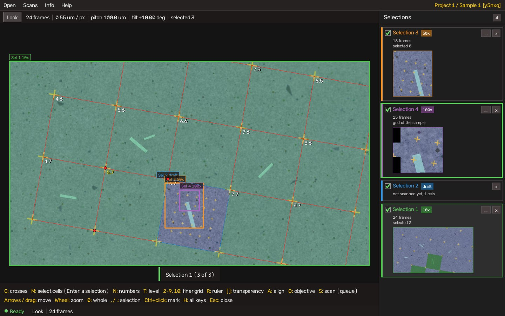
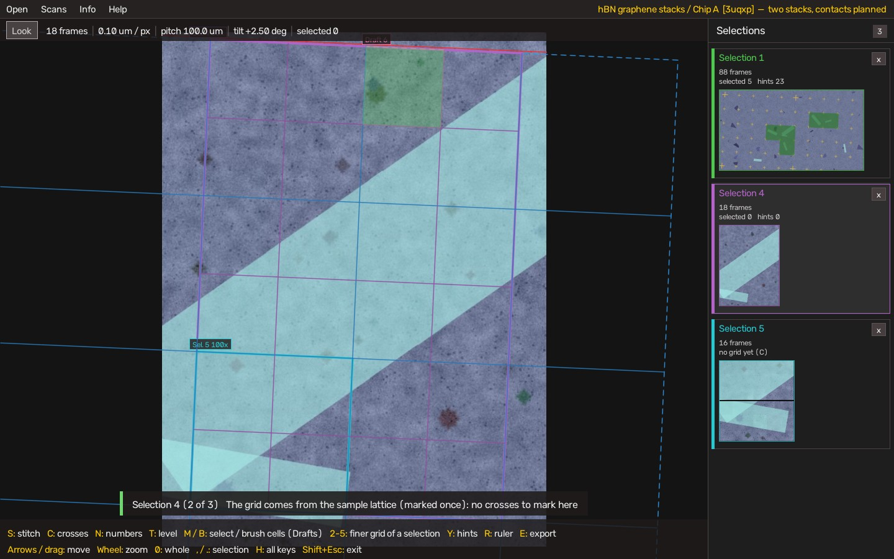
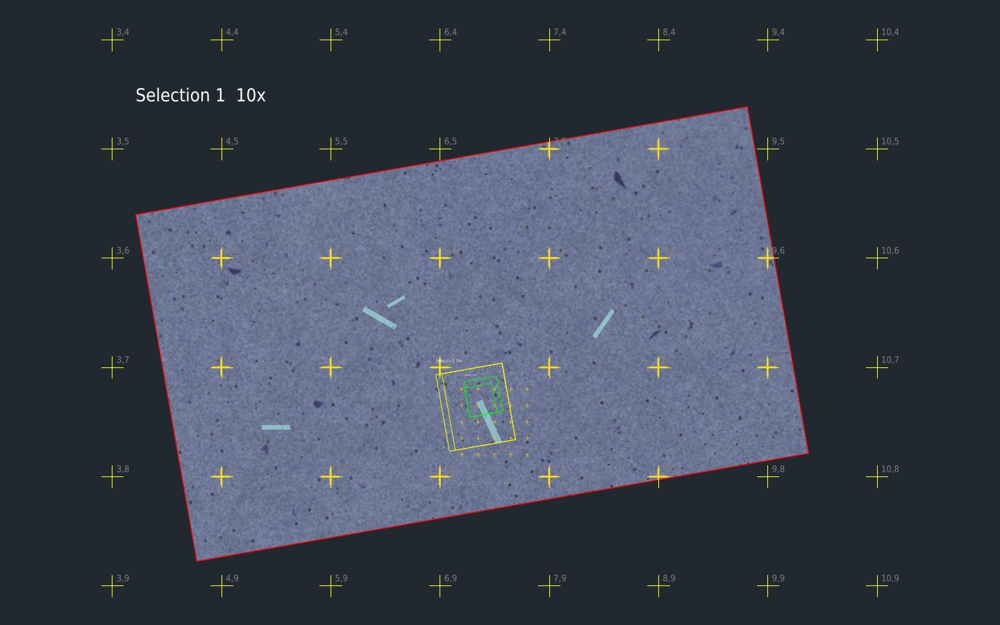

# MicroControl

**Программное управление рамановским микроскопом Optosky ATR8300 (исполнение MP, Mapping): столик, освещение, лазер, камера, автофокус, сканирование площади, склейка и подготовка изображений для обучающих выборок.**

**Полный технический справочник** (формулы, протокол, параметры, коды ошибок). Короткое введение — [README_ru.md](README_ru.md). English: [reference_en.md](reference_en.md) · 中文: [reference_zh.md](reference_zh.md).


> Независимый проект, не связан с Optosky. Предоставляется «как есть», без гарантий — см. [Отказ от ответственности](#отказ-от-ответственности) и [лицензию MIT](../LICENSE).

---

## Содержание

1. Назначение и состав системы
2. Обозначения и единицы
3. Аппаратная часть и её параметры
4. Системы координат
5. Протокол обмена с контроллером
6. Модель движения и временная диаграмма
7. Безопасность: ограничения и их обоснование
8. Камера и формирование изображения
9. Автофокусировка
10. Сканирование площади
11. Хранение данных
12. Сшивка и разметка: сшивка по перекрытиям, кресты, выделение квадратов, вывод, очистка
13. Подготовка изображений для обучающей выборки
14. Программы на G-коде
15. Ручной режим и просмотр
16. Дом микроскопа и память положения
17. Аварийная остановка и монопольный доступ
18. Симулятор
19. Установка
20. Порядок первого запуска на приборе
21. Диагностика неисправностей
22. Справочник: параметры, команды, ошибки, журнал
23. Демонстрационные программы
24. Что не проверено на приборе
25. ИИ-агенты

---

## 1. Назначение и состав системы

MicroControl — библиотека для языка Python, предназначенная для управления микроскопом из записной книжки Jupyter на компьютере, подключённом к прибору. Она заменяет штатную программу Optosky в части оптической микроскопии: перемещение столика по трём осям, освещение, лазер, съёмку, автофокусировку и автоматическое сканирование площади образца с последующей склейкой кадров.

Библиотека повторяет обмен штатной программы с контроллером: те же команды, тот же порядок, те же параметры порта (раздел 5). Протокол восстановлен по исполняемому коду штатной программы и по записям обмена с прибором.

Состав:

| Модуль | Назначение |
|---|---|
| `core` | класс `Microscope`: подключение, движение, параметры, съёмка |
| `protocol` | формат кадров обмена, перечень команд |
| `focus` | меры резкости и алгоритм автофокусировки |
| `scan`, `gcode` | зона сканирования, программа сканирования на G-коде, её выполнение |
| `storage` | хранилище кадров скана (HDF5) |
| `join` | склейка кадров в мозаику |
| `manual`, `viewer` | окно ручного управления, окно просмотра скана |
| `device` | память прибора: дом и последнее положение |
| `control` | монопольный доступ, аварийная остановка |
| `guard` | сторож: выключает прибор, если программа умерла |
| `remote` | сервер у прибора: программа на другом компьютере (net://) |
| `sim` | симулятор прибора |
| `probe` | проверка связи с контроллером |

---

## 2. Обозначения и единицы

Длины — в микрометрах (мкм), время — в секундах (с), мощность лазера — в милливаттах (мВт).

| Символ | Смысл | Значение по умолчанию |
|---|---|---|
| $\delta$ | перемещение столика за один шаг двигателя | $5\text{,}556$ мкм |
| $N$ | число шагов двигателя (целое) | — |
| $M$ | увеличение объектива | 4, 10, 20, 100 |
| $a$ | размер пикселя матрицы камеры | $2\text{,}2$ мкм |
| $p = a/M$ | размер пикселя камеры на образце | $0\text{,}22$ мкм при $M = 10$ |
| $N_x \times N_y$ | число пикселей кадра | $2592 \times 1944$ |
| $W = N_x p,\ H = N_y p$ | поле зрения (размер кадра на образце) | $570 \times 428$ мкм при $M = 10$ |
| $v$ | скорость перемещения столика | $3000$ мкм/с (принятое значение) |
| $\tau$ | пауза после перемещения (`move_pause`) | $0{,}1$ с |
| $\mathrm{NA}$ | числовая апертура объектива | 0,1 / 0,25 / 0,4 / 0,9 |
| $\lambda$ | длина волны | $0\text{,}532$ мкм (лазер) |

---

## 3. Аппаратная часть и её параметры

| Узел | Параметр | Значение | Источник |
|---|---|---|---|
| Столик X, Y | ход | $5 \times 5$ см | паспорт ATR8300MP |
| Столик Z | ход | 20 мм | паспорт |
| Столик | скорость сканирования | 20 мм/с | паспорт; совпадает с темпом команд штатной программы (2 мм за 94 мс) |
| Двигатели | перемещение за шаг $\delta$ | $1/0\text{,}18 = 5\text{,}556$ мкм по всем осям | записи обмена: 200, 300, 500, 2000 мкм в интерфейсе Optosky → 36, 54, 90, 360 шагов |
| Двигатели | концевые выключатели | на всех трёх осях | `usercfg.ini`: `DeviceMotorType=XYZLimit` |
| Контроллер | интерфейс | USB, виртуальный COM-порт STM32, VID 0483, PID 5740 | — |
| Камера | модель, матрица | MindVision MV-SUA502C, $2592 \times 1944$, пиксель $2\text{,}2$ мкм | — |
| Освещение | уровни | целые 0…5; штатная программа включает 5 | — |
| Лазер | длина волны, управление | 532 нм, мощность целыми мВт | — |
| Спектрометр | охлаждение ПЗС | элемент Пельтье с вентилятором; уставка −5 °C при работе, 20 °C при отключении | `usercfg.ini`: `CoolTemperature=-5` |
| — | зазор образец — объектив перед автофокусировкой | ≈ 1 мм | наклейка на столике |

Шум вентилятора, слышимый после запуска штатной программы, — это охлаждение ПЗС спектрометра (команда `12`, раздел 5), а не сигнал готовности столика.

---

## 4. Системы координат

Контроллер не сообщает положение столика: он принимает только относительные перемещения в шагах. Положение вычисляется программой как сумма выполненных перемещений.

Различаются три системы координат.

1. **Шаги двигателя** $(N_x, N_y, N_z)$ — внутреннее положение, целые числа.
2. **Настоящие координаты** $(X, Y, Z)$, мкм, `m.real_position`:

```math
X = \delta \cdot N_x,\quad Y = \delta \cdot N_y,\quad Z = \delta \cdot N_z,
```

отсчитываются от **дома** микроскопа (раздел 16); если дом не задан — от точки подключения.
3. **Рабочие координаты** $(x, y, z)$, мкм, `m.position` — настоящие за вычетом смещения нуля $(x_0, y_0, z_0)$, задаваемого командой `m.offset()` (G-код `G92`):

```math
x = X - x_0,\quad y = Y - y_0,\quad z = Z - z_0.
```

Смещение нуля нужно для удобства; пределы движения и дом от него не зависят.

**Направления.** $+Z$ — столик вверх, к объективу. По коду штатной программы направление задаётся байтом: X `00` — «вперёд», `FF` — «назад»; Y `00` — «влево», `FF` — «вправо»; Z `00` — вниз, `FF` — вверх. Соответствие направлений X, Y изображению на экране проверяется при первом запуске (раздел 20) и при необходимости меняется параметрами `reverse_x`, `reverse_y`, `reverse_z` (двигатель), `mirror_x`, `mirror_y`, `swap_xy` (камера).

**Поворот камеры.** На ATR8300 камера повёрнута на 90°: горизонталь экрана соответствует оси $Y$ столика, вертикаль — оси $X$. Это учитывает параметр `m.swap_xy` (на приборе по умолчанию `True`, в симуляторе — `False`). При `swap_xy` матрица перевода шагов в пиксели антидиагональна,

```math
K = \begin{pmatrix} 0 & k_y \\ k_x & 0 \end{pmatrix},\qquad k_{x,y} = \mp\frac{\delta}{p},
```

где $p$ — размер пикселя на образце, знак задаётся `mirror_x`, `mirror_y`; размер кадра в осях столика — $(h, w)$ вместо $(w, h)$. Кадр камеры на ATR8300 перевёрнут (отражён по обеим осям); `m.turn_180` (на приборе по умолчанию `True`) поворачивает его на 180° при съёмке, а матрица $K$ меняет знак, так что направления стрелок на экране сохраняются. Параметры ориентации (`turn_180`, `swap_xy`, `mirror_*`, `reverse_*`) запоминаются для каждого микроскопа по серийному номеру (раздел 16).

**Перевод микрометров в шаги.** Заданное перемещение $\Delta$ (мкм) переводится в целое число шагов

```math
N = \mathrm{round}\!\left(\frac{\Delta}{\delta}\right),\qquad |N\delta - \Delta| \le \frac{\delta}{2} \approx 2\text{,}8\ \text{мкм}.
```

Если $|N\delta - \Delta| > 0\text{,}05$ мкм, ответ команды содержит фактическое перемещение. Перемещение $|\Delta| < \delta/2$ (результат $N = 0$) отклоняется (ошибка `E214`), нулевое перемещение — тоже (`E213`).

---

## 5. Протокол обмена с контроллером

> Протокол ниже получен только посредством реверс-инжиниринга (см. [Отказ от ответственности](#отказ-от-ответственности)).

### 5.1. Физический уровень

Виртуальный COM-порт: 115 200 бит/с, 8 бит данных, без контроля чётности, 1 стоповый бит. Линии DTR и RTS выключены, как в штатной программе (класс `SerialPort` платформы .NET по умолчанию их не включает; библиотека pyserial по умолчанию включает, поэтому MicroControl выключает их явно).

### 5.2. Кадр

Каждая команда и каждый ответ — кадр

```math
\mathtt{AA}\ \mathtt{55}\ \ L_{hi}\ L_{lo}\ \ C\ \ D_1 \dots D_n\ \ S,
```

где $C$ — код команды, $D_1\dots D_n$ — данные, $L = n + 4$ — длина (2 байта, старший первым), $S$ — контрольная сумма:

```math
S = \left(L_{hi} + L_{lo} + C + \sum_{i=1}^{n} D_i\right) \mathrm{mod} 256.
```

Полная длина кадра $L + 2$ байт. Пример: запрос серийного номера `AA 55 00 04 04 08`, $S = 00 + 04 + 04 = 08$.

Ответ повторяет код команды и несёт данные. Контроллер отвечает за 1–4 мс после приёма команды, **до окончания движения**: ответ на команду движения означает «команда принята», а не «перемещение завершено».

### 5.3. Все числа — целые

Шаги двигателя — 2 байта без знака (0…65 535) и отдельный байт направления; уровень света и мощность лазера — 2 байта; температура охлаждения — байт знака (`00` или `FF`) и модуль в °C. Дробные величины не передаются. MicroControl переводит микрометры в шаги по разделу 4, а для света и лазера принимает только целые значения: `m.laser = 2.5` — ошибка `E208`, без округления.

### 5.4. Используемые команды

| Код | Команда | Данные | Ответ |
|---|---|---|---|
| `04` | серийный номер | — | текст (ASCII) |
| `03` | модель | — | текст |
| `66` | максимальная мощность лазера | — | 2 байта (`FF 00` — не задано) |
| `31` | блок калибровки | индекс `09` | данные калибровки |
| `26` | тип прибора | — | 1 байт: 0 — AutoFocus, 1 — Basic, 2 — Mapping |
| `2D` | освещение | уровень, 2 байта | — |
| `20` | лазер | мощность, мВт, 2 байта | — |
| `12` | уставка охлаждения ПЗС | знак, модуль °C | — |
| `24` | двигатели вкл./выкл. | `01` / `00` | — |
| `2E`, `2F`, `2B` | перемещение X, Y, Z | направление, $N$ (2 байта) | состояние, 1 байт |

Код состояния в ответе на перемещение (перечисления `MotorXResult`, `MotorYResult`, `MotorZResult` штатной программы):

| Байт | Смысл | Действие MicroControl |
|---|---|---|
| `00` | выполнено | — |
| `01`, `02` | достигнут концевой выключатель | направление блокируется, положение оси помечается как неподтверждённое, ошибка `E204` |
| `03` | отказ | ошибка `E306`, положение неподтверждено |
| `04` | двигатель ещё движется (команда пришла слишком рано) | ошибка `E306`, положение неподтверждено, повтор не выполняется: если команда была поставлена в очередь, повтор удвоил бы перемещение |

Все прочие коды команд контроллеру не передаются (перечень разрешённых команд; ошибка `E305`). В частности заблокированы запись калибровки (`30`), типа прибора (`25`) и максимальной мощности лазера (`65`). Уставка охлаждения допускается только −5 °C и 20 °C — значения штатной программы.

### 5.5. Последовательности подключения и отключения

| Шаг | Штатная программа Optosky | MicroControl |
|---|---|---|
| Порт | 115200 8N1, DTR = 0, RTS = 0, ожидание ответа до 5 с | так же |
| Серийный номер | `AA 55 00 04 04 08` | так же; при отсутствии ответа повтор до 3 раз |
| Модель | `AA 55 00 04 03 07` | так же |
| Макс. мощность лазера | `AA 55 00 04 66 6A` | так же |
| Калибровка | `AA 55 00 05 31 09 3F` | так же |
| Тип прибора | `AA 55 00 04 26 2A` | так же |
| Свет, уровень 5 | `AA 55 00 06 2D 00 05 38` | так же |
| Охлаждение −5 °C | `AA 55 00 06 12 FF 05 1C` | так же (`cooling=False` — не включать) |
| Двигатели вкл. (перед первым перемещением по любой оси) | `AA 55 00 05 24 01 2A` | так же |
| Перемещение X «назад», 36 шагов | `AA 55 00 07 2E FF 00 24 58` (записано) | `AA 55 00 07 2E FF 00 24 58` |
| Пауза после перемещения | 50 мс; окончания движения не ждёт | $t = N\delta/v + \tau$ (раздел 6) |
| Отключение | лазер 0 → двигатели выкл. → свет 0 → охлаждение 20 °C → закрытие порта | так же |

Подтверждено записью обмена: контроллер отвечает на серийный номер (`ATR30007`) и модель (`25312082531`) за 1–4 мс.

### 5.6. Чтение ответа и восстановление синхронизации

Драйвер виртуального порта STM32 (версия 2010 г.) не соблюдает предельное время чтения: при отсутствии ответа обычное чтение блокируется на неограниченное время. MicroControl поэтому не полагается на драйвер: он опрашивает число принятых байт и прекращает ожидание по собственному сроку (1 с для рабочих команд, 5 с для команд подключения), выдавая ошибку `E301`.

**Потеря порта.** Если дескриптор порта перестаёт быть действительным (USB-устройство переподключилось или было переведено Windows в режим экономии энергии; ошибка Windows `ClearCommError … The device does not recognize the command`), MicroControl закрывает порт, открывает его заново (до трёх попыток с интервалом 1 с), восстанавливает уровень света и охлаждение и повторяет команду — только если повтор безопасен (запросы на чтение, свет, лазер, включение двигателей). Команда перемещения не повторяется: неизвестно, была ли она выполнена; положение оси помечается как неподтверждённое, выдаётся ошибка `E307`. В ручном режиме при отсутствии обмена дольше 2 с отправляется запрос типа прибора (только чтение, в журнал не пишется), чтобы порт не переводился в режим экономии энергии. Рекомендуется отключить экономию энергии USB: «Электропитание → Изменить параметры плана → Дополнительные параметры → Параметры USB → Параметр временного отключения USB-порта → Запрещено» и в диспетчере устройств у корневых USB-концентраторов снять «Разрешить отключение этого устройства для экономии энергии».

Кадр с неверной длиной оставляет контроллер в состоянии ожидания недостающих байт; следующие кадры он воспринимает со сдвигом и не отвечает, пока не встретит заголовок `AA 55` в правильной позиции. Именно так в версиях до 0.11.1 запрос калибровки без индекса приводил к «зависанию». При подключении первый запрос повторяется до трёх раз — этого достаточно для восстановления синхронизации.

---

## 6. Модель движения и временная диаграмма

Поскольку контроллер подтверждает команду до окончания движения и не сообщает о его завершении, окончание движения определяется по времени. Перемещение на $N$ шагов разбивается на части не более $N_{\max} = 180$ шагов (1 мм); после каждой части выполняется ожидание

```math
t = \frac{|N|\,\delta}{v} + \tau,
```

где $v$ — принятая скорость двигателя (`m.motor_speed`), $\tau$ — пауза успокоения (`m.move_pause`). Между любыми двумя командами выдерживается не менее 0,06 с.

Оси перемещаются строго поочерёдно, никогда одновременно, в порядке: Z вниз → X → Y → Z вверх. Так подъём к объективу выполняется последним, когда столик уже в нужной точке плоскости.

**Выбор $v$.** Скорость двигателя задаёт контроллер; команды скорости в протоколе нет, и программа её не регулирует. Параметр $v$ — это **знание** программы о скорости, используемое только для расчёта ожидания. Ошибка безопасна лишь в одну сторону: при $v$ меньше истинной программа ждёт дольше необходимого; при $v$ больше истинной следующая команда приходит во время движения, контроллер отвечает кодом `04` и её не выполняет; программа повторяет команду через 0,03 с, пока движение не закончится (не дольше 5 с), так что шаги не теряются. Снимок, однако, может быть сделан до остановки столика, поэтому $v$ по умолчанию — 3000 мкм/с, в 6–7 раз меньше паспортной.

**Измерение $v$:** `m.measure_speed(distance=1000)`. Столик смещается на `distance` по X; камера регистрирует кадры до момента, когда изображение перестаёт меняться (разность соседних кадров ниже порога $3\sigma$ шума в течение 1 с). Принимается $v = 0\text{,}8\,v_{\text{изм}}$. Результат отвергается (`E212`, $v$ не меняется), если движение видно менее чем в трёх кадрах, если конечный кадр не отличается от начального или если $v_{\text{изм}} > 20$ мм/с: во всех этих случаях скорость была бы завышена. Измерять следует в фокусе, на участке с деталями, при включённом свете.

**Время сканирования.** Для кадра с шагом $s$ (раздел 10) время на кадр

```math
t_{\text{кадр}} \approx \frac{s}{v} + \tau + \tau_{\text{фото}} + t_{\text{эксп}} + t_{\text{запись}},
```

где $\tau_{\text{фото}}$ — `photo_pause`, $t_{\text{эксп}}$ — экспозиция. При $v = 3000$ мкм/с и $s = 570$ мкм (10x) перемещение занимает около 0,2 с; после измерения скорости — в несколько раз меньше.

---

## 7. Безопасность: ограничения и их обоснование

### 7.1. Физические соображения

Опасно только сближение образца с объективом (движение $+Z$). Перемещение в плоскости XY зазор не уменьшает.

Рабочее расстояние объектива (WD) — зазор между объективом и образцом в фокусе. Справочные значения (Olympus):

| Объектив | Обычная серия (MPLN) | Длиннофокусная серия (LMPLFLN) | Глубина резкости $\approx \lambda/\mathrm{NA}^2$ |
|---|---|---|---|
| 5x | 20,0 мм | 22,5 мм | ≈ 50 мкм |
| 10x, NA 0,25 | 10,6 мм | 21,0 мм | ≈ 8 мкм |
| 20x, NA 0,4 | 1,3 мм | 12,0 мм | ≈ 3 мкм |
| 100x | 0,21 мм (NA 0,9) | 3,4 мм (NA 0,8) | ≈ 1 мкм |

На объективе 100x прибора надпись «L PL» — длиннофокусная серия. Принятые значения WD (консервативные, `m.working_distance`): 4x — 17 мм, 10x — 10 мм, 20x — 3 мм, 100x — 2 мм. Действительное значение указано на оправе объектива (WD) и задаётся так: `m.working_distance = 3400`.

**Правило пределов.** Подъём за одну команду $\Delta z_{\uparrow} \le \min(\mathrm{WD}/3,\ 1000\ \text{мкм})$, округлённый вниз до 50 мкм: даже две ошибочные команды подряд не доводят образец до объектива. Ход по $Z$ по умолчанию — $\pm 50\,000$ мкм от точки подключения, т. е. фактически ограничен концевыми выключателями прибора (полный ход $Z$ — 20 мм); прибор сам не выходит за их пределы. Более узкий ход задаётся командой `m.set_limits` (7.2).

### 7.2. Пределы

| Ограничение | Значение | Ошибка |
|---|---|---|
| Перемещение X, Y за одну команду `move` (`max_move`) | ≤ 2000 мкм | `E201` |
| Подъём Z за одну команду (`max_move_z`) | 4x, 10x, 20x — 1000; 100x — 650 мкм (при WD 3,4 мм — 1000) | `E201` |
| Опускание Z за одну команду (`max_move_down`) | ≤ 2000 мкм | `E201` |
| Переезд `goto` или G-кода (`max_jump`) | ≤ 3000 мкм | `E210` |
| Ход X, Y от точки подключения (`xy_limit`) | ±25 000 мкм | `E202` |
| Потолок Z | $Z_{\text{подкл}} + 50\,000$ мкм (меняется `m.set_limits`) | `E203` |
| Пол Z | $Z_{\text{подкл}} - 50\,000$ мкм (меняется `m.set_limits`) | `E202` |

**Изменение пределов хода.** `m.limits` показывает текущие пределы; `m.set_limits(x=(от, до), y=(от, до), z=(от, до))` задаёт их в рабочих координатах (как `m.position`), мкм, для любого набора осей:

```python
m.set_limits(z=(-2000, 3000))                    # Z: от −2 мм до +3 мм
m.set_limits(x=(-20000, 20000), y=(-20000, 20000))
```

Требования: нижняя граница меньше верхней, текущее положение внутри, не дальше 100 мм в каждую сторону; иначе — `E208`, пределы не меняются. Новые пределы действуют до конца сеанса.

Минимального шага нет: малые шаги безопасны и необходимы (поле зрения 20x — около 285 мкм, 100x — около 57 мкм; глубина резкости — единицы мкм).

Если на приборе установлен короткофокусный объектив (например, 100x с WD 0,21 мм), его WD нужно задать обязательно: `m.working_distance = 210` даёт подъём 50 мкм за команду; потолок в этом случае разумно задать явно: `m.set_limits(z=(-50000, 100))`.

Потолок отсчитывается от положения при подключении: предполагается, что подключение выполняется, когда столик находится в безопасном положении. Объектив указывается при подключении обязательно (`E207`), поскольку от него зависят пределы по Z.

### 7.3. Проверки до движения

Все пределы проверяются **до** отправки первой команды. Программа на G-коде проверяется целиком моделированием всех её команд; при любой ошибке столик не движется, а ошибка указывает номер строки.

Неверное значение параметра или опечатка в имени вызывают ошибку немедленно (`E105`, `E206`, `E208`); при опечатке предлагается ближайшее существующее имя.

### 7.3а. Концевые выключатели

Ответ контроллера на движение указывает, **какой** концевик замкнут (по OptoSky.dll: X — `ReachForward`/`ReachBackward`, Y — `ReachLeft`/`ReachRight`, Z — `ReachTop` = 1 / `ReachBottom` = 2), а не направление движения. Если концевик лежит по направлению движения — это упор: направление блокируется (`E204`, затем `E205`), ось — под вопросом. Если концевик с противоположной стороны (столик стоял на нём в начале движения и уходит от него) — движение продолжается, в журнал пишется предупреждение `MOV-012`. Автофокусировка, упёршись в концевик, сокращает окно и продолжает работу (`AF-003`). `m.confirm_position()` снимает и блокировку направления.

### 7.4. Неподтверждённое положение

**Между сеансами** координаты продолжаются (с домом и без него): шаговый столик стоит, где его оставили, последнее положение пишется в память прибора после каждого движения, поэтому выделения образца остаются на своих местах. При отключении (и при закрытии ручного режима) запоминается кадр камеры; при следующем подключении картинка сверяется с ним: та же — положение подтверждено; со сдвигом — столик двигали рукой или другой программой, координаты поправляются на этот сдвиг; другая (другой образец) — положение остаётся как было, без вопросов (сообщение; маски сами садятся на кресты). Так же, если прошлый сеанс закончился посреди движения. После срабатывания концевого выключателя, потери ответа или кода `03`/`04` во время работы положение оси считается неподтверждённым. В этом состоянии `goto`, G-код и сканирование заблокированы (`E211`); `move` и ручной режим работают. Снятие блокировки — `m.confirm_position()` после проверки, что столик там, где ожидается.

### 7.5. Заблокированные функции

Лазер включается только при подключении с `allow_laser=True` и не выше `laser_max`. Поиск концевых выключателей (`m.find_limits()`, `G28`) — только с `allow_homing=True`: сигнал концевиков на приборе ещё не проверен.

---

## 8. Камера и формирование изображения

Камера работает через SDK MindVision (`MVCAMSDK_X64.dll`). При подключении отключаются автоматическая экспозиция и программное повышение резкости (оно искажает меру резкости автофокуса). После каждого перемещения первые 2 кадра отбрасываются, чтобы снимок не содержал смаза от движения.

Размер пикселя на образце $p = a/M$ (`pixel_size`), поле зрения $W \times H = N_x p \times N_y p$ (`m.frame_size`). Камера считается установленной без поворота относительно осей столика; знаки направлений задаются параметрами `mirror_x`, `mirror_y`.

| Команда | Действие |
|---|---|
| `m.image()` | текущий кадр (массив numpy, порядок каналов BGR) без сохранения |
| `m.photo(name)` | снимок в `photos/<дата>/` |
| `m.exposure = 20` | экспозиция, мс |
| `m.white_balance()` | однократный баланс белого по текущему кадру (наводить на пустой участок) |
| `m.dark_frame()` | тёмный кадр: свет выключается, усредняются 16 кадров |
| `m.empty_frame()` | кадр однородного поля: пустой участок, усредняются 16 кадров |
| `m.sharpness` | резкость текущего кадра |

Опорные кадры записываются в `references/` как 16-битные PNG; значение пикселя равно среднему, умноженному на 256 (сохраняется точность усреднения).

---

## 9. Автофокусировка

### 9.0. Автофокус по глубине резкости (по умолчанию)

Глубина резкости объектива (волновая часть плюс геометрическая, $e = 2{,}2$ мкм — пиксель матрицы, $\lambda = 0{,}55$ мкм):

```math
d = \frac{\lambda n}{\mathrm{NA}^2} + \frac{n\,e}{M\cdot\mathrm{NA}}.
```

| Объектив | NA | $d$, мкм | шаг поиска $d/2$, мкм |
|---|---|---|---|
| 4x | 0,10 | 60,5 | 30 |
| 10x | 0,25 | 9,7 | 4,8 → шаг мотора 5,6 |
| 20x | 0,40 | 3,7 | 1,9 → 5,6 |
| 50x | 0,75 | 1,0 | 0,5 → 5,6 |
| 100x | 0,90 | 0,7 | 0,35 → 5,6 |

NA — типичные значения (`OBJECTIVES` в `config.py`, поправить под свои объективы).

`m.focus()`:
1. **Центр окна** — ожидаемый $Z$ по точкам фокуса из `m.manual()` (4 ближайшие, веса $1/r^2$), без них — текущий $Z$.
2. **Окно** $\pm 4d$ (не меньше 3 шагов мотора), **шаг** $d/2$ (не меньше шага мотора $\delta$). На 10x — 15 кадров вместо 35–40.
3. **Проход снизу вверх**, к лучшему $Z$ столик тоже подходит снизу: люфт выбирается одинаково, и найденный $Z$ повторяется.
4. **Резкость** — среднее по 2 кадрам, кадр сглажен ($\sigma = 1$ px: шум не считается деталью), делится на квадрат средней яркости (не зависит от экспозиции).
5. **Пик** уточняется параболой по $\ln S$ (профиль резкости близок к гауссову), затем округляется до шага мотора.
6. Пик на краю окна — окно сдвигается туда (до 2 раз). Кривая плоская (пик/минимум < 1,15) — фокус далеко, выполняется широкий поиск (9.1).

Широкий поиск напрямую: `m.focus(wide=True)`.

**Ограничение по столику.** Если шаг двигателя $Z$ больше глубины резкости ($\delta = 5{,}56$ мкм при 20x, 50x, 100x), столик может остановиться до $\delta/2 = 2{,}8$ мкм от самого резкого места, а это 0,8–4 глубины резкости; `m.focus()` выводит предупреждение «Limit». Шаг $\delta$ для $Z$ принят равным шагу X, Y; если у привода $Z$ шаг мельче, его нужно задать отдельно.

Проверка в симуляторе (10x, люфт $Z$ 3 шага = 17 мкм, фокус между шагами): из 5 начальных положений от −60 до +70 мкм столик встаёт в ближайший к фокусу шаг (ошибка 0,4–0,6 шага, меньше нельзя).

### 9.1. Меры резкости

Резкость вычисляется по центральной половине кадра (по каждой стороне), переведённой в полутоновое изображение $I(x, y)$ и уменьшенной в $k$ раз:

| `focus_method` | Мера $F$ |
|---|---|
| `laplacian` (по умолчанию) | $\mathrm{Var}\!\left(\nabla^2 I\right)$ — дисперсия лапласиана |
| `tenengrad` | $\langle G_x^2 + G_y^2 \rangle$, $G_{x,y}$ — градиенты оператора Собела |
| `brenner` | $\langle (I(x+2, y) - I(x, y))^2 \rangle$ |
| `variance` | $\mathrm{Var}(I) / \langle I \rangle$ — нормированная дисперсия |

### 9.2. Широкий поиск

Глубина резкости объектива может быть меньше шага поиска (10x: около 8 мкм при шаге 20 мкм), и мелкие детали резки лишь в узком интервале $Z$. Поэтому поиск выполняется в два прохода.

1. **Грубый.** От $\min(Z_0 + R, Z_{\text{потолок}})$ вниз до $\max(Z_0 - R, Z_{\text{пол}})$ с шагом $s_f$, где $R$ — `focus_range`, $s_f$ — `focus_step`; мера вычисляется по кадру, уменьшенному в $k = 8$ раз. Крупные детали различимы и при расфокусировке, поэтому максимум широкий и не пропускается. Проход прекращается, когда пройдено не менее 4 точек, текущее $Z$ ниже лучшего на $2 s_f$ и $F < 0\text{,}6\,F_{\max}$.
2. **Точный.** Интервал $\pm s_f$ вокруг найденного максимума с шагом в один шаг двигателя $\delta$, мера по кадру, уменьшенному в $k = 2$ раза.

К лучшему положению столик подходит сверху: сначала поднимается на $s_f$ выше, затем опускается. Так исключается люфт механизма.

**Контраст пика**

```math
C = \frac{F_{\max}}{\mathrm{median}(F)}
```

по точкам грубого прохода. При $C < 1\text{,}3$ максимум считается неопределённым (в кадре мало деталей): ответ содержит предупреждение, журнал — запись уровня WARNING.

Окно и шаг по умолчанию:

| Объектив | `focus_range`, мкм | `focus_step`, мкм |
|---|---|---|
| 4x | ±2000 | 100 |
| 10x | ±1000 | 50 |
| 20x | ±500 | 25 |
| 100x | ±100 | 10 |

### 9.3. Ограничение разрешения по Z

Шаг двигателя по Z $\delta = 5\text{,}56$ мкм больше глубины резкости объективов 20x (≈ 3 мкм) и 100x (≈ 1 мкм). Если перемещение за шаг по Z на приборе действительно равно $\delta$, на этих объективах положение наилучшей резкости может не совпасть ни с одним доступным положением столика. Это требует проверки на приборе (раздел 24).

---

## 10. Сканирование площади

### 10.1. Зона и сетка кадров

Зона задаётся двумя углами $A = (x_A, y_A)$ и $B = (x_B, y_B)$ — центрами крайних кадров, обычно клавишами `1` и `2` в ручном режиме (раздел 15); либо явно: `m.area = mc.Area(x0, y0, x1, y1)`.

Шаг сетки при перекрытии $q$ (`overlap`, $0 \le q \le 0\text{,}5$) округляется вниз до целого числа шагов двигателя, чтобы между кадрами не было промежутков:

```math
s_x = \delta \left\lfloor \frac{W(1 - q)}{\delta} \right\rfloor,\qquad s_y = \delta \left\lfloor \frac{H(1 - q)}{\delta} \right\rfloor.
```

Число кадров

```math
n_x = \left\lceil \frac{|x_B - x_A|}{s_x} - 0\text{,}05 \right\rceil + 1,\qquad n_y = \left\lceil \frac{|y_B - y_A|}{s_y} - 0\text{,}05 \right\rceil + 1;
```

допуск 0,05 исключает лишний кадр из-за погрешности округления. Затем кадры раскладываются равномерно от угла до угла, $s'_x = |x_B - x_A| / (n_x - 1) \le s_x$ (так же по $y$): первый кадр стоит в $A$, последний — точно в $B$, перекрытие не меньше $q$. Обход — «змейкой» (`path='snake'`, чётные строки в обратном порядке) или построчно (`path='rows'`).

### 10.2. Фокус при сканировании

| `focus` | Метод | Когда применять |
|---|---|---|
| `'plane'` | автофокус в точках редкой сетки (через `focus_every` кадров, плюс углы зоны); через точки по методу наименьших квадратов проводится плоскость $z = \alpha x + \beta y + \gamma$; $Z$ каждого кадра берётся с неё | ровные образцы (пластины, стёкла): учитывается наклон образца |
| `'each'` | автофокус в каждом кадре | неровные образцы |
| `'auto'` (по умолчанию) | если в `m.manual()` заданы точки фокуса — как `'points'`, иначе как `'off'` | — |
| `'points'` | $Z$ каждого кадра — по точкам фокуса из `m.manual()` (углы `1`, `2` и клавиша `K`): 4 ближайшие точки с весами $1/d^2$, $z(\mathbf{r}) = \sum w_i z_i / \sum w_i$; автофокус не выполняется | наклонная подложка: $Z$ меняется плавно, малыми шагами |
| `'off'` | $Z$ не меняется: фокус выставляется один раз в `m.manual()` | всегда, если образец ровный: смена $Z$ сдвигает картинку по X и Y (люфт, перекос оси) и портит сшивку |

Точки с контрастом $C < 1\text{,}3$ в плоскость не включаются (о числе пропущенных сообщается). Если хороших точек меньше трёх, плоскость принимается горизонтальной; если их нет, сканирование не начинается (`E603`). Если отклонение точек от плоскости больше `focus_step`, выдаётся рекомендация `focus='each'`.

**Повторная съёмка размытых кадров** (`refocus=True`). Кадр $k$ считается размытым, если

```math
F_k < 0\text{,}5\,\mathrm{median}(F_{k-20}, \dots, F_{k-1})
```

(при не менее чем 5 предыдущих кадрах). Такой кадр снимается повторно после автофокусировки; признаки `refocused` и `blurry` записываются в `index.csv`.

### 10.3. Выполнение

`m.plan()` формирует программу сканирования на G-коде (её можно прочитать и изменить); `m.scan()` её выполняет. Перед планом камера проверяет знаки осей (`m.check_orientation()`: сдвиг на 20% кадра по X и Y и обратно; при неверном знаке кадры склеились бы в обратном порядке) и при необходимости исправляет `swap_xy`, `mirror_x`, `mirror_y`; отключение — `m.scan_check = False`. Кадры по умолчанию сохраняются как JPG в `frames/` (`frame_format = 'jpg'`, качество `jpg_quality` = 90) уменьшенными до `frame_scale` = 0,5: размер пикселя 0,44 мкм на 10x — всё ещё в 3 раза мельче оптического разрешения ($\approx 0\text{,}61\lambda/\mathrm{NA} \approx 1\text{,}3$ мкм), так что деталей не теряется, а объём меньше примерно в 30 раз; без потерь — `m.frame_format = 'h5'`, `m.frame_scale = 1`. Для каждого кадра: переезд в координаты (в настоящих координатах, `G53`, поэтому смена рабочего нуля после построения плана не сдвигает съёмку), $Z$ с плоскости фокуса, пауза `photo_pause`, снимок. Экспозиция фиксируется на всё сканирование. `m.scan()` возвращает путь к папке скана.

**Ожидаемое время.** Перед сканом MicroControl пишет ожидаемое время (оно же — в подписи мини-карты и в карусели). Первая оценка — по физике (переезды, паузы, экспозиция, запись); после каждого законченного скана настоящее время запоминается для этого микроскопа и этих настроек (объектив, способ фокуса, паузы, проверки, формат кадров) — до 20 последних сканов в файле памяти прибора — и по ним МНК подгоняется прямая $T = T_0 + t\,N$ ($N$ — кадров). Вес выученного растёт с числом сканов: $w = n/(n+2)$ (1 скан — 33 %, 10 — 83 %). «Left» полосы прогресса начинается с этого ожидания и по ходу скана переходит к настоящему темпу.

---

## 11. Хранение данных

```
scans/<дата>_<время>_<объектив>_<название>/      одна область; несколько образцов — папка сеанса:
  session.json       список образцов: номер, цвет, область, точки фокуса
  sample_01/, sample_02/, …   каждая — обычная папка скана (как ниже)
  meta.json          объектив, размер пикселя, поле зрения, шаг двигателя, матрица перевода шаги→пиксели,
                     зона, камера и экспозиция, свет, параметры фокуса, паузы, скорость, опорные кадры,
                     смещение нуля, сведения о приборе, состояние, число кадров
  index.csv          строка на кадр: id, batch, slot, row, col, x_um, y_um, z_um, x_p, y_p, z_p,
                     sharpness, refocused, blurry, t_s
  program.gcode      выполненная программа
  batches/b0000.h5   пачки по batch_size кадров (HDF5, по умолчанию 100; m.batch_size = 2 — файлы закрываются часто)
  jpg/00001_r001_c001.jpg   каждый кадр сразу после снимка, уменьшенный в jpg_scale раз (m.save_jpg = False — не писать)
  join/              результаты склейки
```

В каждом файле `bNNNN.h5` два набора: `tiles` — кадры без потерь (сжатие gzip), разбитые на блоки $4 \times 4$ (любая часть кадра читается без распаковки целого кадра); `thumbs` — уменьшенные в 16 раз копии для просмотра. Сбой при записи повреждает не более одной пачки.

Доступ к кадрам:

```python
st = mc.ScanData(folder)
ids = st.query(x=(0, 2000), y=(0, 1000))      # кадры, задевающие прямоугольник (мкм)
img = st.frame(ids[0], crop=0.5)              # центральная половина кадра
for i, img in st.frames(ids): ...             # перебор с чтением пачками
st.export()                                    # PNG-файлы и TileConfiguration.txt для Fiji
```

---

## 12. Сшивка и разметка (основной путь)

**Порядок работы.**
1. `m.manual()`: области образцов — углы `1`, `2`, одна область за другой (несколько образцов — раздел 15).
2. Фокус по углам: на каждом углу навести фокус (`E`/`Q`) и нажать `1`/`2` (углы зоны) и `K` (остальные углы). Галочка «Z follows the focus points» (`Y`, по умолчанию включена): $Z$ каждого кадра скана — по 4 ближайшим точкам его области с весами $1/d^2$; в ручном режиме внутри области с 2 и более точками фокуса каждый шаг стрелкой тоже ставит $Z$ так же (вверх — не больше `max_move_z`). Без галочки стрелки $Z$ не трогают, скан идёт на одном $Z$.
3. `folder = m.scan()` — кадры с перекрытием 30 %, на 50x и 100x — 35 % (`scan_overlap` в `config.py`). Перед каждым снимком два кадра подряд сравниваются фазовой корреляцией: если картинка ещё сдвигается больше чем на 1 px (столик не успокоился), снимок откладывается (`m.still_check`). Экспозиция и баланс белого на время скана — ручные (не плывут от кадра к кадру).
4. `mc.stitch(folder)` — точные положения кадров по перекрытиям (12.1). Один раз на объектив — `mc.distortion(folder)` (12.5).
5–7. `mc.view(folder)` — точная сшивка (`Shift+J`), кресты (`C`), ровный вид (`T`), выделение квадратов (`M`), номера (`N`), линейка (`R`) (12.2).
8. `mc.export(folder)` — только выделенные квадраты: PNG (прозрачный фон) или JPG, DXF для AutoCAD (12.3).
9. `mc.clean(folder)` — показать, `mc.clean(folder, confirm=True)` — удалить кадры и прочие рабочие файлы.

Мозаика целиком в память не собирается: просмотр и вывод берут из кадров только нужные участки по найденным положениям.

### 12.1. Сшивка по перекрытиям (`mc.stitch`)

На идеях ASHLAR (Muhlich et al., *Bioinformatics* 38, 4613, 2022), MIST (Chalfoun et al., *Sci. Rep.* 7, 4988, 2017) и BigStitcher (Hörl et al., *Nat. Methods* 16, 870, 2019; Preibisch et al., *Bioinformatics* 25, 1463, 2009); своя реализация, без Java. Рассчитана на сотни и тысячи кадров.

1. **Соседи** — пары кадров, чьи прямоугольники по столику перекрываются хотя бы на 30 % от наибольшего перекрытия (уголки по диагонали отбрасываются). Ищутся через сетку клеток размером с кадр, а не все со всеми.
2. **Сдвиг пары, грубо.** Полосы общей части фильтруются лапласианом гауссиана (детали остаются, плавный фон уходит), уменьшаются примерно до $3\cdot10^4$ px, умножаются на окно Ханна и дополняются нулями вдвое. Корреляция с частично нормированным спектром
   ```math
   r = \mathcal{F}^{-1}\!\left[\frac{F_B F_A^{*}}{|F_B F_A^{*}|^{0.25}}\right]
   ```
   Чистая фазовая корреляция (степень 1) поднимает высокие частоты, где после фильтра остались только шум и рисунок сенсора; они привязаны к кадру, и их пик встаёт на предсказание столика. Со степенью 0.25 найденный сдвиг не зависит от ошибки столика. Кандидаты — 5 высших пиков в пределах `max_shift_um` = 40 мкм от предсказания; каждый проверяется совпадением картинок ($e = 1 - \mathrm{NCC}$), побеждает лучший (повторяющийся узор, шум).
3. **Сдвиг пары, точно** — Лукас — Канаде по общей части в полном разрешении:
   ```math
   \boldsymbol\delta = (G^{\top}G)^{-1}G^{\top}(a - \tilde b),\qquad G = \nabla\tilde b,
   ```
   где $\tilde b$ — кадр $b$, сдвинутый на текущую оценку (яркость и контраст выровнены); 2–6 шагов. Нет тяги к целому пикселю (у пиков фазовой корреляции она есть: до 0.18 px на шов, вдоль ряда копится): на тестовой текстуре ошибка 0.003 px.
4. **Тест перестановок.** Та же геометрия, но вместо соседа — далёкий кадр: ошибки заведомо ложных пар. Порог — их 1-й процентиль. Шов, не найденный у предсказания, ищется по **кадрам целиком** без столика (как в MIST): столик мог ошибиться больше перекрытия (люфт на 50x и 100x).
5. **Модель столик → пиксели** по принятым швам: $\mathbf{d}_{ij} = M\,\Delta\mathbf{p}_{ij} + B\,\Delta\mathbf{s}_{ij}$. $M$ ($2\times2$) учитывает поворот камеры, неточный шаг мотора и перекос; $\mathbf{s}_k$ — с какой стороны столик подъехал к кадру $k$ (пишет скан, `dir_x`, `dir_y`), $B$ — люфт по каждой оси (только где он отличим от шага). Положение кадра по модели: $\hat{\mathbf{r}}_k = M\mathbf{p}_k + B\mathbf{s}_k$.
6. **Швы далеко от модели.** Модель точна до пикселя-двух, поэтому шов дальше $\max(4, 5\sigma_m)$ px от неё ($\sigma_m = 1.48\,\mathrm{med}\,|\mathbf{d}_{ij} - (\hat{\mathbf{r}}_j - \hat{\mathbf{r}}_i)|$) — обычно соседний период узора (кресты на размытом кадре) или совпадение шума. Он меряется заново в узком окне вокруг модели; найденные по кадрам целиком остаются, только если согласны с моделью, построенной вместе с ними (ось люфта, которой первая модель не знала); остальные — прочь.
7. **Положения** — разреженный взвешенный МНК (сопряжённые градиенты с диагональным предобуславливателем, без плотных матриц: 3000 кадров за 0.2 с):
   ```math
   \min \sum_{(i,j)} \frac{\bigl|\mathbf{r}_j - \mathbf{r}_i - \mathbf{d}_{ij}\bigr|^2}{\sigma_{ij}^2}
   + \sum_{(i,j)} \frac{\bigl|\mathbf{r}_j - \mathbf{r}_i - (\hat{\mathbf{r}}_j - \hat{\mathbf{r}}_i)\bigr|^2}{\sigma_{st}^2}
   + \varepsilon^2\sum_i \bigl|\mathbf{r}_i - \hat{\mathbf{r}}_i\bigr|^2,
   ```
   $\sigma_{ij} = 0.1 + 10\,e_{ij}$ px (слабое совпадение — грубое измерение), $\sigma_{st}$ — разброс шага столика относительно модели, измеренный по хорошим швам («повторяемость» в MIST), $\varepsilon = 0.01$. Столик держит **шаг между соседями**, а не место кадра: его ошибка плавная, соседи сдвинуты вместе. Выбросы: веса Коши с масштабом от $\infty$ до 2 px; затем, как в BigStitcher, худший из сильных швов убирается, пока он намного хуже остальных.
8. **Второй раунд.** Где столик сильно ошибся или шов не согласен с остальными, шов меряется заново от найденных положений (только Лукас — Канаде; полный поиск, если не сошлось), и положения решаются ещё раз.

Швы сохраняются (`join/seams.npz`): просмотр по ним заново расставляет кадры за доли секунды, когда шов выключают или включают (`J`, 12.2).

Проверка на симуляторе (люфт 3 шага = 16.7 мкм, положения — против истинных положений столика):

| скан | ошибка раньше (медиана / p95 / макс., px) | сейчас |
|---|---|---|
| 10x, 208 кадров | 0.99 / 135 / 136 | 0.11 / 0.22 / 0.28 |
| 10x, 1044 кадра (458 размытых: образец наклонён) | 3.2 / 41 / 199 | 0.40 / 1.3 / 1.6 |
| 50x, 56 кадров, люфт 1 шаг | 4.0 / 183 / 185 | 0.32 / 0.72 / 0.80 |
| 100x, 77 кадров, люфт 1 шаг | 175 / 247 / 371 | 0.68 / 1.65 / 1.99 |

Время: 1044 кадра 640 × 480 за 65 с на 2 ядрах. Найденный люфт: 16.7 мкм (истинный 16.7). Настоящий ASHLAR: `mc.stitch(folder, engine='ashlar')` (нужны `pip install ashlar` и Java).

**Оптические поправки** (применяются при чтении кадров для сшивки, просмотра и вывода):
- *освещение*: поле $F_c(x, y)$ для каждого цвета $c$ — медиана до 60 кадров, каждый поделён на свою медиану, сглаженная, $\langle F_c\rangle = 1$; кадр $I'_c = I_c/F_c$ (`join/flatfield.npy`);
- *яркость кадров*: множители $a_i$ для каждого кадра и цвета по перекрытиям, $I''_i = a_i I'_i$ (`join/gains.npy`); оба считаются при каждой сшивке, `flat=False` — без них;
- *дисторсия* (12.5), если она измерена для этого микроскопа и объектива.

Результат: `join/positions_all.csv`, `join/stitch.json`, `join/seams.npz` (швы), `join/preview_all.jpg` (уменьшенная мозаика), `viewer/levels/` (кадры, уменьшенные в 2, 4, 8 раз — для просмотра больших сканов).

### 12.2. Разметка в просмотре (`mc.view`)


**Одна буква — один смысл в обоих окнах.** Клавиши только одного окна в другом говорят об этом (и ничего не делают).

| Клавиша | Смысл | Окно микроскопа (`m.manual()`) | Просмотр (`mc.view(folder)`) |
|---|---|---|---|
| стрелки, колесо, `+` / `-`, `0` | двигать, масштаб, всё целиком | столик на кадр (шаг X, Y); карта | картинка |
| `,` `.` | предыдущее / следующее выделение | ✓ | ✓ |
| Ctrl+щелчок | отметить несколько | карточки (Merge / Minus / Overlap над списком) | карточки и картинка |
| `Enter` | подтвердить | поехать к выбранному | выбранные клетки -> выделение (выбрано и здесь, и там); записать совмещение |
| `Del` | удалить | выбранное / новое (Ctrl+Z вернёт) | отмеченные / выбранное (не снятые); в режиме крестов — кресты заново |
| `S` | съёмка: в очередь | выбранное / отмеченные (Scan area) | выбранное / отмеченные (в очередь окна микроскопа) |
| `J` | сшивка | сверка живого кадра с мозаикой; `Shift+J` — точная (quality) сшивка выбранного (Stitch) | правка швов руками (quick — сначала её quality-сшивка); `Shift+J` — quality-сшивка в очередь окна микроскопа |
| `X` | экспорт | всё с галочкой -> `<образец>/export/` (Export) | то же |
| `O` | объектив | тот, что стоит: следующий (поставить его) | выбранного / отмеченных выделений; `Shift+O` — для новых |
| `[` `]` | прозрачность | картинка выбранного на карте | картинка выбранного / отмеченных |
| `R` | линейка | два щелчка | точка-точка -> прямая-прямая -> точка-прямая -> выкл |
| `T` | повернуть картинку | камера на 180° (помнится) | ровно по решётке / как снято |
| `M` · `C` · `N` | клетки · кресты · номера | — | выбирать клетки (`Ctrl+A` — все / ни одной) · отмечать кресты (`Shift+C` — кадры на кресты) · номер квадрата |
| `P` · `G` · `A` · `Y` | профили · ровные края · совместить · другие | — | линии профилей (4 щелчка) · срезать ступеньки · совместить эту съёмку с другими (Пробел — само) · картинки других выделений вкл / выкл |
| `U` | контур | — | выделение по углам: стороны только поперёк / вверх-вниз, привязка к крестам и углам; Enter или первый угол замыкает |
| `E` / `Q` (`PgUp` / `PgDn`) · `F` · `K` · `1` / `2` | столик вверх / вниз · автофокус · точка фокуса · углы | ✓ (`Shift` — ×5) | — |
| `L` · `I` · `W` · `Пробел` · `V` | свет · лазер · баланс белого · снимок · открыть просмотр | ✓ | — |
| `Tab` или щелчок по полю | шаги, экспозиция, объектив | ✓ | — |
| `Ctrl+Z` · `Ctrl+Y` | отменить · вернуть | ✓ (и движения) | ✓ |
| `H` · `Esc` | все клавиши · выйти из режима / снять отметки | ✓ | ✓; `Esc`, когда ничего не открыто, — **закрыть просмотр** |
| `Shift+Esc` | закрыть | окно микроскопа (только так) | ✓ |
| `Ctrl+P` | панель Settings (слева) | показать / спрятать | — |

**Панель Settings** окна микроскопа (кнопка Settings, стрелка слева или `Ctrl+P`): Z по точкам фокуса, подъезд с одной стороны (люфт), **Prepare**, **Distortion** (дисторсия), **Zero here** (ноль здесь), **Steps = frame** (шаг = кадр), **Check directions** (проверить направления), **Arrows X / Y** (стрелки в другую сторону), **Map 90 deg** (повернуть карту). Сверху: Prepare, New area, Scan area, Stitch, Export, Settings; меню: Open, New, Info, Scans (история выбранного: View, Make main), Queue, View, Help. Ctrl+тянуть по карте — рамка на объективе, что стоит (кристалл); `Esc` во время дела — остановить.


Решётка всегда **квадратная**: $\mathbf{v}_2 = \mathbf{v}_1$, повёрнутый на 90° (никакого перекоса и «проекции»); неизвестных четыре — начало $\mathbf{O}$, шаг и наклон, — они находятся МНК по отметкам. Двух соседних крестов достаточно; дальние кресты уменьшают ошибку наклона пропорционально расстоянию. `Shift+C` в просмотре — по желанию подогнать ту же квадратную решётку по всем крестам мозаики. Проверка в симуляторе (наклон 3,5°): 2 соседних креста и 2 дальних — шаг 99,998 мкм, наклон 3,494°. Отметки и выделение хранятся в `grid.json` (в пикселях мозаики; после повторной сшивки отметки переезжают вместе с кадрами).

**Центр креста** ищется шаблоном «+» с тёмной каймой (подходит и к тонким тёмным крестам, и к рельефным светлым с контуром); каждый кандидат проверяется на симметрию креста при повороте на 90° и 180° — номера литографии рядом с крестом так не симметричны и центр не уводят. Размер креста (плечо, px) подбирается сам при подгонке решётки: берётся тот, при котором найденные центры лучше всего ложатся на решётку, и запоминается в `grid.json` (`arm_px`). Проверка на снимках образцов с номерами у крестов: решётка по 13 крестам — 0,52 px СКО, по 11 крестам — 1,1 px.

**Номера квадратов.** Индексы решётки $(i, j)$ условны (отсчёт от первой отметки). Литографские номера переводятся так:

```math
\begin{pmatrix}X\\Y\end{pmatrix} = P\begin{pmatrix}i\\j\end{pmatrix} + \mathbf{t},
```

$P$ — перестановка осей со знаками (8 вариантов: какая ось решётки — $X$, в какую сторону растёт). Подбираются $P$ и $\mathbf{t}$, при которых все подписи выполняются точно. Одна подпись задаёт только $\mathbf{t}$ (направления — по умолчанию: $X$ вправо, $Y$ вниз на экране); подпись второго квадрата **в другом ряду и столбце** задаёт направления обеих осей — и номера всех квадратов. Номер пишется в левом верхнем углу каждого квадрата (подписанные — жёлтым); при несогласных подписях — предупреждение. Номера идут в `selection.json` (`names`), в DXF (слой LABELS) и в имена файлов квадратов (`square_X+012_Y+007.png`). Распознавать цифры не нужно: двух подписей достаточно.

**Производительность** (сетка 30 × 30 кадров, 900 кадров 1296 × 972, 2 ядра): сшивка 67 с, память ≤ 0,6 ГБ; открытие просмотра 0,1 с; кадр окна при любом масштабе 7–63 мс, при перетаскивании 2–25 мс. Мелкий масштаб рисуется из обзорной мозаики `join/preview_all.jpg`, средний — из уменьшенных копий кадров `viewer/levels/` (пишутся при сшивке), крупный — из кадров; кэш копий ограничен 400 МБ.

### 12.3. Вывод выделенного (`mc.export`)

Каждый выделенный квадрат (с запасом 16 px) собирается прямо из кадров: пиксель $(u, v)$ квадрата $(i, j)$ берётся из точки мозаики $\mathbf{O} + i\mathbf{v}_1 + j\mathbf{v}_2 + \tfrac{u}{a}\mathbf{v}_1 + \tfrac{v}{b}\mathbf{v}_2$; перекрывающиеся кадры смешиваются **по частотам** (пирамида Лапласа, 5 уровней): каждый пиксель отдаётся кадру с наибольшим весом (вес спадает к краю кадра), маски сглаживаются по уровням — мелкие детали без двоения, плавная яркость без ступеньки на шве. `blend='feather'` — простое смешивание весами. Квадраты ставятся в сетку без поворота, стык — точно по крестам.

- `export/selection.png` — только выделенное, остальное прозрачно (`fmt='jpg'` — белый фон);
- `export/selection.dxf` — DXF R12, единицы мкм: слой `SQUARES` — стороны квадратов, `OUTLINE` — внешний контур выделения, `LABELS` — номера $(i, j)$;
- `export/selection.json` — список квадратов, шаг решётки (мкм), поворот, размер пикселя вывода;
- `cells=True` — ещё и каждый квадрат отдельным файлом (`export/squares/`).

Память ограничена `max_mb` (по умолчанию 2000 МБ): при большой рамке выделения изображение уменьшается.

### 12.5. Дисторсия, сшивка по крестам, чертёж по крестам

**Модель.** Точка ровного кадра $\mathbf{u}$ ($\mathbf{v} = \mathbf{u} - \mathbf{c}$, $\rho^2 = |\mathbf{v}|^2/R^2$, $R$ — половина диагонали кадра) на снимке стоит в $\mathbf{u} + \Delta(\mathbf{v})$:
$$\Delta = k_1\mathbf{v}\rho^2 + k_2\mathbf{v}\rho^4 + \tfrac{1}{R}\bigl(p_1\,2xy + p_2(3x^2+y^2),\; p_1(x^2+3y^2) + p_2\,2xy\bigr),$$
радиальная ($k_1, k_2$) и от децентровки ($p_1, p_2$); линейна по $\theta = (k_1, k_2, p_1, p_2)$.

**Калибровка** (`m.calibrate_distortion()`, кнопка Distortion на панели Settings окна микроскопа): 3×3 кадра с перекрытием 50 % вокруг любых деталей. Каждое перекрытие режется на кусочки (~1/10 кадра); у каждого меряется точный сдвиг $\mathbf{r}_a - \mathbf{r}_b$. Уравнение на кусочек: $\mathbf{P}_b - \mathbf{P}_a + \theta\cdot[\varphi(\mathbf{r}_a) - \varphi(\mathbf{r}_b)] = \mathbf{r}_a - \mathbf{r}_b$ ($\varphi$ — четыре базисных поля): положения кадров и $\theta$ вместе, МНК с весами против выбросов. Ни кресты, ни точность столика не нужны. Хранится для объектива и пишется в `meta.json` каждого скана. Симулятор: из 0.88 px (СКО, нелинейная часть поля) остаётся 0.09 px.

**Сшивка по крестам** (`mc.fit_crosses(folder)`, `Shift+C` в просмотре): неизвестные — положения всех кадров, квадратная решётка $(O, \mathbf{a})$, $\theta$. Каждый крест $(i, j)$, найденный в **сыром** кадре $k$ в точке $\mathbf{r}$: $\mathbf{P}_k + \mathbf{r} - \Delta_\theta(\mathbf{u}) = O + i\mathbf{a} + j\,\mathrm{rot}_{90}\mathbf{a}$; каждый шов: $\mathbf{P}_b - \mathbf{P}_a + \theta\cdot G_{ab} = \mathbf{d}_{ab} + \theta_0\cdot G_{ab}$. Кадр с крестом привязан к решётке абсолютно, ошибки швов не копятся. Если объектив откалиброван, $\theta$ держится рядом с калибровкой. Если $\theta$ меняется больше чем на 0.5 px у края, швы меряются заново по выпрямленным кадрам. Отчёт: доля крестов ближе 0.5 мкм к сетке. Симулятор (10x, наклон 10°, люфт, дисторсия): 100 % точнее 0.5 мкм, 95 % точнее 0.08 мкм.

**Центр креста**: шаблон «+» (с наклоном сетки: окно сначала поворачивается), затем **края плеч**: поперёк каждого плеча 7–40 профилей, в каждом два края с долями пикселя и середина; прямая через середины горизонтальных плеч и прямая через вертикальные; центр — их пересечение. Профили с другой шириной полоски (цифры, грязь) отбрасываются. Синтетический тест, крест под 10°, шум и цифры: 0.1 px (только шаблон — 0.2–0.3 px).

**Чертёж по крестам.** У участка, чей скан размечен сеткой с номерами, картинка на чертеже строится по пикселям: точка чертежа → решётка $(u, v)$ → клетка сетки → точка мозаики билинейно по **4 крестам этой клетки**, измеренным на этой съёмке (ненайденные — по сетке). Картинка стоит ровно по решётке; остаток сшивки, дисторсии и наклона в чертёж не попадает. В `drawing.json` для каждого участка — сколько крестов измерено и насколько они отошли от ровной сетки.

**Кадры**: полное разрешение камеры (`m.frame_scale = 1`), JPG 95; `m.frame_format = 'png'` — без потерь. Кресты и швы меряются по зелёному каналу.

### 12.4. Простая склейка (`mc.join`)

`mc.join(folder)` строит мозаику целиком в пять этапов (для небольших сканов и обучающих выборок).

1. **Начальные положения** кадров — по координатам столика и матрице перевода шагов в пиксели.
2. **Уточнение.** Для каждой пары соседних кадров вычисляется взаимный сдвиг $\mathbf{d}_{ij}$ фазовой корреляцией по полосе перекрытия: максимум обратного преобразования Фурье нормированного взаимного спектра

```math
R = \frac{\hat I_i \hat I_j^{*}}{|\hat I_i \hat I_j^{*}|}.
```

Сдвиг принимается, если высота максимума не меньше 0,08 и поправка не превышает четверти полосы; иначе используется сдвиг по координатам столика.
3. **Глобальная подгонка** положений $\mathbf{r}_i$ методом наименьших квадратов по всем парам одновременно (ошибки не накапливаются вдоль строки):

```math
\min_{\{\mathbf{r}\}} \sum_{(i,j)} w_{ij}\,\bigl|(\mathbf{r}_j - \mathbf{r}_i) - \mathbf{d}_{ij}\bigr|^2 + \varepsilon \sum_i \bigl|\mathbf{r}_i - \mathbf{r}_i^{(0)}\bigr|^2,\quad \varepsilon = 0\text{,}01,
```

$w_{ij}$ — высота максимума корреляции, $\mathbf{r}_i^{(0)}$ — положение по столику.
4. **Выравнивание освещения** (при не менее чем 8 кадрах): для каждого цветового канала поле $F_c(x, y)$ — медиана до 60 кадров, каждый сначала поделён на свою медиану (кадр с другой общей яркостью не портит поле), сглаженная гауссовым фильтром с $\sigma = \min(W, H)/12$ и нормированная на среднее; кадр делится на $F_c$ поканально. Края исправляются и по яркости, и по оттенку.
5. **Яркость кадров** (после того как найдены положения, как выравнивание экспозиции в панорамах): для каждой пары соседей с перекрытием не менее 10 % по X и Y $m_i$, $m_j$ — медианы общего участка в каждом кадре (по цветам). Множители $a_i$ минимизируют
$$\sum_{(i,j)} \bigl(\ln a_i - \ln a_j - \ln m_j + \ln m_i\bigr)^2 + \lambda^2 \sum_i (\ln a_i)^2,\qquad \lambda = 0{,}05,$$
(линейный МНК по $\ln a$), медианный множитель равен 1, $|\ln a_i| \le 0{,}7$. В отчёте: `frame brightness evened (±N %)`.
6. **Смешивание** с весами, спадающими к краям кадра:

```math
w(x, y) = \min(x + 1,\, N_x - x)\cdot\min(y + 1,\, N_y - y).
```

Объём памяти ограничен (`max_mb = 3000`): при необходимости мозаика строится в уменьшенном масштабе; исходные кадры не изменяются. Склеить часть скана: `mc.join(folder, x=(x0, x1), y=(y0, y1))` или `center=0.3`. Результат: `join/mosaic_*.png`, `preview_*.jpg`, `positions_*.csv`.

---

## 13. Подготовка изображений для обучающей выборки

| Требование | Обоснование | Реализация |
|---|---|---|
| Постоянная экспозиция | различия яркости не должны быть признаком | экспозиция фиксируется на скан, записывается в `meta.json` |
| Хранение без потерь | сжатие с потерями вносит артефакты | HDF5 + gzip; программная резкость камеры выключена |
| Физический масштаб | размер объекта в мкм — признак | `pixel_size_um`, координаты кадров в мкм |
| Резкость | размытые кадры ухудшают обучение | плоскость фокуса, повторная съёмка, `sharpness` и `blurry` для каждого кадра |
| Коррекция освещения | виньетирование, неравномерность | опорные кадры $D$ и $E$ сохраняются; сами кадры не изменяются |
| Воспроизводимость | повторение съёмки | `program.gcode`, все параметры в `meta.json`, ссылка на журнал |

**Коррекция поля** при подготовке данных:

```math
I' = \frac{I - D}{E - D}\,\langle E - D \rangle,
```

где $I$ — кадр, $D$ — тёмный кадр (`m.dark_frame()`), $E$ — кадр пустого участка (`m.empty_frame()`), $\langle\cdot\rangle$ — среднее по кадру.

Рекомендации:
1. Перед серией: прогрев освещения 2–5 мин, `m.white_balance()`, `m.empty_frame()` на чистой подложке, `m.dark_frame()`. Повторять при смене объектива или уровня света.
2. Внутри серии не менять экспозицию, свет и баланс белого.
3. Перекрытие: для склейки достаточно `overlap=0`; для разметки объектов на границах кадров — 0,1–0,2.
4. Разделение на обучающую и контрольную выборки — по зонам или образцам, а не по случайным кадрам: соседние кадры коррелированы, и случайное разделение завышает оценку качества.
5. Кадры с `blurry = 1` исключать.

---

## 14. Программы на G-коде

Управление в духе станков с ЧПУ и 3D-принтеров. Единицы — мкм. Комментарий — после `;`. `m.gcode(program, save='имя')` — выполнить строку или файл `.gcode`; при `save` снимки `M240` пишутся в новую папку скана.

| Команда | Параметры | Действие |
|---|---|---|
| `G0`, `G1` | X Y Z | перемещение |
| `G53 G0` | X Y Z | перемещение в настоящих координатах |
| `G4` | P (мс) или S (с) | пауза |
| `G28` | X Y Z | поиск концевых выключателей (требует `allow_homing=True`) |
| `G29` | — | построить плоскость фокуса для зоны |
| `G30` | — | автофокусировка |
| `G90` / `G91` | — | абсолютные / относительные координаты |
| `G92` | X Y Z | смещение нуля: текущей точке присваиваются рабочие координаты |
| `G92.1` | — | отменить смещение нуля |
| `M3` / `M5` | S (мВт) | лазер вкл. / выкл. |
| `M114` | — | напечатать положение |
| `M240` | R C | снимок (строка R, столбец C) |
| `M355` | S1 P(уровень) / S0 | свет |
| `M420` | S0 / S1 | плоскость фокуса выкл. / вкл. |

Параметр `F` (подача) не поддерживается (`E902`): скорость задаёт контроллер (раздел 6). Перед выполнением программа проверяется целиком (раздел 7.3).

---

## 15. Ручной режим и просмотр

**Проекты и образцы.** `mc.Project(имя, описание)` и `project.sample(имя, описание)` открывают или создают `projects/<проект>/project.json` и `projects/<проект>/samples/<образец>/sample.json`. Образец хранит свои выделения (углы в настоящих мкм столика, объектив, размер кадра, точки фокуса, номера, последний выданный номер) и картинки их углов; `m.sample = s` сохраняет выделения прежнего образца и загружает выделения нового; при подключении открывается последний открытый образец. У каждого проекта — уникальный короткий id из 5 символов (`p.uid`, без 0/1/i/l/o; виден в заголовке окна, Info, Open и `mc.projects()`): `mc.Project("k3f9x")`, `mc.Microscope(project="k3f9x")` или Open → **By project id...** открывают этот проект (его недавний образец); id пишется и в каждую съёмку (`project_uid` в `meta.json`). Съёмка выделения пишется в `selections/Sxx_NNx/scans/<дата_время>[_имя]/` — каждая съёмка — новая версия, карты и список просмотра берут последнюю. Классы: `Project` (`samples`, `sample()`), `Sample` (`selections`, `selection(n)`, `scans(latest)`), `Selection` (`scans`, `latest`, `view()`), `Scan` (`stitch()`, `view()`, `export()`). В окнах сверху меню (Open, New — из списка Project или Sample, Info, Scans, View, Help; диалоги — tkinter).

**Таблицы и окна.** `mc.projects()` / `mc.all_samples()` возвращают списки, которые печатаются таблицей (в Jupyter — HTML-таблицей): id, имя, образцы, выделения, съёмки, даты создания и изменения, описание; в диалогах Open — те же колонки. `mc.view_window(папка)` запускает просмотр отдельным процессом — на каждый проект своё окно, в заголовке проект и образец; так открывают Open → New window в просмотре и Open → View in a new window в окне микроскопа.

**Решётка образца, черновики и подсетки.** Литографские кресты нумеруются от 1,1 (не больше 58,58, обычно около 30,30); у креста X,Y координаты решётки $(u, v) = (X-1,\ Y-1)$, квадрат X,Y — $[X-1, X]\times[Y-1, Y]$. Решётка образца (`lattice.py`, хранится в `sample.json` → `lattice`: начало, оси $\mathbf{e}_1$, $\mathbf{e}_2$ в мкм столика, шаг $P$) — **одна на весь образец**: она строится по съёмке, где кресты отмечены руками последними (`C`, на любом выделении), и два квадрата в разных строках и столбцах пронумерованы (`N`; номер вне 1…58 отмечается). Любая другая съёмка показывает эту решётку как есть — кресты заново не нужны. Сетка всегда одна: пока она построена по крестам одного выделения, `C` на другом просит сначала убрать их (открыть то выделение, `C`, `Del`); тогда сетки нет, и новые кресты строят её для всех. Номера квадратов появляются только после того, как два квадрата пронумерованы руками (`N`). Квадраты, выбранные в просмотре (`M`), становятся выделением по **Enter** — по одному на замкнутую фигуру: **черновик** (без объектива, пунктир, не снимается, в экспорт не идёт) или с объективом, выбранным для новых (`Shift+O`). Черновик получает объектив плашкой на карточке (draft → 4x … 100x → draft) и тогда снимается. `U` в просмотре — выделение по углам: каждая сторона идёт только поперёк или вверх / вниз и привязывается к крестам и к уже поставленным углам (серые направляющие), поэтому контур всегда прямоугольный; щелчок по первому углу или Enter замыкает его (последний угол достраивается сам). Состояние кисти — в `grid.json` съёмки (`selected` — квадраты, `refine` — $\{uid: \{n, cells\}\}$).

**Смотреть внутрь, слои.** Выбранное остаётся чистым, всё вокруг подкрашено: в просмотре квадраты, выбранные `M`, чистые, остальная съёмка — под лёгкой зеленью. Когда выделение выбрано (щелчок по карточке), внутри него картинка как есть, а снаружи на 15 % темнее — на карте и на камере. Ничего не обрезается: область, протянутая на карте, заданная углами 1–2 или выбранная квадратами, остаётся как нарисована — над или под другими по порядку списка. Клавиши `2`–`5` работают и прямо над только что выбранными квадратами, до того как Enter сделает из них выделение. Пока карточку тянут в списке справа, список уже показывает порядок, который будет, если отпустить сейчас (карточка в зелёной рамке).

**Плоский список выделений: порядок — это слои.** Вложенности, групп и «пирамидки» нет: все выделения — любого объектива или draft — на одном уровне, выделения одного и разных объективов могут как угодно перекрываться, ничего ни по чему не обрезается. Порядок списка — порядок слоёв: верх списка рисуется поверх (на карте окна микроскопа, в просмотре, в `mixed.png`); новое выделение появляется наверху; порядок меняется перетаскиванием карточки вверх / вниз (любую куда угодно). Объектив любого выделения можно сменить в любой момент (плашка на карточке; его съёмки остаются со своим объективом). Галочка на каждой карточке — идёт ли оно в экспорт. Выделение из клеток хранит свои клетки и свою сетку; Shift+тянуть двигает только его. В просмотре щелчок по карточке делает её рабочей: она временно рисуется поверх всех (порядок списка не меняется). Папки: все съёмки образца — в `<образец>/scans/<дата>_<время>_S03_50x/` (один уровень; выделение и объектив — в имени), картинки углов — в `<образец>/thumbs/<uid>/`, экспорт — в `<образец>/export/`. Прямоугольное выделение после съёмки ставится ровно по снятому (кадры стоят на шагах мотора): его граница — край его картинки; смена объектива контур не меняет. Просмотр показывает любую съёмку по осям столика (+X вправо, +Y вниз, как карта), поэтому раскладка выделений выглядит одинаково, какую съёмку ни открыть. **Сетка на весь образец одна.** Она строится по крестам, отмеченным руками (C) на любом выделении, — по отмеченным последними; сама не появляется (нет крестов — нет сетки) и не меняется, пока не меняются эти кресты. Любая другая съёмка берёт эту сетку как есть (открыли в просмотре — она уже там, по столику, не притянута к своей картинке). Кресты ставятся на выделении, выбранном в списке: тогда сетка для всех — по ним. Если картинка другого объектива сдвинута относительно сетки, `A` (совмещение) двигает картинку под ней — сетка стоит на месте. Совмещение съёмки, по крестам которой построена сетка, двигает сетку вместе с её крестами (они на её картинке); другие берут её при открытии. **`V` открывает просмотр своим окном (своим процессом)**: окно микроскопа в это время работает (очередь и её полоса, камера, линейка, правки); что меняет просмотр (выделения, объективы, Enter), само приходит в окно микроскопа, `S` в просмотре ставит съёмки в очередь окна микроскопа, а строка состояния просмотра показывает эту очередь.



| | |
|---|---|
|  |  |
| *Слои на карте: 10x → черновик → 50x → 100x, камера в углу* | *Съёмка 50x: сетка на весь образец одна — по крестам, отмеченным на 10x* |
|  |  |
| *Чертёж для AutoCAD: наклонный чип ровно по решётке, его кресты — на нарисованных* | *Крупно: quality-снимки 50x и 100x, каждый на своём слое* |

**Экспорт образца** (кнопка Export в окне микроскопа, `X` в просмотре или `mc.export_sample(m, [k, ...], mixed_um=None)`): всё, что отмечено галочкой на карточках, — в **одну папку `<образец>/export/`**, прежний экспорт там заменяется: `drawing.dxf` (+ `.dwg` с ODA File Converter) — каждое выделение на своём слое `S03_50x` (draft — `S03_draft`), в системе решётки (крест 1,1 в $(0, 0)$) или в мкм столика; снимки выделений после quality-сшивки `S03_50x.png` (quick — в чертеже только контур); **`mixed.png`** — все отмеченные снимки (quick и quality) одной картинкой с наложением в порядке списка (верх списка — сверху), с тонкими контурами; её пиксель — как у самой точной отмеченной съёмки (своё — `mixed_um=` в Python; не больше 200 Мпикс — тогда крупнее, и `drawing.json` это говорит); `drawing.json` — отчёт (система координат, слои, снимки, `mixed`: мкм на пиксель). **Все отмеченные выделения должны быть сшиты quality**, иначе экспорт не делается, а сообщение называет, какие не сшиты (снимки разной точности вводят в заблуждение). **Чертёж делается, только когда кресты размечены**: кресты — маяки, по которым снимки склеиваются без ошибки для литографии; без них в экспорте снимки и `mixed.png` без чертежа, а сообщение (и `drawing.json`, `no_drawing`) говорит почему. В Python `drawing=True` / `False` — с чертежом / без него всё равно.

**Навигатор.** Окно ручного режима — один экран на всю работу. Под меню: кнопки Prepare, New area, Scan area, Stitch, Export, Settings (панель настроек по умолчанию скрыта; `Ctrl+P`). Карта (`navmap.py`) рисует сшитые превью основных съёмок видимых выделений в настоящих мкм столика (мозаика → столик по геометрии съёмки с её совмещением) в порядке списка (верх списка — сверху), контуры и подписи и рамку камеры (углы живого кадра на столике, с учётом люфта); камера по умолчанию крупно, карта — справа сверху, `Tab` меняет их местами. Мышь на карте: щелчок — `samples.drive_to` туда (Z — по точкам фокуса области под ним), протянуть — новая прямоугольная область на объективе, что стоит (может перекрывать что угодно), колесо — масштаб к курсору, правая / средняя кнопка — двигать, двойной щелчок — открыть съёмку этой области в просмотре. Export — всё отмеченное в `<образец>/export/` (см. *Экспорт образца*).

**Выделения и слои.** Клавиши `1`, `2` отмечают *выделение*; оно помнит объектив, на котором отмечено, и размер кадра этого объектива. Все выделения на одном уровне и могут перекрываться, какие бы ни были объективы; порядок списка — порядок слоёв. `m.scan()` снимает только выделения объектива, что стоит (ошибка `E706`, если таких нет); остальные ждут. Кадры и ожидаемое время в списке считаются для своего объектива каждого выделения (`timing.estimate(..., objective)`). `meta.json` съёмки хранит `selection`, `sample_uid`, `area_real_um`. `m.list()` показывает все снятые выделения, `m.open(N)` открывает одно в `mc.view`, `m.remove(N, confirm=True)` удаляет его съёмки.

**Точная сшивка из просмотра** (`Shift+J` или `J` на quick-съёмке): quality-сшивка открытой съёмки уходит в очередь окна микроскопа (там у прибора переснимаются размытые кадры, если стоит её объектив); полоса внизу просмотра её показывает; когда готово, `J` правит швы.

**Много выделений разом в просмотре.** Ctrl+щелчок по выделениям на картинке (самое маленькое под мышью) или по их карточкам справа — они отмечены (белый край, сверху «marked N»; `Esc` — снять). Дальше для отмеченных (или для выбранного, если отмеченных нет): `O` — объектив: draft -> 4x -> … -> 100x -> draft, всем сразу, только не снятым (остальные названы в сообщении); `S` — поставить их съёмки в очередь окна микроскопа (`m.manual()` с этим образцом должно быть открыто): съёмки объектива, что стоит, начинаются сразу, остальные **ждут своего объектива** — поставьте его (`O` в окне микроскопа), оно скажет, сколько ждут, `S` запускает их; `[` `]` — прозрачность всех; `Del` — удалить (не снятые; снятые — `x` на карточке). `Shift+O` — объектив **новых** выделений из клеток (`M`): draft или 4x … 100x — они делаются с ним сразу («new: 50x» сверху). Выделения с объективом, но ещё не снятые, тоже в списке («not scanned yet», их плашка объектива). **Вместе:** картинки всех остальных сшитых выделений тоже рисуются, в порядке списка, выбранное — сверху; `Y` — вкл / выкл.

**Слои в просмотре: прозрачность и совмещение.** Все сшитые выделения рисуются в просмотре в порядке списка (верх — сверху), выбранное — поверх всех. `[` делает картинку выбранного выделения (или отмеченных) прозрачнее — 100 / 75 / 50 / 25 / 0 % (0 — только контур), `]` — плотнее; хранится для каждого выделения (`view.json` образца, то же в окне микроскопа). У каждого объектива свой сдвиг оптической оси, у столика — люфт, поэтому одно и то же место, снятое на 20x и 100x, может лечь не друг под другом (двоятся объекты). `A` — **совместить**: тянуть мышью выбранное выделение (эту съёмку; она сверху, полупрозрачная), пока оно не ляжет на остальные — двигается только оно, вместе со своей цветной границей; остальные стоят (стрелки: 1 точка экрана, `Shift` — 10), или `Space` — само (фазовая корреляция картинки под мышью с этой съёмкой там, где они перекрываются; в симуляторе до 0.15 мкм на 10x/50x); `Enter` — сохранить, `Backspace` — без сдвига, `Esc` — отмена. Её сдвиг на столике хранится в `align.json` съёмки, и каждый переход между её мозаикой и столиком его учитывает — выделения, карта в окне микроскопа (сразу) и экспорт; сетка образца стоит на месте, если только кресты, по которым она построена, не на этой съёмке. Из программы: `from microcontrol.snap import align`; `align(folder)` — прочитать, `align(folder, (dx, dy))` — задать, `(0, 0)` — убрать.

**Очередь: съёмки одна за другой, сшивки в фоне.** Scan area (или `S`) не занимает окно: съёмка выбранного выделения встаёт в **очередь**; Ctrl+щелчком по нескольким карточкам — все они. У очереди две дорожки: **прибор** (столик и камера) — одна задача за раз, по порядку; **ядра** — сшивки в отдельных процессах на других ядрах (до половины ядер, не больше 4). Снятое выделение сшивается quick на ядрах, пока прибор уже снимает следующее. Stitch (quality) тоже идёт в очередь: сшить (ядра) -> проверить -> доснять на приборе, если нужно (тот же объектив) -> сшить снова. Полоса внизу окна показывает задачи: дорожку, этап, долю, сколько прошло и осталось, и **all done in ~T** для всей очереди (на приборе — сумма, на ядрах — делится между процессами); `x` останавливает задачу (съёмку — после текущего кадра, снятое цело; процесс сшивки — сразу, прежняя сшивка цела; ждущую — убирает), **Stop all** — все; щелчок по полосе или меню **Queue** — список всех задач. Пока прибор занят очередью, клавиши, которым он нужен (стрелки, E/Q, F, K, L, I, W, O, 1/2, Prepare, поехать куда-то), говорят об этом и ничего не делают; остальное окно работает (выбирать и править выделения, просмотр `V`, экспорт). Выход при незаконченной очереди: остаться, остановить её или выйти, а очередь пусть идёт (`m.queue`; `m.close()` её останавливает). Из программы: `m.queue.scan(uid)`, `m.queue.quality(folder)`, `m.queue.stitch(folder, 'quality')`, `m.queue.stop(job)`, `m.queue.stop_all()`, `m.queue.wait()`. Время сшивки на кадр каждого вида запоминается на этом компьютере (`~/.microcontrol/job_rates.json`). Каждая полоса прогресса показывает и **total** — прошло + осталось. У каждой задачи своя кнопка паузы `||` рядом с `x`: съёмка встаёт после текущего кадра, сшивка замораживает свой процесс; `>` продолжает. Остановка или пауза одной задачи не трогает остальные. Панель показывает первые 3 задачи; остальные — «+N more», пока до них не дойдёт очередь.

**Карточки и границы.** На карточке снятого выделения — кнопка прозрачности (100 / 75 / 50 / 25 / 0 %, щелчок — следующая; `[ ]` тоже). Картинка выделения видна только внутри его цветной границы, на карте и в просмотре: то, что кадры захватили за границей, не показывается, поэтому граница — всегда край картинки. Строка состояния всегда начинается с объектива, выставленного в программе. Все окна и диалоги — шрифтом JetBrains Mono (лежит в `microcontrol/fonts`, лицензия SIL Open Font License); диалоги (Open, New, Info, Layout) — в тёмной теме окон. Черновик (из `U` или `M` в просмотре) снимается тем объективом, что стоит; съёмка, ждущая другой объектив, показывает жёлтую плашку на камере, пока его не поставят. Квадраты в просмотре можно выбирать и там, где ещё ничего не снято. Просмотр и карта рисуют только то, что на экране; кадры подгружаются с диска фоном (пока — уменьшенная копия).

**Раскладка.** Меню Layout окна микроскопа: один вид (камера крупно, карта в углу; `Tab` меняет их) или два вида рядом, камера | карта или карта | камера (`Tab` меняет половины местами); список выделений справа или слева — окно просмотра берёт сторону списка тоже. Хранится в `~/.microcontrol/ui.json` для обоих окон. Всё рисуется в раскладке по умолчанию и на экран выводится переставленным; щелчки пересчитываются обратно, поэтому все клавиши и щелчки работают одинаково в любой раскладке.

**Живая сшивка, туман войны, мосты.** Пока съёмка из очереди идёт, отдельный процесс (`live.py`) сшивает каждый новый кадр с уже снятыми соседями (уменьшенные кадры, как у quick; меряются только новые швы, положения всех кадров решаются заново по всем швам — разделяй и властвуй). После каждого шага он пишет `join/positions_all.csv`, поэтому просмотр, открытый на этой съёмке, показывает кадры по мере появления, а кресты, поставленные тем временем, остаются на своих местах; `join/live_pairs.json` хранит швы, и quick после съёмки берёт их готовыми (кадры только читаются заново). Швы, тест ложных пар и живая сшивка считаются на нескольких ядрах. **Туман войны:** пока столик ездит в окне микроскопа, живые кадры (столик стоял весь кадр и сдвинулся хотя бы на четверть поля с прошлого) ложатся на карту на своё место на столике, ~2 мкм/px, чуть темнее, под снимками; `<образец>/fog/` их хранит (плитки по 512 px). **Мосты в quality-сшивке:** шов, расходящийся с остальными больше чем на 0.1 мкм, или ненайденный шов между двумя кадрами с деталями — слабый; столик сам едет в середину пары и снимает там кадр (он перекрывает оба примерно наполовину), до 24 за круг; мост, уже снятый там, второй раз не снимается. **Прерванные съёмки:** остановленная (x, Stop all) или оборванная ошибкой съёмка сохраняет кадры, и они сразу сшиваются quick; если окно упало посреди съёмки, она досшивается при следующем запуске окна микроскопа. **Туман по пути:** щелчок по карте везёт по X, потом по Y; где по пути туман ещё не рассеян, столик останавливается каждые ~0.9 кадра и кладёт кадр в туман (где уже был — не останавливается). **Другой объектив:** съёмка, поставленная в очередь для другого объектива, ждёт (знак паузы, «on hold») и сама начинается, как только этот объектив поставлен.

**Стоп и строка состояния.** У любого долгого дела в обоих окнах (скан, сшивка, кадры на кресты, сетка по крестам, автофокус, Prepare, вывод, переезд) на полосе прогресса есть кнопка **Stop** (или `Esc`). Дело останавливается на ближайшем шаге (его проверяет полоса прогресса библиотеки); не дошло до шага за 2,5 с — останавливается силой (чистый Python); начатое движение столик доезжает. Скан останавливается мягко, после текущего кадра, снятое сохраняется; сшивка — между швами, прежние результаты остаются как были. Полоса — одна на всё дело: у этапов свои доли (сшивка: свет 8 %, швы 62 %, яркость 8 %, сохранение 22 %), дополнительные раунды швов к ней добавляются, поэтому она не бежит 0 → 100 % на каждом этапе; дело без своих долей (переезд, баланс белого, снимок) идёт по своему обычному времени (запоминается в `~/.microcontrol/busy_times.json`), в самый первый раз — бегущий блок. **Строка состояния** внизу обоих окон всегда говорит, что происходит: `Ready` и факты (положение, резкость …) или дело, его полоса, сколько прошло и осталось, и Stop.

**Выделения: подсетки, черновики, история съёмок.**
- Каждое выделение из клеток литографии рисует свои клетки и свою **подсетку** своим цветом внутри контура (на карте окна микроскопа и в просмотре); сетка квадратов — общая, образца. просмотр приближает до 32 точек экрана на пиксель.
- **Черновики.** Черновик — просто выделение с объективом `draft` (объектива ещё нет: не снимается). Плашка объектива на карточке ходит 4x … 100x, затем `draft`; плашка черновика даёт ему объектив, что стоит. Клетки, выбранные в просмотре (`M`), становятся таким выделением по Enter — оно сразу в списке и выбрано. Рамка Ctrl+тянуть — выделение на объективе, что стоит, готовое к съёмке.
- **История съёмок.** Кнопка `...` на карточке (в обоих окнах) открывает посреди окна список всех его съёмок, от старых к новым (дата, quick / quality, кадры, ошибка швов, размер снимка): щелчок по **звезде** (или строке) делает съёмку основной — её берут карты, просмотр и экспорт; View — открыть её; `Esc` — закрыть список. Новая съёмка выделения становится основной. (Меню Scans при выбранном выделении — тот же список в диалоге.)
- **Экспорт** (кнопка Export, `X`): всё отмеченное на карточках (см. *Экспорт образца*); у каждого выделения берётся основная съёмка. `mc.export_sample(m, [k], png=True, mixed_um=None, drawing=None)`.

**Два вида сшивки: quick и quality.** Каждая съёмка сразу после съёмки сшивается **quick** (быстрый обзор). Точная сшивка **quality** — отдельный шаг на тех же кадрах: **Stitch** в ручном окне (выбранное выделение; у прибора — ещё и пересъёмка нужного), `Shift+J` в просмотре (в очередь окна микроскопа), `m.quality()` / `mc.stitch(папка)` из программы (`m.scan(stitch=None)` — без сшивки после съёмки). Рамки кристаллов (Ctrl+тянуть) снимаются для quality сами (`m.scan(mode='quality')` из программы); остальные снимаются как обычно и тоже могут быть сшиты quality.
- **quick** — быстрый обзор: кадры читаются сразу уменьшенными (JPEG раскрывается в 1/2–1/8 размера, ~320 px по ширине) и сшиваются тем же движком; положения — обратно в полный размер. Quick-сшивку не правят (`J` или `Shift+J` в просмотре делает её quality), и экспорт её не берёт: она может ошибаться на несколько пикселей. Скорость (симулятор, одна съёмка): в 2.4 раза быстрее при кадре 640 px, в 7.3 раза при 1296 px; с камерой 5 Мп — примерно в 20–30 раз (оценка).
- **quality** — точный снимок небольшого участка (кристалла) для чертежа литографии: главное — настоящие расстояния между объектами (чтобы нарисовать бонды и контакты). Рамка снимается с перекрытием 40 %, подъезд к кадру всегда с одной стороны (люфт не случаен), кадры без потерь (PNG), запас вокруг рамки (шаг мотора + половина люфта + разброс столика). Кадры только сдвигаются — не растягиваются и не поворачиваются; дисторсия (если откалибрована) и освещение поправляются при чтении кадров, так что расстояния внутри снимка — как на образце. Масштаб — размер пикселя, откалиброванный по крестам маски (F в просмотре съёмки с крестами, не меньше 8 крестов на протяжении двух шагов по обеим осям); без калибровки — по таблице, и отчёт это говорит (ошибка объектива 1 % — это 1 мкм на 100 мкм). Quality-сшивка у прибора (Stitch, `m.quality()`): сшить, проверить, доснять (до 2 кругов) — размытые кадры снимаются заново с автофокусом, кадр с объектом, не привязанный ни одним швом, получает кадры между ним и соседями, непокрытые места рамки — кадры туда. Результат — рамка ровным прямоугольником: `join/quality.png` (без потерь) и `join/quality.json` (мкм на пиксель и откуда, где снимок на столике, ошибка швов в px и мкм, покрытие, переснятые кадры, проблемы). Шов принимается в пределах 0.1 мкм (и не строже 1 px). Проверка на симуляторе (10x, масштаб объектива неверен на 1 %, люфт): до калибровки расстояния врут на этот 1 % (3.3 мкм на 324 мкм), после — пиксель точнее 2·10⁻⁵, расстояния на 300 мкм — точнее 0.05 мкм; кадры между собой — точнее 0.2 px; размытый кадр переснимается.
- **Экспорт** берёт только quality-съёмки: отмеченная quick останавливает его с сообщением.

**Рамки с кристаллами.** В ручном окне `Ctrl`+тянуть по карте — **черновик-рамка** на стоящем объективе, не по квадратам литографии: вокруг кристалла, видного на картинке 10x. Рамка делается так, чтобы столик точно до неё доехал: нарисованное плюс запас с каждой стороны (шаг мотора + половина люфта + разброс столика, оба — по модели столика из последней сшитой съёмки образца; без неё — шаг мотора), каждый край — на целом шаге мотора. Сообщение говорит нарисованный размер, размер рамки и запас. **Scan area** на черновике снимает его стоящим объективом (только кадры, задевающие рамку; меньше кадра — один кадр на ближайшем шаге мотора). Рамок много: выберите обзор, в котором они лежат (его карточку справа), и **Scan area** — черновики внутри него станут выделениями стоящего объектива, снимутся каждый в свою папку и сошьются.

**Метки, сетка и контур в просмотре.** Отмеченные кресты — маленькие точки («+» выглядел как оси решётки). Сетка рисуется сама только там, где кресты в съёмке действительно видны: хотя бы один уверенный крест (сильный отклик и тот же сдвиг, что у остальных); никогда — только по координатам столика: участок без крестов остаётся без сетки, пока её не отметят руками. Картинка съёмки обрезается по контуру выделения на карте и в просмотре: снятое за ним (целые кадры по краю) не показывается. Черновик удаляется **x** на его карточке в просмотре.

**Картинка на карте стоит в своём контуре.** Люфт сдвигает каждый кадр на $\pm B$ от заданного места — в зависимости от того, с какой стороны подъехал столик. Модель столика берёт за отсчёт среднюю сторону подъезда $\bar s$ этой съёмки, $T = p + B\,(s - \bar s)$: в среднем картинка стоит на заданных координатах и не уезжает из контура на половину люфта.

**Итоговый чертёж одной съёмки** (`mc.export`): кроме `selection.png` / `selection.dxf`, каждый выбранный квадрат пишется отдельной картинкой `export/squares/square_X±NNN_Y±NNN.png` (обрезан по решётке, ровно), а `export/drawing.dxf` (DXF 2010, единицы — мкм, Y вверх; `ezdxf`) ставит каждую картинку на свой квадрат (слой `IMAGES`), с контурами (`SQUARES`, внешний край — `OUTLINE`), номерами (`LABELS`) и пустым слоем `BONDS`. Если установлен бесплатный ODA File Converter (или путь к нему — в `MC_ODA`), пишется и `export/drawing.dwg`. Картинки и в DWG — внешние файлы: переносить всю папку `export/`.

**Выбранные квадраты на картах.** Углы выбранных квадратов переводятся из пикселей мозаики в микрометры столика аффинно по положениям кадров (центр кадра — где стоял столик; скан в один ряд — по матрице камеры `A`); в ручном режиме они рисуются тёмно-зелёным на мини-карте и на живой картинке (`selections.marked_all`, обновление раз в 3 с), в просмотре — на превью в списке.

**Линейка** (`R`, в обоих окнах): два щелчка — расстояние в мкм и проекции; точки ставятся ровно в места щелчков (отметки «+»). В ручном режиме точки лежат на образце (координаты столика), между щелчками столик можно двигать. В ручном режиме: `L` — свет, `I` — лазер, `W` — баланс белого; `S` (дважды) снимает выделения стоящего объектива и сшивает их прямо в окне (`Esc` — остановить после текущего кадра), `V` открывает результат в просмотре.

**Отмена** (`Ctrl+Z`; `Ctrl+Y` / `Ctrl+Shift+Z` — вернуть; в обоих окнах) — любого действия. После каждого окно сравнивает своё состояние с прежним и хранит пару (было, стало), до 1000 шагов; сообщение называет шаг. Окно микроскопа: выделения (контур, объектив, галочки, порядок, точки фокуса, выбранное), клетки кисти, объектив, ноль, положение столика (отмена переезда возвращает столик: сначала вниз, потом X/Y отрезками ≤ `max_jump`, потом вверх шагами ≤ `max_move_z`), свет, шаги, поворот камеры, стрелки, поворот карты, подъезд с одной стороны, точки фокуса вкл./выкл., прозрачность картинок, сетка образца. Лазер отмена только выключает (включить — клавишей `I`). Просмотр: кресты, сетка, квадраты, номера, мелкие сетки, выделения, которые он меняет (объектив, галочки, порядок, новые из клеток, основная съёмка), прозрачность, совмещение (картинка и её контур) и выделение, убранное из списка (возвращается из `_removed/`). Работа очереди (кадры, сшивка) и действия другого окна — не шаги истории этого окна.

**Мини-карта и стрелки.** Мини-карта идёт за стрелками: стрелка вверх — клетка столика на карте вверх. `[` `]` разворачивают стрелки (и карту вместе с ними) (`arrows_flip_x/y`, помнится).

**Слабый ПК.** Видеокарта не нужна: OpenCV рисует всё на процессоре. Окно микроскопа перерисовывается не чаще `UI_FPS` раз в секунду (15; на старом ПК задайте переменную окружения `MC_UI_FPS=10` или `5` — камера для фокуса и съёмки работает с полной частотой); контуры выделений и число кадров считаются один раз и запоминаются, сетка в просмотре рисуется целыми массивами (десятки тысяч квадратов разом), просмотр держит не больше ~400 МБ уровней картинки и, пока тянут, рисует из уменьшенных копий, затем в полном качестве. Обычная цена одного обновления окна на среднем процессоре: 20–30 мс (окно микроскопа), 30–40 мс (просмотр). **Слои и движение.** Просмотр рисует тремя слоями: картинки (мозаика, другие выделения), затем сетка, оттенки, контуры и подписи, затем то, что за мышью (линейка, рамка, контур `U`), и полосы; когда движется только мышь, два нижних слоя берутся готовыми (тянут отметку креста — только картинки). Пока вид едет (тянут, колесо; и карта в окне микроскопа), картинки рисуются вдвое меньше по каждой оси и растягиваются — вчетверо меньше работы, — а через 0.2 с после остановки — в полном качестве. **Уровни при съёмке:** процесс живой сшивки заодно пишет уровни просмотра каждого нового кадра (1/2, 1/4, 1/8 в `viewer/levels/`, JPEG раскрывается сразу вдвое меньше), поэтому просмотр большого скана их сам не строит, а quick-сшивка не пишет заново. **Память:** карта держит не больше ~350 МБ превью сканов (давно не показанные уходят из памяти и читаются снова, когда нужны), туман — не больше 200 плиток с уровнями. **Замер:** `` ` `` (или `F12`) в любом окне показывает мс на кадр по этапам (камера, панель, карта, полосы, список, показ; в просмотре: картинки, сетка, оттенок, контуры, инструменты и полосы, список, показ) и раз в 5 с пишет их в журнал (`PRF-001`): пришлите журнал — будет видно, что тормозит на этом ПК.

**Где проходит время** — `m.info()`: каждое действие меряется таймером (`stats.timed`): команды контроллеру, переезд и паузы столика (X/Y и Z отдельно), снимки камеры, автофокус, проверки неподвижности и резкости, запись кадров, плоскость фокуса, этапы сшивки, экспорт, запись больших картинок. Вложенные действия вычитаются из внешних («своё время») и показываются вместе с ними («с вложенными»). `m.info(reset=True)` — считать заново; `m.info()['Time']` — те же цифры словарём.


`m.manual()` открывает изображение с камеры на весь экран; `m.manual(fullscreen=False)` — в окне. Окна `manual` и `view` одного размера: по умолчанию `WINDOW_SIZE` = 1280 × 900 (config), дальше — последний размер, до которого окно растянули.

Камера читается в отдельном потоке: окно перерисовывается сразу (сдвиг, зум, надписи), не дожидаясь следующего кадра; на время движения, фокуса и снимка поток останавливается. Все надписи и поля видны всегда, мини-карта — всегда, слегка прозрачная.

(Keys: see the table above / see the unified table)

**Поля шагов** (левый верхний угол, под координатами): Step X, Step Y, Step Z, мкм. Для X и Y ввод округляется до ближайшего кратного 5 мкм, для Z можно задать целое число от 1 мкм. Верхний предел ввода — `max_move` для X и Y, `max_move_z` для Z. При движении драйвер округляет расстояние до целого числа шагов двигателя и отклоняет команду, если после округления получилось ноль шагов. Шаги сохраняются между входами в ручной режим в течение сеанса.

**Направления.** Стрелки «влево/вправо» и «вверх/вниз» двигают поле зрения по экрану, независимо от поворота камеры: программа сама выбирает ось столика (при `swap_xy` горизонталь — ось $Y$, вертикаль — ось $X$) и знак. Если направление на экране обратное, его исправляет `m.mirror_x = True` или `m.mirror_y = True` (запоминается для микроскопа).

Одно нажатие — одно перемещение: нажатия, накопленные за время движения (автоповтор при удержании клавиши), отбрасываются.

**Мини-карта** (правый верхний угол, слева от карусели) — окно $11 \times 9$ кадров, «комната»: пока столик внутри, окно стоит, и по нему движется рамка поля зрения; дошёл до края (последняя клетка) — окно перелистывается, столик оказывается у противоположного края новой комнаты. Если зона помещается в окно, окно стоит на ней. Её можно отразить клавишами `[` (влево-вправо) и `]` (вверх-вниз), это запоминается для микроскопа (`m.map_flip_x`, `m.map_flip_y`; на ATR8300 по умолчанию оба `True`). Отражение меняет только картинку карты, на движение и склейку не влияет. Голубые точки — точки фокуса.

- **Серая решётка** без границ заполняет всё окно: каждая клетка — ровно один кадр камеры (поле зрения, округлённое вниз до шага двигателя), поэтому жёлтое поле зрения занимает одну клетку. Перекрытие кадров съёмки добавляет `m.scan()`, на карту оно не влияет. Решётка привязана к углу A, до его отметки — к рабочему нулю. Рисуются только видимые клетки.
- **Номера строк и столбцов** — всегда, у каждой видимой клетки: от первого кадра зоны (предпросмотра или зафиксированной), без зоны — от рабочего нуля; номер строки и столбца столика выделен жёлтым и повторён под картой и в строке состояния.
- **Белая рамка** — поле зрения, **жёлтая заливка** — ровно то, что внутри неё (а не ближайшая клетка).
- **Предпросмотр зоны**: после клавиши `1` новая область (своим цветом) тянется от угла 1 до клетки столика; внизу — «Preview $n_x \times n_y$ fields, $N$ frames» ($N$ — кадров съёмки с перекрытием, раздел 10.1).
- **Зафиксированная зона**: клавиша `2` ставит угол B точно в центр текущей клетки решётки; внизу — «Area $n_x \times n_y$ fields, $N$ frames», по краям — номера столбцов и строк зоны.
- Если зона больше окна: внизу — число кадров зоны, скрытых с каждой стороны («hidden <9 >10 ^6 v5»), под картой — обзор всей зоны с рамкой видимого окна.
- Угол A, отмеченный без B, сохраняется до следующего входа в ручной режим.

Решётка мини-карты — кадры скана с перекрытием `SCAN_OVERLAP` (30 %; 35 % для 50x и 100x).

**Несколько образцов на столике.** Рядом можно положить несколько образцов; у каждого своя область. Области задаются строго по очереди: `1` — первый угол новой области, `2` — противоположный угол (область зафиксирована); затем снова `1` — для следующего образца. Области не перекрываются: `1` внутри существующей области и угол `2`, при котором новая область заходит на другую, отклоняются (`E704`). У каждой области свой цвет (зелёный, синий, оранжевый, фиолетовый, бирюзовый, розовый, …; цвета не повторяются) на мини-карте и в карусели.

Точки фокуса нумеруются сквозь все области: у первой 1, 2 (её углы) и точки, добавленные клавишей `K` (например, 3, 4), следующая область продолжает: 5, 6, 7, 8 и т. д. `K` добавляет точку той области, над которой стоит столик (или новой области). После удаления области остальные перенумеровываются.

**Карусель** (справа, на всю высоту): по карточке на область — цвет, число кадров, размер в мм, её точки фокуса и две маленькие картинки (углы). Щелчок — выбрать область (мини-карта показывает её), **Go** (или `Enter`) — поехать в её ближайший к столику кадр: сначала вниз, если её фокус ниже, затем по X, Y отрезками не длиннее `max_jump`, затем вверх до её фокуса шагами не больше `max_move_z`. **x** — удалить область сразу (Ctrl+Z вернёт); `C` — отменить новую область или удалить выбранную. `,` / `.` — предыдущая / следующая область; колесо над каруселью или перетаскивание её полосы прокрутки (правый край) прокручивает её. Карточку можно перетащить за тело, чтобы поменять порядок: выделения — внутри одного слоя, части маски — внутри своего выделения (зелёная линия — куда ляжет, красная — нельзя); порядок хранится в образце, Ctrl+Z отменяет.

**Люфт и настоящие кресты.** Три средства, от самого сильного: (1) **сверка дополненной реальности** (`J`, включена по умолчанию): когда столик постоял 0,4 с, живой кадр сверяется со сшитой съёмкой под ним (самой подробной, накрывающей кадр) фазовой корреляцией картинок без медленного фона, и положение столика для контуров поправляется: $\mathbf{P}' = \mathbf{P} + d\,K^{-1}\mathbf{t}$ ($\mathbf{t}$ — сдвиг картинки в пикселях камеры, $K$ — пикселей на шаг мотора, $d$ — мкм на шаг). Контуры ложатся на настоящие кресты, каким бы ни был люфт, тепловой дрейф или потерянные шаги (в симуляторе при люфте 3 и 2 шага — одно и то же с любой стороны с точностью 0,05 мкм); поправка видна в строке состояния. (2) **Подъезд с одной стороны** (`m.one_side = True`, `m.overshoot` шагов): каждое движение в $-X$ или $-Y$ проезжает цель и возвращается, столик всегда приходит одинаково, люфт перестаёт быть случайным; съёмки тогда идут строками. Медленнее, но положение повторяется с точностью до шага. (3) Модель столика по стыкам съёмок ($B$ — люфт на знак подхода) работает, когда кадр не с чем сверить. Дополненная реальность обрезана по кадру камеры: на пустые поля контуры не выходят.

**Выделения — слои.** Одна сущность на всех уровнях: у выделения контур (объединение прямоугольников в настоящих мкм столика, без внутренних квадратов; `shape` в `sample.json`), объектив (или `draft`), место в списке (`rank`: порядок слоёв) и его съёмки; все на одном уровне. **Ctrl+щелчок** по карточкам отмечает их (первая — цель); кнопки над списком: **Merge** (в первую), **Minus** (первая минус остальные), **Overlap** (первая = общая часть); Ctrl+Z отменяет. Щелчок по плашке объектива ещё не снятого выделения переключает его на следующий объектив. **Кисть становится выделениями:** квадраты, выбранные в просмотре (`M`), становятся выделением по Enter, по одному на замкнутую фигуру (квадраты, касающиеся стороной), черновик или с объективом, выбранным для новых; дальше оно живёт само. **x** или `Del` удаляет выделение сразу (Ctrl+Z вернёт). **Shift + тянуть** над выделением на картинке двигает его. **Глаз** на карточке прячет выделение на картах и картинке и показывает снова; **Show all** над списком возвращает все спрятанные. Контуры ложатся на настоящие кресты и когда решётка крестов повёрнута относительно столика (проверено при 5° и −12° с люфтом: углы — в пределах 0.5 мкм). Выделение с контуром снимается только кадрами, которые его задевают. На живой картинке контуры лежат строго по геометрии съёмки: у каждого кадра записано, с какой стороны подъехал столик (`dir_x`, `dir_y`); по положениям после сшивки одна система $\mathbf{pos} = M_o\mathbf{p} + B_l\mathbf{s} + \mathbf{c}$ даёт камеру, как её видит сшивка ($M_o$, пикселей на шаг), и люфт столика $B = M_o^{-1}B_l$; настоящее положение — заданное плюс $B\mathbf{s}$ ($\mathbf{s}$ — сторона последнего движения). Без этого при «змейке» (соседние ряды подъезжают с разных сторон) контуры съезжали на ±люфт/2 в зависимости от стороны подъезда (около 10 мкм на симуляторе); `mc.snap.offset(...)` проверяет геометрию по картинке.

`m.scan()` снимает выделения объектива, что стоит, каждое со своим Z по своим точкам фокуса; каждому выделению — новая папка съёмки `<образец>/scans/<дата>_<время>_S03_50x/` (раздел 11). `mc.stitch`, `mc.export`, `mc.clean` работают с такой папкой. `mc.view(folder)` открывает её; список справа переключает выделения образца (щелчок, `,` / `.`); **x** убирает выделение — его съёмки переносятся в `_removed/` (не удаляются).

Координаты столика выводятся крупно в левом верхнем углу; строка состояния внизу начинается с объектива, выставленного в программе («Objective 10x»).

**Просмотр скана:** `mc.view(folder)` — перемещение: тянуть мышью (любой кнопкой), стрелки, двойной щелчок — участок в центр; масштаб — колесо, `+` `-`, PgUp / PgDn; `0` — весь скан; `Shift`+`Esc` или × окна — выход. Пока картинку тянут, она рисуется из уменьшенных копий (плавно), после — в полном качестве.

---

## 16. Дом микроскопа и память положения

**Дом** — постоянное начало настоящих координат данного прибора. Задаётся один раз командой `m.set_home()` в выбранной точке (например, у приметной метки). Сохраняются: положение, объектив, свет, экспозиция и изображение этого места. Повторная команда отклоняется (`E215`); задать заново — `m.set_home(replace=True)`.

Память ведётся **для каждого прибора отдельно** по модели и серийному номеру: `~/.microcontrol/devices/<модель>_<серийный>.json` и `..._home.png`. Положение записывается после каждой части перемещения; перед перемещением записывается признак «в движении».

При следующем подключении положение восстанавливается, и ему верят без вопросов (раздел 7.4); если столик двигали рукой, его поправляет картинка камеры. Если признак «в движении» остался установленным (сеанс прерван во время перемещения), выводится только заметка.

**Проверка:** `m.go_home()` перемещает столик в $X = Y = 0$ и сравнивает изображение с сохранённым. Сдвиг изображения $\mathbf{s}$ (пиксели) определяется фазовой корреляцией и пересчитывается в смещение столика $\mathbf{e} = K^{-1}\mathbf{s}$ (шаги), где $K$ — матрица перевода шагов в пиксели. `m.go_home(correct=True)` исправляет координаты по этому сдвигу. Условия сравнения: тот же образец и тот же объектив. По умолчанию $Z$ не меняется: высота фокуса другого образца может отличаться; `go_home(z=True)` перемещает и $Z$, поднимая столик частями не более `max_move_z`.

---

## 17. Аварийная остановка и монопольный доступ

**Монопольный доступ.** Прибором одновременно управляет только одна программа: при подключении захватывается блокировка файла `~/.microcontrol/control_<порт>.lock` (номер процесса, время, папка). Повторное подключение отклоняется (`E106`) с указанием владельца. Проверка: `python -m microcontrol status`.

**Аварийная остановка** — из любой командной строки, в том числе когда записная книжка не отвечает:
```
python -m microcontrol stop
```

1. Создаётся файл `~/.microcontrol/STOP`. Работающая программа проверяет его каждые 0,05 с во время ожиданий; обнаружив, отправляет «лазер 0» и «свет 0», закрывает порт, освобождает блокировку и завершается ошибкой `E110`.
2. Если блокировка не освобождена за 3 с (программа зависла), процесс принудительно завершается.
3. Порт открывается повторно, отправляются «лазер 0» и «свет 0».
4. Если порт занят другим процессом (Windows: `Access is denied` / «Отказано в доступе»), завершаются все процессы, которые могут его держать: процессы MicroControl (определяются по открытому журналу `logs/MC_*.log` или файлу блокировки; это и «зависшие» ядра Jupyter с подключённым микроскопом) и штатное ПО Optosky (`OptoskyRamanMicroscope.exe`, `RamanMicroscope.exe`). Затем шаг 3 повторяется. Если для завершения не хватает прав (процесс запущен от администратора или другого пользователя), ту же команду нужно выполнить в командной строке администратора.

Список таких процессов без остановки: `python -m microcontrol holders`. Для точного определения нужен пакет `psutil` (входит в `requirements.txt`); без него процессы ищутся по командной строке (Python с `microcontrol`, `ipykernel`, `jupyter`).

Ограничение: команды «стоп» у контроллера нет. Уже отправленная часть перемещения (не более 1 мм) будет выполнена. Последнее средство — выключатель питания прибора.

**Сторож на случай вылета** (`guard.py`). При подключении к прибору (не к симулятору) запускается маленький отдельный процесс — сторож. Он держит трубу от программы и ничего не делает, пока программа жива; `m.close()` пишет в неё «bye», и сторож уходит, ничего не трогая. Если программа умерла, не закрыв прибор (необработанная ошибка, падение OpenCV или драйвера, закрытое окно консоли, перезапуск ядра Jupyter, убитый процесс), система закрывает трубу без «bye». Тогда сторож ждёт, пока система освободит порт и блокировку (до 20 с), сам берёт блокировку, выключает лазер, моторы X, Y, свет и охлаждение ПЗС (если было включено) — как `m.close()`, — пишет сделанное в `logs/MC_<время>_guard.log` (событие `SAF-001`) и отпускает прибор. Он запускается вне консоли и группы процессов программы, поэтому закрытие окна и Ctrl+C его не задевают, и грузит только порт и журнал (без OpenCV и numpy). Зависшая, но живая программа держит порт сама — для этого `python -m microcontrol stop`. `MC_GUARD=0` отключает сторожа. Кроме того, сигналы завершения (`SIGTERM`, `SIGHUP`, на Windows `SIGBREAK`) завершают программу обычным выходом, так что `m.close()` выполняется, а падение интерпретатора пишет стек в `logs/MC_crash.log`.

**Прибор на другом компьютере** (`remote.py`). Компьютер у микроскопа (контроллер на COM-порту, камера на USB) запускает тонкий сервер, программа работает на мощном компьютере:
```
python -m microcontrol serve        # у прибора: --port COM5|auto|sim, --listen 0.0.0.0:5150, --no-camera, --dead 10
```
```python
m = mc.Microscope('net://КЛЮЧ@192.168.50.2', objective=10)   # на мощном компьютере; ключ печатает сервер
```
- **Обмен.** Каждая команда контроллеру — одна транзакция: кадр уходит на сервер, тот пишет его в порт и возвращает ответ (один сетевой круг; программа и так держит паузу 60 мс между командами, так что кабель ничего заметного не добавляет, интернет — 30–80 мс на команду). Кадры камеры идут по своему соединению и команды не задерживают. Вид кадра выбирается замером при подключении: от 90 МБ/с (гигабитный кабель) — без сжатия (старому компьютеру не кодировать 5 Мп), от 25 МБ/с — PNG (без потерь), медленнее — JPEG 95; `MC_NET_CODEC=raw|png|jpg95` задаёт вручную.
- **Безопасность у прибора.** Программа раз в секунду шлёт «я жив» (из потока, в том числе пока считает). Нет вестей `--dead` секунд (по умолчанию 10) или связь оборвалась без `m.close()` — сервер выключает лазер, моторы X, Y, свет и охлаждение (если включали) и отключает программу. Если умрёт сам сервер, прибор выключит его сторож. `python -m microcontrol stop net://АДРЕС` (без ключа) — то же с любого компьютера; `python -m microcontrol status net://АДРЕС` — что включено, кто подключён, последнее выключение и его причина. Сервер пропускает только разрешённые команды (`protocol.ALLOWED`), как и сама программа.
- **Обрыв связи.** Программа подключается заново сама (3 попытки). У каждой команды номер, сервер помнит последнюю выполненную и её ответ: про команду, на которой оборвалась связь, известно точно — выполнена (берётся её ответ) или не дошла (посылается снова; моторы сначала включаются заново). Движение не бывает «может, выполнено». Если сервер успел выключить прибор, свет возвращается, лазер остаётся выключенным (предупреждение; включить снова руками).
- **Хозяин один.** Вторая программа не подключится (`E106`), пока жива первая.
- **Ключ.** Создаётся при первом запуске (`~/.microcontrol/server_token` на сервере). Программа передаёт его один раз (`net://КЛЮЧ@адрес` или `MC_TOKEN`) и запоминает (`~/.microcontrol/net_tokens.json`). Сам ключ по сети не ходит (HMAC случайного вызова); данные не шифруются — через интернет только через VPN (Tailscale, ZeroTier, WireGuard), никогда не открытым портом.
- **Память прибора** (положение столика, дом, последний кадр) живёт на сервере: программы на любом компьютере — и программа, запущенная на самом старом компьютере, — видят одно положение; программа держит копию и отдаёт каждое изменение сразу.
- **Соединение.** Прямой кабель Ethernet (любой; постоянные адреса, например 192.168.50.1 и 192.168.50.2) или один роутер; моноблок без Ethernet — гигабитный адаптер USB 3. Wi-Fi работает, кадры тогда идут JPEG. При первом запуске Windows спросит, можно ли Python принимать подключения, — разрешить для частных сетей (или открыть TCP 5150 в брандмауэре).
- `serve --port sim` — сервер на симуляторе: попробовать всё без прибора.

---

## 18. Симулятор

`mc.Microscope('sim', objective=10)` — виртуальный прибор с теми же командами, ограничениями, журналом и ошибками. Предназначен для обучения и проверки программ без прибора.

**Образец** (как настоящая маска). Подложка с шероховатостью и частицами; на ней — мелкие золотые кресты с периодом 100 мкм (размах 16 мкм, ширина линии 2 мкм) только в поле $58\times58$ узлов (узлы $-8\ldots49$ повёрнутой решётки), остальная подложка без крестов. В четырёх углах поля — угловые метки: крест в 1.25 раза крупнее с квадратиком в четверти, обращённой внутрь поля. Между крестами — мелкие кристаллы (чешуйки $0.5\ldots5$ мкм, редкие до 15 мкм в длину, угловатые, разной толщины), рисуются в пикселях кадра и размываются дифракцией объектива ($\sigma \approx 0.21\,\lambda/\mathrm{NA}$): на 10x это бледные пятнышки, форма видна на 50x–100x. Образец задан в микрометрах, поэтому масштаб картинки соответствует объективу. Плоскость образца наклонена: $\partial Z/\partial X = 0.02$, $\partial Z/\partial Y = -0.015$. Фокус в начальной точке на 100 мкм выше начального положения столика. Параметры для тестов: `m._world.turn_deg` (поворот решётки), `pitch`, `field`, `field0`, `cryst_mean` (кристаллов на 50×50 мкм), `backlash` (по осям), `dist_k1` (дисторсия), `vignette`, `flakes` (светлые полоски), `cross_free` (участки без крестов). В квадрате между крестами (2, 1) и (3, 2) есть ещё мелкие кресты 5 × 5 (шаг 15 мкм, размах 4 мкм, линия 0.6 мкм) — для 50x и 100x.

**Оптика.** Расфокусировка моделируется гауссовым размытием с параметром

```math
\sigma = \frac{\mathrm{NA}\,|\Delta z|}{2p}\ \text{пикселей},
```

соответствующим радиусу кружка рассеяния $\mathrm{NA}\,|\Delta z|$; шум матрицы — нормальный, $\sigma_n = 2$ уровня, новый в каждом кадре.

**Лазер** 532 нм — пятно в центре кадра с параметром

```math
s = \frac{0\text{,}61\,\lambda}{2\,\mathrm{NA}} + \frac{\mathrm{NA}\,|\Delta z|}{2},
```

яркость пропорциональна $P/s^2$. При мощности не менее 20 мВт и $s < 3$ мкм на образце остаётся след (ожог).

**Двигатели:** скорость около 5 мм/с, движение занимает время; команда, пришедшая во время движения, получает ответ `04` и не выполняется. Концевые выключатели — на ±25 мм. До команды «двигатели вкл.» (`24 01`) перемещения не выполняются. Калибровочный запрос без индекса остаётся без ответа, как на приборе.

Симулятор помнит положение «столика» между сеансами в той же папке, как и настоящий прибор.

---

## 19. Установка

Требуется **Python 3.13** (подходят 3.10–3.14; для 3.15 пока нет готовых сборок `h5py`).

```
cd /d D:\MicroControl
py -3.13 -m venv .venv
.venv\Scripts\activate
python -m pip install -r requirements.txt jupyter
jupyter notebook
```

Далее при каждом запуске: `cd /d D:\MicroControl`, `.venv\Scripts\activate`, `jupyter notebook`.

Зависимости: `pyserial`, `numpy`, `opencv-python`, `h5py`. SDK камеры MindVision (MindVision Camera Platform Setup 2.1.10.161) устанавливается из комплекта драйверов прибора.

---

## 20. Порядок первого запуска на приборе

1. Закрыть программу Optosky (в диспетчере задач не должно остаться её процесса).
2. Проверить связь: `python -m microcontrol probe`. Должны быть получены ответы на все 5 запросов подключения.
3. Подключиться без камеры: `m = mc.Microscope(objective=10, camera=False)`; ожидается тип Mapping и шум вентилятора охлаждения. Затем `m.move(dx=200)`.
4. Подключиться с камерой, `m.manual()`. Клавиша `Q`: столик должен **опуститься** (изображение слегка размывается). При подъёме — сразу `Shift`+`Esc`, затем `m.reverse_z = True`.
5. Стрелка `→`: изображение должно сместиться **влево** на ширину кадра; аналогично `↓` — вверх. При несовпадении — `mirror_x`, `mirror_y` или `reverse_x`, `reverse_y`.
6. `F` — автофокусировка; `Shift`+`Esc`; `m.measure_speed()` в фокусе на участке с деталями.
7. Проверить аварийную остановку: во время `m.manual()` выполнить в другом окне `python -m microcontrol stop`.
8. Задать дом у приметной метки: `m.set_home()`. Отключиться, подключиться, `m.confirm_position()`, `m.go_home()` — ожидается «matches the home photo».
9. Отметить углы небольшой зоны (`1`, `2`), `folder = m.scan()`, `mc.join(folder)`, `mc.view(folder)`.
10. При смазанных кадрах: `m.move_pause = 0.5`, `m.photo_pause = 0.6`.

---

## 21. Диагностика неисправностей

При подключении выводится каждый этап: `Port … opening`, `Controller …`, `Camera opening …`. Строка, на которой процесс остановился, указывает на причину; последняя строка журнала в `logs/` — тоже.

| Признак | Причина | Действие |
|---|---|---|
| Остановка на `Port … opening`, затем `E108` | драйвер порта не отвечает (часто после предыдущего сбоя) | переподключить USB контроллера, перезапустить ядро |
| `E102`, программа Optosky пишет «Access to the port … is denied» | порт занят другой программой | `python -m microcontrol status`; `python -m microcontrol stop` (при нехватке прав — в консоли администратора) |
| `E301` при подключении | контроллер не отвечает или не синхронизирован | закрыть Optosky, переподключить USB, `python -m microcontrol probe` |
| Остановка на `Camera opening`, затем `E505` | камеру держит другая программа или завис USB | закрыть Optosky и программу MindVision, переподключить USB камеры; работа без камеры: `camera=False` |
| `E307`; ошибка Windows `ClearCommError … does not recognize the command` | порт пропал: USB переподключился или усыплён Windows | связь восстанавливается автоматически; при повторении — отключить экономию энергии USB (раздел 5.6) |
| `E306` «still moving» | движение не закончилось за 5 с | уменьшить `m.motor_speed`, проверить столик, `m.confirm_position()` |
| `E205` после подъёма | прошлое движение в эту сторону закончилось на концевике | ехать в другую сторону или `m.confirm_position()` (снимает блокировку) |
| `E211` | положение не подтверждено | проверить положение, `m.confirm_position()` |
| Ячейка Jupyter не прерывается | зависание внутри драйвера | `python -m microcontrol stop` или перезапуск ядра |

Программы-перехватчики COM-портов (например, com0com) могут занимать или переименовывать порты: контроллер (STMicroelectronics Virtual COM Port) должен быть виден в диспетчере устройств под своим номером.

---

## 22. Справочник

### 22.1. Подключение

```python
m = mc.Microscope(port='auto', objective=10, camera=True, allow_laser=False,
                  allow_homing=False, cooling=True, folder='.', sdk_folder=None)
```

| Аргумент | Смысл |
|---|---|
| `port` | `'auto'` (поиск по VID/PID), `'COM3'`, `'sim'` |
| `objective` | увеличение, обязательно: 4, 10, 20, 100 |
| `camera` | `False` — без камеры |
| `allow_laser`, `allow_homing` | разрешить лазер, поиск концевиков |
| `cooling` | включать охлаждение ПЗС, как штатная программа |
| `folder` | рабочая папка (журналы, снимки, сканы) |

### 22.2. Параметры

Чтение `m.photo_pause`, изменение `m.photo_pause = 0.5`, таблица всех параметров `m.settings`.

| Параметр | По умолчанию | Допустимо | Смысл |
|---|---|---|---|
| `objective` | — | 4, 10, 20, 100 | объектив |
| `light` | 5 | целые 0…5 | освещение |
| `laser` | 0 | целые 0…`laser_max`, мВт | лазер |
| `laser_max` | 10 | 0…100 мВт | наибольшая разрешённая мощность |
| `exposure` | 20 | 0,05…1000 мс | экспозиция |
| `pixel_size` | $2\text{,}2/M$ | 0,001…10 мкм | пиксель на образце |
| `mirror_x`, `mirror_y` | False (на приборе `mirror_y` = True) | — | изображение зеркально по X / Y; запоминается для микроскопа |
| `swap_xy` | True (прибор), False (симулятор) | — | камера повёрнута на 90°; запоминается для микроскопа |
| `turn_180` | True (прибор), False (симулятор) | — | кадр поворачивается на 180° (на ATR8300 камера даёт перевёрнутое изображение); запоминается |
| `reverse_x`, `reverse_y`, `reverse_z` | False | — | двигатель вращается в обратную сторону |
| `motor_step` | 5,556 | 0,5…50 мкм | $\delta$ |
| `max_move` | 2000 | 1…2000 мкм | X, Y за команду `move` |
| `max_move_z` | из WD | 1…1000 мкм | подъём за команду |
| `working_distance` | по объективу | 100…40 000 мкм | рабочее расстояние; задаёт `max_move_z` |
| `max_move_down` | 2000 | 1…20 000 мкм | опускание за команду |
| `xy_limit` | 25 000 | 100…50 000 мкм | ход X, Y |
| `z_max` | +50 000 | до +100 000 мкм | потолок (то же, что `set_limits(z=…)`) |
| `z_min` | −50 000 | до −100 000 мкм | пол |
| `motor_speed` | 3000 | 50…20 000 мкм/с | $v$ |
| `max_jump` | 3000 | 100…25 000 мкм | переезд `goto` / G-кода |
| `move_pause` | 0,1 (симулятор 0) | 0…10 с | $\tau$ |
| `photo_pause` | 0,1 (симулятор 0) | 0…10 с | пауза перед снимком; проверка неподвижности ждёт дольше, если картинка ещё движется |
| `light_pause` | 0 | 0…120 с | пауза после включения света |
| `focus_method` | laplacian | см. 9.1 | мера резкости |
| `focus_range` | по объективу | 1…2000 мкм | $R$ |
| `focus_step` | по объективу | 1…500 мкм | $s_f$ |
| `focus_every` | 5 | целые 1…100 | период точек плоскости фокуса, кадров |
| `refocus` | False | — | повторная съёмка размытых кадров с автофокусом (меняет $Z$) |
| `frame_format` | jpg | jpg, h5 | кадры JPG-файлами или пачками HDF5 |
| `frame_scale` | 0,5 | 0,1…1 | размер сохраняемого кадра |
| `jpg_quality` | 90 | 50…100 | качество JPG |
| `scan_check` | True | — | проверка знаков осей камерой перед сканом |
| `arrows_flip_x`, `arrows_flip_y` | True / False на приборе | — | стрелки ручного режима в обратную сторону (на снимки и сшивку не влияет) |
| `batch_size` | 100 | целые 1…1000 | кадров в одном файле HDF5 (файл можно открыть, когда он заполнен) |
| `save_jpg` | True | — | каждый кадр сразу пишется в `<скан>/jpg/` (смотреть во время скана) |
| `jpg_scale` | 0,5 | 0,05…1 | размер этих JPG относительно кадра |
| `log_bytes` | True | — | записывать байты обмена в журнал |

### 22.3. Команды

| Команда | Действие | G-код |
|---|---|---|
| `m.move(dx, dy, dz)` | относительное перемещение, мкм | `G91 G0` |
| `m.goto(x, y, z)` | перемещение в точку (рабочие координаты) | `G90 G0` |
| `m.position`, `m.real_position` | рабочие / настоящие координаты | `M114` |
| `m.offset(x, y, z)`, `m.offset_clear()` | смещение нуля / отмена | `G92`, `G92.1` |
| `m.confirm_position()` | подтвердить положение | — |
| `m.limits`, `m.set_limits(x, y, z)` | пределы хода / задать пределы (пары «от, до», мкм) | — |
| `m.set_home()`, `m.go_home()` | дом микроскопа | `G53 G0 X0 Y0` |
| `m.find_limits()` | поиск концевых выключателей | `G28` |
| `m.measure_speed()` | измерить скорость | — |
| `m.focus()` | автофокусировка | `G30` |
| `m.image()`, `m.photo()` | кадр / снимок | `M240` |
| `m.white_balance()`, `m.dark_frame()`, `m.empty_frame()` | баланс белого, опорные кадры | — |
| `m.prepare()` · `m.calibrate_distortion()` · `m.flat_field()`, `m.dark_frame()` | перед съёмкой: лампа, фокус, экспозиция, баланс белого, пауза на успокоение · дисторсия объектива (раздел 12.5) · плоское поле (5 мест, медиана) и тёмный кадр объектива — их берёт сшивка | — |
| `m.mask_pitch`, `m.af_step`, `m.af_range` | проектный шаг крестов маски (все размеры чертежа; калибровка пикселя по `Shift+C`) · шаг и окно автофокуса текущего объектива (помнятся для каждого) | — |
| `m.manual()` | ручной режим | — |
| `m.plan()`, `m.scan()` | программа / выполнение сканирования | `G29`, `M240` |
| `m.gcode(program)` | выполнить G-код | — |
| `m.info()`, `m` | сведения о приборе, состояние | — |
| `m.close()` | отключиться | — |
| `mc.join()`, `mc.view()`, `mc.ScanData()` | склейка, просмотр, доступ к кадрам | — |
| `mc.stitch()`, `mc.fit_crosses()`, `mc.export()`, `mc.clean()` | сшивка (превью), кадры на кресты с дисторсией (раздел 12.5), вывод, очистка | — |
| `mc.Agent()`, `mc.agent.chat()` | инструменты для ИИ-агентов (раздел 25) | — |
| `mc.help()` | краткая справка | — |

Командная строка: `python -m microcontrol stop | status | probe`.

### 22.4. Коды ошибок

Текст ошибки — на английском языке, с кодом. Перечень: `mc.ERRORS`.

| Код | Смысл |
|---|---|
| E101–E108 | подключение: порт не найден, занят, не ATR8300, закрыт, неизвестный параметр, прибор занят другой программой, неверный ответ, порт не открылся |
| E110 | аварийная остановка |
| E111 | неверный или не указан ключ сервера прибора |
| E112 | сервер прибора не отвечает |
| E201 | слишком большой шаг |
| E202 | цель вне разрешённого хода |
| E203 | выше потолка Z (риск столкновения с объективом) |
| E204, E205 | концевой выключатель; направление заблокировано |
| E206 | недопустимое число |
| E207 | неизвестный объектив |
| E208 | недопустимое значение параметра |
| E209 | поиск концевиков заблокирован или не удался |
| E210 | подозрительное перемещение |
| E211 | положение не подтверждено |
| E212 | движение не зарегистрировано при измерении скорости |
| E213, E214 | нечего выполнять; перемещение меньше шага двигателя |
| E215, E216 | дом уже задан; дом не задан |
| E301–E304 | связь: нет ответа, искажённый ответ, контрольная сумма, ответ на другую команду |
| E305 | команда не разрешена |
| E306 | перемещение не выполнено (отказ или «ещё движется») |
| E307 | связь с контроллером потеряна (порт открыт заново; перемещение не повторяется) |
| E401, E402 | лазер заблокирован; мощность выше предела |
| E501–E505 | камера: не найдена, нет SDK, не подключена, не отвечает |
| E601–E603 | автофокус: нет места для поиска, неизвестная мера, нет чёткого максимума ни в одной точке |
| E701–E704 | сканирование: зона не задана, мало места на диске, неверные параметры, области образцов перекрываются |
| E705–E707 | сканирование: угол 1 другим объективом, нет выделения для этого объектива, прибор занят очередью |
| E801 | папка скана не найдена |
| E901, E902 | G-код: синтаксис, неподдерживаемая команда |

### 22.5. Журнал

`logs/MC_ГГГГММДД_ЧЧММСС.log`, одна строка на событие в порядке времени:
```
2026-11-20 12:00:05.011  DEBUG  HW-TX    MOTOR_X    AA 55 00 07 2E 00 00 66 9B
2026-11-20 12:00:05.013  DEBUG  HW-RX    MOTOR_X    AA 55 00 05 2E 00 33
2026-11-20 12:00:05.310  INFO   MOV-001  Moved by dX +567.0, dY +0.0, dZ +0.0 um.
2026-11-20 12:00:09.900  ERROR  E201     Step too large: dX 2000 um, the limit is 1000 um.
```

| Код | Событие |
|---|---|
| SYS-001/002 | начало / конец сеанса |
| CON-001…006 | подключение, отключение, сведения о приборе, восстановление положения, охлаждение, восстановление связи |
| LCK-001 | захват / освобождение прибора |
| MOV-001…011 | сдвиг, переезд, смещение нуля, концевики, объектив, шаг двигателя, скорость, подтверждение, дом задан, приезд домой, двигатели вкл. |
| LGT-001, LSR-001 | свет, лазер |
| CAM-001…003 | снимок, настройка камеры, опорный кадр |
| AF-001/002 | автофокус, плоскость фокуса |
| MAN-001…004 | ручной режим: вход, выход, угол зоны, изменение шага |
| GC-001…003, SCN-001/002 | G-код; кадр скана, повторная съёмка |
| JOI-001, STO-001, SET-001, STP-001 | склейка, запись пачки, изменение параметра, аварийная остановка |
| HW-TX / HW-RX | байты к прибору / от прибора (`m.log_bytes = False` — не писать) |

### 22.6. Файлы

```
logs/                   журналы сеансов
photos/<дата>/          снимки
references/             опорные кадры (16 бит)
scans/                  сканы (раздел 11)
demo/                   демонстрационные программы (раздел 23)

~/.microcontrol/devices/   дом и последнее положение каждого прибора
~/.microcontrol/control_<порт>.lock   кто управляет прибором
~/.microcontrol/STOP       сигнал аварийной остановки
```

---

## 23. Демонстрационные программы

Папка `demo/`. Все программы по умолчанию работают на симуляторе (`PORT = 'sim'`); для прибора — `PORT = 'auto'`. Запуск из папки `demo`: `python demo_1_simulator.py`.

| Файл | Содержание |
|---|---|
| `demo_1_simulator.py` | полный цикл без прибора: автофокус → зона → сканирование → склейка → просмотр |
| `demo_2_first_connect.py` | первое подключение к прибору без камеры и без перемещения |
| `demo_3_manual_scan.py` | основной сценарий: зона в ручном режиме → программа → сканирование → склейка |
| `demo_4_gcode.py` | программа на G-коде; отказ от подозрительной программы до начала движения |
| `demo_5_dataset.py` | опорные кадры, чтение скана, коррекция поля |
| `demo_6_home.py` | дом микроскопа: задание, новый сеанс, проверка по изображению |

Минимальный пример (симулятор):

```python
import microcontrol as mc

m = mc.Microscope('sim', objective=10)
m.focus()                                  # автофокусировка в окне ±1000 мкм
w, h = m.frame_size
m.area = mc.Area(0, 0, 4 * w, 3 * h)       # зона 5 x 4 кадра
folder = m.scan(name='Образец')
m.close()
mc.join(folder)
mc.view(folder)
```

Основной сценарий на приборе:

```python
m = mc.Microscope(objective=10)
m.manual()                 # F — фокус; 1, 2 — углы зоны; Esc
folder = m.scan(name='Образец_1', overlap=0.1)
m.close()
mc.join(folder); mc.view(folder)
```

На приборе столик не поднимают «вслепую» командами вида `m.move(dz=…)`: сначала фокусировка в ручном режиме (клавиша `F`).

---

## 24. Что не проверено на приборе

- Соответствие направлений осей изображению, размер пикселя и зеркальность камеры (раздел 20, шаги 4–5).
- Скорость двигателей; по умолчанию принято 3000 мкм/с (`m.measure_speed()`).
- Включение двигателей командой `24 01` перед первым перемещением — порядок взят из кода штатной программы.
- Коды концевых выключателей `01`/`02` в ответе контроллера; поиск концевиков.
- Перемещение за шаг по Z (принято равным $\delta$, как в интерфейсе Optosky); при $\delta = 5\text{,}56$ мкм достижимость фокуса на 20x и 100x (раздел 9.3): на 100x несколько раз нажать `E`/`Q` и проверить, существует ли положение с резким изображением.
- Лазер: формат команды взят из кода штатной программы.
- Уровни освещения выше 5.

---

## 25. ИИ-агенты

Локальная языковая модель может пользоваться MicroControl полностью: смотреть в камеру и на сшитые мозаики, двигать столик, задавать области образцов, снимать, сшивать, отмечать кресты, нумеровать и выделять квадраты и выводить результат. Всё, что двигает столик или убирает работу оператора, сначала показывается оператору и выполняется только после **Allow**.

**Запуск.**

| Как | Команда |
|---|---|
| Python / Jupyter | `ag = mc.Agent(m)`; `ag.call('get_status')`; `ag.tools()` — список инструментов в формате OpenAI / Ollama |
| Чат с локальной моделью (Ollama) | `mc.agent.chat(m, model='qwen3:8b')`; модель может работать на другом ПК: `host='http://192.168.1.20:11434'`; `vision=True` — картинки моделям, которые видят |
| MCP-сервер (stdio) для любого MCP-клиента (ollmcp, LM Studio, Claude Desktop, …) | `python -m microcontrol.agent --mcp --port COM3 --objective 10`; без микроскопа: `--scans <папка>` |

Языковая модель может работать на компьютере микроскопа или на другом компьютере в сети (Ollama с моделью, умеющей вызывать инструменты: Qwen3 8B и больше, Gemma, Llama 3.1+). Маленькие модели (≤ 4B) чаще путают аргументы.

**Инструменты** (26; у каждого строгая JSON-схема, единицы — в именах: `dx_um`, `x_px`):

| Группа | Инструменты |
|---|---|
| Состояние и справка | `get_status`, `get_settings`, `get_manual` (руководство для модели: единицы, координаты, порядок работы, безопасность) |
| Зрение | `look`: `camera` (кадр сейчас, крест в центре, масштаб), `mosaic` (часть сшитого скана с красной сеткой, номерами квадратов, выделением и линейкой в px мозаики), `map` (карта столика: области, точки фокуса, положение) |
| Столик | `move_stage`, `goto_position`, `autofocus`, `take_photo`, `change_setting` |
| Области образцов | `area_corner` (как клавиши 1 и 2), `add_focus_point`, `goto_area`, `delete_area`, `scan` (`dry_run` — посчитать кадры и время) |
| Сканы на диске | `list_scans`, `scan_info` (с подсказкой следующего шага), `stitch`, `remove_sample` |
| Решётка и квадраты | `mark_cross`, `undo_cross`, `fit_grid`, `label_square`, `list_squares`, `select_squares`, `export` |

**Разрешение.** Нужно для: движения столика, автофокуса, смены параметра, съёмки, удаления области, удаления папки образца, замены выделения. Окно на компьютере микроскопа показывает, что именно произойдёт (откуда и куда; $+Z$ — к объективу — указывается) и причину от агента: **Allow**, **Allow for this session** (этот инструмент), **Deny** (агенту сказано не повторять). `approve='console'` — спросить в консоли, `approve='deny'` — агент только смотрит.

**Защита от ошибок.**

- Аргументы проверяются строго: неизвестные, пропущенные, не того типа, вне диапазона — отказ со списком допустимого; неизвестный инструмент — с ближайшими именами.
- Каждый ответ — JSON: `{"ok": true, "result": …}` или `{"ok": false, "error": {"code", "message", "hint"}}`; подсказка говорит, что делать. После 3 неудач подряд: «остановись и спроси оператора».
- Лазер агентам недоступен. Агент может менять только свет, экспозицию, объектив, параметры фокуса и хранения кадров; пределы безопасности, ориентацию и параметры двигателей меняет только оператор. Все пределы прибора (раздел 7) действуют.
- Не больше 30 действий в минуту и 500 вызовов за сеанс. Каждый вызов пишется в `logs/agent_<дата>.jsonl`.
- Имена папок и квадратов — только из ответов инструментов; руководство велит модели никогда не придумывать числа и спрашивать оператора, если не уверена.

## Отказ от ответственности

**Не связано с производителем.** MicroControl — независимый проект. Он не создан, не одобрен, не поддерживается и не сертифицирован компанией Optosky Photonics или MindVision. Optosky, ATR8300, MindVision и другие названия — товарные знаки их владельцев; здесь они используются только для указания, с каким оборудованием работает программа. Протокол контроллера получен посредством реверс-инжиниринга и только посредством него: по наблюдению обмена штатной программы с прибором через последовательный порт и по именам, которые экспортирует штатная библиотека (OptoSky.dll), исключительно для совместной работы этой программы с прибором. Документация, исходный код и другие материалы Optosky не использовались; исходный код Optosky в проект не входит.

**Без гарантий.** Программа предоставляется «как есть», без каких-либо гарантий, явных или подразумеваемых, в том числе гарантий пригодности для продажи, для определённой цели, точности результатов и ненарушения прав третьих лиц (см. [LICENSE](../LICENSE)).

**Ограничение ответственности.** В максимальной степени, допускаемой законом, авторы не несут ответственности за любой прямой, косвенный, случайный, особый или последующий ущерб, возникший из использования программы или невозможности её использования, в том числе за повреждение микроскопа, объективов, столика, камеры, спектрометра и другого оборудования, повреждение или утрату образцов, потерю данных и результатов измерений, потерю времени или прибыли, а также за вред здоровью.

**Использование на свой риск.** Программа перемещает моторизованный столик и может включать лазер. Пользователь сам отвечает:
- за безопасную работу прибора, в том числе за рабочее расстояние объектива, пределы хода столика и риск столкновения;
- за лазерную безопасность: защитные очки, правила техники безопасности и местные нормы для класса лазера прибора;
- за проверку настроек и результатов до того, как на них полагаться, и за резервные копии важных данных;
- за соблюдение лицензии, гарантийных и сервисных условий производителя прибора — использование сторонней управляющей программы может повлиять на гарантию;
- за соблюдение законов и правил, действующих для пользователя.

Встроенные в MicroControl проверки безопасности снижают риск, но не заменяют внимания и решений пользователя и никем не сертифицированы. Программа не предназначена для медицинского, диагностического применения и для задач, где отказ угрожает безопасности.

---

## Связь

Вопросы и сообщения об ошибках: [andrey.quant@yandex.ru](mailto:andrey.quant@yandex.ru)

Лицензия: [MIT](../LICENSE).
