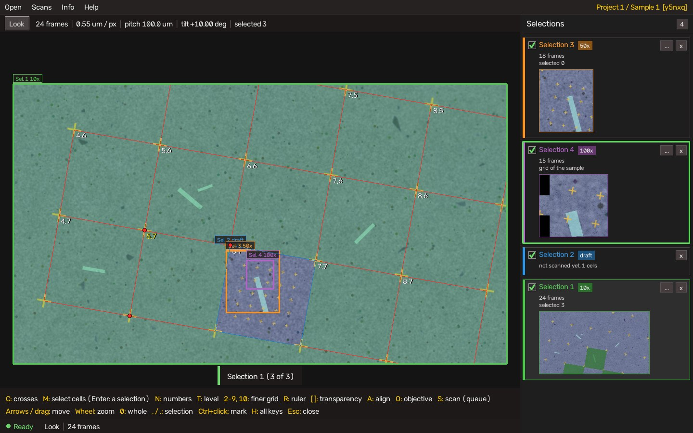
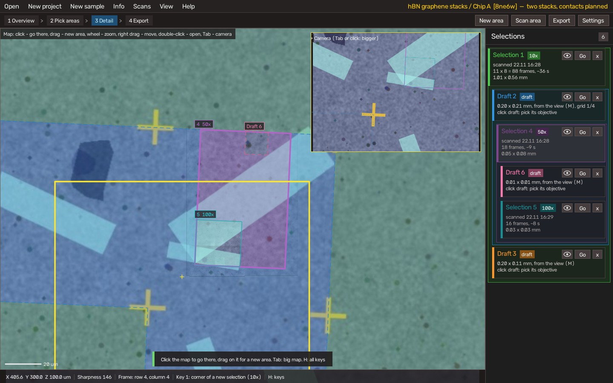

# MicroControl

**Optosky ATR8300 拉曼显微镜（MP / Mapping 型）的软件控制：载物台、照明、激光、相机、自动对焦、区域扫描、图像拼接以及训练数据集图像的准备。**

**完整技术参考**（公式、协议、参数、错误代码）。简短介绍见 [README_zh.md](README_zh.md)。English: [reference_en.md](reference_en.md) · Русский: [reference_ru.md](reference_ru.md)。


> 独立项目，与 Optosky 无关。按「原样」提供，不提供担保 —— 见[免责声明](#免责声明)和 [MIT 许可证](../LICENSE)。

---

## 目录

1. 用途与组成
2. 符号与单位
3. 硬件及其参数
4. 坐标系
5. 控制器协议
6. 运动模型与时间
7. 安全：限制及其依据
8. 相机与成像
9. 自动对焦
10. 区域扫描
11. 数据存储
12. 拼接与标注：重叠拼接、十字标记、方格选择、导出、清理
13. 训练数据集图像的准备
14. G 代码程序
15. 手动模式与查看器
16. 显微镜原点与位置记忆
17. 紧急停止与独占访问
18. 模拟器
19. 安装
20. 在仪器上首次运行
21. 故障排除
22. 参考：参数、命令、错误、日志
23. 示例程序
24. 尚未在仪器上验证的内容
25. AI 智能体

---

## 1. 用途与组成

MicroControl 是一个 Python 库，用于在连接仪器的计算机上通过 Jupyter 笔记本控制显微镜。它替代 Optosky 原厂软件中的光学显微部分：三轴移动载物台、照明、激光、拍照、自动对焦、样品区域自动扫描以及之后的图像拼接。

本库复现了原厂软件与控制器之间的通信：相同的命令、相同的顺序、相同的串口设置（第 5 节）。协议是从原厂软件的可执行代码以及与仪器通信的抓包记录中恢复出来的。

模块：

| 模块 | 用途 |
|---|---|
| `core` | `Microscope` 类：连接、运动、参数、拍照 |
| `protocol` | 帧格式、命令列表 |
| `focus` | 清晰度度量与自动对焦算法 |
| `scan`, `gcode` | 扫描区域、G 代码扫描程序及其执行 |
| `storage` | 扫描图像存储（HDF5 或 JPG） |
| `stitch`, `optics` | 重叠拼接（类似 ASHLAR）、平场校正、镜头畸变、多频段融合 |
| `crosses`, `mask` | 十字标记网格、方格选择、编号、导出 |
| `join` | 简单拼图 |
| `manual`, `viewer` | 手动控制窗口、扫描查看器 |
| `device` | 仪器记忆：原点与最后位置 |
| `control` | 独占访问、紧急停止 |
| `guard` | 崩溃看守：程序终止时关闭仪器 |
| `remote` | 仪器端服务器：程序在另一台电脑上（net://） |
| `sim` | 仪器模拟器 |
| `probe` | 控制器连接检查 |

---

## 2. 符号与单位

长度单位为微米（µm），时间为秒（s），激光功率为毫瓦（mW）。

| 符号 | 含义 | 默认值 |
|---|---|---|
| $\delta$ | 电机每步载物台位移 | $5.556$ µm |
| $N$ | 电机步数（整数） | — |
| $M$ | 物镜放大倍数 | 4, 10, 20, 50, 100 |
| $a$ | 相机传感器像素尺寸 | $2.2$ µm |
| $p = a/M$ | 样品上的相机像素尺寸 | $M = 10$ 时为 $0.22$ µm |
| $N_x \times N_y$ | 图像像素尺寸 | $2592 \times 1944$ |
| $W = N_x p,\ H = N_y p$ | 视场（样品上的图像尺寸） | $M = 10$ 时为 $570 \times 428$ µm |
| $v$ | 载物台速度 | $3000$ µm/s（假定值） |
| $\tau$ | 移动后的停顿（`move_pause`） | $0.1$ s |
| $\mathrm{NA}$ | 物镜数值孔径 | 0.1 / 0.25 / 0.4 / 0.75 / 0.9 |
| $\lambda$ | 波长 | $0.532$ µm（激光） |

---

## 3. 硬件及其参数

| 部件 | 参数 | 数值 | 来源 |
|---|---|---|---|
| 载物台 X, Y | 行程 | $5 \times 5$ cm | ATR8300MP 规格书 |
| 载物台 Z | 行程 | 20 mm | 规格书 |
| 载物台 | 扫描速度 | 20 mm/s | 规格书；与原厂软件的命令速率一致（94 ms 内 2 mm） |
| 电机 | 每步位移 $\delta$ | 所有轴均为 $1/0.18 = 5.556$ µm | 抓包记录：Optosky 界面中的 200、300、500、2000 µm → 36、54、90、360 步 |
| 电机 | 限位开关 | 三个轴均有 | `usercfg.ini`：`DeviceMotorType=XYZLimit` |
| 控制器 | 接口 | USB，STM32 虚拟串口，VID 0483，PID 5740 | — |
| 相机 | 型号、传感器 | MindVision MV-SUA502C，$2592 \times 1944$，像素 $2.2$ µm | — |
| 照明 | 档位 | 整数 0…5；原厂软件使用 5 | — |
| 激光 | 波长、控制 | 532 nm，功率为整数 mW | — |
| 光谱仪 | CCD 制冷 | 带风扇的帕尔贴元件；工作时设定 −5 °C，关闭时 20 °C | `usercfg.ini`：`CoolTemperature=-5` |
| — | 自动对焦前样品与物镜的间隙 | ≈ 1 mm | 载物台上的标签 |

原厂软件启动后听到的风扇声来自光谱仪 CCD 的制冷（命令 `12`，第 5 节），而不是载物台就绪的信号。

---

## 4. 坐标系

控制器不报告载物台的位置：它只接受以步为单位的相对移动。位置由程序累加已执行的移动计算得到。

共有三个坐标系。

1. **电机步数** $(N_x, N_y, N_z)$ —— 内部位置，整数。
2. **实际坐标** $(X, Y, Z)$，µm，`m.real_position`：

```math
X = \delta \cdot N_x,\quad Y = \delta \cdot N_y,\quad Z = \delta \cdot N_z,
```

从显微镜**原点**（第 16 节）起算；若未设置原点，则从连接时的位置起算。

3. **工作坐标** $(x, y, z)$，µm，`m.position` —— 实际坐标减去由 `m.offset()`（G 代码 `G92`）设定的零点偏移 $(x_0, y_0, z_0)$：

```math
x = X - x_0,\quad y = Y - y_0,\quad z = Z - z_0.
```

零点偏移只为方便使用；行程限制和原点与它无关。

**方向。** $+Z$ —— 载物台向上，朝向物镜。在原厂软件代码中方向是一个字节：X `00` ——「前」，`FF` ——「后」；Y `00` ——「左」，`FF` ——「右」；Z `00` —— 下，`FF` —— 上。X、Y 与屏幕图像的对应关系在首次运行时检查（第 20 节），必要时用 `reverse_x`、`reverse_y`、`reverse_z`（电机）和 `mirror_x`、`mirror_y`、`swap_xy`（相机）修改。

**相机旋转。** ATR8300 的相机旋转了 90°：屏幕水平方向是载物台的 $Y$ 轴，竖直方向是 $X$ 轴。这由 `m.swap_xy` 处理（仪器上默认 `True`，模拟器中为 `False`）。启用 `swap_xy` 时，步→像素矩阵为反对角矩阵

```math
K = \begin{pmatrix} 0 & k_y \\ k_x & 0 \end{pmatrix},\qquad k_{x,y} = \mp\frac{\delta}{p},
```

其中 $p$ 为样品上的像素尺寸，符号由 `mirror_x`、`mirror_y` 决定；载物台坐标下的图像尺寸为 $(h, w)$ 而非 $(w, h)$。ATR8300 相机的图像是上下颠倒的（两个轴都镜像）；`m.turn_180`（仪器上默认 `True`）在拍照时将图像旋转 180°，$K$ 随之变号，因此屏幕上方向键的方向不变。方向参数（`turn_180`、`swap_xy`、`mirror_*`、`reverse_*`）按序列号为每台显微镜分别保存（第 16 节）。

**微米到步数。** 请求的位移 $\Delta$（µm）换算为整数步数

```math
N = \mathrm{round}\!\left(\frac{\Delta}{\delta}\right),\qquad |N\delta - \Delta| \le \frac{\delta}{2} \approx 2.8\ \text{µm}.
```

若 $|N\delta - \Delta| > 0.05$ µm，返回结果中会报告实际位移。位移 $|\Delta| < \delta/2$（得到 $N = 0$）会被拒绝（错误 `E214`），零位移同样被拒绝（`E213`）。

---

## 5. 控制器协议

> 以下协议仅通过逆向工程获得（见[免责声明](#免责声明)）。

### 5.1. 物理层

虚拟串口：115 200 bit/s，8 位数据位，无校验，1 位停止位。DTR 和 RTS 关闭，与原厂软件相同（.NET 的 `SerialPort` 类默认不拉高它们；pyserial 会拉高，所以 MicroControl 显式关闭）。

### 5.2. 帧

每条命令和每个应答都是一帧

```math
\mathtt{AA}\ \mathtt{55}\ \ L_{hi}\ L_{lo}\ \ C\ \ D_1 \dots D_n\ \ S,
```

其中 $C$ 为命令码，$D_1\dots D_n$ 为数据，$L = n + 4$ 为长度（2 字节，高字节在前），$S$ 为校验和：

```math
S = \left(L_{hi} + L_{lo} + C + \sum_{i=1}^{n} D_i\right) \mathrm{mod} 256.
```

整帧长度为 $L + 2$ 字节。示例：序列号查询 `AA 55 00 04 04 08`，$S = 00 + 04 + 04 = 08$。

应答重复命令码并携带数据。控制器在收到命令后 1–4 ms 内应答，**在运动结束之前**：对运动命令的应答表示「命令已接受」，而不是「移动已完成」。

### 5.3. 所有数值均为整数

电机步数为 2 个无符号字节（0…65 535）加一个单独的方向字节；照明档位和激光功率为 2 字节；制冷温度为一个符号字节（`00` 或 `FF`）加 °C 数值。不传输小数。MicroControl 按第 4 节把微米换算为步数；照明和激光只接受整数：`m.laser = 2.5` 会报错 `E208`，不会四舍五入。

### 5.4. 使用的命令

| 代码 | 命令 | 数据 | 应答 |
|---|---|---|---|
| `04` | 序列号 | — | 文本（ASCII） |
| `03` | 型号 | — | 文本 |
| `66` | 最大激光功率 | — | 2 字节（`FF 00` —— 未设置） |
| `31` | 标定数据块 | 索引 `09` | 标定数据 |
| `26` | 仪器类型 | — | 1 字节：0 —— AutoFocus，1 —— Basic，2 —— Mapping |
| `2D` | 照明 | 档位，2 字节 | — |
| `20` | 激光 | 功率，mW，2 字节 | — |
| `12` | CCD 制冷设定 | 符号，°C 数值 | — |
| `24` | 电机开/关 | `01` / `00` | — |
| `2E`, `2F`, `2B` | 移动 X、Y、Z | 方向，$N$（2 字节） | 状态，1 字节 |

移动应答中的状态码（原厂软件的 `MotorXResult`、`MotorYResult`、`MotorZResult` 枚举）：

| 字节 | 含义 | MicroControl 的处理 |
|---|---|---|
| `00` | 完成 | — |
| `01`, `02` | 到达限位开关 | 该方向被锁定，该轴位置标记为未确认，错误 `E204` |
| `03` | 故障 | 错误 `E306`，位置未确认 |
| `04` | 电机仍在运动（命令来得太早） | 错误 `E306`，位置未确认，不重发：若命令已进入队列，重发会使位移加倍 |

不会向控制器发送任何其他命令码（白名单；错误 `E305`）。特别是写入标定（`30`）、仪器类型（`25`）和最大激光功率（`65`）均被禁止。制冷设定只能是 −5 °C 或 20 °C —— 与原厂软件相同。

### 5.5. 连接与断开顺序

| 步骤 | Optosky 原厂软件 | MicroControl |
|---|---|---|
| 串口 | 115200 8N1，DTR = 0，RTS = 0，应答超时 5 s | 相同 |
| 序列号 | `AA 55 00 04 04 08` | 相同；无应答时最多重试 3 次 |
| 型号 | `AA 55 00 04 03 07` | 相同 |
| 最大激光功率 | `AA 55 00 04 66 6A` | 相同 |
| 标定 | `AA 55 00 05 31 09 3F` | 相同 |
| 仪器类型 | `AA 55 00 04 26 2A` | 相同 |
| 照明，档位 5 | `AA 55 00 06 2D 00 05 38` | 相同 |
| 制冷 −5 °C | `AA 55 00 06 12 FF 05 1C` | 相同（`cooling=False` —— 不开启） |
| 电机开启（任一轴首次移动前） | `AA 55 00 05 24 01 2A` | 相同 |
| X 轴「后」移 36 步 | `AA 55 00 07 2E FF 00 24 58`（抓包） | `AA 55 00 07 2E FF 00 24 58` |
| 移动后的停顿 | 50 ms；不等待运动结束 | $t = N\delta/v + \tau$（第 6 节） （有意不同） |
| 断开 | 激光 0 → 电机关 → 照明 0 → 制冷 20 °C → 关闭串口 | 相同 |

抓包确认：控制器在 1–4 ms 内应答序列号（`ATR30007`）和型号（`25312082531`）查询。

### 5.6. 读取应答与重新同步

STM32 虚拟串口驱动（2010 年版本）忽略读取超时：没有应答时普通读取会永远阻塞。因此 MicroControl 不依赖驱动：它轮询已接收的字节数，并在自己的期限（工作命令 1 s，连接命令 5 s）后停止等待，报错 `E301`。

**串口丢失。** 若串口句柄失效（USB 设备重新连接，或 Windows 将其置于节能状态；Windows 错误 `ClearCommError … The device does not recognize the command`），MicroControl 关闭串口并重新打开（最多三次，间隔 1 s），恢复照明档位和制冷，然后重发命令 —— 仅在重发安全时（读取查询、照明、激光、电机开启）。移动命令从不重发：无法知道它是否已执行；该轴位置标记为未确认并报错 `E307`。在手动模式下，若超过 2 s 没有通信，会发送一次仪器类型查询（只读，不记日志），以防串口进入休眠。建议关闭 USB 节能：「电源选项 → 更改计划设置 → 更改高级电源设置 → USB 设置 → USB 选择性暂停设置 → 已禁用」，并在设备管理器中对 USB 根集线器取消勾选「允许计算机关闭此设备以节约电源」。

长度错误的帧会让控制器等待缺失的字节；随后它会错位读取后续帧，直到在正确位置遇到 `AA 55` 帧头之前都不应答。0.11.1 版本之前，不带索引的标定查询正是这样使控制器「卡住」的。连接时第一条查询最多重复三次 —— 足以重新同步。

---

## 6. 运动模型与时间

由于控制器在运动结束之前就确认命令，并且从不报告运动结束，移动的结束由时间判断。$N$ 步的移动被拆分为不超过 $N_{\max} = 180$ 步（1 mm）的若干段；每段之后程序等待

```math
t = \frac{|N|\,\delta}{v} + \tau,
```

其中 $v$ 为假定的电机速度（`m.motor_speed`），$\tau$ 为稳定停顿（`m.move_pause`）。任意两条命令之间至少间隔 0.06 s。

各轴严格依次运动，从不同时运动，顺序为：Z 下降 → X → Y → Z 上升。因此朝向物镜的上升总是最后进行，此时载物台已在平面上的目标点。

**$v$ 的选择。** 电机速度由控制器决定；协议中没有速度命令，程序也不调节速度。参数 $v$ 是程序对速度的**了解**，仅用于计算等待时间。误差只在一个方向上是安全的：$v$ 低于真实速度时，程序等待时间偏长；$v$ 偏高时，下一条命令在运动中到达，控制器应答 `04` 且不执行；程序每 0.03 s 重发该命令直到运动结束（最多 5 s），因此不会丢步。但拍照可能在载物台停稳之前进行，所以默认 $v$ 为 3000 µm/s，比规格书值低 6–7 倍。

**测量 $v$：** `m.measure_speed(distance=1000)`。载物台沿 X 移动 `distance`；相机连续采集图像直到画面不再变化（相邻帧之差在 1 s 内低于 $3\sigma$ 噪声阈值）。取 $v = 0.8\,v_{\text{meas}}$。以下情况结果被拒绝（`E212`，$v$ 不变）：运动出现在少于三帧中、最后一帧与第一帧无差别、或 $v_{\text{meas}} > 20$ mm/s —— 这些情况下速度都会被高估。请在对焦状态下、在有细节的区域、开灯测量。

**扫描时间。** 对于图像步长 $s$（第 10 节），每帧时间为

```math
t_{\text{frame}} \approx \frac{s}{v} + \tau + \tau_{\text{photo}} + t_{\text{exp}} + t_{\text{write}},
```

其中 $\tau_{\text{photo}}$ 为 `photo_pause`，$t_{\text{exp}}$ 为曝光时间。$v = 3000$ µm/s、$s = 570$ µm（10x）时移动约需 0.2 s；测量速度后会少几倍。

---

## 7. 安全：限制及其依据

### 7.1. 物理依据

只有使样品靠近物镜（$+Z$ 移动）是危险的。在 XY 平面内移动不会减小间隙。

物镜工作距离（WD）是对焦时物镜与样品之间的间隙。参考值（Olympus）：

| 物镜 | 标准系列（MPLN） | 长工作距离（LMPLFLN） | 景深 $\approx \lambda/\mathrm{NA}^2$ |
|---|---|---|---|
| 5x | 20.0 mm | 22.5 mm | ≈ 50 µm |
| 10x, NA 0.25 | 10.6 mm | 21.0 mm | ≈ 8 µm |
| 20x, NA 0.4 | 1.3 mm | 12.0 mm | ≈ 3 µm |
| 100x | 0.21 mm（NA 0.9） | 3.4 mm（NA 0.8） | ≈ 1 µm |

仪器的 100x 物镜标有「L PL」—— 长工作距离系列。假定的 WD 值（保守，`m.working_distance`）：4x —— 17 mm，10x —— 10 mm，20x —— 3 mm，100x —— 2 mm。实际值印在物镜筒上（WD），可这样设置：`m.working_distance = 3400`。

**限制规则。** 每条命令的上升量 $\Delta z_{\uparrow} \le \min(\mathrm{WD}/3,\ 1000\ \text{µm})$，向下取整到 50 µm：即使连续两条错误命令也不能使样品碰到物镜。Z 行程默认为距连接点 $\pm 50\,000$ µm，即实际上由仪器限位开关限制（Z 全行程 20 mm）；仪器本身不会越过限位。更窄的行程用 `m.set_limits` 设置（7.2）。

### 7.2. 限制

| 限制 | 数值 | 错误 |
|---|---|---|
| 每条 `move` 命令的 X、Y 位移（`max_move`） | ≤ 2000 µm | `E201` |
| 每条命令的 Z 上升（`max_move_z`） | 4x、10x、20x —— 1000；100x —— 650 µm（WD 3.4 mm 时 —— 1000） | `E201` |
| 每条命令的 Z 下降（`max_move_down`） | ≤ 2000 µm | `E201` |
| `goto` 或 G 代码的一次行程（`max_jump`） | ≤ 3000 µm | `E210` |
| 距连接点的 X、Y 行程（`xy_limit`） | ±25 000 µm | `E202` |
| Z 上限 | $Z_{\text{conn}} + 50\,000$ µm（由 `m.set_limits` 修改） | `E203` |
| Z 下限 | $Z_{\text{conn}} - 50\,000$ µm（由 `m.set_limits` 修改） | `E202` |

**修改行程限制。** `m.limits` 显示当前限制；`m.set_limits(x=(下限, 上限), y=(下限, 上限), z=(下限, 上限))` 在工作坐标（与 `m.position` 相同）中设置，单位 µm，可设置任意轴组合：

```python
m.set_limits(z=(-2000, 3000))                    # Z：−2 mm 到 +3 mm
m.set_limits(x=(-20000, 20000), y=(-20000, 20000))
```

要求：下限小于上限，当前位置在范围内，每个方向不超过 100 mm；否则报错 `E208`，限制不变。新限制在本次会话结束前有效。

没有最小步长：小步长是安全且必要的（20x 视场约 285 µm，100x 约 57 µm；景深只有几 µm）。

若安装了短工作距离物镜（例如 WD 0.21 mm 的 100x），必须设置其 WD：`m.working_distance = 210` 使每条命令上升 50 µm；同时最好显式设置上限：`m.set_limits(z=(-50000, 100))`。

上限从连接时的位置起算：假定连接时载物台处于安全位置。连接时必须指定物镜（`E207`），因为 Z 限制取决于它。

### 7.3. 运动前的检查

所有限制都在发送第一条命令**之前**检查。G 代码程序通过模拟其全部命令整体检查；出现任何错误时载物台不动，错误信息指出行号。

参数值错误或名称拼写错误会立即报错（`E105`、`E206`、`E208`）；拼写错误时会提示最接近的已有名称。

### 7.3a. 限位开关

控制器对移动的应答说明的是**哪一个**限位开关闭合（来自 OptoSky.dll：X —— `ReachForward`/`ReachBackward`，Y —— `ReachLeft`/`ReachRight`，Z —— `ReachTop` = 1 / `ReachBottom` = 2），而不是运动方向。若该开关位于运动方向上，即为停止：该方向被锁定（`E204`，之后 `E205`），该轴位置变为不确定。若开关在相反一侧（载物台开始时停在开关上并正在离开），运动继续，并记录警告 `MOV-012`。自动对焦碰到限位开关时会缩小搜索窗口并继续（`AF-003`）。`m.confirm_position()` 也会解除方向锁定。

### 7.4. 未确认的位置

**会话之间**坐标会延续（无论是否设置了原点）：步进载物台停在原处，每次移动后最后位置都写入仪器记忆，因此样品的选区保持在原位。断开连接时（以及关闭手动模式时）会保存一帧相机图像；下次连接时将画面与之比较：相同 —— 位置得到确认；有偏移 —— 载物台被手动或其他程序移动过，坐标按偏移修正；完全不同（换了样品）—— 位置保持不变，无需确认（给出提示；掩膜自动对齐十字）。上次会话在移动中途结束时同样如此。工作中触发限位开关、丢失应答或收到 `03`/`04` 码之后，该轴位置被视为未确认。此状态下 `goto`、G 代码和扫描被禁止（`E211`）；`move` 和手动模式可用。确认载物台位于预期位置后，用 `m.confirm_position()` 解除锁定。

### 7.5. 锁定的功能

只有在以 `allow_laser=True` 连接时才能开启激光，且不超过 `laser_max`。限位开关搜索（`m.find_limits()`、`G28`）—— 仅在 `allow_homing=True` 时可用：限位开关信号尚未在仪器上验证。

---

## 8. 相机与成像

相机通过 MindVision SDK（`MVCAMSDK_X64.dll`）工作。连接时关闭自动曝光和软件锐化（锐化会扭曲自动对焦的清晰度度量），并固定白平衡（手动），使扫描图像的颜色不漂移。每次移动后丢弃前 2 帧，以免图像有运动模糊。

样品上的像素尺寸为 $p = a/M$（`pixel_size`），视场为 $W \times H = N_x p \times N_y p$（`m.frame_size`）。

| 命令 | 作用 |
|---|---|
| `m.image()` | 当前图像（numpy 数组，BGR 通道顺序），不保存 |
| `m.photo(name)` | 拍照保存到 `photos/<日期>/` |
| `m.exposure = 20` | 曝光，ms |
| `m.white_balance()` | 对当前图像做一次白平衡（对准空白区域） |
| `m.dark_frame()` | 暗场图像：关闭照明，平均 16 帧 |
| `m.empty_frame()` | 平场图像：空白区域，平均 16 帧 |
| `m.sharpness` | 当前图像的清晰度 |

参考图像以 16 位 PNG 保存在 `references/` 中；像素值为平均值乘以 256（保留平均的精度）。

---

## 9. 自动对焦

### 9.0. 基于景深的自动对焦（默认）

物镜景深（波动部分加几何部分，$e = 2.2$ µm —— 传感器像素，$\lambda = 0.55$ µm）：

```math
d = \frac{\lambda n}{\mathrm{NA}^2} + \frac{n\,e}{M\cdot\mathrm{NA}}.
```

| 物镜 | NA | $d$，µm | 搜索步长 $d/2$，µm |
|---|---|---|---|
| 4x | 0.10 | 60.5 | 30 |
| 10x | 0.25 | 9.7 | 4.8 → 电机步长 5.6 |
| 20x | 0.40 | 3.7 | 1.9 → 5.6 |
| 50x | 0.75 | 1.0 | 0.5 → 5.6 |
| 100x | 0.90 | 0.7 | 0.35 → 5.6 |

NA 为典型值（`config.py` 中的 `OBJECTIVES`，请按实际物镜修改）。

`m.focus()`：
1. **窗口中心** —— 由 `m.manual()` 中的对焦点估计的 $Z$（最近的 4 个点，权重 $1/r^2$）；没有对焦点时为当前 $Z$。
2. **窗口** $\pm 4d$（至少 3 个电机步），**步长** $d/2$（不小于电机步长 $\delta$）。10x 下为 15 帧，而不是 35–40 帧。
3. **自下而上扫描**；载物台也从下方接近最佳 $Z$：齿隙以相同方式消除，找到的 $Z$ 可重复。
4. **清晰度** —— 2 帧的平均值，图像先平滑（$\sigma = 1$ px：噪声不算作细节），再除以平均亮度的平方（与曝光无关）。
5. **峰值**用通过 $\ln S$ 的抛物线精化（清晰度曲线接近高斯形），然后取整到电机步长。
6. 峰值在窗口边缘 —— 窗口向该方向移动（最多 2 次）。曲线平坦（峰值/最小值 < 1.15）—— 焦点很远，执行宽范围搜索（9.2）。

直接进行宽范围搜索：`m.focus(wide=True)`。

**载物台的限制。** 若 $Z$ 电机步长大于景深（20x、50x、100x 时 $\delta = 5.56$ µm），载物台可能停在距最清晰点 $\delta/2 = 2.8$ µm 处，即 0.8–4 个景深；`m.focus()` 会给出「Limit」提示。假定 $Z$ 步长 $\delta$ 与 X、Y 步长相同；若 $Z$ 驱动步长更细，请单独设置。

模拟器验证（10x，$Z$ 齿隙 3 步 = 17 µm，焦点位于两步之间）：从 −60 到 +70 µm 之间的 5 个起点出发，载物台都停在最接近焦点的那一步（误差 0.4–0.6 步，为可能的最小值）。

### 9.1. 清晰度度量

清晰度在图像中央一半（每边各取一半）上计算，转为灰度 $I(x, y)$ 并缩小 $k$ 倍：

| `focus_method` | 度量 $F$ |
|---|---|
| `laplacian`（默认） | $\mathrm{Var}\!\left(\nabla^2 I\right)$ —— 拉普拉斯算子的方差 |
| `tenengrad` | $\langle G_x^2 + G_y^2 \rangle$，$G_{x,y}$ —— Sobel 梯度 |
| `brenner` | $\langle (I(x+2, y) - I(x, y))^2 \rangle$ |
| `variance` | $\mathrm{Var}(I) / \langle I \rangle$ —— 归一化方差 |

### 9.2. 宽范围搜索

景深可能小于搜索步长（10x：步长 20 µm 时景深约 8 µm），细小细节只在很窄的 $Z$ 区间内清晰。因此搜索分两遍。

1. **粗搜。** 从 $\min(Z_0 + R, Z_{\text{ceiling}})$ 向下到 $\max(Z_0 - R, Z_{\text{floor}})$，步长 $s_f$，其中 $R$ 为 `focus_range`，$s_f$ 为 `focus_step`；度量在缩小 $k = 8$ 倍的图像上计算。大的细节即使失焦也可见，所以峰较宽，不会错过。满足以下条件时粗搜停止：已完成至少 4 个点、当前 $Z$ 比最佳点低 $2 s_f$、且 $F < 0.6\,F_{\max}$。
2. **细搜。** 在最大值附近 $\pm s_f$ 区间内以一个电机步长 $\delta$ 为步长，在缩小 $k = 2$ 倍的图像上计算度量。

载物台从上方接近最佳位置：先上升到高出 $s_f$ 处，再下降。这样可以消除机构齿隙。

**峰值对比度**

```math
C = \frac{F_{\max}}{\mathrm{median}(F)}
```

按粗搜各点计算。$C < 1.3$ 时认为最大值不可靠（图像中细节太少）：返回结果中有警告，日志中有 WARNING 记录。

默认窗口和步长：

| 物镜 | `focus_range`，µm | `focus_step`，µm |
|---|---|---|
| 4x | ±2000 | 100 |
| 10x | ±1000 | 50 |
| 20x | ±500 | 25 |
| 100x | ±100 | 10 |

### 9.3. Z 分辨率的限制

Z 电机步长 $\delta = 5.56$ µm 大于 20x（≈ 3 µm）和 100x（≈ 1 µm）物镜的景深。若仪器上 Z 每步位移确实等于 $\delta$，在这些物镜下最清晰的位置可能不与任何可到达的载物台位置重合。需要在仪器上验证（第 24 节）。

---

## 10. 区域扫描

### 10.1. 区域与图像网格

区域由两个角点 $A = (x_A, y_A)$ 和 $B = (x_B, y_B)$ 给出 —— 即角上图像的中心，通常在手动模式中用 `1` 和 `2` 键设定（第 15 节）；或显式设置：`m.area = mc.Area(x0, y0, x1, y1)`。

重叠率为 $q$（`overlap`，$0 \le q \le 0.5$；默认 30 %，50x 和 100x 时 35 % —— `SCAN_OVERLAP`）时的网格步长向下取整为整数个电机步，因此图像之间没有缝隙：

```math
s_x = \delta \left\lfloor \frac{W(1 - q)}{\delta} \right\rfloor,\qquad s_y = \delta \left\lfloor \frac{H(1 - q)}{\delta} \right\rfloor.
```

图像数量

```math
n_x = \left\lceil \frac{|x_B - x_A|}{s_x} - 0.05 \right\rceil + 1,\qquad n_y = \left\lceil \frac{|y_B - y_A|}{s_y} - 0.05 \right\rceil + 1;
```

0.05 的容差避免因取整多出一帧。然后各帧从角点到角点均匀分布，$s'_x = |x_B - x_A| / (n_x - 1) \le s_x$（$y$ 同理）：第一帧位于 $A$，最后一帧正好位于 $B$，重叠不小于 $q$。路径为「蛇形」（`path='snake'`，偶数行反向）或逐行（`path='rows'`）。

### 10.2. 扫描中的对焦

| `focus` | 方法 | 适用 |
|---|---|---|
| `'plane'` | 在稀疏网格点上自动对焦（每 `focus_every` 帧一次，加上区域角点）；用最小二乘拟合平面 $z = \alpha x + \beta y + \gamma$；每帧的 $Z$ 取自该平面 | 平整样品（晶圆、玻璃）：考虑了样品倾斜 |
| `'each'` | 每帧自动对焦 | 不平整的样品 |
| `'auto'`（默认） | 若在 `m.manual()` 中设置了对焦点 —— 同 `'points'`，否则同 `'off'` | — |
| `'points'` | 每帧 $Z$ 由 `m.manual()` 中的对焦点给出（角点 `1`、`2` 和 `K` 键）：最近的 4 个点，权重 $1/d^2$，$z(\mathbf{r}) = \sum w_i z_i / \sum w_i$；不做自动对焦 | 倾斜的基底：$Z$ 平滑、小步变化 |
| `'off'` | $Z$ 不变：焦点在 `m.manual()` 中设定一次 | 样品平整时：改变 $Z$ 会使图像在 X、Y 上偏移（齿隙、轴歪斜），破坏拼接 |

对比度 $C < 1.3$ 的点不用于拟合平面（会报告跳过的数量）。可用点少于三个时平面为水平；没有可用点时扫描不启动（`E603`）。若各点偏离平面超过 `focus_step`，建议使用 `focus='each'`。

**重拍模糊图像**（`refocus=True`）。第 $k$ 帧满足以下条件时视为模糊

```math
F_k < 0.5\,\mathrm{median}(F_{k-20}, \dots, F_{k-1})
```

（之前至少有 5 帧）。这样的图像在自动对焦后重拍；`refocused` 和 `blurry` 标记写入 `index.csv`。

### 10.3. 执行

`m.plan()` 生成 G 代码扫描程序（可阅读和编辑）；`m.scan()` 执行它。规划前相机会检查各轴符号（`m.check_orientation()`：在 X、Y 上各移动图像的 20 % 再返回；符号错误会使图像以相反顺序拼接），必要时修正 `swap_xy`、`mirror_x`、`mirror_y`；用 `m.scan_check = False` 关闭。默认图像以 JPG 保存在 `frames/` 中（`frame_format = 'jpg'`，质量 `jpg_quality` = 90），缩小到 `frame_scale` = 0.5：10x 下 0.44 µm 的像素仍比光学分辨率（$\approx 0.61\lambda/\mathrm{NA} \approx 1.3$ µm）细 3 倍，因此不损失细节，而数据量约小 30 倍；无损保存 —— `m.frame_format = 'h5'`、`m.frame_scale = 1`。每帧的流程：移动到坐标（使用实际坐标 `G53`，因此规划后修改工作零点不会使拍摄位置偏移），按对焦模型设置 $Z$，停顿 `photo_pause`，静止检查（两帧之差必须在 0.25 px 以内），拍照。整个扫描期间曝光固定。`m.scan()` 返回扫描文件夹路径。

**预计时间。** 扫描前 MicroControl 会给出预计时间（小地图标签和轮播中也有）。第一次估计基于物理过程（移动、暂停、曝光、写入）；每次扫描完成后，实际用时会按此显微镜和此组设置（物镜、对焦方式、暂停、检查、帧格式）记录下来 —— 在仪器记忆文件中最多保存最近 20 次扫描 —— 并用最小二乘拟合直线 $T = T_0 + t\,N$（$N$ 为帧数）。学习结果的权重随扫描次数增加：$w = n/(n+2)$（1 次 —— 33 %，10 次 —— 83 %）。进度条的「Left」先采用该预计值，随扫描进行逐渐过渡到实际速度。

---

## 11. 数据存储

```
scans/<日期>_<时间>_<物镜>_<名称>/      一个区域；多个样品 —— 会话文件夹：
  session.json       样品列表：编号、颜色、区域、对焦点
  sample_01/, sample_02/, …   每个都是普通的扫描文件夹（如下）
  meta.json          物镜、像素尺寸、视场、电机步长、步→像素矩阵、
                     区域、相机与曝光、照明、对焦设置、停顿、速度、参考图像、
                     零点偏移、仪器信息、状态、图像数量
  index.csv          每帧一行：id, batch, slot, row, col, x_um, y_um, z_um, x_p, y_p, z_p,
                     sharpness, refocused, blurry, t_s
  program.gcode      执行的程序
  frames/00001_r001_c001.jpg   JPG 图像（默认，frame_format = 'jpg'）
  batches/b0000.h5   或每 batch_size 帧一批（HDF5，frame_format = 'h5'）
  join/              拼接结果
  viewer/            查看器缓存：图像缩略图和缩小副本（levels/）
  grid.json          十字标记、方格选择、方格编号
  export/            导出的方格（PNG/JPG、DXF、JSON）
```

每个 `bNNNN.h5` 文件有两个数据集：`tiles` —— 无损图像（gzip），分为 $4 \times 4$ 块（读取图像的任意部分无需解压整帧）；`thumbs` —— 缩小 16 倍的副本，供查看器使用。写入时的故障最多损坏一批。

访问图像：

```python
st = mc.ScanData(folder)
ids = st.query(x=(0, 2000), y=(0, 1000))      # 与矩形（µm）相交的图像
img = st.frame(ids[0], crop=0.5)              # 图像中央一半
for i, img in st.frames(ids): ...             # 逐批读取并遍历
st.export()                                    # 用于 Fiji 的 PNG 文件和 TileConfiguration.txt
```

---

## 12. 拼接与标注（主要流程）

**流程。**
1. `m.manual()`：样品区域 —— 角点 `1`、`2`，一个区域接一个区域（多个样品见第 15 节）。
2. 角点对焦：在每个角点把图像调清晰（`E`/`Q`），然后按 `1`/`2`（区域角点）和 `K`（其他角点）。「Z follows the focus points」复选框（`Y`，默认开启）：扫描中每帧的 $Z$ 由其区域内最近的 4 个对焦点按权重 $1/d^2$ 给出；在手动模式下，在至少有 2 个对焦点的区域内，每次用方向键移动也按同样方式设置 $Z$（向上不超过 `max_move_z`）。不勾选 —— 方向键不改变 $Z$，扫描使用同一个 $Z$。
3. `folder = m.scan()` —— 图像重叠 30 %，50x 和 100x 时 35 %（`config.py` 中的 `scan_overlap`）。每次拍照前用相位相关比较两帧连续图像：若画面仍移动超过 1 px（载物台尚未停稳），则推迟拍照（`m.still_check`）。扫描时曝光和白平衡为手动（不会逐帧漂移）。
4. `mc.stitch(folder)` —— 由重叠区求出图像的精确位置（12.1）。每个物镜一次 —— `mc.distortion(folder)`（12.5）。
5–7. `mc.view(folder)` —— 精确拼接（`Shift+J`）、十字标记（`C`）、水平视图（`T`）、方格选择（`M`）、方格编号（`N`）、标尺（`R`）（12.2）。
8. `mc.export(folder)` —— 只导出选中的方格：PNG（透明背景）或 JPG，以及用于 AutoCAD 的 DXF（12.3）。
9. `mc.clean(folder)` —— 显示，`mc.clean(folder, confirm=True)` —— 删除原始图像和其他中间文件。

整幅拼图从不在内存中完整生成：查看器和导出只按求得的位置从原始图像中取需要的部分。

### 12.1. 重叠拼接（`mc.stitch`）

借鉴 ASHLAR（Muhlich et al., *Bioinformatics* 38, 4613, 2022）、MIST（Chalfoun et al., *Sci. Rep.* 7, 4988, 2017）和 BigStitcher（Hörl et al., *Nat. Methods* 16, 870, 2019；Preibisch et al., *Bioinformatics* 25, 1463, 2009）的思想；自行实现，无需 Java。面向数百到数千帧。

1. **相邻帧** —— 按载物台预测的矩形重叠面积不少于最大重叠 30 % 的帧对（舍弃对角小角）。通过帧大小的网格单元查找，而非两两比较。
2. **帧对位移，粗略。** 公共部分的条带经高斯拉普拉斯滤波（保留细节，去除平缓背景），缩小到约 $3\cdot10^4$ px，乘以 Hann 窗并补零到两倍。用部分归一化的频谱做相关：
   ```math
   r = \mathcal{F}^{-1}\!\left[\frac{F_B F_A^{*}}{|F_B F_A^{*}|^{0.25}}\right]
   ```
   纯相位相关（幂次 1）会放大高频，而滤波后高频只剩噪声和传感器图案；它们与帧固定，其峰值正落在载物台预测处。幂次取 0.25 时，求得的位移与载物台误差无关。候选为距预测 `max_shift_um` = 40 µm 以内最高的 5 个峰；每个都用图像吻合度（$e = 1 - \mathrm{NCC}$）检验，取最好的（重复图案、噪声）。
3. **帧对位移，精确** —— 在全分辨率公共部分上做 Lucas–Kanade：
   ```math
   \boldsymbol\delta = (G^{\top}G)^{-1}G^{\top}(a - \tilde b),\qquad G = \nabla\tilde b,
   ```
   其中 $\tilde b$ 为按当前估计平移后的帧 $b$（亮度和对比度已均衡）；2–6 步。没有向整像素的偏向（相位相关峰有：每条接缝最多 0.18 px，沿一行累积）：在测试纹理上误差 0.003 px。
4. **置换检验。** 几何相同，但用远处的帧代替相邻帧：得到必然错误配对的误差。阈值为其第 1 百分位。在预测附近找不到的接缝，按**整帧**、不依赖载物台再搜索（同 MIST）：载物台误差可能大于重叠（50x、100x 的回差）。
5. **载物台 → 像素模型**（按接受的接缝）：$\mathbf{d}_{ij} = M\,\Delta\mathbf{p}_{ij} + B\,\Delta\mathbf{s}_{ij}$。$M$（$2\times2$）包含相机旋转、电机步距误差和斜交；$\mathbf{s}_k$ 为载物台到达帧 $k$ 的方向（由扫描记录，`dir_x`、`dir_y`），$B$ 为各轴回差（仅在能与步距区分时）。模型给出的帧位置：$\hat{\mathbf{r}}_k = M\mathbf{p}_k + B\mathbf{s}_k$。
6. **远离模型的接缝。** 模型精确到一两个像素，因此距模型超过 $\max(4, 5\sigma_m)$ px 的接缝（$\sigma_m = 1.48\,\mathrm{med}\,|\mathbf{d}_{ij} - (\hat{\mathbf{r}}_j - \hat{\mathbf{r}}_i)|$）通常是图案的相邻周期（模糊帧上的十字）或噪声巧合。在模型周围的窄窗口内重新测量；按整帧找到的接缝只有与包含它们重建的模型一致时才保留（第一个模型不知道的回差轴）；其余舍弃。
7. **位置** —— 稀疏加权最小二乘（带对角预条件的共轭梯度，无稠密矩阵：3000 帧 0.2 s）：
   ```math
   \min \sum_{(i,j)} \frac{\bigl|\mathbf{r}_j - \mathbf{r}_i - \mathbf{d}_{ij}\bigr|^2}{\sigma_{ij}^2}
   + \sum_{(i,j)} \frac{\bigl|\mathbf{r}_j - \mathbf{r}_i - (\hat{\mathbf{r}}_j - \hat{\mathbf{r}}_i)\bigr|^2}{\sigma_{st}^2}
   + \varepsilon^2\sum_i \bigl|\mathbf{r}_i - \hat{\mathbf{r}}_i\bigr|^2,
   ```
   $\sigma_{ij} = 0.1 + 10\,e_{ij}$ px（吻合弱即测量粗），$\sigma_{st}$ 为载物台步距相对模型的离散度，由好的接缝测得（MIST 中的"重复性"），$\varepsilon = 0.01$。载物台约束的是**相邻帧之间的步距**，而不是帧的位置：其误差是平滑的，相邻帧一起偏移。离群值：Cauchy 权重，尺度从 $\infty$ 降到 2 px；然后像 BigStitcher 一样，只要强接缝中最差的一条明显差于其余，就将其移除。
8. **第二轮。** 在载物台误差大或接缝与其余不一致处，从已求得的位置出发重新测量接缝（仅 Lucas–Kanade；不收敛则完整搜索），再求解一次位置。

接缝被保存（`join/seams.npz`）：在查看器中关闭或打开某条接缝时（`J`，12.2），据此在不到一秒内重新排布各帧。

模拟器验证（回差 3 步 = 16.7 µm，与载物台真实位置比较）：

| 扫描 | 之前的误差（中位数 / p95 / 最大，px） | 现在 |
|---|---|---|
| 10x，208 帧 | 0.99 / 135 / 136 | 0.11 / 0.22 / 0.28 |
| 10x，1044 帧（458 帧模糊：样品倾斜） | 3.2 / 41 / 199 | 0.40 / 1.3 / 1.6 |
| 50x，56 帧，回差 1 步 | 4.0 / 183 / 185 | 0.32 / 0.72 / 0.80 |
| 100x，77 帧，回差 1 步 | 175 / 247 / 371 | 0.68 / 1.65 / 1.99 |

时间：1044 帧 640 × 480，2 核 65 s。求得回差：16.7 µm（真实 16.7）。真正的 ASHLAR：`mc.stitch(folder, engine='ashlar')`（需要 `pip install ashlar` 和 Java）。

**光学校正**（在读取图像用于拼接、查看和导出时应用）：
- *照明*：每个颜色通道 $c$ 的场 $F_c(x, y)$ —— 最多 60 帧的中位数（每帧先除以自身中位数），平滑处理，$\langle F_c\rangle = 1$；图像 $I'_c = I_c/F_c$（`join/flatfield.npy`）；
- *帧亮度*：由重叠区求出每帧每通道的增益 $a_i$，$I''_i = a_i I'_i$（`join/gains.npy`）；两者每次拼接时计算，`flat=False` —— 不做；
- *畸变*（12.5），如果已为该显微镜和物镜测量过。

结果：`join/positions_all.csv`、`join/stitch.json`、`join/seams.npz`（接缝）、`join/preview_all.jpg`（缩小的拼图）、`viewer/levels/`（缩小 2、4、8 倍的图像 —— 供查看器处理大扫描）。

### 12.2. 在查看器中标注（`mc.view`）


**同一个字母在两个窗口中含义相同。** 仅属于一个窗口的按键在另一个窗口中会给出提示（不执行操作）。

| 按键 | 含义 | 显微镜窗口（`m.manual()`） | 查看器（`mc.view(folder)`） |
|---|---|---|---|
| 方向键、滚轮、`+` / `-`、`0` | 移动、缩放、全图 | 载物台移动一帧（步长 X、Y）；地图 | 图像 |
| `,` `.` | 上一个 / 下一个选区 | ✓ | ✓ |
| Ctrl+单击 | 标记多个 | 卡片（列表上方 Merge / Minus / Overlap） | 卡片和图像 |
| `Enter` | 确认 | 移动到所选选区 | 选中的单元 -> 选区（两处均被选中）；保存对齐 |
| `Del` | 删除 | 所选 / 新建的选区（Ctrl+Z 可恢复） | 已标记 / 所选的（未拍摄）；十字模式中 —— 重新标十字 |
| `S` | 拍摄：放入队列 | 所选 / 已标记的选区（Scan area） | 所选 / 已标记的（显微镜窗口的队列） |
| `J` | 拼接 | 实时画面与拼图比对；`Shift+J` —— 所选的精确（quality）拼接（Stitch） | 手动编辑拼缝（quick 先做 quality 拼接）；`Shift+J` —— quality 拼接放入显微镜窗口的队列 |
| `X` | 导出 | 所有勾选的 -> `<样品>/export/`（Export） | 同左 |
| `O` | 物镜 | 当前物镜：下一个（装上它） | 所选 / 已标记选区的物镜；`Shift+O` —— 新选区的物镜 |
| `[` `]` | 透明度 | 地图上所选选区的图片 | 所选选区 / 已标记的图片 |
| `R` | 标尺 | 点击两点 | 点-点 -> 线-线 -> 点-线 -> 关闭 |
| `T` | 旋转图像 | 相机旋转 180°（记住） | 按晶格放正 / 按拍摄 |
| `M` · `C` · `N` | 单元 · 十字 · 编号 | — | 选择单元（`Ctrl+A` —— 全选 / 全不选）· 标十字（`Shift+C` —— 帧对齐到十字）· 方格编号 |
| `P` · `G` · `A` · `Y` | 剖面 · 平直边缘 · 对齐 · 其他 | — | 剖面线（4 次点击）· 裁去台阶 · 将当前扫描与其他对齐（空格 —— 自动）· 其他选区图片开 / 关 |
| `U` | 轮廓 | — | 按角点画选区：边只能横向/竖向，吸附到十字和角点；Enter 或第一个角点闭合 |
| `E` / `Q`（`PgUp` / `PgDn`）· `F` · `K` · `1` / `2` | 载物台上 / 下 · 自动对焦 · 对焦点 · 角点 | ✓（`Shift` —— ×5） | — |
| `L` · `I` · `W` · `空格` · `V` | 照明 · 激光 · 白平衡 · 拍照 · 打开查看器 | ✓ | — |
| `Tab` 或单击字段 | 步长、曝光、物镜 | ✓ | — |
| `Ctrl+Z` · `Ctrl+Y` | 撤销 · 重做 | ✓（包括移动） | ✓ |
| `H` · `Esc` | 全部按键 · 退出模式 / 取消标记 | ✓ | ✓；无其他打开内容时按 `Esc` —— **关闭查看器** |
| `Shift+Esc` | 关闭 | 显微镜窗口（只能这样） | ✓ |
| `Ctrl+P` | Settings 面板（左侧） | 显示 / 隐藏 | — |

显微镜窗口的 **Settings 面板**（Settings 按钮、左侧箭头或 `Ctrl+P`）：Z 跟随对焦点、单向接近（回程间隙；默认开启）、**Prepare**、**Distortion**（畸变）、**Zero here**（此处置零）、**Steps = frame**（步长 = 一帧）、**Check directions**（检查方向）、**Arrows X / Y**（方向键反向）、**Map 90 deg**（地图旋转）、**Clear fog**（迷雾是按载物台坐标直接放置的实时帧，不做匹配；清除地图上“战争迷雾”的实时帧；设置 `m.fog_refresh`（默认关闭：静止时实时帧本来就会覆盖迷雾）：在已到过的地方行驶时也会重新拍摄，迷雾被新帧覆盖）。顶部：Prepare、New area、Scan area、Stitch、Export、Settings；菜单：Open、New、Info、Scans（所选选区的历史：View、Make main）、Queue、View、Help。在地图上 Ctrl+拖动 —— 当前物镜的方框（晶体）；任务进行中按 `Esc` —— 停止。


网格始终是**正方形**的：$\mathbf{v}_2$ 是 $\mathbf{v}_1$ 旋转 90°（没有歪斜，没有「投影」）；未知量有四个 —— 原点 $\mathbf{O}$、间距和倾角 —— 由标记点用最小二乘求出。两个相邻十字就足够；远处的十字使倾角误差按距离成比例减小。查看器中 `Shift+C` 可选地用同样的正方形网格拟合拼图中的所有十字。模拟器验证（倾角 3.5°）：2 个相邻十字加 2 个远处十字 —— 间距 99.998 µm，倾角 3.494°。标记和选择保存在 `grid.json` 中（以拼图像素为单位；重新拼接后需要重新标记）。

**十字中心**用带暗边的「+」模板查找（既适合细的暗色十字，也适合带轮廓的凸起亮色十字）；每个候选点都检查十字在旋转 90° 和 180° 时的对称性 —— 十字旁边的光刻编号没有这种对称性，不会把中心拉偏。十字尺寸（臂长，px）在用所有十字拟合网格时自动选择：取使找到的中心最贴合网格的尺寸，保存在 `grid.json`（`arm_px`）中。在十字旁带编号的样品图像上验证：13 个十字的网格 —— 均方根 0.52 px，11 个十字 —— 1.1 px。在 4x 的整幅图像上，十字向边缘偏离直线网格最多约 7 px —— 这是镜头畸变（`mc.distortion`）。

**方格编号。** 网格索引 $(i, j)$ 是任意的（从第一个标记起算）。光刻编号按下式得到

```math
\begin{pmatrix}X\\Y\end{pmatrix} = P\begin{pmatrix}i\\j\end{pmatrix} + \mathbf{t},
```

$P$ 为带符号的轴置换（8 种情况：网格的哪个轴是 $X$，以及增长方向）。选择 $P$ 和 $\mathbf{t}$ 使所有标注严格成立。一个标注只给出 $\mathbf{t}$（方向取默认：屏幕上 $X$ 向右，$Y$ 向下）；在**另一行另一列**的第二个方格上标注即可确定两个轴的方向 —— 从而确定所有方格的编号。编号写在每个方格的左上角（手动标注的为黄色）；标注相互矛盾时会给出警告。编号写入 `selection.json`（`names`）、DXF（LABELS 图层）以及方格的文件名（`square_X+012_Y+007.png`）。不需要识别数字：两个标注就足够。

**性能**（30 × 30 图像网格，900 帧 1296 × 972，2 核）：拼接 67 s，内存 ≤ 0.6 GB；打开查看器 0.1 s；任意缩放下每帧画面 7–63 ms，拖动时 2–25 ms。小比例尺由概览拼图 `join/preview_all.jpg` 绘制，中等比例尺由缩小的图像副本 `viewer/levels/`（拼接时写入）绘制，大比例尺由原始图像绘制；副本缓存限制为 400 MB。

### 12.3. 导出选中部分（`mc.export`）

每个选中的方格（带 16 px 边距）直接由原始图像组装：方格 $(i, j)$ 的像素 $(u, v)$ 取自拼图点 $\mathbf{O} + i\mathbf{v}_1 + j\mathbf{v}_2 + \tfrac{u}{a}\mathbf{v}_1 + \tfrac{v}{b}\mathbf{v}_2$；重叠的图像**按频率**融合（拉普拉斯金字塔，5 层）：每个像素归属权重最大的图像（权重向图像边缘递减），掩模按层平滑 —— 细节不重影，亮度平滑，接缝处无台阶。`blend='feather'` —— 简单的加权融合。方格按网格排列，不旋转，恰好在十字处相接。

- `export/selection.png` —— 只有选中部分，其余透明（`fmt='jpg'` —— 白色背景）；
- `export/selection.dxf` —— DXF R12，单位 µm：图层 `SQUARES` —— 方格边，`OUTLINE` —— 选区外轮廓，`LABELS` —— 方格编号 $(X, Y)$；
- `export/selection.json` —— 方格列表及其编号、网格间距（µm）、旋转、输出像素尺寸；
- `cells=True` —— 另外把每个方格存为单独文件（`export/squares/`）。

内存由 `max_mb` 限制（默认 2000 MB）：选区很大时图像会被缩小。

### 12.5. 镜头畸变、按十字拼接、按十字生成图纸

**模型。** 平直帧中的点 $\mathbf{u}$（$\mathbf{v} = \mathbf{u} - \mathbf{c}$，$\rho^2 = |\mathbf{v}|^2/R^2$，$R$ —— 帧对角线的一半）在照片中位于 $\mathbf{u} + \Delta(\mathbf{v})$：
$$\Delta = k_1\mathbf{v}\rho^2 + k_2\mathbf{v}\rho^4 + \tfrac{1}{R}\bigl(p_1\,2xy + p_2(3x^2+y^2),\; p_1(x^2+3y^2) + p_2\,2xy\bigr),$$
径向（$k_1, k_2$）与偏心（$p_1, p_2$）；对 $\theta = (k_1, k_2, p_1, p_2)$ 是线性的。

**标定**（`m.calibrate_distortion()`，显微镜窗口中按 `D`）：在任意细节周围拍 3×3 张 50 % 重叠的帧。每个重叠区切成小块（约帧的 1/10），逐块测量精确位移 $\mathbf{r}_a - \mathbf{r}_b$。每块一个方程：$\mathbf{P}_b - \mathbf{P}_a + \theta\cdot[\varphi(\mathbf{r}_a) - \varphi(\mathbf{r}_b)] = \mathbf{r}_a - \mathbf{r}_b$（$\varphi$ —— 四个基场）：帧位置与 $\theta$ 一起用带抗离群权重的最小二乘求解。不需要十字，也不依赖载物台精度。按物镜保存，并写入每次扫描的 `meta.json`。模拟器：0.88 px（场的非线性部分的均方根）只剩 0.09 px。

**按十字拼接**（`mc.fit_crosses(folder)`，查看器中 `Shift+C`）：未知量 —— 所有帧的位置、正方形晶格 $(O, \mathbf{a})$、$\theta$。在**原始**帧 $k$ 中于 $\mathbf{r}$ 处找到的每个十字 $(i, j)$：$\mathbf{P}_k + \mathbf{r} - \Delta_\theta(\mathbf{u}) = O + i\mathbf{a} + j\,\mathrm{rot}_{90}\mathbf{a}$；每条接缝：$\mathbf{P}_b - \mathbf{P}_a + \theta\cdot G_{ab} = \mathbf{d}_{ab} + \theta_0\cdot G_{ab}$。含十字的帧绝对固定在晶格上，接缝误差不会累积。物镜已标定时，$\theta$ 保持在标定值附近。若 $\theta$ 在边缘处变化超过 0.5 px，则在校正后的帧上重新测量接缝。报告：距网格不超过 0.5 µm 的十字所占比例。模拟器（10x、倾斜 10°、回程间隙、畸变）：100 % 优于 0.5 µm，95 % 优于 0.08 µm。

**十字中心**：先用「+」模板（按网格倾斜：先旋转窗口），再用**臂的边缘**：在每个臂上横向取 7–40 条剖面，每条求出两个亚像素边缘及其中点；通过水平臂中点的直线与通过垂直臂中点的直线，二者交点即中心。条带宽度不同的剖面（数字、污渍）被剔除。合成测试，十字倾斜 10°、有噪声和数字：0.1 px（仅模板为 0.2–0.3 px）。

**按十字生成图纸。** 若某选区的扫描已用带编号的网格标注，其在图纸中的图片逐像素生成：图纸点 → 晶格 $(u, v)$ → 网格方格 → 由**该方格的 4 个十字**（在本次扫描中测得，未找到的取自网格）双线性映射到拼图上的点。图片与晶格对齐；拼接、畸变和倾斜的残差不会进入图纸。`drawing.json` 中列出每个区域测得了多少十字以及它们偏离理想网格多远。

**帧**：相机全分辨率（`m.frame_scale = 1`），JPG 95；`m.frame_format = 'png'` —— 无损。十字和接缝在绿色通道中测量。

### 12.4. 简单拼图（`mc.join`）

`mc.join(folder)` 分五步生成整幅拼图（用于小扫描和训练数据集）。

1. **初始位置** —— 由载物台坐标和步→像素矩阵得到。
2. **精化。** 对每对相邻图像，在重叠条带上用相位相关计算相对位移 $\mathbf{d}_{ij}$：归一化互功率谱的傅里叶逆变换的最大值

```math
R = \frac{\hat I_i \hat I_j^{*}}{|\hat I_i \hat I_j^{*}|}.
```

若峰高不小于 0.08 且修正量不超过条带宽度的四分之一，则接受该位移；否则使用载物台位移。
3. **全局拟合**：对所有配对同时用最小二乘求位置 $\mathbf{r}_i$（误差不会沿行累积）：

```math
\min_{\{\mathbf{r}\}} \sum_{(i,j)} w_{ij}\,\bigl|(\mathbf{r}_j - \mathbf{r}_i) - \mathbf{d}_{ij}\bigr|^2 + \varepsilon \sum_i \bigl|\mathbf{r}_i - \mathbf{r}_i^{(0)}\bigr|^2,\quad \varepsilon = 0.01,
```

$w_{ij}$ —— 相关峰高，$\mathbf{r}_i^{(0)}$ —— 按载物台计算的位置。
4. **照明均匀化**（至少 8 帧时）：对每个颜色通道求场 $F_c(x, y)$ —— 最多 60 帧的中位数，每帧先除以自身中位数（整体亮度不同的帧不会破坏场），用 $\sigma = \min(W, H)/12$ 的高斯平滑并按平均值归一化；图像逐通道除以 $F_c$。边缘的亮度和色调都得到校正。
5. **帧亮度**（位置确定之后，类似全景图的曝光补偿）：对 X、Y 方向重叠均不少于 10 % 的每对相邻帧，$m_i$、$m_j$ 为公共部分在各帧中的中位数（按通道）。增益 $a_i$ 最小化
$$\sum_{(i,j)} \bigl(\ln a_i - \ln a_j - \ln m_j + \ln m_i\bigr)^2 + \lambda^2 \sum_i (\ln a_i)^2,\qquad \lambda = 0.05,$$
（对 $\ln a$ 的线性最小二乘），增益中位数为 1，$|\ln a_i| \le 0.7$。报告中显示 `frame brightness evened (±N %)`。
6. **融合**，权重向图像边缘递减：

```math
w(x, y) = \min(x + 1,\, N_x - x)\cdot\min(y + 1,\, N_y - y).
```

内存有限制（`max_mb = 3000`）：必要时以缩小的比例生成拼图；原始图像不变。部分扫描：`mc.join(folder, x=(x0, x1), y=(y0, y1))` 或 `center=0.3`。结果：`join/mosaic_*.png`、`preview_*.jpg`、`positions_*.csv`。

---

## 13. 训练数据集图像的准备

| 要求 | 原因 | 实现 |
|---|---|---|
| 曝光恒定 | 亮度差异不能成为特征 | 扫描期间曝光固定，并写入 `meta.json` |
| 无损存储 | 有损压缩会引入伪影 | HDF5 + gzip（`frame_format = 'h5'`、`frame_scale = 1`）；相机软件锐化关闭 |
| 物理尺度 | 以 µm 计的物体尺寸是特征 | `pixel_size_um`，图像坐标以 µm 计 |
| 清晰度 | 模糊图像影响训练 | 对焦模型、重拍、每帧的 `sharpness` 和 `blurry` |
| 照明校正 | 暗角、不均匀 | 保存参考图像 $D$ 和 $E$；图像本身不修改 |
| 可重复性 | 重复采集 | `program.gcode`，所有参数在 `meta.json` 中，指向日志的链接 |

准备数据时的**场校正**：

```math
I' = \frac{I - D}{E - D}\,\langle E - D \rangle,
```

其中 $I$ 为图像，$D$ 为暗场图像（`m.dark_frame()`），$E$ 为空白区域图像（`m.empty_frame()`），$\langle\cdot\rangle$ 为图像平均值。

建议：
1. 一组采集之前：照明预热 2–5 分钟，`m.white_balance()`，在干净的基底上 `m.empty_frame()`，`m.dark_frame()`。更换物镜或照明档位时重复。
2. 一组采集内不要改变曝光、照明和白平衡。
3. 重叠：重叠拼接使用默认的 30 %；若只为标注图像边缘上的物体 —— 0.1–0.2 即可。
4. 按区域或样品划分训练集和验证集，而不是随机划分图像：相邻图像相互关联，随机划分会高估质量。
5. 排除 `blurry = 1` 的图像。

---

## 14. G 代码程序

类似数控机床和 3D 打印机的控制方式。单位 —— µm。`;` 之后为注释。`m.gcode(program, save='name')` —— 执行字符串或 `.gcode` 文件；指定 `save` 时，`M240` 拍摄的图像保存到新的扫描文件夹。

| 命令 | 参数 | 作用 |
|---|---|---|
| `G0`, `G1` | X Y Z | 移动 |
| `G53 G0` | X Y Z | 按实际坐标移动 |
| `G4` | P（ms）或 S（s） | 停顿 |
| `G28` | X Y Z | 限位开关搜索（需要 `allow_homing=True`） |
| `G29` | — | 为区域建立对焦平面 |
| `G30` | — | 自动对焦 |
| `G90` / `G91` | — | 绝对 / 相对坐标 |
| `G92` | X Y Z | 零点偏移：当前点获得这些工作坐标 |
| `G92.1` | — | 取消零点偏移 |
| `M3` / `M5` | S（mW） | 激光开 / 关 |
| `M114` | — | 输出位置 |
| `M240` | R C | 拍照（第 R 行，第 C 列） |
| `M355` | S1 P(档位) / S0 | 照明 |
| `M420` | S0 / S1 | 对焦平面关 / 开 |

不支持 `F`（进给速度）参数（`E902`）：速度由控制器决定（第 6 节）。执行前整个程序会被检查（第 7.3 节）。

---

## 15. 手动模式与查看器

**项目与样品。** `mc.Project(名称, 描述)` 和 `project.sample(名称, 描述)` 打开或创建 `projects/<项目>/project.json` 与 `projects/<项目>/samples/<样品>/sample.json`。样品保存其选区（载物台真实 µm 角点、物镜、帧大小、对焦点、编号、已发出的最大编号）及角点图片；`m.sample = s` 保存原样品的选区并载入新样品的选区；连接时打开上次打开的样品。每个项目都有唯一的 5 字符简短 id（`p.uid`，不含 0/1/i/l/o；显示在窗口标题、Info、Open 和 `mc.projects()` 中）：`mc.Project("k3f9x")`、`mc.Microscope(project="k3f9x")` 或 Open → **By project id...** 打开该项目（其最近的样品）；id 也写入每次拍摄（`meta.json` 中的 `project_uid`）。选区的每次拍摄写入 `selections/Sxx_NNx/scans/<日期_时间>[_名称]/` —— 每次都是新版本，地图和查看器列表使用最新一次。类：`Project`（`samples`、`sample()`）、`Sample`（`selections`、`selection(n)`、`scans(latest)`）、`Selection`（`scans`、`latest`、`view()`）、`Scan`（`stitch()`、`view()`、`export()`）。窗口顶部有菜单（Open、New —— 从列表中选择 Project 或 Sample、Info、Scans、View、Help；对话框用 tkinter）。

**表格与窗口。** `mc.projects()` / `mc.all_samples()` 返回以表格打印的列表（Jupyter 中为 HTML 表格）：id、名称、样品、选区、拍摄、创建和修改日期、描述；Open 对话框显示相同的列。`mc.view_window(folder)` 以独立进程启动查看器 —— 每个项目一个窗口，标题为项目和样品；查看器中 Open → New window 和显微镜窗口中 Open → View in a new window 都使用它。

**样品晶格、草稿与细网格。** 光刻十字从 1,1 开始编号（最多 58,58，通常约 30,30）；十字 X,Y 的晶格坐标为 $(u, v) = (X-1,\ Y-1)$，方格 X,Y 为 $[X-1, X]\times[Y-1, Y]$。样品晶格（`lattice.py`，保存在 `sample.json` → `lattice`：原点、载物台 µm 中的轴 $\mathbf{e}_1$、$\mathbf{e}_2$、间距 $P$）**整个样品只有一个**：它由最后手动标记十字（`C`，任意选区）并为不同行列的两个方格编号（`N`；1…58 之外的编号会被标出）的那次拍摄拟合得到。其他拍摄按原样显示这一晶格 —— 无需再标十字。网格始终只有一个：当它由某个选区的十字构成时，在另一个选区按 `C` 会要求先去掉那些十字（打开那个选区，`C`，`Del`）；之后网格消失，新的十字为所有拍摄构建网格。方格编号只有在手动为两个方格编号（`N`）之后才显示。查看器中选中的方格（`M`）按 **Enter** 变成选区 —— 每个闭合图形一个：**草稿**（无物镜、虚线、不拍摄、不进入导出）或带有为新选区选定的物镜（`Shift+O`）。草稿通过卡片上的物镜标签获得物镜（draft → 4x … 100x → draft），然后即可拍摄。查看器中按 `U` 按角点画选区：每条边只能横向或竖向，并吸附到十字和已放置的角点（灰色辅助线），因此轮廓始终是直角的；单击第一个角点或 Enter 闭合（最后一个角自动补上）。画笔状态保存在拍摄的 `grid.json` 中（`selected` —— 方格，`refine` —— $\{uid: \{n, cells\}\}$）。

**看向内部、图层。** 选中的部分保持清晰，周围加色调：查看器中用 `M` 选中的方格清晰，其余部分覆盖浅绿色。选中一个选区（点击其卡片）时，其内部图像不变，外部暗 15 % —— 在地图和相机画面中都是如此。不做任何裁剪：在地图上拖出、用角 1–2 设置或用方格选出的区域保持原样，按列表顺序位于其他区域之上或之下。`2`–`5` 也可直接作用于刚选中的方格，在 Enter 把它们变成选区之前。在右侧列表中拖动卡片时，列表已显示放下后将有的顺序（卡片带绿色框）。

**选区为平面列表：顺序即图层。** 没有嵌套、没有组、没有「金字塔」：所有选区（任意物镜或 draft）处于同一层级，同一或不同物镜的选区可以任意重叠，不做任何裁剪。列表顺序即图层顺序：列表顶部绘制在最上层（显微镜窗口的地图、查看器、`mixed.png`）；新选区出现在顶部；上下拖动卡片即可改变顺序（任意卡片拖到任意位置）。任何选区的物镜可随时更改（卡片上的标签；其已有拍摄保留原物镜）。每张卡片上的复选框决定是否导出。由单元组成的选区保留其单元和自身网格；Shift+拖动只移动它本身。在查看器中单击卡片使其成为当前工作对象：暂时绘制在所有其他之上（列表顺序不变）。文件夹：样品的所有拍摄在 `<样品>/scans/<日期>_<时间>_S03_50x/`（一层，名称中含选区和物镜），角点图片在 `<样品>/thumbs/<uid>/`，导出在 `<样品>/export/`。 矩形选区在拍摄后精确设为实际拍摄范围（帧位于电机步上），其轮廓即图片边缘；更换物镜不改变轮廓。查看器按载物台坐标轴显示任何拍摄（+X 向右，+Y 向下，与地图一致），因此无论打开哪个拍摄，选区布局看起来都相同。 **整个样品只有一个网格。** 它由在任意选区上手动标记（C）的十字构建 —— 取最后标记的；不会自动出现（没有十字就没有网格），只要这些十字不变它就不变。其他拍摄按原样使用这个网格（在查看器中打开即可看到，按载物台坐标，不吸附到自己的图片）。十字标在列表中选中的选区上：之后所有拍摄的网格都按它们。若另一物镜的图片相对网格有偏移，`A`（对齐）把图片移到网格下 —— 网格不动。对齐其十字构成网格的那个拍摄时，网格随十字一起移动（十字在它的图片上），其他拍摄在打开时采用新网格。**`V` 在独立窗口（独立进程）中打开查看器**：显微镜窗口同时继续工作（队列及其进度栏、相机、标尺、编辑）；查看器中的更改（选区、物镜、Enter）会自动传到显微镜窗口，查看器中的 `S` 将拍摄放入显微镜窗口的队列，查看器的状态栏显示该队列。



| | |
|---|---|
|  |  |
| *地图上的层：10x → 草稿 → 50x → 100x，角落为相机* | *50x 拍摄：整个样品一个网格 —— 来自 10x 上标的十字* |
|  |  |
| *AutoCAD 图纸：倾斜的芯片按晶格摆正，其十字落在绘制的十字上* | *特写：50x 与 100x 的 quality 图片，各在自己的图层* |

**样品导出**（显微镜窗口的 Export 按钮、查看器中的 `X`，或 `mc.export_sample(m, [k, ...], mixed_um=None)`）：卡片上勾选的全部内容进入**同一个文件夹 `<样品>/export/`**，其中之前的导出被替换：`drawing.dxf`（安装 ODA File Converter 时另有 `.dwg`）—— 每个选区在自己的图层 `S03_50x`（draft —— `S03_draft`），使用晶格坐标（十字 1,1 位于 $(0, 0)$）或载物台 µm；quality 拼接后的选区图片 `S03_50x.png`（quick —— 图纸中仅轮廓）；**`mixed.png`** —— 所有勾选的拍摄（quick 和 quality）合成一张图片，按列表顺序叠加（列表顶部在最上），带细轮廓；其像素大小与勾选中最精细的拍摄相同（Python 中用 `mixed_um=` 自定义；不超过 2 亿像素 —— 否则更粗，并在 `drawing.json` 中说明）；`drawing.json` —— 报告（坐标系、图层、图片、`mixed`：µm/像素）。**所有勾选的选区都必须做过 quality 拼接**，否则拒绝导出，消息列出未拼接的选区（精度不同的图片会误导）。**只有在十字已标记时才生成图纸**：十字是信标，保证图片拼合无误、光刻误差最小；没有十字时导出只有图片和 `mixed.png`，消息（以及 `drawing.json` 的 `no_drawing`）说明原因。Python 中 `drawing=True` / `False` —— 强制带 / 不带图纸。

**导航器。** 手动窗口是完成全部工作的一个屏幕。菜单下方：按钮 Prepare、New area、Scan area、Stitch、Export、Settings（设置面板默认隐藏；`Ctrl+P`）。地图（`navmap.py`）以载物台真实 µm 绘制可见选区主拍摄的拼接预览（按拍摄几何及其对齐把拼图换算到载物台），按列表顺序（列表上方在上层），以及轮廓、标签和相机框（载物台上实时画面的四角，计入回差）；相机默认放大，地图在右上角，`Tab` 交换。地图上的鼠标：点击 —— `samples.drive_to` 到那里（Z 取其下区域的对焦点），拖动 —— 当前物镜的新矩形区域（可与任何区域重叠），滚轮 —— 以光标为中心缩放，右键 / 中键拖动 —— 移动，双击 —— 在查看器中打开该区域的拍摄。Export —— 所有勾选的写入 `<样品>/export/`（见*样品导出*）。

**选区与图层。** 按键 `1`、`2` 标记一个*选区*；它记住标记时的物镜和该物镜的帧尺寸。所有选区在同一层级，无论物镜如何都可以重叠；列表顺序就是图层顺序。`m.scan()` 只拍摄当前物镜的选区（若没有则报错 `E706`）；其他的等待。列表中的帧数和预计时间按各选区自己的物镜计算（`timing.estimate(..., objective)`）。拍摄的 `meta.json` 保存 `selection`、`sample_uid`、`area_real_um`。`m.list()` 显示所有已拍摄的选区，`m.open(N)` 在 `mc.view` 中打开一个，`m.remove(N, confirm=True)` 删除其拍摄。

**从查看器做精确拼接**（`Shift+J`，或在 quick 拍摄上按 `J`）：打开的拍摄的 quality 拼接进入显微镜窗口的队列（若其物镜在位，会在仪器旁补拍模糊帧）；查看器底部的进度栏显示它；完成后 `J` 编辑拼缝。

**在查看器中同时处理多个选区。** 按住 Ctrl 点击图片上的选区（鼠标下最小的那个）或右侧的卡片 —— 它们被标记（白边，顶部显示「marked N」；`Esc` —— 取消标记）。然后，对已标记的（若无标记则对所选的）：`O` —— 物镜：draft -> 4x -> … -> 100x -> draft，一次作用于全部，只对尚未拍摄的（其余在消息中列出）；`S` —— 把它们的拍摄放入显微镜窗口的队列（必须打开该样品的 `m.manual()`）：当前物镜的拍摄立即开始，其他的**等待各自的物镜** —— 装上它（显微镜窗口中按 `O`），它会说明有多少在等待，`S` 启动它们；`[` `]` —— 全部的透明度；`Del` —— 删除（未拍摄的；已拍摄的 —— 卡片上的 `x`）。`Shift+O` —— 由单元（`M`）**新建**选区的物镜：draft 或 4x … 100x —— 新建时立即采用（顶部显示「new: 50x」）。已有物镜但尚未拍摄的选区也在列表中（「not scanned yet」，带物镜标签）。**一起显示：** 其他所有已拼接选区的图片也会按列表顺序绘制，所选的在最上；`Y` —— 开 / 关。

**查看器中的图层：透明度与对齐。** 所有已拼接的选区在查看器中按列表顺序绘制（上面的在上层），所选的在所有之上。`[` 使所选选区（或已标记的）图片更透明 —— 100 / 75 / 50 / 25 / 0 %（0 —— 只剩轮廓），`]` —— 更不透明；按选区保存（样品的 `view.json`，显微镜窗口中相同）。每个物镜的光轴有自己的偏移，载物台有回差，因此用 20x 和 100x 拍同一处可能不重合（物体出现重影）。`A` —— **对齐**：用鼠标拖动所选选区（当前拍摄；它在最上层、半透明），直到与其他图片重合 —— 只有它连同其彩色边框移动，其他不动（方向键：1 个屏幕点，`Shift` —— 10），或 `Space` —— 自动（在重叠处对鼠标下的图片与本拍摄做相位相关；模拟器中在 10x/50x 下误差 0.15 µm 以内）；`Enter` 保存，`Backspace` —— 不偏移，`Esc` —— 取消。它在载物台上的偏移保存在拍摄的 `align.json` 中，其拼图与载物台之间的每次换算都会计入 —— 选区、手动窗口中的地图（立即）和导出；样品网格保持不动，除非构成网格的十字就在这次拍摄上。在程序中：`from microcontrol.snap import align`；`align(folder)` —— 读取，`align(folder, (dx, dy))` —— 设置，`(0, 0)` —— 去掉。

**队列：依次拍摄，后台拼接。** Scan area（或 `S`）不再占用窗口：所选选区的拍摄进入**队列**；按住 Ctrl 单击多张卡片 —— 全部进入队列。队列有两条通道：**仪器**（载物台和相机）一次一个任务，按顺序执行；**CPU** 通道在其他核心上用独立进程拼接（最多一半核心，不超过 4 个）。拍完的选区在 CPU 通道上做 quick 拼接，同时仪器已在拍摄下一个选区。Stitch（quality）也进入队列：拼接（CPU）-> 检查 -> 需要时在仪器上补拍（同一物镜）-> 再次拼接。窗口底部的进度栏显示各任务：通道、步骤、进度、已用和剩余时间，以及整个队列的 **all done in ~T**（仪器通道累加，CPU 通道由各进程分担）；`x` 停止任务（拍摄 —— 在当前帧之后，已拍的保留；拼接进程 —— 立即，之前的拼接保留；等待中的 —— 移除），**Stop all** —— 全部；单击进度栏或菜单 **Queue** —— 所有任务列表。仪器被队列占用时，需要仪器的按键（方向键、E/Q、F、K、L、I、W、O、1/2、Prepare、移动到某处）会提示并不执行；窗口其余功能照常（选择和编辑选区、查看 `V`、导出）。队列未完成时退出：留在窗口、停止队列，或退出并让队列继续（`m.queue`；`m.close()` 会停止它）。程序中：`m.queue.scan(uid)`、`m.queue.quality(folder)`、`m.queue.stitch(folder, 'quality')`、`m.queue.stop(job)`、`m.queue.stop_all()`、`m.queue.wait()`。每种拼接每帧所需时间在本机上学习（`~/.microcontrol/job_rates.json`）。每个进度条还显示 **total** —— 已用 + 剩余。 每个任务在 `x` 旁边都有自己的暂停按钮 `||`：拍摄在当前帧之后暂停，拼接冻结其进程；`>` 继续。停止或暂停一个任务不影响其他任务。面板显示前 3 个任务；其余显示为 “+N more”，轮到时才显示。

**卡片和边界。** 已拍选区的卡片上有透明度按钮（100 / 75 / 50 / 25 / 0 %，单击切换到下一档；`[ ]` 也可以）。选区的图片只在其彩色边界内显示（地图和查看器中都是）：帧拍到的边界外部分不显示，因此边界始终就是图片的边缘。状态栏总是以程序中设置的物镜开头。所有窗口和对话框都使用 JetBrains Mono 字体（位于 `microcontrol/fonts`，SIL Open Font License）；对话框（Open、New、Info、Layout）采用窗口的深色主题。草稿（查看器中用 `U` 或 `M` 得到）用当前物镜拍摄；等待其他物镜的拍摄会在相机画面上显示黄色提示，直到设置该物镜。查看器中也可以在尚未拍摄的地方选择方格。查看器和地图只绘制屏幕上可见的部分；帧在后台从磁盘加载（加载前显示缩小的副本）。

**布局。** 显微镜窗口的 Layout 菜单：单视图（相机大图，地图在角落；`Tab` 切换）或并排两个视图，相机 | 地图 或 地图 | 相机（`Tab` 交换两半）；选区列表在右侧或左侧 —— 查看窗口也采用同样的列表位置。保存在 `~/.microcontrol/ui.json` 中，两个窗口共用。所有内容按默认布局绘制，再重新排列显示；点击会换算回去，因此任何布局下所有按键和点击的作用都相同。

**实时拼接、战争迷雾、桥接帧。** 队列中的拍摄进行时，独立进程（`live.py`）把每个新帧立即与已拍的相邻帧拼接（缩小的帧，同 quick；只测量新接缝，所有帧的位置按全部接缝重新求解 —— 分而治之）。每一步后写入 `join/positions_all.csv`，因此在该拍摄上打开的查看器会随时显示新帧，期间标记的十字保持在原位；`join/live_pairs.json` 保存接缝，拍摄后的 quick 拼接直接使用（只需重新读取帧）。接缝、伪匹配测试和实时拼接都在多个核心上计算。**战争迷雾：** 在显微镜窗口中移动载物台时，实时帧（整帧期间载物台静止，且自上一帧起至少移动了四分之一视场）按载物台位置放到地图上，约 2 µm/px，稍暗，位于拍摄图像之下；`<样品>/fog/` 保存它们（512 px 的图块）。**quality 拼接中的桥接帧：** 与其他接缝相差超过 0.1 µm 的接缝，或两帧都有细节却未找到的接缝，视为弱接缝；载物台自动移到两帧中间并在那里拍一帧（与两帧各重叠约一半），每轮最多 24 帧；已拍过桥接帧的位置不再重拍。**中断的拍摄：** 被停止（x、Stop all）或因错误中断的拍摄会保留已拍帧，并立即做 quick 拼接；若拍摄中窗口崩溃，下次启动显微镜窗口时会补做拼接。**沿途的迷雾：** 在地图上单击时先沿 X 再沿 Y 移动；途中迷雾尚未驱散的地方，载物台每约 0.9 帧停一下，把一帧放入迷雾（已到过的地方不停）。**其他物镜：** 为其他物镜排队的拍摄会等待（暂停符号，“on hold”），一旦设为该物镜就自动开始。

**停止与状态栏。** 两个窗口中的任何长时间任务（扫描、拼接、帧放到十字上、按十字拟合网格、自动对焦、Prepare、导出、移动到某处）的进度条上都有 **Stop** 按钮（或 `Esc`）。任务在下一步停止（由库的进度条检查）；2.5 s 内未到达下一步的任务会被强制停止（纯 Python）；已开始的移动由载物台走完。扫描在当前帧之后平稳停止，已拍内容保留；拼接在接缝之间停止，之前的结果保持不变。整个任务只有一条进度条：各阶段有各自的份额（拼接：照明 8 %、接缝 62 %、亮度 8 %、保存 22 %），额外的接缝轮次会追加进去，因此不会在每个阶段都从 0 跑到 100 %；没有自身份额的任务（移动、白平衡、拍照）按其通常耗时推进（记录在 `~/.microcontrol/busy_times.json`），第一次则显示滚动块。两个窗口底部的**状态栏**始终显示当前在做什么：`Ready` 和各项信息（位置、清晰度……），或任务、其进度条、已用和剩余时间以及 Stop。

**选区：细网格、草稿、拍摄历史。**
- 每个由光刻单元组成的选区以自己的颜色在轮廓内绘制其单元和**细网格**（手动窗口的地图和查看器中）；方格网格是样品共用的。查看器最多放大到每像素 32 个屏幕点。
- **草稿。** 草稿只是物镜为 `draft` 的选区（尚无物镜：不拍摄）。卡片上的物镜标签依次为 4x … 100x，然后 `draft`；草稿标签会赋予它当前物镜。查看器中选中的单元（`M`）按 Enter 变成这样的选区 —— 立即出现在列表中并被选中。Ctrl+拖动画的框是当前物镜的选区，可直接拍摄。
- **拍摄历史。** 卡片上的 `...` 按钮（两个窗口都有）在窗口中央打开其全部拍摄的列表，从旧到新（日期、quick / quality、帧数、接缝误差、图像尺寸）：点击**星标**（或该行）设为主拍摄 —— 地图、查看器和导出都使用它；View —— 打开；`Esc` —— 关闭列表。选区的新拍摄自动成为主拍摄。（选中选区后菜单 Scans —— 同一列表的对话框。）
- **导出**（Export 按钮、`X`）：卡片上勾选的全部内容（见*样品导出*）；每个选区取其主拍摄。`mc.export_sample(m, [k], png=True, mixed_um=None, drawing=None)`。

**两种拼接：quick 与 quality。** 每次拍摄结束后立即进行 **quick** 拼接（快速概览）。精确的 **quality** 拼接是对同一批帧的单独步骤：手动窗口中的 **Stitch**（所选选区；在仪器旁还会补拍所需帧）、查看器中的 `Shift+J`（进入显微镜窗口的队列）、程序中的 `m.quality()` / `mc.stitch(文件夹)`（`m.scan(stitch=None)` —— 拍摄后不拼接）。晶体框（Ctrl+拖动）自动按 quality 方式拍摄（程序中用 `m.scan(mode='quality')`）；其他选区按常规拍摄，同样可以做 quality 拼接。
- **quick** —— 快速概览：帧直接以缩小尺寸读取（JPEG 按 1/2–1/8 尺寸解码，宽约 320 px），用同一引擎拼接，位置再换算回全尺寸。quick 拼接不能编辑（在查看器中按 `J` 或 `Shift+J` 改为 quality），导出不采用它：可能有几个像素的误差。速度（模拟器，同一次拍摄）：640 px 帧快 2.4 倍，1296 px 帧快 7.3 倍；500 万像素相机约快 20–30 倍（估算）。
- **quality** —— 小区域（晶体）的精确图像，用于光刻图纸：首要目标是物体之间的真实距离（用于绘制键合线和触点）。框的拍摄：重叠 40 %，始终从同一侧接近每一帧（回差不再随机），帧无损保存（PNG），框周围留余量（电机步长 + 一半回差 + 载物台离散度）。帧只做平移 —— 不拉伸、不旋转；读取帧时校正畸变（如已标定）和照明，因此图像内的距离与样品上一致。比例尺 —— 按掩模十字标定的像素尺寸（在含十字的扫描的查看器中按 F，两个方向上至少跨两个周期、不少于 8 个十字）；未标定时使用表格值，报告中会注明（物镜误差 1 % 即每 100 µm 误差 1 µm）。在仪器旁进行 quality 拼接（Stitch、`m.quality()`）：拼接、检查、补拍（最多 2 轮）—— 模糊帧用自动对焦重拍，含物体但没有任何接缝相连的帧在其与邻帧之间补拍，框内未覆盖处补拍。结果为边缘平直的矩形框图像：`join/quality.png`（无损）和 `join/quality.json`（每像素 µm 及来源、图像在载物台上的位置、接缝误差（px 与 µm）、覆盖率、补拍帧、问题）。接缝误差在 0.1 µm 以内（且不严于 1 px）即接受。模拟器验证（10x，物镜比例误差 1 %，有回差）：标定前距离误差即为该 1 %（324 µm 上 3.3 µm），标定后像素误差小于 2·10⁻⁵，300 µm 上的距离误差小于 0.05 µm；帧间误差小于 0.2 px；模糊帧会被补拍。
- **导出** 只采用 quality 拍摄：勾选的 quick 拍摄会以消息中止导出。

**晶体框。** 在手动窗口中，在地图上 `Ctrl`+拖动会用当前物镜画出一个**草稿框**，不吸附到光刻方格：框住在 10x 图上看到的晶体。框的做法保证载物台真能到达：所画区域每边加余量（电机步长 + 一半回差 + 载物台离散度，后两者来自样品最近一次拼接拍摄的载物台模型；没有时只用电机步长），每条边都落在整数电机步上。提示信息给出所画尺寸、框尺寸和余量。对草稿按 **Scan area** 用当前物镜拍摄（只拍与框相交的帧；比一帧小 —— 在最近的电机步上拍一帧）。框很多时：选择它们所在的概览（右侧其卡片），然后 **Scan area** —— 其中的草稿变为当前物镜的选区，各自拍入一个文件夹并拼接。

**查看器中的标记、网格和轮廓。** 标记的十字显示为小点（"+" 看起来像晶格轴）。只有在拍摄中确实看到十字的地方才自动画网格：至少一个可靠十字（响应强且与其他十字同一偏移）；绝不只按载物台坐标画 —— 没有十字的区域在手动标记之前没有网格。拍摄图在地图和查看器中按选区轮廓裁剪：轮廓外拍到的部分（边缘的整帧）不显示。在查看器中按卡片上的 **x** 删除草稿。

**地图上的图像位于其轮廓内。** 回差会使每一帧相对指令位置偏移 $\pm B$，取决于载物台从哪一侧到达。载物台模型以该次拍摄的平均到达方向 $\bar s$ 为参考，$T = p + B\,(s - \bar s)$：平均而言图像位于指令坐标上，不会偏出其轮廓半个回差。

**单个拍摄的最终图纸**（`mc.export`）：除 `selection.png` / `selection.dxf` 外，每个选中的方格保存为单独图片 `export/squares/square_X±NNN_Y±NNN.png`（沿网格裁剪、已摆正），`export/drawing.dxf`（DXF 2010，单位 µm，Y 向上；`ezdxf`）把每张图片放在其方格上（图层 `IMAGES`），并带有轮廓（`SQUARES`，外边缘 `OUTLINE`）、编号（`LABELS`）和空图层 `BONDS`。若安装了免费的 ODA File Converter（或在 `MC_ODA` 中给出其路径），还会写出 `export/drawing.dwg`。DWG 中的图片同样是外部文件：请整体移动 `export/` 文件夹。

**地图上的选中方格。** 选中方格的网格角点通过对帧位置的仿射拟合从拼图像素换算到载物台微米（帧中心 = 载物台所在位置；单行扫描用相机矩阵 `A`）；手动模式中以深绿色画在小地图和实时画面上（`selections.marked_all`，每 3 秒刷新），查看器中画在列表的预览上。

**标尺**（`R`，两个窗口都有）：点击两点 —— 以 µm 为单位的距离及其投影；点准确放在点击处（「+」标记）。手动模式中这些点位于样品上（载物台坐标），两次点击之间可以移动载物台。手动模式中：`L` —— 照明，`I` —— 激光，`W` —— 白平衡；`S`（按两次）在窗口内拍摄当前物镜的选区并拼接（`Esc` —— 拍完当前帧后停止），`V` 在查看器中打开结果。

**撤销**（`Ctrl+Z`；`Ctrl+Y` / `Ctrl+Shift+Z` —— 重做；两个窗口均可）—— 任何操作。每次操作后窗口将状态与之前比较并保存（之前，之后），最多 1000 步；消息会说明是哪一步。显微镜窗口：选区（轮廓、物镜、勾选、顺序、对焦点、所选）、画笔单元、物镜、零点、载物台位置（撤销移动会把载物台移回：先下，再按 ≤ `max_jump` 分段 X/Y，再按 ≤ `max_move_z` 向上）、照明、步长、相机旋转、方向键、地图旋转、单向靠近、对焦点开关、图片透明度、样品网格。激光撤销只会关闭（打开用 `I`）。查看器：十字、网格、方格、编号、细网格、它修改的选区（物镜、勾选、顺序、由单元新建的、主拍摄）、透明度、对齐（图片及其轮廓），以及从列表移除的选区（从 `_removed/` 移回）。队列的工作（拍摄、拼接）和另一个窗口的操作不是本窗口历史的步骤。

**小地图与方向键。** 小地图随方向键移动：按上键，载物台格子在地图上向上。`[` `]` 使方向键（以及随之移动的小地图）反向（`arrows_flip_x/y`，会记住）。

**低配电脑。** 不需要显卡：OpenCV 全部在处理器上绘制。显微镜窗口每秒最多重绘 `UI_FPS` 次（15；旧电脑可设置环境变量 `MC_UI_FPS=10` 或 `5` —— 相机仍以全速用于对焦和拍摄）；选区轮廓和帧数只计算一次并缓存，查看器中的网格以整个数组绘制（一次数万个方格），查看器最多保留约 400 MB 图像层级，拖动时先用缩小副本绘制，然后再以完整质量绘制。中档处理器上每次窗口更新的典型耗时：20–30 ms（显微镜窗口），30–40 ms（查看器）。 **分层与移动。** 查看器分三层绘制：图像（拼图、其他选区），然后是网格、着色、轮廓和标签，最后是跟随鼠标的内容（标尺、框选、`U` 轮廓）和状态栏；只有鼠标移动时，下面两层直接复用（拖动十字标记时只复用图像层）。视图移动时（拖动、滚轮；显微镜窗口中的地图也是），图像按每个方向一半的尺寸绘制再拉伸——工作量减为四分之一——停止 0.2 秒后以完整质量绘制。**拍摄时生成层级：** 实时拼接进程同时为每个新帧写入查看器层级（`viewer/levels/` 中的 1/2、1/4、1/8，JPEG 直接按一半尺寸解码），因此大扫描的查看器不必自己生成，quick 拼接也不再重写。**内存：** 地图最多保留约 350 MB 扫描预览（一段时间未显示的会移出内存，需要时重新读取），迷雾最多保留 200 个带层级的图块。**计时：** 在任一窗口按 `` ` ``（或 `F12`）显示各阶段每帧毫秒数（相机、面板、地图、状态栏、列表、显示；查看器中：图像、网格、着色、轮廓、工具和状态栏、列表、显示），并每 5 秒写入日志（`PRF-001`）：发送日志即可看出这台电脑上什么慢。 **方向：** 地图和查看器按相机显示的方向呈现样品：载物台位移在屏幕上的方向与相机中画面移动方向一致（$Q$ —— 最接近 $-K$ 的带符号轴置换，$K$ —— 每个电机步的画面像素；考虑 `T` 和镜像轴），查看器从显微镜窗口写入的设置中读取 $Q$。

**时间花在哪里** —— `m.info()`：每个操作都计时（`stats.timed`）：控制器命令、载物台移动与停顿（X/Y 与 Z 分开）、相机拍照、自动对焦、静止与清晰度检查、保存帧、对焦平面、拼接各阶段、导出、写入大图。嵌套操作从外层操作中扣除（自身时间），并与外层一起显示（含内部）。`m.info(reset=True)` 重新计数；`m.info()['Time']` 以字典形式给出这些数字。


`m.manual()` 全屏打开相机图像；`m.manual(fullscreen=False)` —— 在窗口中打开。`manual` 和 `view` 窗口大小相同：默认 `WINDOW_SIZE` = 1280 × 900（config），之后为窗口最后被拉伸到的大小。

相机在单独线程中读取：窗口立即重绘（平移、缩放、文字），不必等待下一帧；在移动、对焦和拍照期间该线程暂停。所有文字和输入框始终可见，小地图始终显示，略微透明。

(Keys: see the table above / see the unified table)

**步长输入框**（左上角，坐标下方）：步长 X、步长 Y、步长 Z，µm。X、Y 的输入值取整到最接近的 5 µm 倍数，Z 可以输入从 1 µm 起的整数。X、Y 输入上限为 `max_move`，Z 输入上限为 `max_move_z`。移动时，驱动程序将请求的距离取整为整数个电机步，并拒绝取整后为零步的移动。一次会话内，再次进入手动模式时步长保持不变。

**方向。** 左/右和上/下方向键按屏幕方向移动视场，与相机旋转无关：程序自己选择载物台轴（启用 `swap_xy` 时水平方向为 $Y$ 轴，竖直方向为 $X$ 轴）和符号。若屏幕上某个方向相反，用 `m.mirror_x = True` 或 `m.mirror_y = True` 修正（按显微镜保存）。

按一次键 —— 移动一次：移动期间积累的按键（按住键时的自动重复）被丢弃。

**小地图**（右上角，轮播左侧）—— $11 \times 9$ 帧的窗口，即一个「房间」：载物台在房间内时窗口不动，视场框在其中移动；载物台到达边缘（最后一格）时窗口翻页，载物台出现在新房间的对边。若区域能放进窗口，窗口固定在区域上。可用 `[`（左右）和 `]`（上下）翻转，按显微镜保存（`m.map_flip_x`、`m.map_flip_y`；ATR8300 上默认均为 `True`）。翻转只改变地图显示，不影响运动和拼接。蓝点为对焦点。

- **灰色网格**无边框，铺满整个窗口：每格正好是相机的一帧（视场向下取整到电机步长），因此黄色视场占一格。拍摄时帧的重叠由 `m.scan()` 添加，不影响小地图。网格对齐角点 A，标记 A 之前对齐工作零点。只绘制可见的格子。
- **行号和列号** —— 始终显示在每个可见格子上：从区域的第一帧起算（预览或已固定的区域），没有区域时从工作零点起算；载物台所在的行号和列号为黄色，并在地图下方和状态栏中重复显示。
- **白框** —— 视场，**黄色填充** —— 恰好是白框内部（而不是最近的格子）。
- **区域预览**：按 `1` 键后，新区域（以其颜色）从角点 1 延伸到载物台所在的格子；底部显示「Preview $n_x \times n_y$ fields, $N$ frames」（$N$ —— 带重叠的扫描帧数，第 10.1 节）。
- **固定区域**：按 `2` 键将角点 B 放在当前格子的正中心；底部显示「Area $n_x \times n_y$ fields, $N$ frames」，边缘显示区域的列号和行号。
- 若区域大于窗口：底部显示各方向被隐藏的区域帧数（「hidden <9 >10 ^6 v5」），地图下方显示整个区域的概览和可见窗口。
- 只标记了 A 而没有 B 时，A 保留到下次进入手动模式。

小地图网格即扫描图像，重叠率为 `SCAN_OVERLAP`（30 %；50x 和 100x 为 35 %）。

**载物台上的多个样品。** 可以并排放置多个样品；每个样品有自己的区域。区域严格依次设置：`1` —— 新区域的第一个角点，`2` —— 对角（区域固定）；然后再按 `1` 设置下一个样品。区域不能重叠：在已有区域内按 `1`，或角点 `2` 使新区域覆盖其他区域，都会被拒绝（`E704`）。每个区域在小地图和轮播中有自己的颜色（绿、蓝、橙、紫、青、粉……；颜色不重复）。

对焦点在所有区域中连续编号：第一个区域为 1、2（其角点）以及用 `K` 添加的点（例如 3、4），下一个区域接着编号 5、6、7、8，依此类推。`F` 把点加到载物台所在的区域（或新区域）。删除一个区域后，其余区域重新编号。

**轮播**（右侧，占满整个高度）：每个区域一张卡片 —— 颜色、帧数、尺寸（mm）、对焦点以及两张小图（角点）。点击 —— 选择该区域（小地图显示它），**Go**（或 `Enter`）—— 移动到该区域中离载物台最近的一帧：若其焦点更低先下降，再沿 X、Y 按不超过 `max_jump` 的分段移动，最后以不超过 `max_move_z` 的步长上升到其焦点。**x** —— 立即删除区域（Ctrl+Z 可恢复）；`C` —— 取消新区域或删除所选区域。`,` / `.` —— 上一个 / 下一个区域；在轮播上滚动滚轮或拖动其滚动条（右边缘）可翻页。按住卡片主体拖动可调整顺序：同一层内的选区、同一选区内的掩膜部分（绿线 —— 放置位置，红线 —— 不允许）；顺序保存在样品中，Ctrl+Z 可撤销。

**回差与真实十字。** 三种手段，从最强的开始：(1) **增强现实对准**（`J`，默认关闭：地图和相机框只按载物台坐标）：平台静止 0.4 s 后，实时画面与其下方的拼接拍摄（覆盖画面的最精细的一个）进行去除慢背景后的相位相关比对，并修正用于轮廓的平台位置：$\mathbf{P}' = \mathbf{P} + d\,K^{-1}\mathbf{t}$（$\mathbf{t}$ —— 相机像素中的画面位移，$K$ —— 每个电机步的像素数，$d$ —— 每步的 µm）。无论回差、热漂移或丢步如何，轮廓都落在真实十字上（模拟器中回差 3 和 2 步时，从任一侧接近结果一致，精度 0.05 µm）；修正量显示在状态栏。(2) **单侧接近**（`m.one_side = True`，`m.overshoot` 步）：每次向 $-X$ 或 $-Y$ 的移动都先越过目标再返回，平台总以同样方式到位，回差不再随机；此时拍摄按行进行。较慢，但位置可重复到一步。(3) 画面无可比对时，使用由拍摄拼缝得到的平台模型（$B$ —— 每个接近方向的回差）。增强现实按相机画面裁剪：轮廓不会画到空白边缘上。

**选区即图层。** 各级只用一种实体：选区有轮廓（载物台真实 µm 中的矩形并集，无内部方格；`sample.json` 中的 `shape`）、物镜（或 `draft`）、列表中的位置（`rank`：图层顺序）及其拍摄；全部在同一层级。**Ctrl+点击**卡片会标记它们（第一个为目标）；列表上方的按钮：**Merge**（并入第一个）、**Minus**（第一个减去其余）、**Overlap**（第一个 = 公共部分）；Ctrl+Z 撤销。点击尚未拍摄选区的物镜标签会切换到下一个物镜。**画笔变为选区：** 查看器中选中的方格（`M`）按 Enter 变成选区，每个闭合图形（以边相接的方格）一个，草稿或带有为新选区选定的物镜；之后它独立存在。**x** 或 `Del` 立即删除选区（Ctrl+Z 可恢复）。在图片上对选区 **Shift + 拖动** 可移动它。卡片上的**眼睛**在地图和图片上隐藏该选区，再点显示；列表上方的 **Show all** 恢复所有隐藏的选区。 十字网格相对载物台转动时，轮廓同样落在真实十字上（在 5° 和 −12°、有回差时验证：角点误差 < 0.5 µm）。带轮廓的选区只拍摄与之相交的帧。实时图像上的轮廓严格按拍摄几何放置：每帧都记录载物台从哪一侧到达（`dir_x`、`dir_y`）；由拼接后的位置，一个方程组 $\mathbf{pos} = M_o\mathbf{p} + B_l\mathbf{s} + \mathbf{c}$ 给出拼接所见的相机（$M_o$，每步像素）和载物台回差 $B = M_o^{-1}B_l$；真实位置 = 指令位置 + $B\mathbf{s}$（$\mathbf{s}$ —— 最后一次移动的方向）。否则蛇形扫描（相邻行从相反方向到达）会使轮廓偏移 ±回差/2，取决于到达方向（模拟器上约 10 µm）；`mc.snap.offset(...)` 按图像检查几何。

`m.scan()` 拍摄当前物镜的选区，每个都按自己的对焦点取 Z；每个选区都得到一个新的拍摄文件夹 `<样品>/scans/<日期>_<时间>_S03_50x/`（第 11 节）。`mc.stitch`、`mc.export`、`mc.clean` 作用于这样的文件夹。`mc.view(folder)` 打开它；右侧列表在样品的选区之间切换（点击、`,` / `.`）；**x** 移除选区 —— 其拍摄移到 `_removed/`（不删除）。

载物台坐标以大字显示在左上角；底部状态栏以程序中设置的物镜开头（「Objective 10x」）。

**扫描查看器：**`mc.view(folder)` —— 移动：鼠标拖动、方向键，双击 —— 将该点移到中心；缩放 —— 滚轮、`+` `-`、PgUp / PgDn；`0` —— 整个扫描；`Shift`+`Esc` 或窗口的 × —— 退出。拖动时画面由缩小的副本绘制（流畅），停止后以完整质量绘制。标注按键见第 12.2 节。

---

## 16. 显微镜原点与位置记忆

**原点**是某台仪器实际坐标的固定起点。用 `m.set_home()` 在选定的点（例如明显的标记处）设置一次。保存内容：位置、物镜、照明、曝光以及该处的图像。重复执行会被拒绝（`E215`）；重新设置 —— `m.set_home(replace=True)`。

记忆按型号和序列号**为每台仪器分别**保存：`~/.microcontrol/devices/<型号>_<序列号>.json` 和 `..._home.png`。每段移动之后写入位置；移动前写入「正在移动」标记。

下次连接时位置被恢复，并直接采信，无需确认（第 7.4 节）；若载物台被手动移动过，由相机图像修正。若「正在移动」标记仍存在（会话在移动中被中断），只给出提示。

**检查：**`m.go_home()` 将载物台移到 $X = Y = 0$，并将图像与保存的图像比较。图像位移 $\mathbf{s}$（像素）由相位相关求出，再换算为载物台偏移 $\mathbf{e} = K^{-1}\mathbf{s}$（步），其中 $K$ 为步→像素矩阵。`m.go_home(correct=True)` 按此偏移修正坐标。条件：同一样品、同一物镜。默认 $Z$ 不变：其他样品的对焦高度可能不同；`go_home(z=True)` 也移动 $Z$，按不超过 `max_move_z` 的分段上升。

---

## 17. 紧急停止与独占访问

**独占访问。** 同一时刻只有一个程序控制仪器：连接时获取文件锁 `~/.microcontrol/control_<端口>.lock`（进程号、时间、文件夹）。第二个连接会被拒绝（`E106`），并指出占用者。检查：`python -m microcontrol status`。

**紧急停止** —— 可在任意命令行中执行，包括笔记本无响应时：
```
python -m microcontrol stop
```

1. 创建文件 `~/.microcontrol/STOP`。正在运行的程序在等待期间每 0.05 s 检查一次；发现后发送「激光 0」和「照明 0」，关闭串口，释放锁，并以错误 `E110` 结束。
2. 若 3 s 内锁未被释放（程序卡住），则终止该进程。
3. 重新打开串口，发送「激光 0」和「照明 0」。
4. 若串口被其他进程占用（Windows：`Access is denied`），则终止所有可能占用它的进程：MicroControl 进程（通过打开的日志 `logs/MC_*.log` 或锁文件识别；包括连接着显微镜的「卡住」的 Jupyter 内核）以及 Optosky 原厂软件（`OptoskyRamanMicroscope.exe`、`RamanMicroscope.exe`）。然后重复第 3 步。若没有足够权限终止进程（该进程以管理员或其他用户身份运行），请在管理员命令行中执行同一命令。

列出这些进程而不停止它们：`python -m microcontrol holders`。精确识别需要 `psutil` 包（在 `requirements.txt` 中）；没有它时按命令行识别进程（含 `microcontrol`、`ipykernel`、`jupyter` 的 Python）。

限制：控制器没有「停止」命令。已发送的那段移动（最多 1 mm）会被执行。最后的手段是仪器电源开关。

**崩溃看守**（`guard.py`）。连接仪器（非模拟器）时会启动一个独立的小进程 —— 看守。它持有来自程序的管道，程序存活时什么也不做；`m.close()` 向管道写入 "bye"，看守随即退出，不碰任何东西。如果程序未关闭仪器就终止（未处理的错误、OpenCV 或驱动崩溃、控制台窗口被关闭、Jupyter 内核重启、进程被杀），系统会在没有 "bye" 的情况下关闭管道。此时看守等待系统释放端口和锁（最多 20 s），自己获取锁，关闭激光、X/Y 电机、照明和 CCD 制冷（如曾开启）—— 与 `m.close()` 相同 —— 把所做的事写入 `logs/MC_<时间>_guard.log`（事件 `SAF-001`），然后释放仪器。它在程序的控制台和进程组之外启动，因此关闭窗口或 Ctrl+C 不会影响它；它只加载端口和日志（不加载 OpenCV 或 numpy）。挂起但仍存活的程序自己占着端口 —— 这种情况用 `python -m microcontrol stop`。`MC_GUARD=0` 关闭看守。此外，终止信号（`SIGTERM`、`SIGHUP`、Windows 上的 `SIGBREAK`）会通过正常退出结束程序，因此 `m.close()` 会执行；解释器崩溃时会把堆栈写入 `logs/MC_crash.log`。

**仪器在另一台电脑上**（`remote.py`）。显微镜旁的电脑（控制器接 COM 口，相机接 USB）运行一个轻量服务器，程序在高性能电脑上运行：
```
python -m microcontrol serve        # 仪器端：--port COM5|auto|sim, --listen 0.0.0.0:5150, --no-camera, --dead 10
```
```python
m = mc.Microscope('net://密钥@192.168.50.2', objective=10)   # 在高性能电脑上；密钥由服务器打印
```
- **通信。** 每条控制器命令是一次事务：帧发往服务器，服务器写入端口并返回应答（一次网络往返；程序本来就在命令之间保持 60 ms 间隔，所以网线带来的延迟可忽略，互联网每条命令增加 30–80 ms）。相机帧走单独的连接，不会拖慢命令。帧的格式在连接时通过测速选择：90 MB/s 以上（千兆网线）—— 不压缩（旧电脑不必编码 5 Mpx），25 MB/s 以上 —— PNG（无损），更慢 —— JPEG 95；可用 `MC_NET_CODEC=raw|png|jpg95` 指定。
- **安全保障在仪器端。** 程序每秒发送一次「存活」（由线程发送，计算时也发送）。`--dead` 秒（默认 10）没有消息，或连接未经 `m.close()` 就断开 —— 服务器关闭激光、X/Y 电机、照明和制冷（如曾开启），并断开该程序。服务器自身崩溃时，由其看守关闭仪器。`python -m microcontrol stop net://地址`（无需密钥）—— 可从任何电脑执行同样操作；`python -m microcontrol status net://地址` —— 哪些已开启、谁已连接、最近一次关闭及原因。服务器只放行允许的命令（`protocol.ALLOWED`），与程序本身一致。
- **局域网、Wi-Fi。** 服务器在其端口上响应 UDP 广播（`MICROCONTROL?` → 名称、控制器、相机、版本、占用者；无需密钥）：`remote.find_servers()`、`python -m microcontrol find`；`net://密钥@auto[:端口]` 取唯一找到的服务器（找到多个则报错并列出）。在 Windows 上 `serve` 为其端口的 TCP 和 UDP 添加防火墙规则（专用和域网络），或打印 `netsh` 命令。程序端套接字启用 TCP keepalive（空闲 5 秒，2 秒 × 5 次探测），超时为 30 秒加命令自身超时：Wi-Fi 静默断线以重连结束而不是卡死。`python -m microcontrol mcp net://密钥@auto` —— `agent.py` 的 MCP 服务器（stdio），仪器在服务器后面：显微镜 → 旧电脑 → 新电脑 → AI 智能体。
- **连接中断。** 程序会自动重连（3 次尝试）。每条命令有编号，服务器记住最后执行的命令及其应答：连接中断时的那条命令能确切知道 —— 已执行（取其应答）或未送达（重新发送；先重新开启电机）。移动永远不会处于「可能已执行」状态。若服务器在此期间已关闭仪器，照明会恢复，激光保持关闭（发出警告；需手动重新设置）。
- **唯一控制者。** 第一个程序存活时，第二个程序会被拒绝（`E106`）。
- **密钥。** 首次启动时生成（服务器上的 `~/.microcontrol/server_token`）。程序只需提供一次（`net://密钥@地址` 或 `MC_TOKEN`），之后会记住（`~/.microcontrol/net_tokens.json`）。密钥本身从不在网络上传输（对随机挑战做 HMAC）；数据不加密 —— 通过互联网只能经由 VPN（Tailscale、ZeroTier、WireGuard），绝不要开放端口。
- **仪器记忆**（载物台位置、原点、最后一帧）保存在服务器上：任何电脑上的程序 —— 以及在旧电脑本机运行的程序 —— 看到的都是同一位置；程序保留副本，每次改动立即上传。
- **连接方式。** 以太网线直连（任意网线；固定地址，例如 192.168.50.1 和 192.168.50.2）或接同一路由器；没有以太网口的一体机 —— 用 USB 3 千兆网卡。Wi-Fi 也可用，此时帧以 JPEG 传输。首次启动时 Windows 会询问是否允许 Python 接受连接 —— 对专用网络选择允许（或在防火墙中开放 TCP 5150）。
- `serve --port sim` —— 在模拟器上运行服务器，无需仪器即可试用全部功能。

---

## 18. 模拟器

`mc.Microscope('sim', objective=10)` —— 一台虚拟仪器，具有相同的命令、限制、日志和错误。用于学习，以及在没有仪器的情况下测试程序。

**样品**（与真实掩模一致）。带粗糙度和颗粒的衬底；其上 —— 周期 100 µm 的小金十字（跨度 16 µm，线宽 2 µm），只在 $58\times58$ 个节点的区域内（旋转晶格的节点 $-8\ldots49$），其余衬底没有十字。区域四角 —— 角标：放大 1.25 倍的十字，在朝向区域内部的象限有一个小方块。十字之间 —— 小晶体（薄片 $0.5\ldots5$ µm，少数长达 15 µm，有棱角，厚度不同），在帧像素中绘制并按物镜衍射模糊（$\sigma \approx 0.21\,\lambda/\mathrm{NA}$）：在 10x 下是淡淡的小斑点，在 50x–100x 下可见其形状。样品以微米定义，因此图像比例与物镜一致。样品平面倾斜：$\partial Z/\partial X = 0.02$，$\partial Z/\partial Y = -0.015$。起始点的焦点比载物台初始位置高 100 µm。测试参数：`m._world.turn_deg`（晶格旋转）、`pitch`、`field`、`field0`、`cryst_mean`（每 50×50 µm 的晶体数）、`backlash`（按轴）、`dist_k1`（畸变）、`vignette`、`flakes`（亮条）、`cross_free`（无十字区域）。 在十字 (2, 1) 与 (3, 2) 之间的方格中还有 5 × 5 个小十字（间距 15 µm，跨度 4 µm，线宽 0.6 µm），供 50x 和 100x 使用。

**光学。** 离焦用高斯模糊模拟，

```math
\sigma = \frac{\mathrm{NA}\,|\Delta z|}{2p}\ \text{像素},
```

对应弥散圆半径 $\mathrm{NA}\,|\Delta z|$；传感器噪声为正态分布，$\sigma_n = 2$ 级，每帧重新生成。

**激光** 532 nm —— 图像中心的光斑，

```math
s = \frac{0.61\,\lambda}{2\,\mathrm{NA}} + \frac{\mathrm{NA}\,|\Delta z|}{2},
```

亮度与 $P/s^2$ 成正比。功率不小于 20 mW 且 $s < 3$ µm 时，会在样品上留下烧蚀痕迹。

**电机：**速度约 5 mm/s，移动需要时间；移动期间到达的命令得到应答 `04` 且不执行。限位开关在 ±25 mm 处。在「电机开启」命令（`24 01`）之前不执行任何移动。不带索引的标定查询没有应答，与真实仪器相同。

与真实仪器一样，模拟器在同一文件夹中的会话之间记住「载物台」位置。

---

## 19. 安装

需要 **Python 3.13**（3.10–3.14 可用；3.15 尚无现成的 `h5py` 构建）。

```
cd /d D:\MicroControl
py -3.13 -m venv .venv
.venv\Scripts\activate
python -m pip install -r requirements.txt jupyter
jupyter notebook
```

之后每次启动：`cd /d D:\MicroControl`，`.venv\Scripts\activate`，`jupyter notebook`。

依赖：`pyserial`、`numpy`、`opencv-python`、`h5py`、`psutil`。MindVision 相机 SDK（Windows x64，例如 MindVision Camera Platform Setup 2.1.10.161）必须安装在连接相机的电脑上：请从相机厂商网站 mindvision.com.cn（下载 → SDK）下载，以管理员身份运行安装程序并重启电脑。通过 `net://` 工作的电脑不需要。

---

## 20. 在仪器上首次运行

1. 关闭 Optosky 软件（任务管理器中不应留有其进程）。
2. 检查连接：`python -m microcontrol probe`。5 条连接查询都应有应答。
3. 不带相机连接：`m = mc.Microscope(objective=10, camera=False)`；应显示 Mapping 类型并听到制冷风扇声。然后 `m.move(dx=200)`。
4. 带相机连接，`m.manual()`。按 `Q`：载物台应**下降**（图像略微变模糊）。若上升 —— 立即按 `Shift`+`Esc`，然后 `m.reverse_z = True`。
5. 方向键 `→`：图像应**向左**移动一个画面宽度；同样 `↓` —— 向上。否则 —— `mirror_x`、`mirror_y` 或 `reverse_x`、`reverse_y`。
6. `F` —— 自动对焦；`Shift`+`Esc`；在对焦状态下、在有细节的区域执行 `m.measure_speed()`。
7. 检查紧急停止：在 `m.manual()` 运行时，在另一个窗口执行 `python -m microcontrol stop`。
8. 在明显的标记处设置原点：`m.set_home()`。断开、连接、`m.confirm_position()`、`m.go_home()` —— 应显示「与原点照片一致」。
9. 标记一个小区域的角点（`1`、`2`），`folder = m.scan()`，`mc.stitch(folder)`，`mc.view(folder)`。
10. 若图像有拖影：`m.move_pause = 0.5`，`m.photo_pause = 0.6`。

---

## 21. 故障排除

连接时会输出每个阶段：`Port … opening`、`Controller …`、`Camera opening …`。进程停在哪一行就指出了原因；`logs/` 中日志的最后一行也是如此。

| 现象 | 原因 | 处理 |
|---|---|---|
| 停在 `Port … opening`，然后 `E108` | 串口驱动无响应（通常在之前的故障之后） | 重新插拔控制器 USB，重启内核 |
| `E102`，Optosky 软件提示「对端口 … 的访问被拒绝」 | 串口被其他程序占用 | `python -m microcontrol status`；`python -m microcontrol stop`（必要时在管理员命令行中） |
| 连接时 `E301` | 控制器无应答或失去同步 | 关闭 Optosky，重新插拔 USB，`python -m microcontrol probe` |
| 拼接后所有帧都在同一位置（只看到一帧） | 接缝匹配到了相机传感器上的灰尘或条纹（每帧都相同），样品本身几乎是空的 | 已在 0.43.2 修复：此类接缝被丢弃，帧保持在载物台放置的位置（`join/stitch.json` 中的 `note`）；重新拼接（Shift+J 或 `mc.stitch(folder)`） |
| 停在 `Camera opening`，然后 `E505` | 相机被其他程序占用或 USB 卡住 | 关闭 Optosky 和 MindVision 软件，重新插拔相机 USB；不带相机工作：`camera=False` |
| `E307`；Windows 错误 `ClearCommError … does not recognize the command` | 串口丢失：USB 重新连接或被 Windows 置于休眠 | 连接会自动恢复；若反复出现 —— 关闭 USB 节能（第 5.6 节） |
| `E306`「仍在运动」 | 移动在 5 s 内未结束 | 降低 `m.motor_speed`，检查载物台，`m.confirm_position()` |
| 上升后 `E205` | 之前在该方向上的移动停在限位开关上 | 向另一方向移动或 `m.confirm_position()`（解除锁定） |
| `E211` | 位置未确认 | 检查位置，`m.confirm_position()` |
| Jupyter 单元无法中断 | 在驱动内部卡住 | `python -m microcontrol stop` 或重启内核 |
| `cv2` 没有 `getMouseWheelDelta` | OpenCV 版本较旧 | 无需处理：MicroControl 自己读取滚轮 |

串口拦截程序（例如 com0com）可能占用或重命名串口：控制器（STMicroelectronics Virtual COM Port）在设备管理器中应以自己的编号显示。

---

## 22. 参考

### 22.1. 连接

```python
m = mc.Microscope(port='auto', objective=10, camera=True, allow_laser=False,
                  allow_homing=False, cooling=True, folder='.', sdk_folder=None)
```

| 参数 | 含义 |
|---|---|
| `port` | `'auto'`（按 VID/PID 查找）、`'COM3'`、`'sim'` |
| `objective` | 放大倍数，必填：4、10、20、50、100 |
| `camera` | `False` —— 不使用相机 |
| `allow_laser`, `allow_homing` | 允许激光、允许限位开关搜索 |
| `cooling` | 开启 CCD 制冷，与原厂软件相同 |
| `folder` | 工作文件夹（日志、照片、扫描） |

### 22.2. 参数

读取 `m.photo_pause`，修改 `m.photo_pause = 0.5`，全部参数表 `m.settings`。

| 参数 | 默认值 | 允许范围 | 含义 |
|---|---|---|---|
| `objective` | — | 4, 10, 20, 50, 100 | 物镜 |
| `light` | 5 | 整数 0…5 | 照明 |
| `laser` | 0 | 整数 0…`laser_max`，mW | 激光 |
| `laser_max` | 10 | 0…100 mW | 允许的最大功率 |
| `exposure` | 20 | 0.05…1000 ms | 曝光 |
| `pixel_size` | $2.2/M$ | 0.001…10 µm | 样品上的像素 |
| `mirror_x`, `mirror_y` | False（仪器上 `mirror_y` = True） | — | 图像沿 X / Y 镜像；按显微镜保存 |
| `swap_xy` | True（仪器），False（模拟器） | — | 相机旋转 90°；按显微镜保存 |
| `turn_180` | True（仪器），False（模拟器） | — | 图像旋转 180°（ATR8300 相机图像上下颠倒）；按显微镜保存 |
| `reverse_x`, `reverse_y`, `reverse_z` | False | — | 电机反向转动 |
| `motor_step` | 5.556 | 0.5…50 µm | $\delta$ |
| `max_move` | 2000 | 1…2000 µm | 每条 `move` 命令的 X、Y 位移 |
| `max_move_z` | 按 WD | 1…1000 µm | 每条命令的上升量 |
| `working_distance` | 按物镜 | 100…40 000 µm | 工作距离；决定 `max_move_z` |
| `max_move_down` | 2000 | 1…20 000 µm | 每条命令的下降量 |
| `xy_limit` | 25 000 | 100…50 000 µm | X、Y 行程 |
| `z_max` | +50 000 | 最大 +100 000 µm | 上限（同 `set_limits(z=…)`） |
| `z_min` | −50 000 | 最小 −100 000 µm | 下限 |
| `motor_speed` | 3000 | 50…20 000 µm/s | $v$ |
| `max_jump` | 3000 | 100…25 000 µm | `goto` / G 代码的一次行程 |
| `move_pause` | 0.1（模拟器 0） | 0…10 s | $\tau$ |
| `photo_pause` | 0.1（模拟器 0） | 0…10 s | 拍照前的停顿；若画面仍在移动，静止检查会等待更久 |
| `light_pause` | 0 | 0…120 s | 开灯后的停顿 |
| `focus_method` | laplacian | 见 9.1 | 清晰度度量 |
| `focus_range` | 按物镜 | 1…2000 µm | $R$ |
| `focus_step` | 按物镜 | 1…500 µm | $s_f$ |
| `focus_every` | 5 | 整数 1…100 | 对焦平面取点周期，帧 |
| `refocus` | False | — | 自动对焦后重拍模糊图像（会改变 $Z$） |
| `frame_format` | jpg | jpg, h5 | 图像存为 JPG 文件或 HDF5 批 |
| `frame_scale` | 0.5 | 0.1…1 | 保存图像的尺寸比例 |
| `jpg_quality` | 90 | 50…100 | JPG 质量 |
| `scan_check` | True | — | 扫描前用相机检查轴符号 |
| `still_check` | True | — | 每次扫描拍照前等待画面停止移动 |
| `map_flip_x`, `map_flip_y` | 仪器上为 True | — | 小地图翻转（仅显示） |
| `arrows_flip_x`, `arrows_flip_y` | 仪器上为 True / False | — | 手动模式方向键反向（不影响拍照和拼接） |
| `batch_size` | 100 | 整数 1…1000 | 每个 HDF5 文件的帧数（文件写满后即可打开） |
| `save_jpg` | True | — | 每帧立即写入 `<扫描>/jpg/`（便于扫描过程中查看） |
| `jpg_scale` | 0.5 | 0.05…1 | 这些 JPG 相对图像的尺寸 |
| `log_bytes` | True | — | 在日志中记录通信字节 |

### 22.3. 命令

| 命令 | 作用 | G 代码 |
|---|---|---|
| `m.move(dx, dy, dz)` | 相对移动，µm | `G91 G0` |
| `m.goto(x, y, z)` | 移动到某点（工作坐标） | `G90 G0` |
| `m.position`, `m.real_position` | 工作 / 实际坐标 | `M114` |
| `m.offset(x, y, z)`, `m.offset_clear()` | 零点偏移 / 取消 | `G92`, `G92.1` |
| `m.confirm_position()` | 确认位置 | — |
| `m.limits`, `m.set_limits(x, y, z)` | 行程限制 / 设置（「下限, 上限」对，µm） | — |
| `m.set_home()`, `m.go_home()` | 显微镜原点 | `G53 G0 X0 Y0` |
| `m.find_limits()` | 限位开关搜索 | `G28` |
| `m.measure_speed()` | 测量速度 | — |
| `m.focus()` | 自动对焦 | `G30` |
| `m.check_orientation()` | 用相机检查轴符号 | — |
| `m.image()`, `m.photo()` | 图像 / 拍照 | `M240` |
| `m.white_balance()`, `m.dark_frame()`, `m.empty_frame()` | 白平衡、参考图像 | — |
| `m.prepare()` · `m.calibrate_distortion()` · `m.flat_field()`、`m.dark_frame()` | 扫描前：灯、对焦、曝光、白平衡、稳定停顿 · 物镜的镜头畸变（第 12.5 节） · 物镜的平场（5 个位置取中值）与暗场帧，供拼接使用 | — |
| `m.mask_pitch`、`m.af_step`、`m.af_range` | 掩模十字的设计间距（图纸全部尺寸；`Shift+C` 按十字标定像素） · 当前物镜的自动对焦步长与窗口（按物镜记住） | — |
| `m.manual()` | 手动模式 | — |
| `m.plan()`, `m.scan()` | 扫描程序 / 执行 | `G29`, `M240` |
| `m.gcode(program)` | 执行 G 代码 | — |
| `m.info()`, `m` | 仪器信息、状态 | — |
| `m.close()` | 断开连接 | — |
| `mc.stitch()`, `mc.fit_crosses()`, `mc.view()`, `mc.export()`, `mc.clean()` | 拼接（预览）、帧放到十字上并求畸变（第 12.5 节）、标注、导出、清理 | — |
| `mc.Agent()`, `mc.agent.chat()` | AI 智能体工具（第 25 节） | — |
| `mc.join()`, `mc.ScanData()` | 简单拼图、访问图像 | — |
| `mc.help()` | 简短帮助 | — |

命令行：`python -m microcontrol stop | status | holders | probe`。

### 22.4. 错误代码

错误文本为英文，并带有代码。完整列表：`mc.ERRORS`。

| 代码 | 含义 |
|---|---|
| E101–E108 | 连接：找不到串口、串口被占用、不是 ATR8300、已关闭、未知参数、仪器被其他程序占用、应答错误、串口无法打开 |
| E110 | 紧急停止 |
| E111 | 仪器服务器密钥错误或缺失 |
| E112 | 仪器服务器无应答 |
| E201 | 步长过大 |
| E202 | 目标超出允许行程 |
| E203 | 超过 Z 上限（有碰撞物镜的风险） |
| E204, E205 | 限位开关；方向被锁定 |
| E206 | 无效数字 |
| E207 | 未知物镜 |
| E208 | 无效参数值 |
| E209 | 限位开关搜索被禁止或失败 |
| E210 | 可疑的移动 |
| E211 | 位置未确认 |
| E212 | 测量速度时未检测到运动 |
| E213, E214 | 无需执行；位移小于电机步长 |
| E215, E216 | 原点已设置；原点未设置 |
| E301–E304 | 通信：无应答、应答损坏、校验和错误、应答对应其他命令 |
| E305 | 命令不允许 |
| E306 | 移动未执行（故障或「仍在运动」） |
| E307 | 与控制器的连接丢失（串口已重新打开；移动不重发） |
| E401, E402 | 激光被锁定；功率超过上限 |
| E501–E505 | 相机：未找到、没有 SDK（E502：下载并安装 MindVision SDK）、未连接、被其他程序占用（E504，SDK 代码 −45）、无响应 |
| E601–E603 | 自动对焦：没有搜索空间、未知度量、所有点都没有明显的最大值 |
| E701–E704 | 扫描：未设置区域、磁盘空间不足、参数无效、样品区域重叠 |
| E705–E707 | 扫描：角点 1 使用了其他物镜、没有该物镜的选区、仪器正被队列占用 |
| E801 | 找不到扫描文件夹 |
| E901, E902 | G 代码：语法错误、不支持的命令 |

### 22.5. 日志

`logs/MC_YYYYMMDD_HHMMSS.log`，每个事件一行，按时间顺序：
```
2026-11-20 12:00:05.011  DEBUG  HW-TX    MOTOR_X    AA 55 00 07 2E 00 00 66 9B
2026-11-20 12:00:05.013  DEBUG  HW-RX    MOTOR_X    AA 55 00 05 2E 00 33
2026-11-20 12:00:05.310  INFO   MOV-001  Moved by dX +567.0, dY +0.0, dZ +0.0 um.
2026-11-20 12:00:09.900  ERROR  E201     Step too large: dX 2000 um, the limit is 1000 um.
```

| 代码 | 事件 |
|---|---|
| SYS-001/002 | 会话开始 / 结束 |
| CON-001…006 | 连接、断开、仪器信息、位置恢复、制冷、连接恢复 |
| LCK-001 | 获取 / 释放仪器锁 |
| MOV-001…013 | 移动、前往、零点偏移、限位开关、物镜、电机步长、速度、确认、原点设置、回原点、电机开启、离开限位时的限位码、运动中重发 |
| LGT-001, LSR-001 | 照明、激光 |
| CAM-001…003 | 拍照、相机设置、参考图像 |
| AF-001…004 | 自动对焦、对焦平面、在限位处对焦、对焦窗口移动 |
| MAN-001…007, ORI-001 | 手动模式：开始、结束、区域角点、步长修改、十字、对焦点、十字标注；方向检查 |
| GC-001…003, SCN-001…003 | G 代码；扫描图像、重拍、载物台仍在移动 |
| STI-001/002, MSK-001/002 | 拼接、拼接引擎；导出、清理 |
| JOI-001, STO-001, SET-001, STP-001 | 拼图、批写入、参数修改、紧急停止 |
| HW-TX / HW-RX | 发往 / 来自仪器的字节（`m.log_bytes = False` —— 不记录） |

### 22.6. 文件

```
logs/                   会话日志
photos/<日期>/          照片
references/             参考图像（16 位）
scans/                  扫描（第 11 节）
demo/                   示例程序（第 23 节）

~/.microcontrol/devices/   每台仪器的原点、最后位置、方向和镜头畸变
~/.microcontrol/control_<端口>.lock   谁在控制仪器
~/.microcontrol/STOP       紧急停止信号
```

---

## 23. 示例程序

`demo/` 文件夹。所有程序默认在模拟器上运行（`PORT = 'sim'`）；用于仪器时 —— `PORT = 'auto'`。在 `demo` 文件夹中运行：`python demo_1_simulator.py`。

| 文件 | 内容 |
|---|---|
| `demo_1_simulator.py` | 不需要仪器的完整流程：自动对焦 → 区域 → 扫描 → 拼接 → 查看 |
| `demo_2_first_connect.py` | 首次连接仪器，不使用相机，不移动 |
| `demo_3_manual_scan.py` | 主要流程：在手动模式中设置区域 → 程序 → 扫描 → 拼接 |
| `demo_4_gcode.py` | G 代码程序；可疑程序在任何运动之前被拒绝 |
| `demo_5_dataset.py` | 参考图像、读取扫描、场校正 |
| `demo_6_home.py` | 显微镜原点：设置、新会话、图像检查 |

最小示例（模拟器）：

```python
import microcontrol as mc

m = mc.Microscope('sim', objective=10)
m.focus()                                  # 自动对焦
w, h = m.frame_size
m.area = mc.Area(0, 0, 4 * w, 3 * h)       # 5 x 4 帧的区域
folder = m.scan(name='Sample')
m.close()
mc.stitch(folder)
mc.view(folder)
```

仪器上的主要流程：

```python
m = mc.Microscope(objective=10)
m.manual()                 # E / Q —— 对焦；1、2 —— 区域角点；F —— 更多对焦点；Esc
folder = m.scan(name='Sample_1')
m.close()
mc.stitch(folder)
mc.view(folder)            # G —— 同一行的两个十字；S / B —— 选择方格；N —— 编号；E —— 导出
mc.export(folder)
mc.clean(folder, confirm=True)
```

在仪器上不要用 `m.move(dz=…)` 之类的命令「盲目」升高载物台：先在手动模式中对焦。

---

## 24. 尚未在仪器上验证的内容

- 各轴方向与图像的对应关系、像素尺寸和相机镜像（第 20 节，第 4–5 步）。
- 电机速度；默认假定 3000 µm/s（`m.measure_speed()`）。
- 首次移动前用 `24 01` 开启电机 —— 顺序取自原厂软件代码。
- 控制器应答中的限位开关码 `01`/`02`；限位开关搜索。
- Z 每步位移（假定等于 $\delta$，与 Optosky 界面一致）；当 $\delta = 5.56$ µm 时 20x 和 100x 能否对焦（第 9.3 节）：在 100x 下按几次 `E`/`Q`，检查是否存在图像清晰的位置。
- 激光：命令格式取自原厂软件代码。
- 高于 5 的照明档位。

---

## 25. AI 智能体

本地语言模型可以完整地使用 MicroControl：通过相机和拼接后的拼图观察、移动载物台、设置样品区域、扫描、拼接、标记十字、为方格编号和选择并导出。凡是移动载物台或删除操作员工作的操作，都会先显示给操作员，只有在点击 **Allow** 后才执行。

**启动。**

| 方式 | 命令 |
|---|---|
| Python / Jupyter | `ag = mc.Agent(m)`；`ag.call('get_status')`；`ag.tools()` —— OpenAI / Ollama 格式的工具列表 |
| 与本地模型对话（Ollama） | `mc.agent.chat(m, model='qwen3:8b')`；模型可以运行在另一台电脑上：`host='http://192.168.1.20:11434'`；`vision=True` —— 向能看图的模型发送图片 |
| MCP 服务器（stdio），适用于任何 MCP 客户端（ollmcp、LM Studio、Claude Desktop 等） | `python -m microcontrol.agent --mcp --port COM3 --objective 10`；不连接显微镜：`--scans <文件夹>` |

语言模型可以运行在显微镜电脑上，也可以运行在网络中的另一台电脑上（Ollama 加支持工具调用的模型：Qwen3 8B 或更大、Gemma、Llama 3.1+）。小模型（≤ 4B）更容易弄错参数。

**工具**（26 个；每个都有严格的 JSON 模式，单位写在名称中：`dx_um`、`x_px`）：

| 组 | 工具 |
|---|---|
| 状态与帮助 | `get_status`、`get_settings`、`get_manual`（给模型的手册：单位、坐标、工作流程、安全） |
| 观察 | `look`：`camera`（当前帧、中心十字、比例尺）、`mosaic`（拼接扫描的一部分，带红色网格、方格编号、选择和以拼图 px 为单位的标尺）、`map`（载物台地图：区域、对焦点、位置） |
| 载物台 | `move_stage`、`goto_position`、`autofocus`、`take_photo`、`change_setting` |
| 样品区域 | `area_corner`（相当于按键 1 和 2）、`add_focus_point`、`goto_area`、`delete_area`、`scan`（`dry_run` —— 计算帧数和时间） |
| 磁盘上的扫描 | `list_scans`、`scan_info`（附带下一步建议）、`stitch`、`remove_sample` |
| 网格与方格 | `mark_cross`、`undo_cross`、`fit_grid`、`label_square`、`list_squares`、`select_squares`、`export` |

**批准。** 以下操作需要批准：移动载物台、自动对焦、修改参数、扫描、删除区域、移除样品文件夹、替换选择。显微镜电脑上的窗口会显示将要发生的具体内容（从哪里到哪里；会注明 $+Z$ 是朝向物镜）以及智能体给出的理由：**Allow**、**Allow for this session**（该工具）、**Deny**（会告诉智能体不要重复）。`approve='console'` —— 在控制台询问，`approve='deny'` —— 智能体只能查看。

**防错保护。**

- 参数严格检查：未知、缺失、类型错误、超出范围 —— 拒绝并列出允许的内容；未知工具 —— 给出最接近的名称。
- 每个回答都是 JSON：`{"ok": true, "result": …}` 或 `{"ok": false, "error": {"code", "message", "hint"}}`；提示说明该怎么做。连续失败 3 次后：「停下并询问操作员」。
- 激光对智能体不可用。智能体只能修改照明、曝光、物镜、对焦和帧存储参数；安全限制、方向和电机参数只能由操作员修改。仪器的所有限制（第 7 节）依然有效。
- 每分钟最多 30 个操作，每个会话最多 500 次调用。每次调用都写入 `logs/agent_<日期>.jsonl`。
- 文件夹和方格的名称只来自工具结果；手册要求模型绝不编造数字，不确定时询问操作员。

## 免责声明

**与制造商无关。** MicroControl 是一个独立项目。它并非由 Optosky（奥谱天成）或 MindVision（迈德威视）开发、认可、支持或认证。Optosky、ATR8300、MindVision 及其他名称是其各自所有者的商标，此处仅用于说明本软件适用于哪些设备。控制器协议是通过逆向工程获得的，且仅通过逆向工程获得：观察原厂软件与仪器之间经串口的通信，以及原厂库（OptoSky.dll）导出的名称，唯一目的是使本程序能够与仪器协同工作。未使用 Optosky 的任何文档、源代码或其他资料；本项目不包含 Optosky 的任何源代码。

**不提供担保。** 本软件按「原样」提供，不附带任何明示或暗示的担保，包括适销性、特定用途适用性、结果准确性和不侵权的担保（见 [LICENSE](../LICENSE)）。

**责任限制。** 在法律允许的最大范围内，作者对因使用或无法使用本软件而产生的任何直接、间接、附带、特殊或后果性损害不承担责任，包括显微镜、物镜、载物台、相机、光谱仪或其他设备的损坏，样品的损坏或丢失，数据和测量结果的丢失，时间或利润的损失，以及人身伤害。

**风险自负。** 本软件会移动电动载物台，并可开启激光。以下事项由用户自行负责：
- 仪器的安全操作，包括物镜工作距离、载物台行程限制和碰撞风险；
- 激光安全：防护眼镜、安全规程以及适用于该仪器激光等级的当地法规；
- 在依赖设置和结果之前进行检查，并备份重要数据；
- 遵守仪器制造商的许可、保修和服务条款 —— 使用第三方控制软件可能影响保修；
- 遵守适用于用户的法律和法规。

MicroControl 内置的安全检查可以降低风险，但不能代替用户的注意和判断，且未经任何机构认证。本软件不适用于医疗、诊断或安全攸关的用途。

---

## 联系方式

问题和错误报告：[andrey.quant@yandex.ru](mailto:andrey.quant@yandex.ru)

许可证：[MIT](../LICENSE)。
